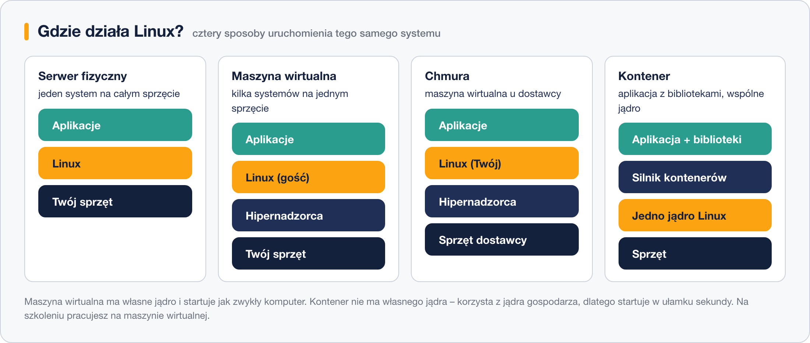

# Gdzie działa Linux – serwer, maszyna wirtualna, chmura, kontener

> **W tej lekcji:** poznasz cztery sposoby uruchamiania Linuksa – na fizycznym serwerze, w maszynie wirtualnej, w chmurze i w kontenerze – i nauczysz się rozpoznawać, w którym z nich właśnie pracujesz.

## Po co mi to?

Ten sam Rocky Linux może stać na serwerze w piwnicy firmy, w maszynie wirtualnej na Twoim laptopie, u Amazona w chmurze albo działać jako kontener przez trzy sekundy. Administrator musi wiedzieć, „na czym stoi”, bo od tego zależą decyzje: czy mogę dołożyć pamięci, kto odpowiada za sprzęt, czym różni się restart od usunięcia. A w rozmowie o pracę pytania o różnicę między maszyną wirtualną a kontenerem padają niemal zawsze.

## Jak to działa



**Serwer fizyczny** (ang. *bare metal*) – system zainstalowany bezpośrednio na sprzęcie. Cała moc dla jednego systemu, ale każda zmiana (więcej RAM, wymiana dysku) to fizyczna praca przy maszynie.

**Maszyna wirtualna** (ang. *virtual machine*, VM) – „komputer udawany programowo”. Specjalne oprogramowanie, **hipernadzorca** (ang. *hypervisor* – np. KVM, VMware, VirtualBox, Hyper-V), dzieli jeden fizyczny serwer na wiele niezależnych maszyn. Każda ma własne wirtualne procesory (vCPU), pamięć, dysk i **własne jądro** – z jej wnętrza wszystko wygląda jak zwykły komputer. Awaria albo eksperyment w jednej maszynie nie dotyka pozostałych. Tak właśnie pracujesz na szkoleniu.

**Chmura** (ang. *cloud*) – te same maszyny wirtualne, tylko na sprzęcie dostawcy (AWS, Microsoft Azure, Google Cloud, OVH…). Nie kupujesz serwera: klikasz (albo wywołujesz API) i po minucie masz działający system, płacisz za godziny użycia. Za sprzęt, prąd i sieć odpowiada dostawca; za system operacyjny i aplikacje – nadal Ty. Dystrybucje publikują gotowe **obrazy chmurowe**, więc niczego się nie instaluje – system dostaje konfigurację (klucze, użytkowników) przy pierwszym starcie przez mechanizm `cloud-init`.

**Kontener** (ang. *container*) – najlżejsza forma. Kontener nie ma własnego jądra: to odizolowany proces (lub grupa procesów) korzystający z jądra gospodarza. Izolację zapewniają mechanizmy jądra Linux – przestrzenie nazw (ang. *namespaces*) oddzielają procesy, sieć i pliki, a *cgroups* ograniczają zużycie CPU i pamięci. Kontener zawiera aplikację z jej bibliotekami, startuje w ułamku sekundy i zajmuje megabajty zamiast gigabajtów. Narzędzia: Docker, a w świecie Red Hat – **Podman**; zarządzaniem setkami kontenerów zajmuje się Kubernetes.

Porównanie w pigułce:

| Cecha | Serwer fizyczny | Maszyna wirtualna | Kontener |
|---|---|---|---|
| Własne jądro | tak | tak | nie – jądro gospodarza |
| Czas startu | minuty | ~minuta | sekundy |
| Narzut zasobów | brak | średni | minimalny |
| Izolacja | pełna (fizyczna) | bardzo dobra | dobra, wspólne jądro |
| Typowe użycie | bazy danych, hipernadzorcy | serwery firmowe, szkolenia | mikrousługi, aplikacje WWW |

## W praktyce

Jak sprawdzić, gdzie działa system, w którym właśnie siedzisz?

```bash
# wykrywa hipernadzorcę lub technologię kontenerów
systemd-detect-virt
```

```text
kvm
```

Możliwe wyniki to m.in. `none` (serwer fizyczny), `kvm`, `oracle` (VirtualBox), `vmware`, `microsoft` (Hyper-V/Azure), `amazon`, a dla kontenerów np. `podman` lub `docker`.

```bash
# więcej szczegółów o „sprzęcie” – w maszynie wirtualnej zobaczysz nazwę hipernadzorcy
hostnamectl
```

```text
 Static hostname: serwer
      Chassis: vm
Virtualization: oracle
Operating System: Rocky Linux 9.4 (Blue Onyx)
```

## Najczęstsze błędy i pułapki

- **Mylenie kontenera z maszyną wirtualną.** Kontener współdzieli jądro z gospodarzem – nie uruchomisz w nim innego systemu niż Linux ani innej wersji jądra.
- **„Chmura jest zawsze tańsza”.** Płacisz za każdą godzinę działania. Zapomniana maszyna testowa potrafi po miesiącu kosztować więcej niż zakup małego serwera.
- **Traktowanie maszyny szkoleniowej jak fizycznej.** W VM możesz śmiało eksperymentować – w razie katastrofy maszynę przywraca się z migawki w minutę. Korzystaj z tego podczas ćwiczeń.
- **Zasoby wirtualne to nadal zasoby fizyczne.** Jeśli dasz maszynom wirtualnym łącznie więcej pamięci, niż ma serwer, przy obciążeniu wszystkie zwolnią.

## Podsumowanie

- Ten sam Linux działa na sprzęcie, w maszynie wirtualnej, w chmurze i w kontenerze – różnią się warstwy pod nim.
- Maszyna wirtualna = pełny komputer z własnym jądrem, tworzony przez hipernadzorcę.
- Chmura = maszyny wirtualne (i inne usługi) wynajmowane u dostawcy, opłacane za użycie.
- Kontener = izolowany proces na wspólnym jądrze; lekki i błyskawiczny, ale to nie osobny system.
- `systemd-detect-virt` i `hostnamectl` zdradzają, w jakim środowisku pracujesz.

## Zobacz też

- [6. Tworzenie maszyny wirtualnej](6.%20Tworzenie%20maszyny%20wirtualnej.md)
- [4. Wybór nośnika instalacji](4.%20Wybór%20nośnika%20instalacji.md) – tam m.in. o obrazach chmurowych i `cloud-init`
