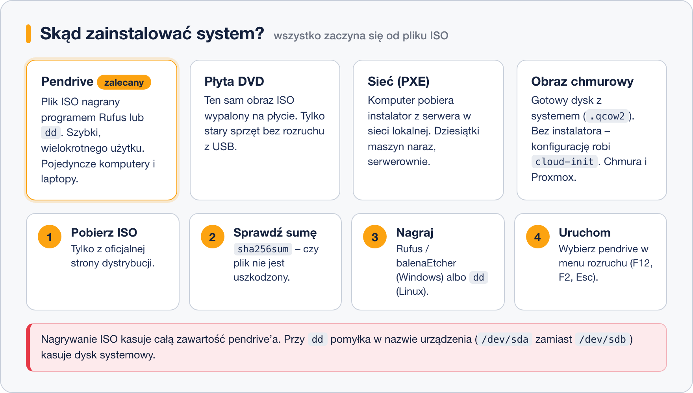

# Wybór nośnika instalacji

> **W tej lekcji:** dowiesz się, czym jest obraz ISO, jakimi drogami można zainstalować system (pendrive, DVD, sieć, obrazy chmurowe) i jak samodzielnie przygotować pendrive instalacyjny w Windows i w Linuksie.

## Po co mi to?

Każda instalacja zaczyna się od tego samego pytania: skąd komputer ma wziąć system? W domu wystarczy pendrive, w serwerowni z pięćdziesięcioma maszynami nikt nie biega z pendrive’em – instaluje się przez sieć, a w chmurze w ogóle nie ma instalacji. Znajomość tych dróg pozwala wybrać właściwą do sytuacji i nie utknąć na samym starcie.

## Jak to działa

Punktem wyjścia jest zawsze **obraz ISO** – pojedynczy plik (zwykle kilka–kilkanaście GB) zawierający cały nośnik instalacyjny: program rozruchowy, instalator i pakiety. Pobierasz go z oficjalnej strony dystrybucji (dla Rocky Linux: rockylinux.org, dla AlmaLinux: almalinux.org). Dystrybucje rodziny RHEL oferują zwykle dwa warianty: pełny **DVD ISO** (wszystkie pakiety na nośniku) oraz mały **Boot/netinstall ISO**, który resztę pobiera z internetu podczas instalacji.



- **Pendrive (USB)** – standard przy pojedynczych maszynach. Szybki, wielokrotnego użytku; obraz nagrywa się na niego specjalnym programem (o tym niżej).
- **Płyta DVD** – ten sam obraz wypalony na płycie. Dziś używana rzadko, głównie na starym sprzęcie bez rozruchu z USB.
- **Sieć (PXE)** – komputer startuje z karty sieciowej i pobiera instalator z serwera w sieci lokalnej. Wymaga przygotowanej infrastruktury (serwer DHCP + TFTP), za to pozwala instalować dziesiątki maszyn bez żadnego nośnika. Tak pracują duże serwerownie.
- **Obrazy chmurowe** – gotowy, zainstalowany system w pliku (np. `.qcow2` dla KVM/Proxmox). Instalatora nie ma wcale: przy pierwszym uruchomieniu narzędzie **cloud-init** nadaje maszynie nazwę, tworzy użytkownika i wgrywa klucze SSH. Tak powstają maszyny w chmurze i u dostawców VPS.
- **Instalacja w maszynie wirtualnej** – najwygodniejsza do nauki: plik ISO „wkłada się” do wirtualnego napędu bez nagrywania czegokolwiek. Zrobimy tak w lekcji o VirtualBoksie.

## W praktyce

### Krok 1: zweryfikuj pobrany obraz

Po pobraniu ISO warto sprawdzić **sumę kontrolną** – czy plik nie został uszkodzony w transmisji:

```bash
# liczymy sumę SHA-256 pobranego pliku i porównujemy z wartością ze strony dystrybucji
sha256sum Rocky-9.4-x86_64-dvd.iso
```

```text
ee3ac97fdffab58652421941599902012179c37535aece76824673105169c4a2  Rocky-9.4-x86_64-dvd.iso
```

W Windows to samo zrobisz w PowerShellu poleceniem `Get-FileHash .\Rocky-9.4-x86_64-dvd.iso`.

### Krok 2: nagraj pendrive w Windows

Użyj darmowego programu **Rufus** (rufus.ie) albo **balenaEtcher**:

1. Włóż pendrive (minimum 8 GB – **cała zawartość zostanie skasowana**).
2. W Rufusie wybierz urządzenie i wskaż plik ISO.
3. Kliknij „Start”; przy pytaniu o tryb zapisu wybierz zalecany tryb obrazu DD.
4. Po kilku minutach pendrive jest gotowy do rozruchu.

### Krok 2 (wariant): nagraj pendrive w Linuksie

```bash
# sprawdzamy, jak system nazwał pendrive – patrz na rozmiar i brak zamontowanych partycji
lsblk
```

```text
NAME   MAJ:MIN RM   SIZE RO TYPE MOUNTPOINTS
sda      8:0    0 465,8G  0 disk
├─sda1   8:1    0     1G  0 part /boot
└─sda2   8:2    0 464,8G  0 part /
sdb      8:16   1  14,6G  0 disk
```

```bash
# nagrywamy obraz na CAŁE urządzenie /dev/sdb (nie na partycję /dev/sdb1!)
sudo dd if=Rocky-9.4-x86_64-dvd.iso of=/dev/sdb bs=4M status=progress conv=fsync
```

Opcje: `if` – plik wejściowy, `of` – urządzenie docelowe, `bs=4M` – zapis większymi porcjami, `status=progress` – pokazuje postęp, `conv=fsync` – dopilnuje zapisania wszystkiego przed zakończeniem.

### Krok 3: uruchom komputer z pendrive’a

Włóż pendrive, włącz komputer i wejdź do menu rozruchu (najczęściej klawisz F12, F11 lub Esc – zależnie od producenta) albo zmień kolejność rozruchu w ustawieniach UEFI/BIOS (F2/Del). Wybierz pendrive – pojawi się menu instalatora.

## Najczęstsze błędy i pułapki

- **Pomylone urządzenie przy `dd`.** Wpisanie `/dev/sda` zamiast `/dev/sdb` nieodwracalnie nadpisuje dysk systemowy. Zawsze najpierw `lsblk`, a w razie wątpliwości wyjmij i włóż pendrive, patrząc, co się pojawia.
- **Skopiowanie pliku ISO na pendrive w eksploratorze.** Zwykłe przeciągnięcie pliku nie tworzy nośnika rozruchowego – obraz trzeba nagrać Rufusem/Etcherem/`dd`.
- **Pominięcie sumy kontrolnej.** Uszkodzony obraz potrafi przerwać instalację w połowie dziwnym błędem – weryfikacja zajmuje minutę i oszczędza godziny.
- **Za mały pendrive.** Pełny obraz DVD RHEL/Rocky ma ok. 8–11 GB; na pendrive 8 GB bezpieczniej nagrać mały obraz „boot/netinstall”.

## Podsumowanie

- Wszystko zaczyna się od obrazu ISO z oficjalnej strony dystrybucji; po pobraniu sprawdź `sha256sum`.
- Pojedyncze maszyny → pendrive; masowe instalacje → PXE; chmura i wirtualizacja → gotowe obrazy z `cloud-init`; maszyna wirtualna → ISO podpięte bez nagrywania.
- Pendrive przygotujesz Rufusem/balenaEtcherem (Windows) albo `dd` (Linux).

| Polecenie | Co robi |
|---|---|
| `sha256sum plik.iso` | weryfikuje integralność obrazu |
| `lsblk` | pokazuje dyski i partycje – znajdziesz pendrive |
| `sudo dd if=obraz.iso of=/dev/sdX bs=4M status=progress conv=fsync` | nagrywa obraz na pendrive |

## Zobacz też

- [5. Wybór rodzaju i wersji systemu](5.%20Wybór%20rodzaju%20i%20wersji%20systemu.md)
- [6. Tworzenie maszyny wirtualnej](6.%20Tworzenie%20maszyny%20wirtualnej.md) – tam ISO podłączymy do wirtualnego napędu
