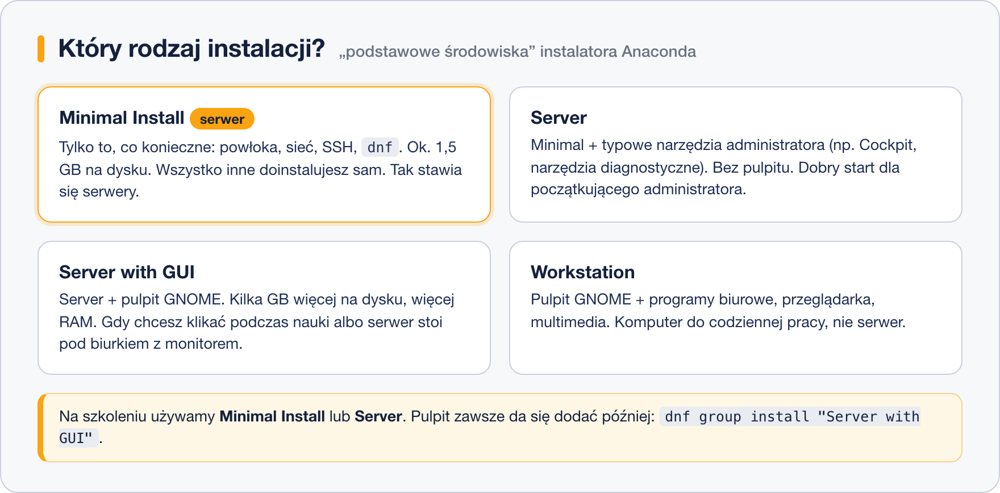
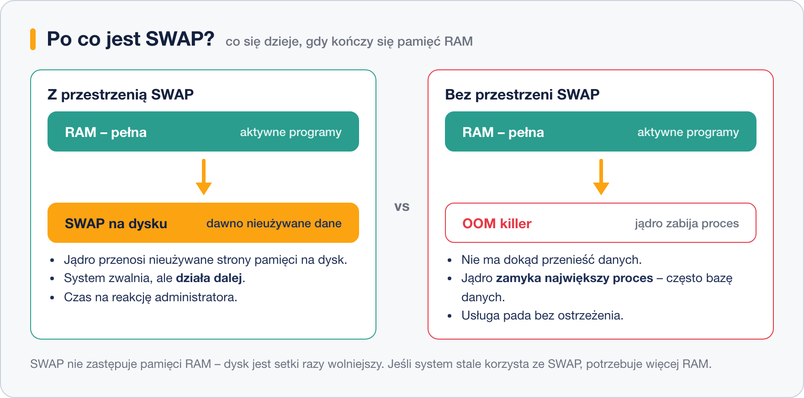

# Wybór rodzaju i wersji systemu

> **W tej lekcji:** nauczysz się świadomie wybierać rodzaj instalacji w instalatorze Anaconda (Minimal, Server, Server with GUI, Workstation), rozumieć numerację wersji i cykl wsparcia RHEL oraz zdecydować, czy Twój serwer potrzebuje przestrzeni SWAP.

## Po co mi to?

Instalator zada Ci dwa ważne pytania: *co* zainstalować (zestaw oprogramowania) i – pośrednio, przy partycjonowaniu – *czy* system ma mieć SWAP. Wcześniej sam musisz wybrać *którą wersję* pobrać. Złe odpowiedzi nie bolą od razu, ale mszczą się później: pulpit na serwerze marnuje zasoby, wersja bez wsparcia nie dostaje poprawek, a brak SWAP potrafi położyć usługę w najmniej oczekiwanym momencie.

## Jak to działa

### Rodzaj instalacji: zestawy oprogramowania Anacondy

Instalator systemów rodziny RHEL nazywa się **Anaconda**. Na ekranie „Wybór oprogramowania” wskazujesz **podstawowe środowisko** – gotowy zestaw pakietów:



- **Minimal Install** – absolutne minimum: powłoka, sieć, SSH, `dnf`. Zajmuje ok. 1,5 GB. Wszystko inne doinstalowujesz wtedy, gdy jest potrzebne. Tak stawia się serwery produkcyjne – im mniej pakietów, tym mniej aktualizacji i mniejsza powierzchnia ataku.
- **Server** – minimal plus typowe narzędzia administracyjne. Nadal bez grafiki. Rozsądny wybór na początek nauki.
- **Server with GUI** – Server plus pulpit GNOME. Wygodny, gdy dopiero poznajesz system, ale kosztuje kilka GB dysku i ok. 1 GB RAM więcej.
- **Workstation** – komputer biurkowy: pulpit, przeglądarka, narzędzia biurowe. To wybór na laptopa, nie na serwer.

Po prawej stronie ekranu można dodać grupy dodatkowe (np. „Container Management”). Nie przesadzaj – wszystko da się doinstalować później jednym poleceniem `dnf`.

### Wersje i cykl wsparcia

Dystrybucje rodziny RHEL numerują wersje jako `główna.poboczna`, np. **9.4** czy **10.0**. Wersja główna wychodzi co ok. 3 lata i jest wspierana przez **10 lat**; co pół roku dostaje **wydanie poboczne** (ang. *point release*) z poprawkami i odświeżonym sprzętem. W obrębie wersji głównej aktualizacje nie psują zgodności – serwer postawiony na 9.0 spokojnie aktualizuje się do 9.4.

| Wersja | Premiera | Koniec pełnego wsparcia | Uwagi |
|---|---|---|---|
| RHEL 9 (i Rocky/Alma 9) | 2022 | ok. 2032 (10 lat) | obecny standard produkcyjny |
| RHEL 10 (i Rocky/Alma 10) | 2025 | ok. 2035 (10 lat) | najnowsza wersja główna |
| Ubuntu LTS (dla porównania) | co 2 lata (np. 24.04) | 5 lat (dłużej z płatnym Ubuntu Pro) | numer = rok.miesiąc wydania |

Zasada praktyczna: na nowy serwer bierz **najnowszą wersję główną**, chyba że aplikacja, którą masz uruchomić, oficjalnie wspiera tylko starszą. Zawsze pobieraj obraz z najnowszym wydaniem pobocznym.

### SWAP – mieć czy nie mieć?

**SWAP** (przestrzeń wymiany) to obszar na dysku, do którego jądro odkłada dawno nieużywane fragmenty pamięci, gdy RAM się kończy.



Bez SWAP, gdy pamięć się wyczerpie, jądro uruchamia mechanizm **OOM killer** (ang. *Out Of Memory*) i zamyka proces zużywający najwięcej pamięci – często właśnie Twoją bazę danych. Ze SWAP system najpierw zwalnia, dając Ci czas na reakcję. Dlatego na typowym serwerze i na maszynie do nauki SWAP **warto mieć**. Rezygnuje się z niego świadomie w szczególnych przypadkach (np. niektóre klastry i bazy o wymaganiach producenta).

Zalecane rozmiary (na podstawie wytycznych Red Hata, bez hibernacji):

| RAM w systemie | Zalecany SWAP |
|---|---|
| do 2 GB | 2 × RAM |
| 2–8 GB | tyle co RAM |
| 8–64 GB | co najmniej 4 GB |
| powyżej 64 GB | co najmniej 4 GB (wg potrzeb) |

Partycjonowanie automatyczne Anacondy utworzy SWAP zgodnie z tą tabelą – zwykle nie musisz nic zmieniać.

## W praktyce

Po instalacji sprawdzisz swoje wybory:

```bash
# wersja systemu
cat /etc/redhat-release
```

```bash
# czy i ile SWAP ma system
free -h
```

```text
               total        used        free      shared  buff/cache   available
Mem:           3,8Gi       654Mi       2,6Gi       8,0Mi       802Mi       3,2Gi
Swap:          3,9Gi          0B       3,9Gi
```

```bash
# skąd pochodzi SWAP (partycja? wolumin LVM? plik?)
swapon --show
```

```text
NAME      TYPE      SIZE USED PRIO
/dev/dm-1 partition 3,9G   0B   -2
```

## Najczęstsze błędy i pułapki

- **Pulpit na serwerze produkcyjnym „bo wygodniej”.** To dodatkowe zasoby i dodatkowe luki do łatania. Do klikania wystarczy Cockpit przez przeglądarkę – więcej w module o środowiskach graficznych.
- **Instalacja starej wersji głównej** (np. 9 zamiast 10) bez powodu skraca życie serwera – migracja między wersjami głównymi to osobny projekt.
- **Zero SWAP na maszynie z małym RAM.** Maszyna szkoleniowa z 2–4 GB RAM bez SWAP potrafi „zamrozić się” przy pierwszej większej aktualizacji.
- **SWAP jako lekarstwo na brak RAM.** Jeśli `free -h` stale pokazuje użyty SWAP, system potrzebuje więcej pamięci – dysk jest setki razy wolniejszy od RAM.

## Podsumowanie

- Anaconda oferuje zestawy: Minimal Install (serwery produkcyjne), Server (nauka administracji), Server with GUI i Workstation (praca z pulpitem).
- RHEL i jego darmowe odpowiedniki: wersja główna co ~3 lata, wsparcie 10 lat, wydania poboczne co pół roku. Ubuntu LTS dla porównania: co 2 lata, wsparcie 5 lat.
- SWAP na serwerze zwykle warto mieć; rozmiar wg tabeli (dla 2–8 GB RAM – tyle co RAM).

| Polecenie | Co pokazuje |
|---|---|
| `cat /etc/redhat-release` | wersję systemu |
| `free -h` | pamięć RAM i SWAP |
| `swapon --show` | skąd pochodzi SWAP |
