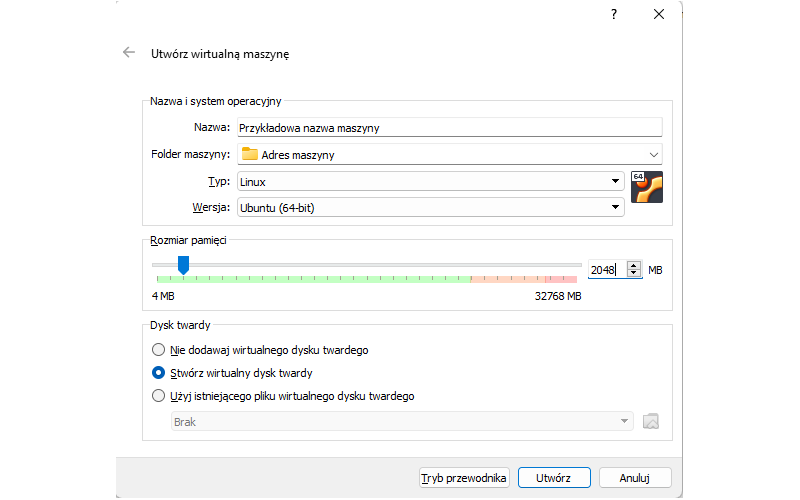
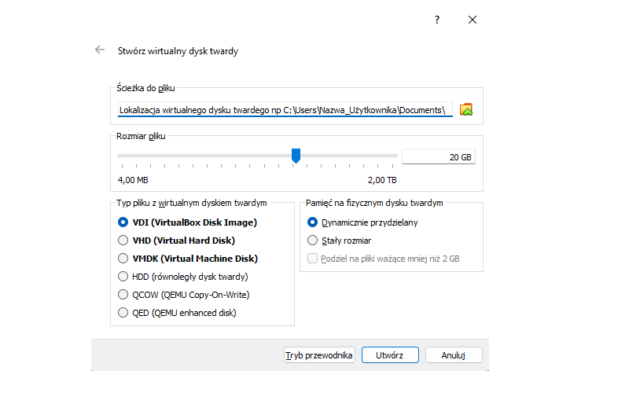
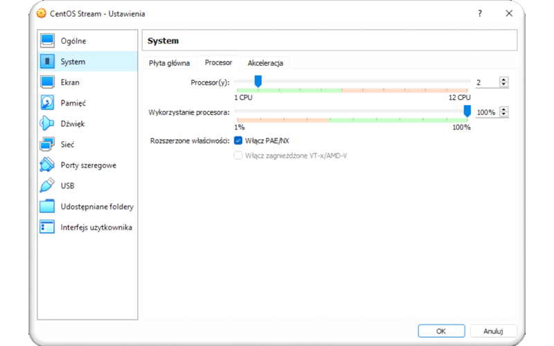
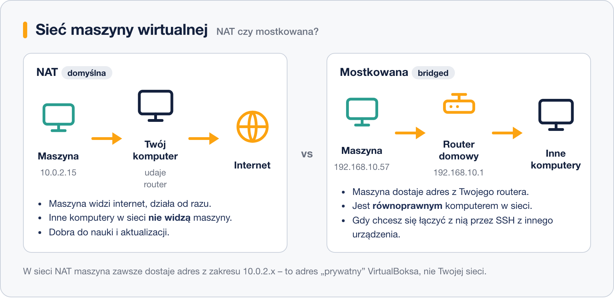
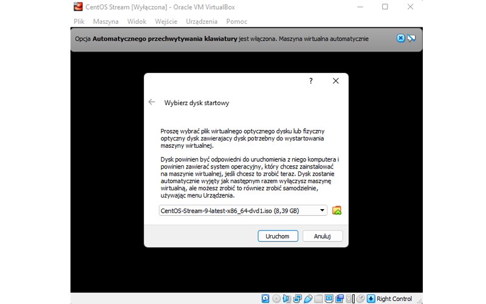
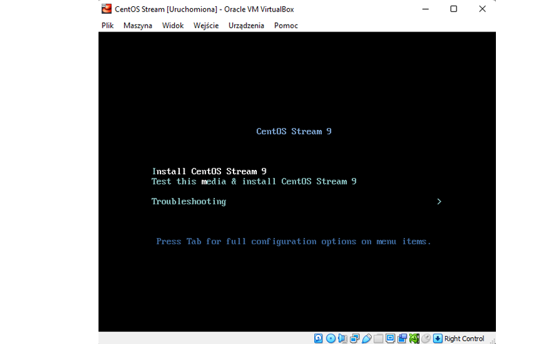

# Tworzenie maszyny wirtualnej

> **W tej lekcji:** krok po kroku utworzysz w VirtualBoksie maszynę wirtualną pod instalację systemu z rodziny RHEL i zrozumiesz, co oznaczają vCPU, pamięć, dysk przydzielany dynamicznie oraz sieć NAT i mostkowana.

## Po co mi to?

Do nauki administracji nie potrzebujesz drugiego komputera – wystarczy **maszyna wirtualna** na Twoim laptopie. Możesz ją psuć, przywracać z migawki i kasować bez żadnych konsekwencji dla swojego systemu. Użyjemy darmowego programu **Oracle VirtualBox** (do pobrania z virtualbox.org, działa na Windows, macOS i Linuksie); te same pojęcia spotkasz potem w każdej profesjonalnej wirtualizacji (VMware, Proxmox, Hyper-V).

## Jak to działa

Zanim klikniesz „Utwórz”, poznaj cztery pojęcia, o które zapyta kreator:

- **vCPU** (wirtualny procesor) – liczba rdzeni Twojego procesora, z których maszyna może korzystać. Nie są zarezerwowane na stałe; to limit, nie przydział.
- **Pamięć RAM** – ta jest przydzielana naprawdę, kosztem gospodarza. Dla systemu rodziny RHEL bez pulpitu wystarczą 2 GB (2048 MB), z pulpitem lepiej dać 4 GB.
- **Dysk przydzielany dynamicznie** – plik na Twoim dysku, który udaje dysk twardy maszyny. „Dynamicznie” znaczy, że choć deklarujesz np. 20 GB, plik rośnie tylko w miarę zapełniania. Przeciwieństwo to „stały rozmiar” – 20 GB zajęte od razu.
- **Sieć NAT albo mostkowana** – o tym niżej, przy konfiguracji.

## W praktyce

### Krok 1: nowa maszyna

W VirtualBoksie kliknij **Nowa**. W trybie eksperckim wszystko ustawisz na jednym ekranie:

- **Nazwa** – np. `rocky9-nauka`. Po nazwie VirtualBox czasem sam rozpozna typ systemu.
- **Typ**: `Linux`. **Wersja**: wybierz `Red Hat (64-bit)` – dla CentOS Stream, Rocky i AlmaLinux to właściwy profil (na zrzucie przykładowo widnieje Ubuntu).
- **Rozmiar pamięci**: 2048 MB. Trzymaj się zielonej części suwaka – to pamięć, którą gospodarz może bezpiecznie oddać.
- **Dysk twardy**: zostaw „Stwórz wirtualny dysk twardy”.

### Krok 2: wirtualny dysk

- **Rozmiar pliku**: 20 GB – wystarczy na system i ćwiczenia.
- **Typ**: `VDI` (natywny format VirtualBoksa; VMDK/VHD wybieraj tylko, gdy dysk ma być przenoszony do innej wirtualizacji).
- **Pamięć na fizycznym dysku**: `Dynamicznie przydzielany` – plik urośnie dopiero wraz z danymi.

Kliknij **Utwórz** – maszyna pojawi się na liście.

### Krok 3: procesory i drobne ustawienia

Wejdź w **Ustawienia → System → Procesor**:

Ustaw **2 vCPU** (zielony zakres suwaka = liczba rdzeni, którą możesz oddać bez szkody dla gospodarza). Przy okazji w **Ustawienia → Sieć** zdecyduj o trybie karty sieciowej:

- **NAT** (domyślny) – maszyna widzi internet, ale jest schowana za Twoim komputerem jak za domowym routerem. Do nauki i aktualizacji w zupełności wystarczy.
- **Mostkowana** (ang. *bridged*) – maszyna dostaje adres z Twojego routera i jest widoczna w sieci lokalnej jak osobny komputer. Wybierz ją, gdy zechcesz łączyć się z maszyną przez SSH z innego urządzenia.

### Krok 4: podłącz obraz ISO i uruchom

Kliknij **Uruchom**. Przy pierwszym starcie VirtualBox zapyta o **dysk startowy** – wskaż pobrany wcześniej obraz ISO:

To odpowiednik włożenia pendrive’a do fizycznego serwera. Po kliknięciu **Uruchom** maszyna wystartuje z obrazu i pokaże menu instalatora:

Strzałkami wybierz pierwszą pozycję **Install…** i naciśnij Enter (pozycja „Test this media & install” najpierw sprawdzi spójność nośnika – na fizycznym pendrive warto, w maszynie wirtualnej można pominąć). Dalszy ciąg – w następnej lekcji.

> **Wskazówka:** gdy klikniesz w okno maszyny, przechwyci ono mysz i klawiaturę. Uwalnia je **prawy Ctrl** (tzw. host key, widoczny w prawym dolnym rogu okna).

## Najczęstsze błędy i pułapki

- **Za dużo zasobów dla maszyny.** Oddanie połowy RAM i wszystkich rdzeni laptopa sprawi, że zwolni i gospodarz, i maszyna. Trzymaj się zielonych zakresów suwaków.
- **64-bitowe wersje nie pojawiają się na liście.** Znak, że wirtualizacja sprzętowa (Intel VT-x/AMD-V) jest wyłączona w UEFI/BIOS komputera albo zajęta przez inną wirtualizację (na Windows: Hyper-V).
- **Maszyna startuje w kółko z ISO.** Po zakończonej instalacji obraz powinien zostać wysunięty automatycznie; jeśli nie – Ustawienia → Pamięć → usuń ISO z wirtualnego napędu.
- **Brak internetu w maszynie przy NAT** zwykle oznacza, że to gospodarz nie ma sieci – NAT dzieli jego połączenie.

## Podsumowanie

- Maszyna do nauki: 2 vCPU, 2048 MB RAM, dysk VDI 20 GB przydzielany dynamicznie, sieć NAT.
- Dysk dynamiczny rośnie wraz z danymi – deklarowany rozmiar to górny limit.
- NAT = internet bez widoczności w sieci; mostkowana = maszyna jak osobny komputer w Twojej sieci.
- ISO podłączone do maszyny działa jak pendrive w fizycznym serwerze; prawy Ctrl uwalnia mysz z okna maszyny.

## Zobacz też

- [4. Wybór nośnika instalacji](4.%20Wybór%20nośnika%20instalacji.md)
- [7. Instalacja krok po kroku](7.%20Instalacja%20krok%20po%20kroku.md)
