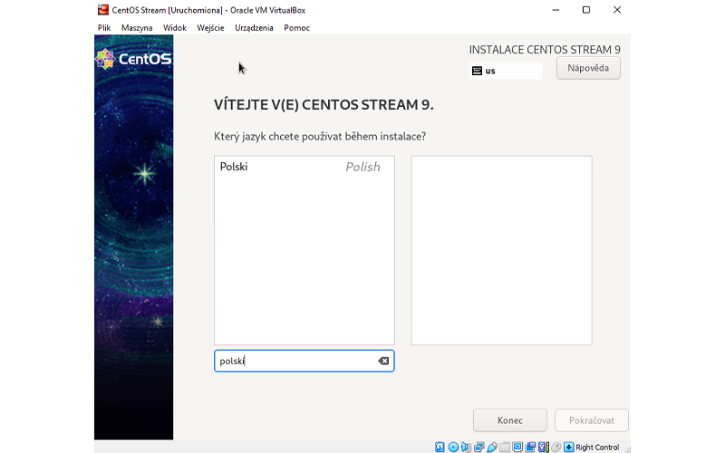
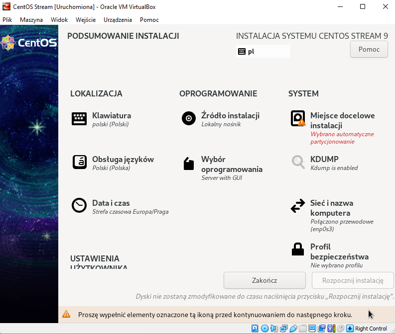
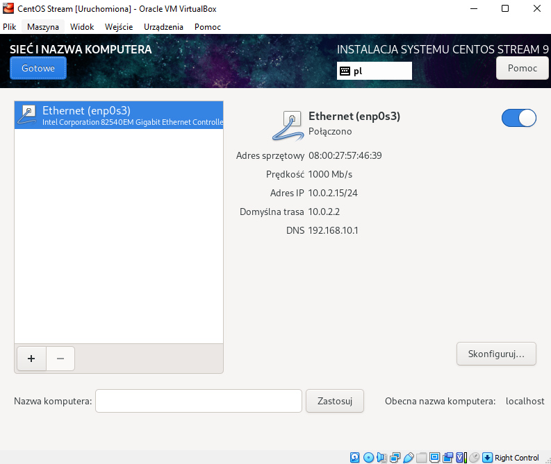
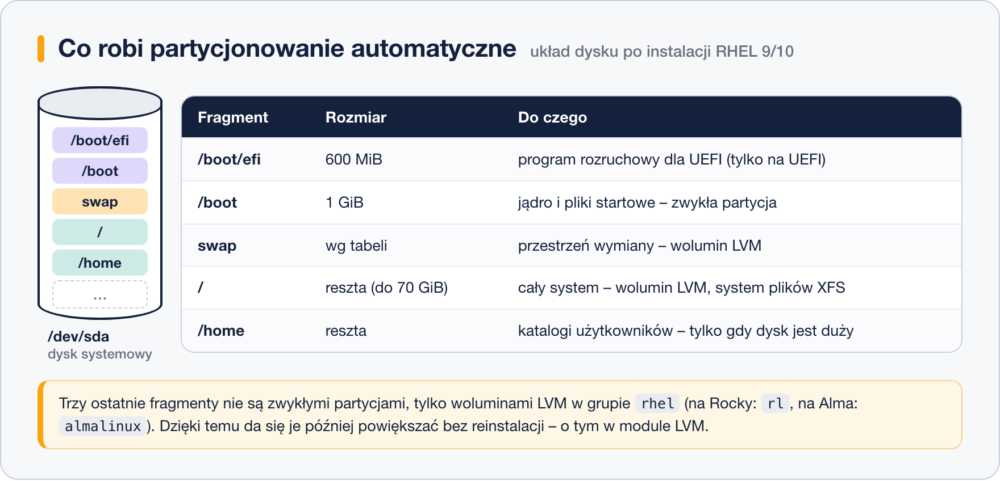
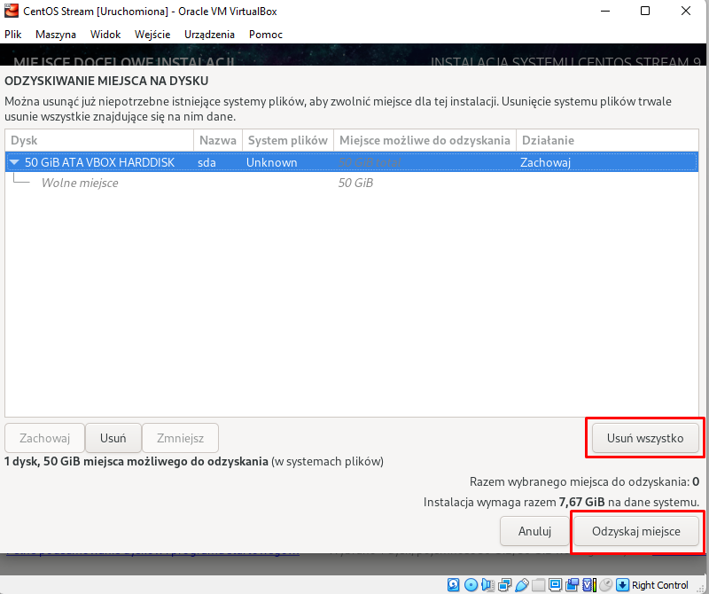
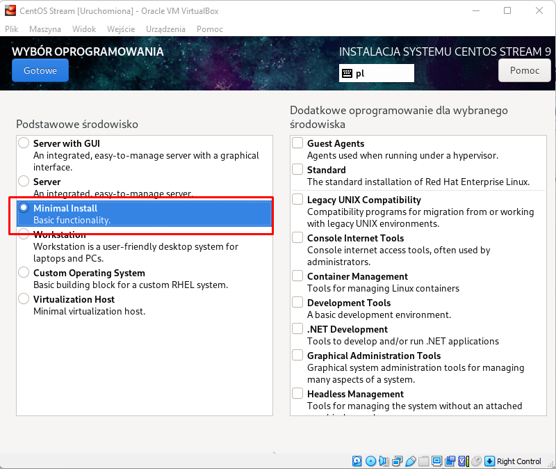
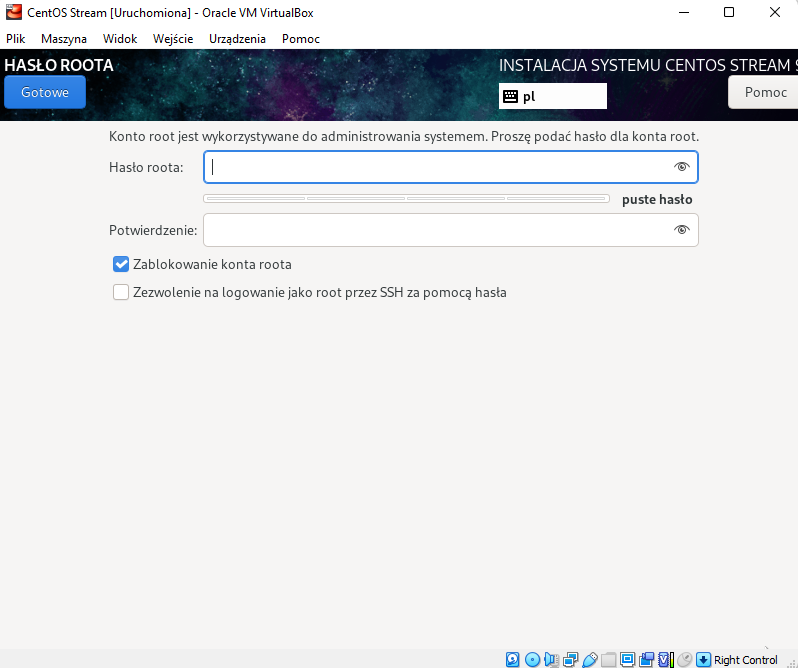
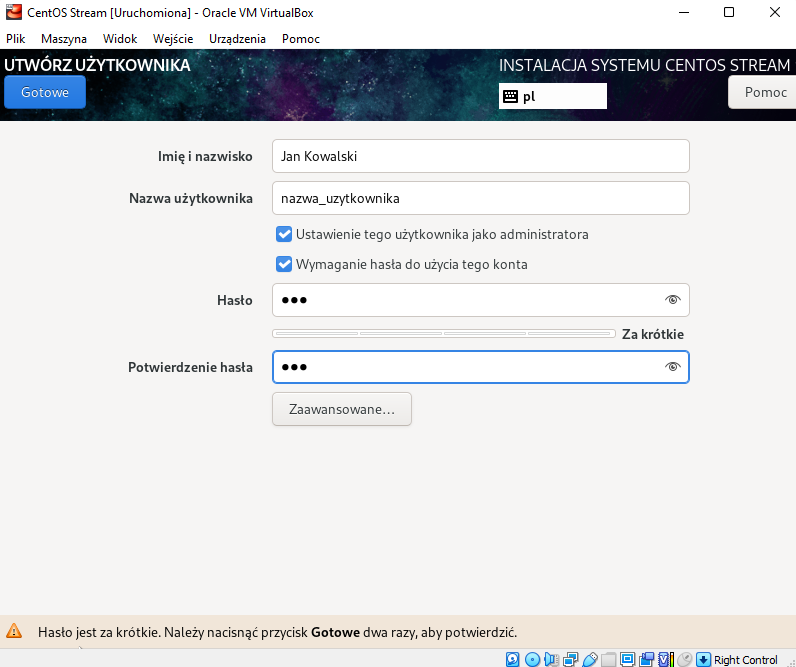
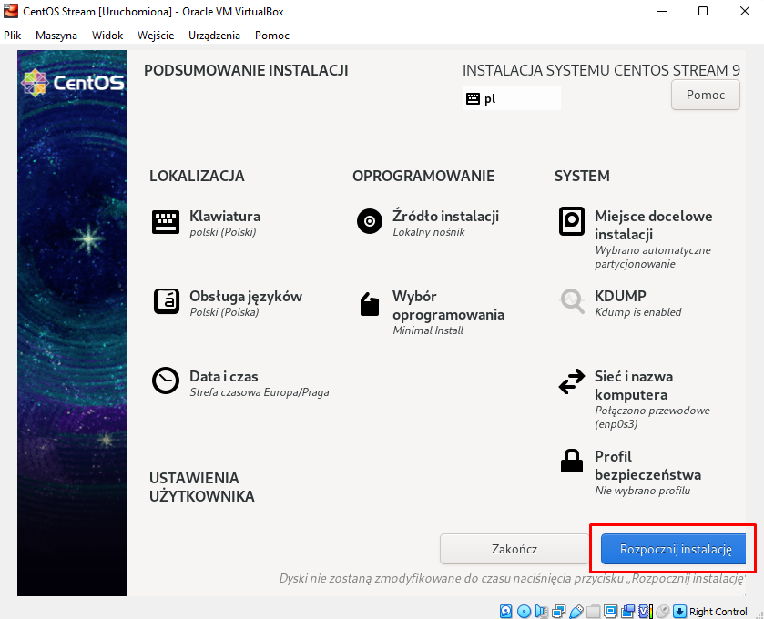

# Instalacja krok po kroku

> **W tej lekcji:** przejdziesz przez wszystkie ekrany instalatora Anaconda – od wyboru języka po utworzenie użytkownika – i wykonasz pierwsze czynności po starcie świeżego systemu.

## Po co mi to?

Instalacja to pierwsza rzecz, którą administrator robi z nowym serwerem – i moment, w którym podejmuje decyzje trudne do odwrócenia (układ dysku, hasła, nazwa komputera). Instalator **Anaconda** jest wspólny dla całej rodziny RHEL: raz przećwiczony na CentOS Stream czy Rocky Linux, wygląda tak samo na produkcyjnym RHEL-u. Przykładowe zrzuty w tej lekcji pochodzą z CentOS Stream 9 w VirtualBoksie – u Ciebie mogą się różnić detalami, układ pozostaje ten sam.

## W praktyce

### Krok 1: język instalacji

Po wybraniu „Install…” w menu rozruchowym (poprzednia lekcja) i chwili ładowania pojawia się wybór języka:



Wpisz w pole wyszukiwania „polski” i przejdź dalej. Wybór dotyczy języka instalatora i systemu; na serwerach produkcyjnych często zostawia się angielski, bo komunikaty błędów łatwiej wyszukać w internecie.

### Krok 2: podsumowanie instalacji – centrum dowodzenia

Anaconda nie prowadzi przez sztywną sekwencję ekranów. Zamiast tego pokazuje **podsumowanie**, z którego wchodzisz do poszczególnych sekcji w dowolnej kolejności:



Pozycje oznaczone ostrzeżeniem wymagają Twojej decyzji, zanim przycisk „Rozpocznij instalację” stanie się aktywny. Przejdźmy po kolei:

- **Klawiatura i Obsługa języków** – ustawione na podstawie kroku 1; sprawdź tylko, czy układ to `polski`.
- **Data i czas** – wybierz strefę `Europa/Warszawa`.
- **Źródło instalacji** – przy obrazie DVD: lokalny nośnik; zmienia się tylko przy instalacji sieciowej.

### Krok 3: sieć i nazwa komputera



Włącz interfejs przełącznikiem (w maszynie z siecią NAT dostanie adres automatycznie – na zrzucie 10.0.2.15) i nadaj **nazwę komputera**, np. `serwer`. Z siecią skonfigurowaną już teraz instalator pobierze aktualne pakiety, a system po starcie od razu będzie online.

### Krok 4: miejsce docelowe instalacji – dysk

W sekcji „Miejsce docelowe instalacji” zaznacz dysk i wybierz partycjonowanie **automatyczne** – instalator sam utworzy sensowny układ:



Partycjonowanie **własne** daje pełną kontrolę (osobne `/var`, inne rozmiary) – wrócisz do niego, gdy poznasz LVM w dziale 3. Jeśli na dysku był już system plików, Anaconda pokaże ekran „Odzyskiwanie miejsca na dysku”:



Na świeżej maszynie wirtualnej klikasz „Usuń wszystko”, a potem „Odzyskaj miejsce”. **Uwaga:** na fizycznym komputerze to usuwa istniejące dane – upewnij się, że wskazałeś właściwy dysk.

### Krok 5: wybór oprogramowania



Wybierz **Minimal Install** (albo **Server**) – rodzaje instalacji omawia [lekcja 5](5.%20Wybór%20rodzaju%20i%20wersji%20systemu.md). Dodatkowe grupy zostaw puste; wszystko doinstalujesz później.

### Krok 6: hasło roota



**root** to konto administratora o nieograniczonych uprawnieniach. Masz dwie szkoły:

- zostawić **„Zablokowanie konta roota”** i nadać uprawnienia administracyjne zwykłemu użytkownikowi (krok 7) – bezpieczniejsze i zalecane,
- ustawić rootowi silne hasło – wtedy nie zaznaczaj „Zezwolenie na logowanie jako root przez SSH za pomocą hasła”: zdalne logowanie roota hasłem to klasyczny cel ataków.

### Krok 7: utworzenie użytkownika



Utwórz swojego użytkownika (np. `admin`) i **koniecznie zaznacz „Ustawienie tego użytkownika jako administratora”** – doda go do grupy `wheel`, dzięki czemu będzie mógł wykonywać polecenia administracyjne przez `sudo`. Instalator pilnuje jakości hasła: za krótkie trzeba potwierdzić dwukrotnym „Gotowe” (lepiej po prostu ustawić dłuższe).

### Krok 8: start instalacji



Gdy wszystkie sekcje są uzupełnione, kliknij **„Rozpocznij instalację”**. Do tego momentu dysk nie został tknięty – to ostatnia chwila na poprawki. Instalacja trwa kilka–kilkanaście minut; na koniec kliknij „Uruchom ponownie system”.

### Po restarcie: pierwsze logowanie

System wita Cię tekstowym ekranem logowania – przy Minimal Install to normalne, pulpitu nie ma:

```text
serwer login: admin
Password:
[admin@serwer ~]$
```

Dobre pierwsze kroki:

```bash
# aktualizujemy wszystkie pakiety do bieżących wersji (sudo poprosi o Twoje hasło)
sudo dnf update
```

```bash
# sprawdzamy, czy system wygląda zgodnie z oczekiwaniami
hostnamectl
free -h
lsblk
```

`lsblk` pokaże układ dysku utworzony przez instalator – porównaj go z grafiką z kroku 4.

## Najczęstsze błędy i pułapki

- **Pominięta sekcja z ostrzeżeniem** – przycisk startu pozostaje szary. Przewiń podsumowanie w dół: sekcja „Ustawienia użytkownika” bywa poza ekranem.
- **Układ klawiatury inny niż język** – hasło wpisane z polskimi znakami przy angielskim układzie nie zadziała po zalogowaniu. Ustaw spójnie klawiaturę i sprawdź hasło w polu z podglądem (ikona oka).
- **Brak użytkownika-administratora i zablokowany root** – po instalacji nie wykonasz żadnej czynności administracyjnej. Zawsze zaznaczaj „jako administratora”.
- **Oczekiwanie pulpitu po Minimal Install** – czarna konsola to nie błąd. Pulpit można doinstalować (moduł 02).

## Podsumowanie

- Anaconda = ekran podsumowania + sekcje: lokalizacja, źródło, oprogramowanie, dysk, sieć, root, użytkownik.
- Dysk jest modyfikowany dopiero po kliknięciu „Rozpocznij instalację”.
- Zalecany zestaw: Minimal Install, partycjonowanie automatyczne, root zablokowany, użytkownik w grupie `wheel`.
- Po pierwszym logowaniu: `sudo dnf update`, potem `hostnamectl`, `free -h`, `lsblk` dla kontroli.

## Zobacz też

- [5. Wybór rodzaju i wersji systemu](5.%20Wybór%20rodzaju%20i%20wersji%20systemu.md)
- [6. Tworzenie maszyny wirtualnej](6.%20Tworzenie%20maszyny%20wirtualnej.md)
- [Zadania do modułu](../../Zadania/01.%20Instalacja%20systemu/I.%20Zadania.md)
