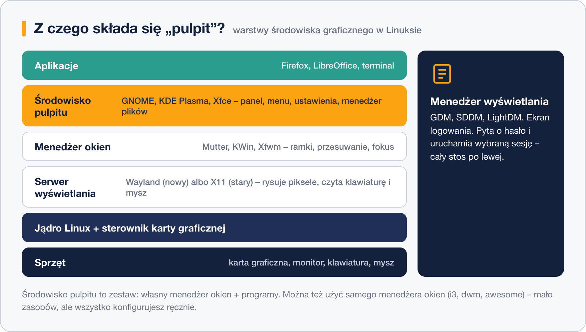

# Czym jest środowisko graficzne

> **W tej lekcji:** rozłożysz „pulpit” Linuksa na części: serwer wyświetlania (X11/Wayland), menedżer okien, menedżer wyświetlania i środowisko pulpitu – i dowiesz się, które z nich do czego służą.

Środowisko graficzne jest w Linuksie **opcjonalnym dodatkiem** złożonym z wymiennych warstw: serwer może działać zupełnie bez grafiki, można wybrać jedno z wielu środowisk, a nawet wymienić sam sposób rysowania okien. Administrator musi znać te warstwy, bo gdy coś nie działa (czarny ekran po zalogowaniu, brak myszy po RDP), trzeba wiedzieć, która z nich zawiodła.

## Jak to działa



Od dołu do góry:

- **Serwer wyświetlania** (ang. *display server*) rysuje piksele na ekranie i odbiera zdarzenia z klawiatury i myszy. Przez dekady robił to **X11** (zwany też X.Org); jego następcą jest **Wayland** – prostszy i bezpieczniejszy. W RHEL 9 Wayland jest domyślny, a w RHEL 10 X11 jako serwer został już usunięty (stare aplikacje działają przez warstwę zgodności Xwayland).
- **Menedżer okien** (ang. *window manager*) decyduje, jak okna wyglądają i zachowują się: ramki, przyciski, przenoszenie, który ma fokus. Każde środowisko ma własny: GNOME – Mutter, KDE – KWin, Xfce – Xfwm.
- **Środowisko pulpitu** (ang. *desktop environment*) to kompletny zestaw: menedżer okien **plus** panel, menu, ustawienia, menedżer plików i podstawowe aplikacje. To jego „markę” widzisz: GNOME, KDE Plasma, Xfce.
- **Menedżer wyświetlania** (ang. *display manager*) to ekran logowania, który uruchamia całą resztę: **GDM** (GNOME), **SDDM** (KDE), **LightDM** (lżejsze środowiska). W systemd działa jako zwykła usługa.

### Lekkie alternatywy: sam menedżer okien

Nie trzeba instalować całego środowiska. Minimaliści używają **samego menedżera okien** – np. kafelkowych *dwm*, *awesome* czy *i3*, które układają okna automatycznie obok siebie i obsługuje się je klawiaturą. Zużywają kilkadziesiąt MB pamięci zamiast setek, ale wszystko (panel, tapetę, dźwięk) konfigurujesz ręcznie w plikach tekstowych – to narzędzia dla zaawansowanych entuzjastów, na serwerach i w pracy początkującego administratora ich nie spotkasz.

## W praktyce

```bash
# czy pracuję w sesji Wayland, czy X11?
echo $XDG_SESSION_TYPE
```

```text
wayland
```

W sesji czysto tekstowej (konsola, SSH) zobaczysz `tty` – to znak, że żadna grafika nie działa.

```bash
# jakie środowisko pulpitu jest uruchomione?
echo $XDG_CURRENT_DESKTOP
```

```text
GNOME
```

```bash
# jaki menedżer wyświetlania obsługuje ekran logowania?
systemctl status gdm
```

```text
● gdm.service - GNOME Display Manager
     Loaded: loaded (/usr/lib/systemd/system/gdm.service; enabled)
     Active: active (running)
```

## Najczęstsze błędy i pułapki

- **Utożsamianie środowiska z systemem.** „Ten Linux wygląda inaczej” zwykle znaczy tylko tyle, że zainstalowano inne środowisko – pod spodem to ta sama dystrybucja i te same polecenia.
- **Mylenie menedżera okien z menedżerem wyświetlania.** Pierwszy zarządza oknami w trakcie sesji, drugi to ekran logowania przed jej startem. Podobne nazwy, zupełnie różne role.
- **Szukanie grafiki na serwerze przez SSH.** W sesji SSH `$XDG_SESSION_TYPE` pokaże `tty` nawet wtedy, gdy na konsoli serwera pulpit działa – zmienne opisują Twoją sesję, nie cały system.
- **Stare poradniki o X11.** Narzędzia typu `xrandr` czy mechanizmy jak przekazywanie X11 mogą nie działać w sesji Wayland – zawsze najpierw sprawdź typ sesji.

## Podsumowanie

- Grafika w Linuksie to warstwy: serwer wyświetlania → menedżer okien → środowisko pulpitu; do tego menedżer wyświetlania jako ekran logowania.
- Wayland zastępuje X11: w RHEL 9 jest domyślny, w RHEL 10 – jedyny.
- Środowisko pulpitu = menedżer okien + panel + aplikacje; sam menedżer okien (dwm, awesome, i3) to opcja dla minimalistów.

| Polecenie | Co pokazuje |
|---|---|
| `echo $XDG_SESSION_TYPE` | `wayland`, `x11` albo `tty` |
| `echo $XDG_CURRENT_DESKTOP` | nazwę środowiska pulpitu |
| `systemctl status gdm` | stan menedżera wyświetlania |
