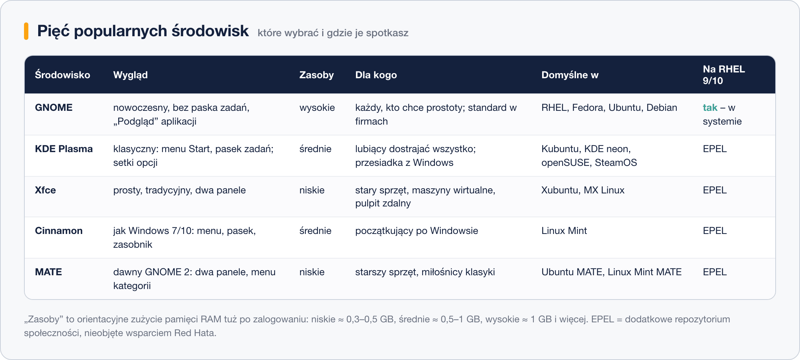
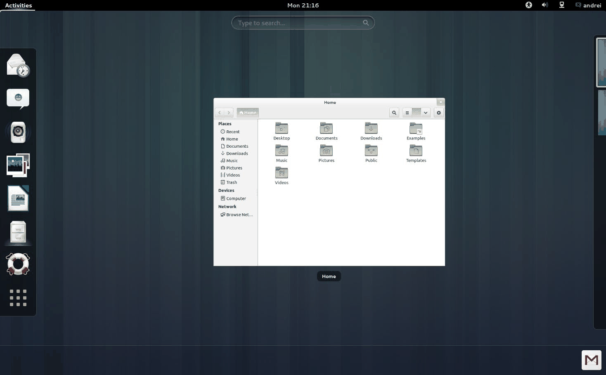
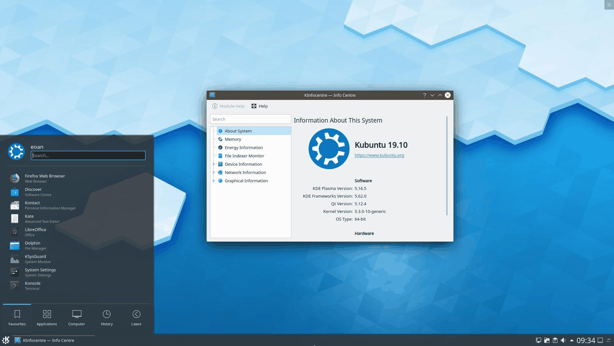
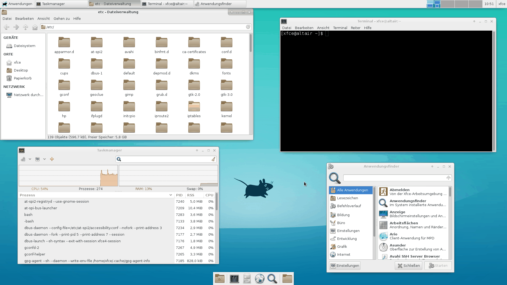
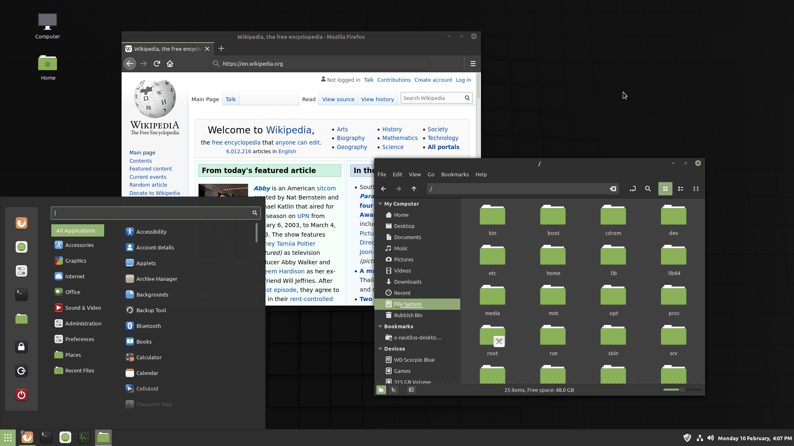
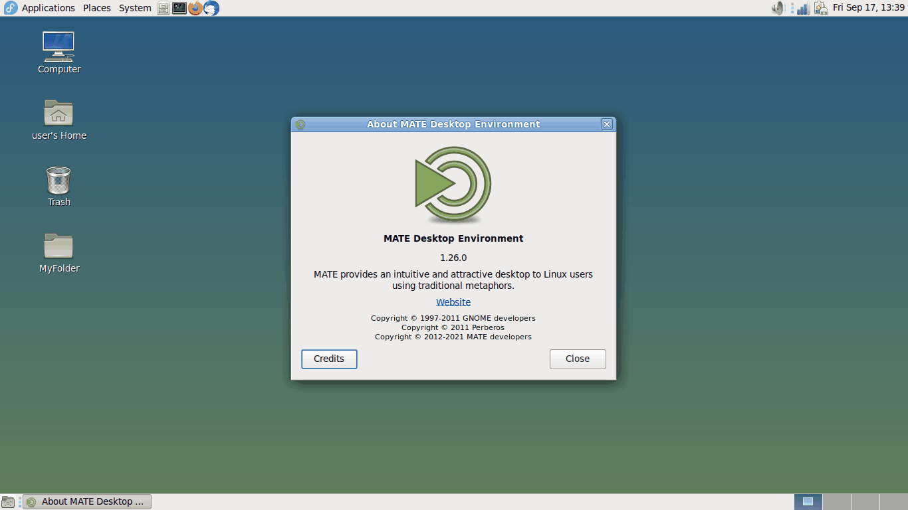

# Przegląd środowisk – GNOME, KDE Plasma, Xfce, Cinnamon, MATE

> **W tej lekcji:** poznasz pięć najpopularniejszych środowisk pulpitu – jak wyglądają, ile zasobów potrzebują, dla kogo są i w których dystrybucjach je spotkasz.

## Po co mi to?

Prędzej czy później usiądziesz przy cudzej maszynie z pulpitem, którego nie znasz, albo sam będziesz musiał coś doradzić: „co zainstalować mamie na stary laptop?”, „jakie środowisko na maszynę szkoleniową przez pulpit zdalny?”. Nazwy GNOME, KDE, Xfce przewijają się w każdej dyskusji o Linuksie – po tej lekcji będziesz wiedział, co się za nimi kryje. Pamiętaj: środowisko to tylko „skórka i narzędzia” – polecenia w terminalu wszędzie działają tak samo.

## Jak to działa



### GNOME – standard świata korporacyjnego



Domyślne środowisko RHEL-a, Fedory, Ubuntu i Debiana – jeśli na serwerze z rodziny RHEL jest jakikolwiek pulpit, to niemal na pewno GNOME. Stawia na prostotę: brak klasycznego paska zadań, aplikacje uruchamia się z widoku „Podgląd” (klawisz Super). Minimalistyczny wygląd, duża spójność, dobra obsługa ekranów dotykowych i dostępności. Cena: największe wymagania sprzętowe z całej piątki i mało opcji dostosowania bez rozszerzeń. Dla kogo: użytkownicy ceniący porządek; środowiska firmowe.

### KDE Plasma – wszystko do ustawienia



Układ znajomy dla użytkownika Windows: menu „Start”, pasek zadań, zasobnik systemowy. Znak rozpoznawczy to konfigurowalność – zmienisz praktycznie każdy detal, od animacji po zachowanie okien. Wbrew dawnej opinii Plasma jest dziś dość lekka (lżejsza od GNOME). Domyślna w Kubuntu, KDE neon, openSUSE i na konsoli Steam Deck. Dla kogo: lubiący dostrajać system; przesiadający się z Windows.

### Xfce – lekko i tradycyjnie



Lekkie, szybkie i stabilne, rozwijane bardzo konserwatywnie – wygląd nie zmienił się zasadniczo od lat i to jest jego zaleta. Mało efektów, mało zależności, niskie zużycie pamięci. Właśnie dlatego to częsty wybór na **maszyny wirtualne i pulpity zdalne** (płynniej przesyła się prostszy obraz) oraz na starszy sprzęt. Domyślne w Xubuntu i MX Linux. Dla kogo: pragmatycy; maszyny o małych zasobach.

### Cinnamon – dla przesiadających się z Windows



Stworzony przez zespół Linux Mint jako „tradycyjna” odpowiedź na zmiany w GNOME 3 (technicznie to jego odgałęzienie, ang. *fork*). Menu z kategoriami, pasek zadań, ikony na pulpicie – użytkownik Windows czuje się jak u siebie od pierwszej minuty. Dla kogo: początkujący na komputerze biurkowym; to częsta rekomendacja na „pierwszego Linuksa”.

### MATE – kontynuacja klasycznego GNOME 2



Gdy GNOME 3 porzuciło klasyczny wygląd, społeczność utrzymała przy życiu GNOME 2 pod nazwą MATE (od yerba mate). Dwa panele, menu „Programy/Miejsca/System”, bardzo małe wymagania. Rozwijane spokojnie, bez rewolucji. Dla kogo: starszy sprzęt; użytkownicy przywiązani do klasyki.

## W praktyce

Sprawdzisz, co działa na maszynie, bez klikania:

```bash
# jakie środowisko obsługuje bieżącą sesję graficzną
echo $XDG_CURRENT_DESKTOP
```

```text
GNOME
```

```bash
# jakie sesje są do wyboru na ekranie logowania
ls /usr/share/xsessions/ /usr/share/wayland-sessions/ 2>/dev/null
```

```text
/usr/share/wayland-sessions/:
gnome-wayland.desktop  gnome.desktop
```

Na ekranie logowania GDM środowisko i typ sesji wybiera się ikoną zębatki (prawy dolny róg) – jeden system może mieć zainstalowanych kilka środowisk naraz.

## Najczęstsze błędy i pułapki

- **„Który Linux jest ładniejszy”** to zwykle porównanie środowisk, nie dystrybucji – GNOME wygląda tak samo na Fedorze i na Ubuntu.
- **Instalowanie kilku środowisk „na próbę”** na jednej maszynie działa, ale miesza aplikacje (dwa edytory, dwa terminale…) i potrafi zaskoczyć na ekranie logowania. Do testów lepsza osobna maszyna wirtualna.
- **Ocenianie wymagań po wieku projektu.** „Stare” MATE i Xfce są lekkie, „nowoczesne” GNOME – najcięższe; intuicja bywa myląca.
- **Oczekiwanie KDE/Cinnamon w standardzie RHEL.** W repozytoriach RHEL 9/10 jest tylko GNOME; resztę instaluje się z dodatkowego repozytorium EPEL – o tym w następnej lekcji.

## Podsumowanie

- GNOME – standard w RHEL i dużych dystrybucjach, prosty, ale zasobożerny.
- KDE Plasma – maksimum konfiguracji, układ jak w Windows.
- Xfce – lekkie i stabilne; pierwszy wybór na VM i pulpit zdalny.
- Cinnamon – przyjazny start po Windowsie (Linux Mint).
- MATE – klasyka GNOME 2, bardzo małe wymagania.
- Środowisko można zmienić w każdej chwili – to pakiet jak każdy inny, a polecenia systemu pozostają te same.
