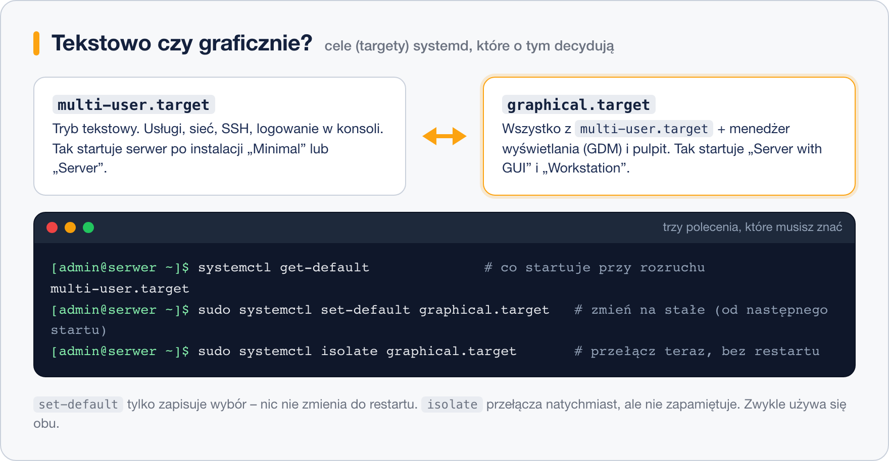

# Instalacja środowiska graficznego na serwerze RHEL

> **W tej lekcji:** doinstalujesz pulpit do serwera postawionego jako Minimal Install, nauczysz się przełączać system między trybem tekstowym a graficznym (`systemctl set-default` / `isolate`) i dodasz Xfce z repozytorium EPEL.

## Po co mi to?

Postawiłeś serwer bez grafiki – i dobrze. Ale czasem pulpit jest potrzebny: na maszynie szkoleniowej, na stacji testowej, dla aplikacji, która wymaga okna. Nie trzeba niczego reinstalować: środowisko graficzne to zwykłe pakiety, które można dodać i usunąć. Przy okazji poznasz **cele systemd** (ang. *targets*) – mechanizm, który decyduje, czy system startuje do konsoli, czy do ekranu logowania.

## Jak to działa

Pakiety w rodzinie RHEL są zorganizowane w **grupy** – jedna nazwa obejmuje dziesiątki powiązanych pakietów. Środowiska graficzne instaluje się właśnie grupami. O tym natomiast, czy po starcie uruchomi się ekran logowania, decyduje **domyślny cel systemd**:



- `multi-user.target` – tryb tekstowy: usługi, sieć, logowanie w konsoli.
- `graphical.target` – to samo plus menedżer wyświetlania (GDM) i pulpit.

Instalacja grupy graficznej **nie zmienia** domyślnego celu – to osobny krok.

## W praktyce

### Krok 1: zobacz dostępne grupy

```bash
# lista grup pakietów – środowiska znajdziesz wśród „environment groups”
dnf group list
```

```text
Available Environment Groups:
   Server with GUI
   Server
   Minimal Install
   Workstation
   ...
Installed Environment Groups:
   Minimal Install
```

```bash
# co wchodzi w skład grupy (uwaga na cudzysłowy przy nazwie ze spacjami)
dnf group info "Server with GUI"
```

### Krok 2: zainstaluj GNOME

```bash
# instalacja środowiska GNOME z narzędziami serwera (pobierze ponad tysiąc pakietów, kilka GB)
sudo dnf group install "Server with GUI"
```

Na stacji roboczej zamiast tego wybierzesz grupę `"Workstation"`. Po instalacji system **nadal** wystartuje tekstowo – zmień cel:

```bash
# od następnego startu uruchamiaj ekran logowania
sudo systemctl set-default graphical.target
# a teraz, bez restartu, przełącz się do grafiki od razu
sudo systemctl isolate graphical.target
```

`set-default` tylko zapisuje wybór na przyszłość; `isolate` przełącza natychmiast, ale niczego nie zapamiętuje – dlatego zwykle wykonuje się oba. Powrót do trybu tekstowego to analogicznie `set-default multi-user.target` i/lub `isolate multi-user.target`.

```bash
# kontrola: co jest ustawione
systemctl get-default
```

```text
graphical.target
```

### Krok 3 (wariant): lżejsze Xfce z EPEL

W oficjalnych repozytoriach RHEL 9/10 jest tylko GNOME. Inne środowiska dostarcza **EPEL** (Extra Packages for Enterprise Linux) – dodatkowe repozytorium społeczności Fedory:

```bash
# na Rocky/AlmaLinux/CentOS Stream: włączamy repozytorium EPEL
sudo dnf install epel-release

# instalacja środowiska Xfce (grupa z EPEL)
sudo dnf group install "Xfce"

# i jak poprzednio – cel graficzny
sudo systemctl set-default graphical.target
```

Na ekranie logowania wybierz sesję „Xfce Session” ikoną zębatki. Pamiętaj: pakiety z EPEL nie są objęte wsparciem Red Hata – na produkcyjnym RHEL-u decyzja o EPEL powinna być świadoma (a samo repozytorium wymaga tam dodatkowo włączenia kanału CRB).

> **Na Ubuntu/Debianie:** środowiska instaluje się metapakietami, np. `sudo apt install ubuntu-desktop` (GNOME) albo `sudo apt install xubuntu-desktop` (Xfce); reszta logiki – w tym cele systemd – działa tak samo.

### Usuwanie środowiska

```bash
# usuwa pakiety grupy; wcześniej wróć do trybu tekstowego
sudo systemctl set-default multi-user.target
sudo dnf group remove "Server with GUI"
```

## Najczęstsze błędy i pułapki

- **Po instalacji „nic się nie zmieniło”.** Grupa została zainstalowana, ale cel wciąż jest tekstowy – wykonaj `set-default` + `isolate` (albo restart).
- **Brak miejsca na dysku.** „Server with GUI” to kilka GB; na maszynie z dyskiem 20 GB sprawdź wcześniej `df -h /`. Gdy miejsca mało – wybierz Xfce.
- **Wolny, rwący pulpit w maszynie wirtualnej.** VM zwykle nie ma akceleracji 3D; GNOME animacjami to odczuwa. Pomaga zwiększenie pamięci wideo w ustawieniach maszyny albo lżejsze środowisko.
- **`dnf group install Server with GUI` bez cudzysłowów** – `dnf` potraktuje każde słowo jako osobną grupę i zgłosi błąd. Nazwy ze spacjami zawsze w cudzysłowach.
- **`isolate` przez SSH przy przełączaniu w dół** (`multi-user.target`) wyłączy sesje graficzne na konsoli – upewnij się, że nikt na niej nie pracuje.

## Podsumowanie

- Środowisko graficzne to grupa pakietów: `dnf group list` → `sudo dnf group install "Server with GUI"`.
- Tryb startu kontrolują cele systemd: `multi-user.target` (tekst) i `graphical.target` (grafika).
- `set-default` ustawia na stałe, `isolate` przełącza natychmiast.
- KDE, Xfce, Cinnamon i MATE na RHEL 9/10 pochodzą z repozytorium EPEL.

| Polecenie | Co robi |
|---|---|
| `dnf group list` | pokazuje grupy pakietów |
| `sudo dnf group install "Server with GUI"` | instaluje GNOME z narzędziami |
| `systemctl get-default` | pokazuje domyślny cel |
| `sudo systemctl set-default graphical.target` | grafika od następnego startu |
| `sudo systemctl isolate graphical.target` | grafika natychmiast |
