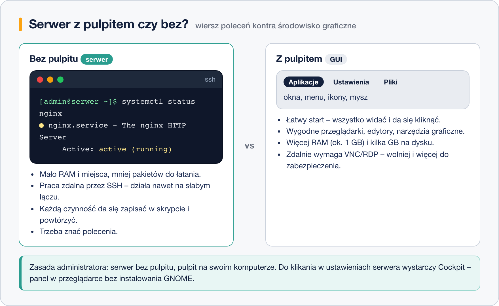

# Środowisko graficzne na serwerze – wady i zalety

> **W tej lekcji:** zestawisz pracę w wierszu poleceń (CLI) z interfejsem graficznym (GUI), poznasz argumenty za serwerem bez pulpitu i sytuacje, w których GUI jednak ma sens.

## Po co mi to?

To jedno z pierwszych „religijnych” pytań, jakie usłyszysz w pracy: *czy serwer powinien mieć pulpit?* Odpowiedź wpływa na bezpieczeństwo, zużycie zasobów i sposób, w jaki będziesz tym serwerem zarządzać przez lata. Warto umieć uzasadnić decyzję, a nie tylko powtórzyć, że „prawdziwi admini używają terminala”.

## Jak to działa



**CLI** (ang. *Command Line Interface*) to praca poleceniami w terminalu, **GUI** (ang. *Graphical User Interface*) – oknami i myszą. Na serwerze różnica przekłada się na konkrety:

### Argumenty za serwerem bez pulpitu

- **Zasoby.** Pulpit zajmuje ok. 1 GB RAM i kilka GB dysku, zanim uruchomisz jakąkolwiek usługę. Na dziesięciu maszynach wirtualnych to dziesięć zmarnowanych gigabajtów pamięci.
- **Bezpieczeństwo.** Każdy pakiet to potencjalne luki do łatania. Środowisko graficzne to setki pakietów (biblioteki graficzne, przeglądarka…), których serwer WWW w ogóle nie potrzebuje. Mniej pakietów = mniejsza powierzchnia ataku i mniej aktualizacji.
- **Praca zdalna.** Serwerami zarządza się zdalnie przez **SSH** – tekstowy, szyfrowany kanał, który działa płynnie nawet przez słabe łącze i zużywa kilobajty. Zdalny pulpit (VNC/RDP) przesyła obraz: potrzebuje megabitów, dodatkowej usługi i dodatkowego zabezpieczania.
- **Powtarzalność.** Polecenie można skopiować, zapisać w skrypcie, wykonać na stu serwerach w pętli i udokumentować. Sekwencji kliknięć – nie. Cała nowoczesna automatyzacja (Ansible, skrypty) opiera się na CLI.
- **Stabilność.** Mniej warstw to mniej rzeczy, które mogą się zawiesić.

### Kiedy GUI na serwerze ma sens

- **Maszyny szkoleniowe i testowe** – gdy uczestnicy dopiero poznają system, pulpit obniża próg wejścia.
- **Aplikacje wymagające okna** – niektóre instalatory komercyjnego oprogramowania (np. narzędzia baz danych) oferują tylko kreator graficzny.
- **Stacje operatorskie** – komputer w serwerowni służący do monitoringu z przeglądarką.
- **Okres przejściowy** – administrator po Windowsie bywa produktywniejszy z GUI, zanim opanuje CLI. To w porządku, o ile traktuje się to jako etap.

### Trzecia droga: Cockpit

Zanim zainstalujesz pulpit „żeby było wygodnie”, poznaj **Cockpit** – panel administracyjny w przeglądarce, rozwijany przez Red Hata i obecny w RHEL 9/10. Daje wykresy obciążenia, zarządzanie usługami, kontami, siecią, aktualizacjami, a nawet terminal – bez instalowania środowiska graficznego na serwerze. Obraz renderuje Twoja przeglądarka, serwer pozostaje tekstowy.

## W praktyce

```bash
# instalacja i włączenie panelu Cockpit (w grupie „Server” często już jest)
sudo dnf install cockpit
sudo systemctl enable --now cockpit.socket
```

```bash
# otwieramy port w zaporze sieciowej
sudo firewall-cmd --add-service=cockpit --permanent
sudo firewall-cmd --reload
```

Teraz w przeglądarce na swoim komputerze otwórz `https://adres-serwera:9090` i zaloguj się kontem systemowym. Przy pierwszym wejściu przeglądarka ostrzeże o certyfikacie wystawionym przez sam serwer – na maszynie szkoleniowej można to zaakceptować.

Dla porównania – ta sama informacja w CLI i w Cockpicie:

```bash
# zużycie pamięci w terminalu
free -h
```

W Cockpicie to samo zobaczysz jako wykres na stronie „Przegląd”.

## Najczęstsze błędy i pułapki

- **Pulpit „na wszelki wypadek”.** Jeśli nie masz konkretnego powodu, nie instaluj – dodać zawsze zdążysz (poprzednia lekcja), a odchudzanie produkcyjnego serwera jest ryzykowne.
- **Wystawianie zdalnego pulpitu do internetu.** VNC bez dodatkowego szyfrowania i RDP z hasłem słownikowym to klasyczne wektory włamań. SSH z kluczami jest bezpieczniejszy i prostszy.
- **Utożsamianie GUI z Cockpitem.** Cockpit nie wymaga środowiska graficznego na serwerze – to usługa WWW; nie trzeba dla niego instalować GNOME.
- **Wniosek „CLI jest zawsze lepsze”.** Do przeglądania logów na dziesięciu serwerach – tak. Do nauki, prezentacji czy aplikacji okienkowej – niekoniecznie. Narzędzie dobiera się do zadania.

## Podsumowanie

- Domyślna zasada: **serwer bez pulpitu**, zarządzanie przez SSH; pulpit na komputerze administratora.
- GUI kosztuje zasoby, zwiększa powierzchnię ataku i utrudnia automatyzację; zyskiem jest niski próg wejścia.
- Uzasadnione wyjątki: maszyny szkoleniowe, aplikacje okienkowe, stacje operatorskie.
- Cockpit (`https://serwer:9090`) daje wygodę klikania bez instalowania środowiska graficznego.

## Zobacz też

- [3. Instalacja środowiska graficznego na serwerze RHEL](3.%20Instalacja%20środowiska%20graficznego%20na%20serwerze%20RHEL.md)
- [1. Czym jest środowisko graficzne](1.%20Czym%20jest%20środowisko%20graficzne.md)
- [Zadania do modułu](../../Zadania/02.%20Środowiska%20graficzne/I.%20Zadania.md)
