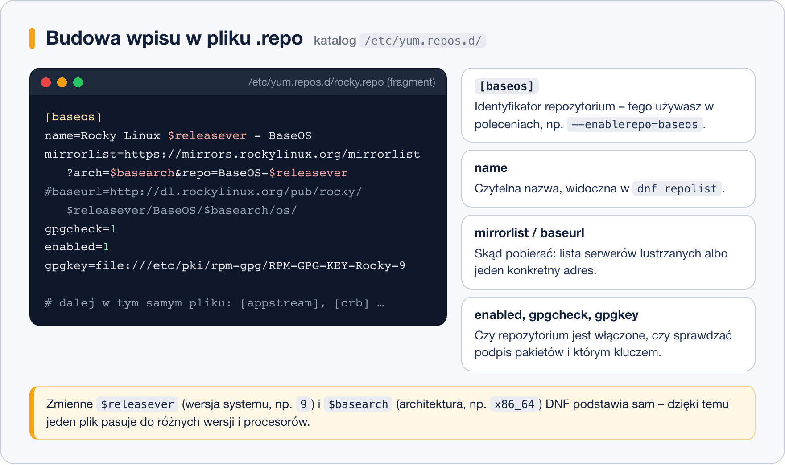

# Konfiguracja repozytoriów

> **W tej lekcji:** nauczysz się czytać i rozumieć pliki `.repo`, włączać i wyłączać repozytoria, dodawać EPEL i CRB oraz odświeżać metadane. Po tej lekcji komunikat „nie znaleziono pakietu” przestanie być ścianą, a stanie się wskazówką.

Repozytoria to źródła, z których `dnf` pobiera pakiety. Świeżo zainstalowany Rocky czy AlmaLinux ma ich kilka, ale nie wszystkie są włączone, a wielu popularnych narzędzi (np. `htop`) w ogóle w nich nie ma. Administrator regularnie dodaje repozytorium EPEL, włącza repozytorium dostarczone przez producenta oprogramowania (Docker, PostgreSQL), a czasem wyłącza coś, co powoduje konflikty – bez tej umiejętności zatrzymasz się na pierwszym „No match for argument”.

## Jak to działa

### Gdzie mieszka konfiguracja

Każde repozytorium jest opisane wpisem w pliku tekstowym z rozszerzeniem `.repo` w katalogu **`/etc/yum.repos.d/`** (nazwa katalogu została po YUM). Jeden plik może zawierać kilka wpisów.

```bash
# jakie pliki .repo mamy po instalacji systemu?
ls /etc/yum.repos.d/
```

```text
rocky-addons.repo  rocky-devel.repo  rocky-extras.repo  rocky.repo
```

### Budowa wpisu



Najważniejsze pola:

| Pole | Znaczenie |
|---|---|
| `[identyfikator]` | krótka nazwa repozytorium, używana w opcjach typu `--enablerepo` |
| `name=` | czytelny opis, pokazywany w `dnf repolist` |
| `baseurl=` | bezpośredni adres katalogu z pakietami |
| `metalink=` / `mirrorlist=` | zamiast `baseurl`: adres usługi, która wskaże najbliższy serwer lustrzany |
| `enabled=` | `1` – repozytorium aktywne, `0` – wyłączone (ale skonfigurowane) |
| `gpgcheck=` | `1` – sprawdzaj podpisy pakietów (tak ma być) |
| `gpgkey=` | skąd wziąć klucz publiczny do weryfikacji podpisów |

W adresach występują **zmienne**, które DNF podstawia automatycznie:

- `$releasever` – wersja systemu, np. `9` albo `10`,
- `$basearch` – architektura procesora, np. `x86_64` albo `aarch64`.

Dzięki nim ten sam plik `.repo` działa na różnych wersjach i maszynach. Aktualne wartości podejrzysz poleceniem `dnf config-manager --dump-variables` (RHEL 9; w nowszym dnf5: `dnf repoinfo`… – patrz lekcja 5) albo prościej: `cat /etc/os-release`.

### Repozytoria rodziny RHEL 9/10

- **BaseOS** – rdzeń systemu (jądro, systemd, powłoka). Zawsze włączone.
- **AppStream** – aplikacje, języki, serwery (nginx, PostgreSQL, Python). Zawsze włączone.
- **CRB** (*CodeReady Builder*; w CentOS Stream: `crb`) – biblioteki i nagłówki dla budujących oprogramowanie. Domyślnie **wyłączone**; wymaga go wiele pakietów z EPEL.
- **EPEL** (*Extra Packages for Enterprise Linux*) – ogromne repozytorium społeczności Fedory z pakietami, których nie ma w dystrybucji (htop, fail2ban, tealdeer…). Instalowane osobno.

## W praktyce

### Co jest włączone

```bash
# lista włączonych repozytoriów
dnf repolist
```

```text
id repozytorium          nazwa repozytorium
appstream                Rocky Linux 9 - AppStream
baseos                   Rocky Linux 9 - BaseOS
extras                   Rocky Linux 9 - Extras
```

```bash
# wszystkie, także wyłączone
dnf repolist --all
```

### Dodanie EPEL i włączenie CRB

```bash
# pakiet epel-release jest w repozytorium Extras – instaluje plik .repo i klucz GPG
sudo dnf install epel-release

# EPEL potrzebuje repozytorium CRB – włączamy je na stałe
sudo dnf config-manager --set-enabled crb

# sprawdzamy efekt
dnf repolist
```

```text
id repozytorium          nazwa repozytorium
appstream                Rocky Linux 9 - AppStream
baseos                   Rocky Linux 9 - BaseOS
crb                      Rocky Linux 9 - CRB
epel                     Extra Packages for Enterprise Linux 9 - x86_64
extras                   Rocky Linux 9 - Extras
```

Od teraz `dnf search htop` znajdzie pakiet, którego wcześniej „nie było”.

> **Na prawdziwym RHEL:** `epel-release` instaluje się z adresu podanego w dokumentacji EPEL, a CRB włącza przez `subscription-manager repos --enable codeready-builder-for-rhel-9-x86_64-rpms`. Na Rocky/Alma/CentOS Stream wystarczą polecenia powyżej.

`config-manager` działa też w drugą stronę:

```bash
# wyłączenie repozytorium na stałe
sudo dnf config-manager --set-disabled epel

# jednorazowe użycie wyłączonego repozytorium (bez zmiany konfiguracji)
sudo dnf --enablerepo=epel install htop
```

Tak naprawdę `--set-enabled`/`--set-disabled` tylko zmienia `enabled=0/1` we wpisie – możesz to samo zrobić edytorem tekstu.

### Metadane: odświeżanie i czyszczenie

`dnf` trzyma pobrane spisy pakietów w pamięci podręcznej (`/var/cache/dnf/`) i odświeża je co kilka godzin. Czasem warto zrobić to ręcznie:

```bash
# usuwamy całą pamięć podręczną (spisy, pobrane pakiety)
sudo dnf clean all

# pobieramy świeże metadane ze wszystkich włączonych repozytoriów
sudo dnf makecache
```

```text
Rocky Linux 9 - BaseOS                          2.4 MB/s | 2.3 MB     00:00
Rocky Linux 9 - AppStream                       5.1 MB/s | 8.4 MB     00:01
Extra Packages for Enterprise Linux 9 - x86_64  9.8 MB/s |  23 MB     00:02
Utworzono pamięć podręczną metadanych.
```

To pierwsza rzecz do zrobienia, gdy `dnf` zachowuje się dziwnie: widzi stare wersje, zgłasza błędy sum kontrolnych albo nie widzi świeżo dodanego pakietu w firmowym repozytorium.

## Najczęstsze błędy i pułapki

- **Instalacja `epel-release` bez włączenia CRB.** Część pakietów z EPEL nie zainstaluje się, zgłaszając brakujące zależności. Zapamiętaj parę: **EPEL + CRB**.
- **Repozytoria „z internetu” dodawane bez zastanowienia.** Każde repozytorium może nadpisać pakiety systemowe swoją wersją. Dodawaj tylko zaufane źródła (producent oprogramowania, EPEL) i nie mieszaj repozytoriów przeznaczonych dla innych wersji systemu – to prosta droga do [piekła zależności](7.%20Piekło%20zależności.md).
- **`gpgcheck=0`, „bo tak działa”.** Wyłączenie weryfikacji podpisów oznacza, że zainstalujesz wszystko, co przyjdzie z sieci – także pakiet podmieniony przez atakującego. Zamiast tego zaimportuj właściwy klucz.
- **Błąd „Failed to download metadata for repo”.** Najczęściej: brak sieci, literówka w `baseurl`, albo repozytorium dla innej wersji (`$releasever` wskazuje np. 10, a repozytorium ma tylko katalog 9). Przeczytaj komunikat – podaje dokładny adres URL, który zawiódł; spróbuj otworzyć go w przeglądarce.
- **Edycja plików `.repo` bez kopii.** Przed ręczną zmianą zrób `sudo cp plik.repo plik.repo.bak` – literówka w tych plikach potrafi zablokować całego `dnf`.

## Podsumowanie

- Repozytoria są opisane w plikach `/etc/yum.repos.d/*.repo`; jeden plik może mieć wiele wpisów.
- Kluczowe pola: `[id]`, `name`, `baseurl`/`metalink`, `enabled`, `gpgcheck`, `gpgkey`; zmienne `$releasever` i `$basearch` DNF podstawia sam.
- RHEL 9/10: BaseOS + AppStream (włączone), CRB (do włączenia), EPEL (do doinstalowania). EPEL zawsze w parze z CRB.
- Metadane odświeżysz przez `dnf clean all` + `dnf makecache`.

| Polecenie | Co robi |
|---|---|
| `dnf repolist` / `dnf repolist --all` | włączone / wszystkie repozytoria |
| `sudo dnf install epel-release` | dodaje repozytorium EPEL |
| `sudo dnf config-manager --set-enabled crb` | włącza repozytorium na stałe |
| `sudo dnf config-manager --set-disabled id` | wyłącza repozytorium |
| `sudo dnf --enablerepo=id install pakiet` | jednorazowo używa wyłączonego repozytorium |
| `sudo dnf clean all` | czyści pamięć podręczną |
| `sudo dnf makecache` | pobiera świeże metadane |
