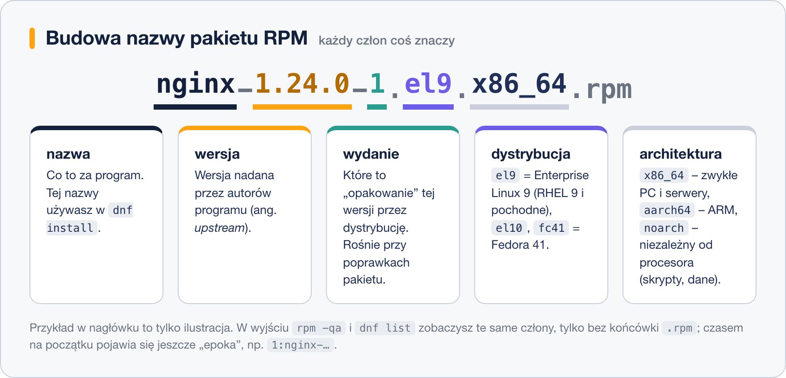

# Pakiety RPM – praca z plikami lokalnymi

> **W tej lekcji:** zajrzysz do środka pliku `.rpm`, nauczysz się czytać jego nazwę oraz zadawać systemowi pytania poleceniem `rpm`: co jest zainstalowane, skąd pochodzi dany plik, co zawiera pakiet i czy ktoś go nie zmodyfikował.

## Po co mi to?

Zwykle wszystko bierzesz z repozytorium. Ale zdarza się, że producent daje Ci oprogramowanie jako **plik `.rpm` do pobrania** – agent monitoringu, sterownik, firmowa aplikacja. Musisz umieć taki plik obejrzeć przed instalacją i poprawnie go zainstalować.

Druga, codzienna sprawa: `rpm` to „wyszukiwarka” systemu. Znalazłeś nieznany plik konfiguracyjny? `rpm -qf` powie, czyj jest. Chcesz wiedzieć, gdzie pakiet rozłożył swoje pliki? `rpm -ql`. Podejrzewasz, że ktoś grzebał w systemie? `rpm -V` porówna pliki z oryginałem.

## Jak to działa

### Co jest w pliku .rpm

Plik `.rpm` to skompresowane archiwum plików programu **plus** metadane: nazwa, wersja, zależności, licencja, skrypty uruchamiane przy instalacji oraz podpis GPG. Informacja o tym, co zostało zainstalowane, trafia do **bazy RPM** w `/var/lib/rpm` – to ją odpytują wszystkie polecenia `rpm -q…` i z niej korzysta także `dnf`.

### Jak czytać nazwę pakietu



Schemat to `nazwa-wersja-wydanie.dystrybucja.architektura`, np. `nginx-1.24.0-1.el9.x86_64.rpm`:

- **nazwa** (`nginx`) – jej używasz w `dnf install`;
- **wersja** (`1.24.0`) – numer nadany przez autorów programu;
- **wydanie** (`1`) – numer „opakowania” tej wersji przez dystrybucję, rośnie przy poprawkach samego pakietu;
- **dystrybucja** (`el9`) – Enterprise Linux 9, czyli RHEL 9 i pochodne;
- **architektura** (`x86_64`) – dla jakiego procesora; `noarch` oznacza pakiet niezależny od architektury.

## W praktyce

### Pobranie pakietu do obejrzenia

Do ćwiczeń przyda się prawdziwy plik `.rpm` – `dnf download` pobierze go z repozytorium bez instalowania:

```bash
# pobieramy pakiet htop do katalogu bieżącego
dnf download htop
ls
```

```text
htop-3.2.2-1.el9.x86_64.rpm
```

### Zaglądanie do pakietu (plik lokalny: opcja -p)

```bash
# metadane pliku .rpm (q=query, i=info, p=package, czyli plik a nie baza)
rpm -qip htop-3.2.2-1.el9.x86_64.rpm

# lista plików, które pakiet zainstaluje
rpm -qlp htop-3.2.2-1.el9.x86_64.rpm
```

```text
/usr/bin/htop
/usr/share/doc/htop/AUTHORS
/usr/share/man/man1/htop.1.gz
...
```

### Instalacja: dlaczego `dnf`, a nie `rpm -ivh`

Klasyczne polecenie instalacji to `rpm -ivh plik.rpm` (`i` = install, `v` = gadatliwie, `h` = pasek postępu). Problem: **`rpm` nie zna repozytoriów**. Jeśli pakiet czegoś wymaga, dostaniesz tylko błąd:

```bash
sudo rpm -ivh moj-agent-2.0-1.el9.x86_64.rpm
```

```text
błąd: Zależności nie zostały spełnione:
        libcurl.so.4()(64bit) jest wymagane przez moj-agent-2.0-1.el9.x86_64
```

Dlatego pliki lokalne też instalujemy przez `dnf`:

```bash
# dnf zainstaluje plik lokalny ORAZ dociągnie zależności z repozytoriów
sudo dnf install ./moj-agent-2.0-1.el9.x86_64.rpm
```

Ważny szczegół: ścieżka musi zawierać `/` (np. `./`), inaczej `dnf` potraktuje argument jak nazwę pakietu z repozytorium. Transakcja trafi do `dnf history` jak każda inna, więc da się ją cofnąć.

`rpm -ivh` zostaje na sytuacje awaryjne (np. tryb ratunkowy bez sieci) – i nawet wtedy bez opcji wymuszających.

### Pytania do bazy RPM

Tu `rpm` błyszczy. Wszystkie te polecenia działają bez `sudo`:

```bash
# wszystkie zainstalowane pakiety (posortowane)
rpm -qa | sort | less

# czy konkretny pakiet jest zainstalowany?
rpm -q openssh-server
```

```text
openssh-server-8.7p1-38.el9.x86_64
```

```bash
# informacje o zainstalowanym pakiecie
rpm -qi openssh-server

# z jakiego pakietu pochodzi ten plik? (f = file)
rpm -qf /etc/ssh/sshd_config
```

```text
openssh-server-8.7p1-38.el9.x86_64
```

```bash
# jakie pliki ma zainstalowany pakiet? (l = list)
rpm -ql openssh-server | head

# tylko pliki konfiguracyjne pakietu (c = config)
rpm -qc openssh-server
```

```text
/etc/pam.d/sshd
/etc/ssh/sshd_config
/etc/sysconfig/sshd
```

### Weryfikacja: czy ktoś zmieniał pliki pakietu

```bash
# porównanie plików pakietu ze stanem z chwili instalacji
rpm -V openssh-server
```

```text
S.5....T.  c /etc/ssh/sshd_config
```

Każda litera to wykryta różnica: `S` – inny rozmiar, `5` – inna suma kontrolna MD5 (zmieniona zawartość), `T` – inny czas modyfikacji; `c` oznacza plik konfiguracyjny. Zmieniony plik konfiguracyjny to zwykle norma (sam go edytowałeś). Zmieniony **program** w `/usr/bin` – sygnał alarmowy: uszkodzenie dysku albo włamanie. Brak wyniku = wszystko zgodne.

## Najczęstsze błędy i pułapki

- **`rpm -ivh` zamiast `dnf install ./plik.rpm`.** Skończy się błędem zależności albo – gorzej – pokusą użycia `--nodeps`. Nie rób tego; konsekwencje opisuje lekcja [7. Piekło zależności](7.%20Piekło%20zależności.md).
- **Zapomniana opcja `-p` przy pytaniu o plik.** `rpm -qi plik.rpm` zapyta bazę o pakiet „o takiej nazwie” i odpowie, że nie jest zainstalowany. Do plików lokalnych zawsze `-qip`, `-qlp` itd.
- **Instalowanie pakietów `el8` na systemie `el9`** (albo pakietów Fedory na RHEL). Czasem się uda, częściej skończy się konfliktem bibliotek. Szukaj pakietu zbudowanego dla Twojej wersji.
- **Pobieranie `.rpm` z przypadkowych stron.** Plik spoza repozytorium nie przechodzi weryfikacji podpisu wobec znanych kluczy. Pobieraj tylko ze strony producenta i – jeśli publikuje sumy kontrolne – porównaj je (`sha256sum plik.rpm`).

## Podsumowanie

- Nazwa pakietu: `nazwa-wersja-wydanie.dystrybucja.architektura`.
- `dnf download` pobiera pakiet bez instalacji; `rpm -q…p` pozwala obejrzeć plik przed instalacją.
- Pliki lokalne instaluj przez `dnf install ./plik.rpm` – dociągnie zależności i zapisze transakcję w historii.
- `rpm` to narzędzie do pytań: `-qa`, `-qi`, `-ql`, `-qc`, `-qf`, `-V`.

| Polecenie | Co robi |
|---|---|
| `dnf download pakiet` | pobiera `.rpm` bez instalowania |
| `rpm -qip plik.rpm` / `rpm -qlp plik.rpm` | info / lista plików **pliku** `.rpm` |
| `sudo dnf install ./plik.rpm` | instaluje plik lokalny z zależnościami |
| `rpm -qa` | wszystkie zainstalowane pakiety |
| `rpm -qi pakiet` | informacje o zainstalowanym pakiecie |
| `rpm -ql pakiet` / `rpm -qc pakiet` | pliki / pliki konfiguracyjne pakietu |
| `rpm -qf /ścieżka/plik` | z jakiego pakietu pochodzi plik |
| `rpm -V pakiet` | weryfikacja, czy pliki pakietu się zmieniły |

## Zobacz też

- [1. Jak działa menedżer pakietów](1.%20Jak%20działa%20menedżer%20pakietów.md) – podział ról `rpm` / `dnf`.
- [5. DNF – następca YUM](5.%20DNF%20–%20następca%20YUM.md) – historia transakcji i jej cofanie.
- [3. Konfiguracja repozytoriów](3.%20Konfiguracja%20repozytoriów.md) – zanim sięgniesz po plik z internetu, sprawdź repozytoria.
