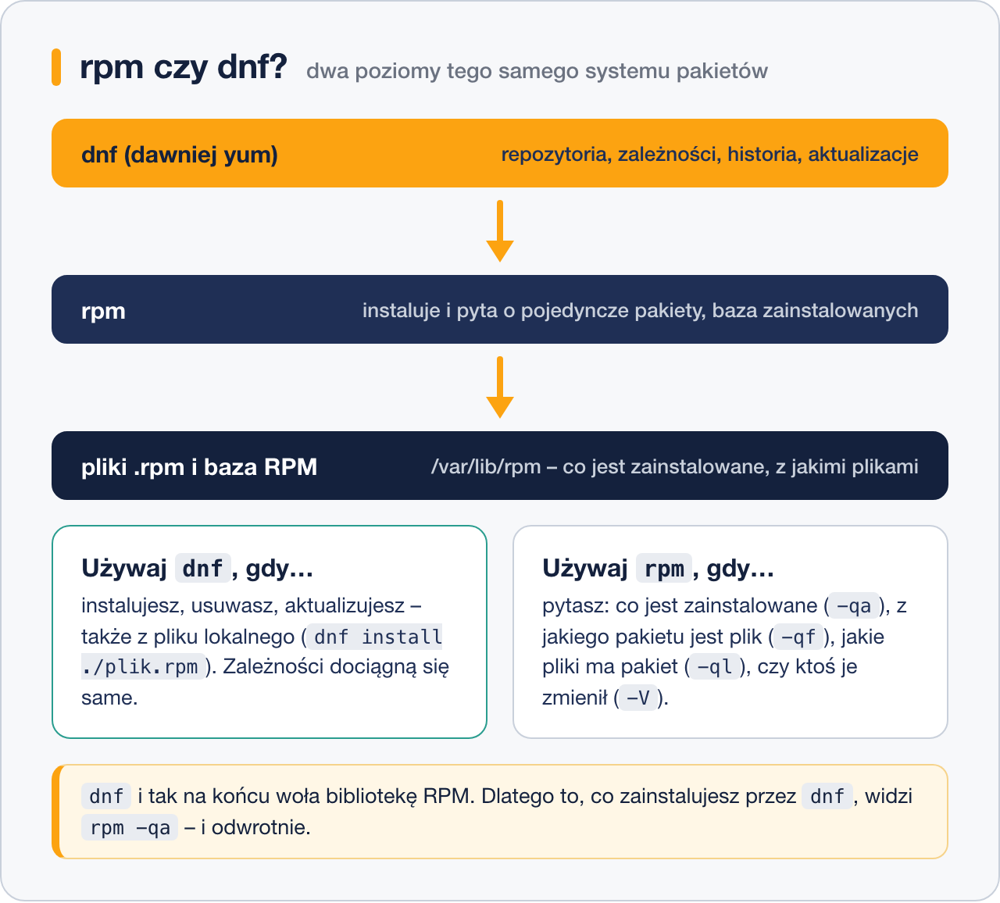

# DNF – następca YUM

> **W tej lekcji:** poznasz możliwości, które DNF dodaje ponad klasyczny YUM: historię z cofaniem transakcji, automatyczne sprzątanie zależności, grupy pakietów, strumienie modułów oraz sprawdzanie, co wymaga restartu. Na końcu – ściąga yum ↔ dnf ↔ apt.

## Po co mi to?

Skoro `yum` i `dnf` to dziś to samo polecenie (lekcja [2](2.%20Menedżer%20pakietów%20YUM.md)), po co osobna lekcja? Bo DNF ma funkcje, o których stare podręczniki YUM milczą, a które realnie ułatwiają życie: potrafi **cofnąć** nieudaną instalację, **posprzątać** osierocone zależności, zainstalować **cały zestaw** narzędzi jednym poleceniem i powiedzieć, **które usługi wymagają restartu** po aktualizacji. To narzędzia codziennej higieny serwera.

## Jak to działa

DNF (*Dandified YUM*) zastąpił YUM w RHEL 8. Z punktu widzenia użytkownika najważniejsze różnice wobec starego YUM:

- szybsze i bardziej przewidywalne rozwiązywanie zależności (biblioteka libsolv),
- spójna historia transakcji z możliwością cofania,
- śledzenie, co zainstalowałeś sam, a co weszło „przy okazji” jako zależność,
- grupy pakietów i moduły (AppStream).



> **RHEL 10 / nowa Fedora:** pracuje tam **dnf5** – przepisana, szybsza wersja. Polecenia z tej lekcji działają tak samo; różnice dotyczą głównie wtyczek i niektórych opcji (np. `config-manager` ma w dnf5 składnię `dnf config-manager setopt crb.enabled=1`). Gdy coś nie działa jak w przykładzie, zajrzyj do `man dnf` na swojej maszynie.

## W praktyce

### Historia i cofanie transakcji

```bash
# lista transakcji
dnf history
```

```text
ID     | Wiersz poleceń           | Data i czas      | Działania   | Zmien.
-------------------------------------------------------------------------
     7 | install httpd            | 2026-10-18 11:02 | Install     |   10
     6 | upgrade                  | 2026-10-18 10:40 | Upgrade     |   52
```

```bash
# co dokładnie zrobiła transakcja 7?
dnf history info 7

# cofamy ją: zainstalowane pakiety zostaną usunięte
sudo dnf history undo 7
```

`undo` wykonuje operację odwrotną (po instalacji – usuwa, po usunięciu – instaluje z powrotem). Nie cofnie się, jeśli stan systemu już na to nie pozwala (np. pakiet w międzyczasie zniknął z repozytorium) – wtedy wypisze, czego brakuje.

### Sprzątanie nieużywanych zależności

DNF zapisuje przy każdym pakiecie, czy zainstalowałeś go wprost, czy wszedł jako zależność. Gdy usuwasz program, jego zależności mogą zostać – `autoremove` je znajduje:

```bash
# usuwa pakiety zainstalowane jako zależności, których już nic nie potrzebuje
sudo dnf autoremove
```

Przed potwierdzeniem przeczytaj listę – jeśli jest na niej coś, czego używasz, zainstaluj to jawnie (`sudo dnf install pakiet`), a DNF oznaczy pakiet jako „chciany”.

### Grupy pakietów

Grupa to nazwany zestaw pakietów do jednego celu:

```bash
# jakie grupy są dostępne?
dnf group list

# co wchodzi w skład grupy?
dnf group info "Development Tools"

# instalacja całej grupy (kompilatory, make, git...)
sudo dnf group install "Development Tools"
```

### Moduły (AppStream)

W RHEL 9 część oprogramowania ma w repozytorium AppStream kilka **strumieni** (wersji) do wyboru, np. różne wersje Node.js:

```bash
# jakie strumienie ma nodejs?
dnf module list nodejs
```

```text
Nazwa      Strumień    Profile                 Podsumowanie
nodejs     18          common [d], development Javascript runtime
nodejs     20          common [d], development Javascript runtime
nodejs     22          common [d], development Javascript runtime
```

```bash
# wybieramy strumień 22 i instalujemy
sudo dnf module enable nodejs:22
sudo dnf install nodejs
```

`[d]` oznacza profil domyślny. Jeśli nie wybierzesz strumienia, dostaniesz wersję domyślną dystrybucji. W RHEL 10 mechanizm modułów został wycofany – różne wersje dostarczane są po prostu jako osobne pakiety.

### Co wymaga restartu po aktualizacji

Aktualizacja biblioteki nie restartuje programów, które trzymają w pamięci starą wersję:

```bash
# które usługi działają na starych bibliotekach?
sudo dnf needs-restarting
```

```text
1024 : /usr/sbin/sshd -D
1310 : /usr/sbin/httpd -DFOREGROUND
```

```bash
# czy trzeba zrestartować cały system (nowe jądro, glibc, systemd)?
sudo dnf needs-restarting -r
echo $?
```

Kod wyjścia `1` = restart systemu zalecany, `0` = niepotrzebny. Pojedyncze usługi restartujesz przez `systemctl restart nazwa`.

## Najczęstsze błędy i pułapki

- **`autoremove` potwierdzane w ciemno.** Na serwerze, na którym ktoś instalował pakiety ręcznie przez `rpm`, lista do usunięcia bywa zaskakująca. Zawsze ją czytaj.
- **`history undo` traktowane jak wehikuł czasu.** Cofa jedną transakcję, nie „przywraca system z wczoraj”. Po `undo` aktualizacji bezpieczeństwa system znów jest podatny – używaj świadomie.
- **Mieszanie strumieni modułów.** Po `module enable nodejs:18` aktualizacja do 22 wymaga `sudo dnf module reset nodejs`, potem `enable` nowego strumienia. Samo `dnf upgrade` nie przeskoczy między strumieniami.
- **Ślepe kopiowanie poleceń dnf5 / starego dnf.** Między RHEL 9 a 10 różnią się detale (`config-manager`, nazwy wtyczek). Jak zawsze: `man dnf` na maszynie, na której pracujesz, mówi prawdę.

## Podsumowanie

- DNF = YUM + historia z `undo`, `autoremove`, grupy, moduły, `needs-restarting`.
- `dnf history` + `dnf history undo N` – kontrola i cofanie zmian.
- `dnf group install "..."` – zestawy narzędzi jednym poleceniem.
- `dnf module list/enable` – wybór wersji oprogramowania w RHEL 9 (w RHEL 10 modułów już nie ma).
- Po `dnf upgrade` sprawdź `dnf needs-restarting -r`.

| Czynność | dnf (RHEL 9/10) | yum (stare RHEL) | apt (Debian/Ubuntu) |
|---|---|---|---|
| odśwież metadane | `dnf makecache` | `yum makecache` | `apt update` |
| szukaj | `dnf search X` | `yum search X` | `apt search X` |
| zainstaluj | `dnf install X` | `yum install X` | `apt install X` |
| usuń | `dnf remove X` | `yum remove X` | `apt remove X` |
| aktualizuj wszystko | `dnf upgrade` | `yum update` | `apt upgrade` |
| posprzątaj zależności | `dnf autoremove` | — | `apt autoremove` |
| historia | `dnf history` | `yum history` | — (log w `/var/log/apt/`) |
| cofnij transakcję | `dnf history undo N` | `yum history undo N` | — |
| grupy | `dnf group install "X"` | `yum groupinstall "X"` | — (meta-pakiety) |
