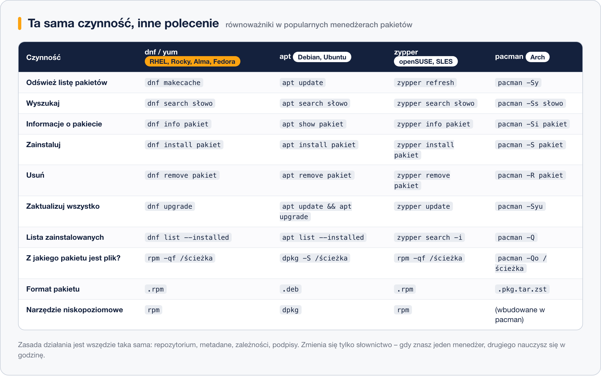

# Menedżery pakietów innych dystrybucji

> **W tej lekcji:** zobaczysz, jak to samo zadanie – instalacja i aktualizacja oprogramowania – wygląda poza rodziną Red Hat: w Debianie/Ubuntu (`apt`), openSUSE (`zypper`) i Arch Linuksie (`pacman`), oraz czym są pakiety uniwersalne Flatpak i Snap.

## Po co mi to?

Mało kto pracuje całe życie na jednej dystrybucji. W firmie serwery bywają na RHEL-u, maszyny deweloperów na Ubuntu, a kontenery na Debianie czy Alpine. Instrukcje w internecie też często zakładają `apt`. Dobra wiadomość: **zasada działania jest wszędzie identyczna** – pakiety, repozytoria, metadane, zależności, podpisy. Uczysz się jej raz (zrobiłeś to w [lekcji 1](1.%20Jak%20działa%20menedżer%20pakietów.md)), a potem tylko podmieniasz słownictwo.

## Jak to działa

### Dwie wielkie rodziny formatów

- **`.rpm`** – RHEL, Rocky, AlmaLinux, CentOS Stream, Fedora, openSUSE/SLES. Narzędzie niskopoziomowe: `rpm`; wysokopoziomowe: `dnf`/`yum` (Red Hat) albo `zypper` (SUSE).
- **`.deb`** – Debian, Ubuntu, Linux Mint. Narzędzie niskopoziomowe: `dpkg`; wysokopoziomowe: `apt`.

Para `dpkg`/`apt` odpowiada dokładnie parze `rpm`/`dnf`: `dpkg` instaluje pojedyncze pliki i odpowiada na pytania, `apt` zna repozytoria i zależności. Formaty są **niezgodne** – pakietu `.deb` nie zainstalujesz na Rocky i odwrotnie.

### apt (Debian, Ubuntu)

Największa praktyczna różnica wobec `dnf`: `apt` **nie odświeża metadanych sam**. Przed instalacją czy aktualizacją wykonuje się `apt update` (odpowiednik `dnf makecache` – tylko odświeża spis, niczego nie instaluje!), a dopiero potem `apt upgrade` albo `apt install`. Repozytoria są opisane w `/etc/apt/sources.list` i katalogu `/etc/apt/sources.list.d/`.

> **Na Ubuntu/Debianie:** `apt update` ≠ `dnf update`. W świecie apt „update” odświeża spis, a „upgrade” aktualizuje pakiety. W świecie dnf `update`/`upgrade` to synonimy i oba instalują aktualizacje.

### zypper (openSUSE, SUSE Linux Enterprise)

SUSE używa formatu `.rpm` (więc `rpm -qa` itd. działają tak samo jak u nas), ale wysokopoziomowym narzędziem jest `zypper`: `zypper refresh`, `zypper install`, `zypper update`. Składnia jest rozwlekła, ale czytelna; ma też skróty (`zypper in`, `zypper up`).

### pacman (Arch Linux)

Arch to dystrybucja typu *rolling release* – nie ma wydań, pakiety płyną ciągle. `pacman` używa jednoliterowych operacji: `-S` (zainstaluj/synchronizuj), `-R` (usuń), `-Ss` (szukaj), `-Syu` (odśwież wszystko i zaktualizuj), `-Q` (pytania o zainstalowane). Zwięzłe, ale trzeba uważać – znaczenie zmienia wielkość liter.

### Tabela równoważników



### Flatpak i Snap – pakiety uniwersalne

Obok klasycznych menedżerów wyrosły systemy **pakietów uniwersalnych**, działających na każdej dystrybucji:

- **Flatpak** – aplikacje graficzne (przeglądarki, komunikatory, edytory) z centralnego sklepu Flathub, uruchamiane w izolacji od systemu (ang. *sandbox*). W RHEL 9/10 dostępny z repozytoriów: `sudo dnf install flatpak`.
- **Snap** – odpowiednik rozwijany przez Canonical (Ubuntu), gdzie jest domyślny; obejmuje też aplikacje serwerowe. Na rodzinie RHEL używany rzadko (pakiet `snapd` jest w EPEL).

Pakiet uniwersalny nosi **własne kopie bibliotek**, więc jest duży, ale nie wchodzi w konflikt z systemem i bywa świeższy niż wersja z repozytorium dystrybucji. Na serwerach królują klasyczne pakiety; Flatpak/Snap spotkasz głównie na pulpitach.

```bash
# przykład: instalacja aplikacji z Flathuba na stacji roboczej
sudo dnf install flatpak
sudo flatpak remote-add --if-not-exists flathub https://flathub.org/repo/flathub.flatpakrepo
flatpak install flathub org.keepassxc.KeePassXC
```

## W praktyce

Typowa sesja na Ubuntu wygląda tak (porównaj z lekcją 2):

```bash
# 1. odśwież spis pakietów (bez tego apt widzi stare wersje)
sudo apt update

# 2. zainstaluj program
sudo apt install htop

# 3. zaktualizuj cały system
sudo apt upgrade

# 4. pytania, jak w rpm: skąd ten plik? co jest zainstalowane?
dpkg -S /etc/ssh/sshd_config
apt list --installed | grep ssh
```

```text
openssh-server: /etc/ssh/sshd_config
```

Zwróć uwagę na symetrię: `apt update` ↔ `dnf makecache`, `apt install` ↔ `dnf install`, `dpkg -S` ↔ `rpm -qf`, `apt autoremove` ↔ `dnf autoremove`.

## Najczęstsze błędy i pułapki

- **Wpisywanie `apt` na Rocky (albo `dnf` na Ubuntu).** Komunikat „command not found” to przypomnienie: najpierw sprawdź, na czym siedzisz – `cat /etc/os-release`.
- **Instrukcje z internetu dla niewłaściwej dystrybucji.** Nazwy pakietów się różnią (u nas `httpd`, na Debianie `apache2`). Przetłumacz polecenia zamiast kopiować w ciemno.
- **Zapominanie o `apt update` przed instalacją na Debianie/Ubuntu.** Objaw: „Unable to locate package” albo błędy 404 przy pobieraniu – spis jest przestarzały.
- **Mieszanie źródeł pakietów** (np. dodawanie repozytoriów Debiana na Ubuntu, instalowanie cudzych `.deb`/`.rpm`). Kończy się konfliktami wersji – o tym następna lekcja.

## Podsumowanie

- Dwie rodziny formatów: `.rpm` (`rpm` + `dnf`/`zypper`) i `.deb` (`dpkg` + `apt`); zasady działania identyczne.
- `apt update` tylko odświeża spis; aktualizację robi `apt upgrade`.
- `zypper` = `.rpm` w świecie SUSE; `pacman -Syu` = całość aktualizacji w Arch.
- Flatpak/Snap to pakiety uniwersalne z własnymi bibliotekami – głównie na pulpity.
- Ucz się pojęć, nie składni – składnię masz w tabeli.

| Czynność | dnf | apt | zypper | pacman |
|---|---|---|---|---|
| odśwież spis | `dnf makecache` | `apt update` | `zypper refresh` | `pacman -Sy` |
| szukaj | `dnf search X` | `apt search X` | `zypper search X` | `pacman -Ss X` |
| zainstaluj | `dnf install X` | `apt install X` | `zypper install X` | `pacman -S X` |
| usuń | `dnf remove X` | `apt remove X` | `zypper remove X` | `pacman -R X` |
| aktualizuj system | `dnf upgrade` | `apt update && apt upgrade` | `zypper update` | `pacman -Syu` |
| skąd ten plik? | `rpm -qf P` | `dpkg -S P` | `rpm -qf P` | `pacman -Qo P` |

## Zobacz też

- [1. Jak działa menedżer pakietów](1.%20Jak%20działa%20menedżer%20pakietów.md) – wspólne zasady.
- [5. DNF – następca YUM](5.%20DNF%20–%20następca%20YUM.md) – tabela yum ↔ dnf ↔ apt.
- [7. Piekło zależności](7.%20Piekło%20zależności.md) – czemu nie wolno mieszać światów.
