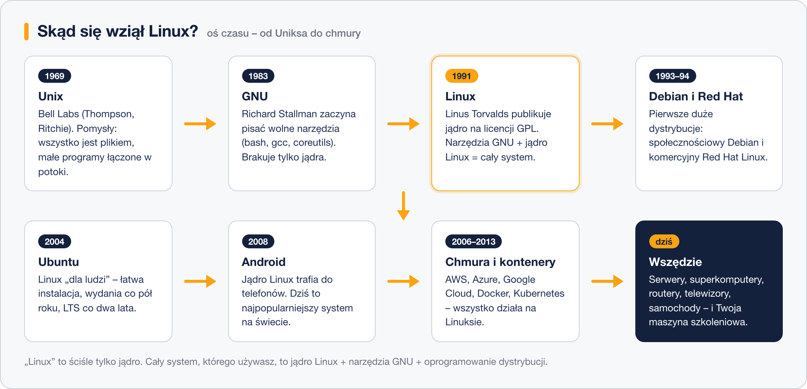
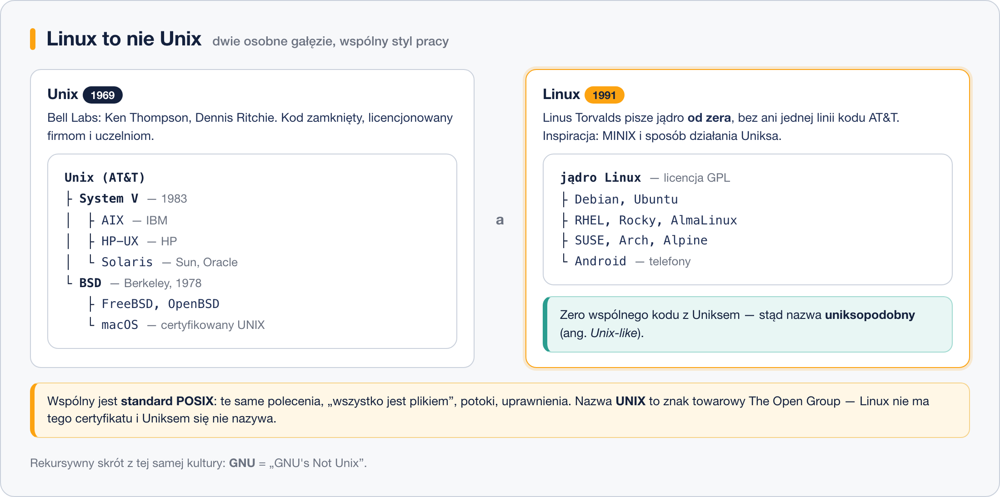
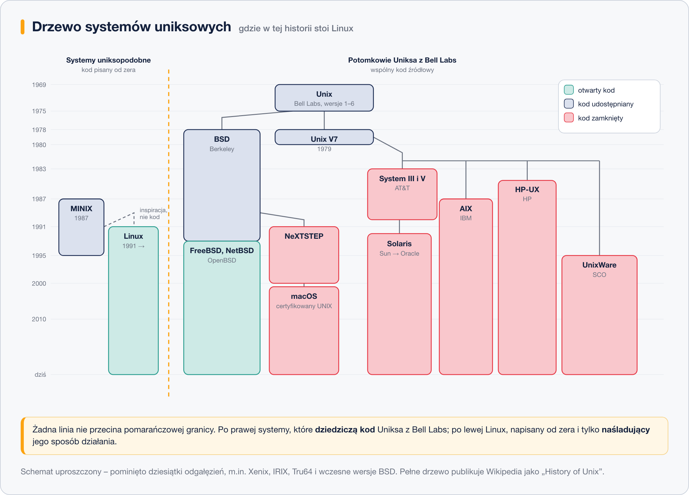

# Czym jest Linux i skąd się wziął

> **W tej lekcji:** dowiesz się, czym właściwie jest Linux, skąd się wziął i dlaczego spotkasz go niemal w każdej serwerowni – co oznaczają pojęcia „jądro”, „GNU” i „open source” oraz dlaczego Linux **nie jest** Uniksem, choć tak bardzo go przypomina.

Linux to system operacyjny, który obsługuje większość internetu: serwery WWW, bazy danych, chmurę publiczną, a nawet telefony z Androidem. W pracy administratora zetkniesz się z nim nawet wtedy, gdy na co dzień zarządzasz środowiskiem Windows – dlatego zanim zaczniesz wpisywać polecenia, warto wiedzieć, czym ten system jest i skąd się wziął.

## Jak to działa

**Linux** to rodzina systemów operacyjnych zbudowanych wokół wspólnego **jądra** (ang. *kernel*) o nazwie Linux. Jądro to serce systemu: zarządza procesorem, pamięcią, dyskami i siecią. Samo jądro to jednak za mało, żeby pracować – potrzebne są jeszcze powłoka, narzędzia, biblioteki i programy. Większość z nich pochodzi z projektu **GNU**, dlatego czasem spotkasz pełną nazwę „GNU/Linux”.

Linux jest **wolnym i otwartym oprogramowaniem** (ang. *open source*): jego kod źródłowy może czytać, zmieniać i rozpowszechniać każdy. Gwarantuje to licencja **GPL** (General Public License). Właśnie dzięki niej nad systemem pracują tysiące programistów i setki firm – w tym Red Hat, którego systemami zajmiemy się na tym szkoleniu.

Krótka historia, która tłumaczy dzisiejszy krajobraz:



- **1969 – Unix.** W Bell Labs powstaje system, z którego Linux czerpie pomysły: „wszystko jest plikiem”, małe programy łączone w potoki, wielu użytkowników naraz.
- **1983 – GNU.** Richard Stallman zaczyna budować wolny zamiennik Uniksa: powłokę, kompilator, podstawowe narzędzia. Brakuje tylko jądra.
- **1991 – Linux.** Linus Torvalds, student z Helsinek, publikuje własne jądro i udostępnia je na licencji GPL. Nazwa to połączenie imienia „Linus” i końcówki „-x” z Uniksa. Jądro Torvaldsa + narzędzia GNU = kompletny system.
- **Lata 90. – pierwsze dystrybucje.** Powstają Debian (projekt społecznościowy) i Red Hat Linux (firma komercyjna) – o dystrybucjach więcej w następnych lekcjach.
- **2004 – Ubuntu**, Linux „dla ludzi”, ułatwia start na komputerach biurkowych.
- **2008 – Android** przenosi jądro Linux do telefonów.
- **Dziś** Linux napędza zdecydowaną większość serwerów internetowych, wszystkie superkomputery z listy TOP500, chmurę (AWS, Azure, Google Cloud), kontenery, routery i telewizory.

### Linux to nie Unix

Tę pomyłkę słychać na każdym szkoleniu: „Linux to taki Unix”. Otóż nie. To **dwie zupełnie osobne gałęzie**, które tylko wyglądają i pracują podobnie.



**Unix** powstał w 1969 roku w Bell Labs (firma AT&T) jako oprogramowanie zamknięte i płatne. Z jego kodu wyrosły System V i BSD, a z nich komercyjne systemy: AIX (IBM), HP-UX, Solaris (Sun, później Oracle), a także macOS – tak, komputer Mac stoi bliżej Uniksa niż Linux.

**Linux** to jądro, które Linus Torvalds napisał **od zera** w 1991 roku, bez dostępu do kodu AT&T i bez ani jednej skopiowanej z niego linijki. Wzorował się na tym, **jak Unix działa** (korzystał wtedy z MINIX-a – uniksopodobnego systemu dydaktycznego Andrew Tanenbauma), ale nie na tym, **jak Unix jest napisany**. Gdyby było inaczej, Linux nie przetrwałby pierwszego procesu sądowego – spory o kod Uniksa potrafiły zatrzymać cały projekt na lata, co w latach 90. spotkało BSD.

Skoro kod jest inny, dlaczego wszystko wygląda tak samo? Bo wspólny jest **standard**, a nie kod:

- **POSIX** – zbiór zasad opisujących, jak system uniksowy ma się zachowywać: jak nazywają się polecenia, jak działa `fork()`, jak wyglądają uprawnienia do plików. Linux go realizuje, choć nie ma oficjalnego certyfikatu.
- **Filozofia Uniksa** – wszystko jest plikiem, każdy program robi jedną rzecz, programy łączy się w potoki, konfiguracja siedzi w plikach tekstowych.

Dlatego o Linuksie mówimy **uniksopodobny** (ang. *Unix-like*), a nie „Unix”. Zresztą samej nazwy **UNIX** nie wolno użyć ot tak – to znak towarowy organizacji The Open Group, a prawo do niego ma system, który przeszedł płatną certyfikację (AIX, HP-UX, Solaris, macOS). Żadna popularna dystrybucja Linuksa takiej certyfikacji nie ma, bo nikomu się to nie opłaca.

#### Jak czytać drzewo systemów uniksowych

Poniższy schemat pokazuje to samo w ujęciu historycznym – kto od kogo pochodzi przez pięćdziesiąt lat:



Czyta się go tak:

- **Pionowa oś to czas.** Lata biegną z góry na dół, od powstania Uniksa w 1969 roku po dziś. Wysokość prostokąta pokazuje, jak długo system żyje – prostokąty sięgające dołu to systemy nadal rozwijane.
- **Kolor to dostępność kodu.** Zielony – kod otwarty, każdy może go czytać i zmieniać. Niebieski – kod udostępniany wybranym (uczelniom, firmom) na licencji. Czerwony – kod zamknięty, produkt handlowy.
- **Linie to dziedziczenie kodu.** Z Uniksa Bell Labs wychodzą dwie wielkie gałęzie: **BSD** z uniwersytetu w Berkeley i **System III/V** z AT&T. Z BSD wyrosły dzisiejsze FreeBSD, NetBSD i OpenBSD oraz NeXTSTEP, z którego powstał **macOS**. Z System V – komercyjne uniksy: **AIX** (IBM), **HP-UX** (HP), **Solaris** (Sun, dziś Oracle) i UnixWare. Każda z tych linii oznacza realnie przekazany kod i licencję, za którą ktoś płacił.
- **Pomarańczowa granica oddziela Linuksa.** Po lewej stronie stoją MINIX i Linux – i **żadna ciągła linia jej nie przecina**. Przerywana strzałka od MINIX-a mówi tylko tyle, że Torvalds pracował na tym systemie i wzorował się na jego zachowaniu. Kod napisał własny.

Trzy wnioski, które warto z tego wynieść do pracy:

1. **Komercyjne uniksy wciąż żyją.** AIX, HP-UX i Solaris spotkasz w bankach, telekomach i u dużych ubezpieczycieli – zwykle pod bazami danych sprzed dwóch dekad.
2. **Mac na biurku jest bliżej Uniksa niż Linux.** macOS wywodzi się z BSD i ma certyfikat UNIX; Linux nie ma ani jednego, ani drugiego.
3. **Osobna gałąź okazała się przewagą.** Spory prawne o kod Uniksa w latach 90. zatrzymały rozwój BSD na kilka lat. Linux, który nie miał w sobie cudzego kodu, w tym samym czasie przejął serwerownie.

> **Ciekawostka:** cała ta rozdzielność ma własny żart. Skrót **GNU** rozwija się rekursywnie jako „GNU's Not Unix” – „GNU to nie Unix”. Pełne drzewo pokrewieństwa systemów uniksowych i miejsce Linuksa obok (a nie wewnątrz) niego znajdziesz na [schemacie historii Uniksa w Wikipedii](https://en.wikipedia.org/wiki/History_of_Unix#/media/File:Unix_history-simple.svg).

A maskotka? Pingwin **Tux**, narysowany w 1996 roku przez Larry'ego Ewinga w programie GIMP. To nieoficjalny, ale rozpoznawalny na całym świecie symbol systemu.

### Dlaczego administratorzy lubią Linuksa

- **Stabilność** – serwery pracują miesiącami bez restartu; restart jest potrzebny praktycznie tylko po aktualizacji jądra.
- **Bezpieczeństwo** – przemyślany system uprawnień i szybkie poprawki.
- **Brak opłat licencyjnych** – płaci się co najwyżej za wsparcie techniczne.
- **Automatyzacja** – wszystko da się zrobić poleceniem, więc i zapisać w skrypcie.
- **Przejrzystość** – otwarty kod oznacza, że można sprawdzić, jak system działa naprawdę.

## W praktyce

Na zainstalowanym systemie (zrobimy to w dalszych lekcjach) trzema poleceniami sprawdzisz, z czym masz do czynienia:

```bash
# jaka to dystrybucja i wersja
cat /etc/os-release
```

```text
NAME="Rocky Linux"
VERSION="9.4 (Blue Onyx)"
ID="rocky"
```

```bash
# jaka wersja jądra Linux jest uruchomiona
uname -r
```

```text
5.14.0-427.13.1.el9_4.x86_64
```

```bash
# pełne podsumowanie: nazwa komputera, system, jądro, architektura
hostnamectl
```

## Najczęstsze błędy i pułapki

- **„Linux” to nie jeden system.** Istnieją setki dystrybucji, które różnią się narzędziami i cyklem wydań. Instrukcja znaleziona w internecie dla Ubuntu nie zawsze zadziała na Rocky Linux.
- **Mylenie jądra z systemem.** Wersja jądra (np. 5.14) i wersja dystrybucji (np. Rocky 9.4) to dwie różne rzeczy – obie sprawdzisz poleceniami wyżej.
- **„Linux to Unix”.** Linux jest uniksopodobny: ten sam styl pracy i standard POSIX, ale inny kod, inna licencja i brak certyfikatu UNIX. Polecenia z podręcznika do Solarisa czy AIX-a często mają tu inne opcje – `man` na własnej maszynie jest ważniejszy niż cudza ściąga.
- **„Skoro darmowy, to gorszy”.** Jest odwrotnie: to właśnie na Linuksie działają banki, giełdy i chmura. Płatne bywa wsparcie, nie system.

## Podsumowanie

- Linux to rodzina systemów operacyjnych zbudowanych na wspólnym jądrze, rozwijana jako otwarte oprogramowanie na licencji GPL.
- Kompletny system = jądro Linux + narzędzia GNU + oprogramowanie dodane przez dystrybucję.
- Powstał w 1991 roku, a dziś dominuje na serwerach, w chmurze i w urządzeniach wbudowanych.
- Linux **nie wywodzi się** z Uniksa – został napisany od zera. Łączy je standard POSIX i filozofia, nie kod; stąd określenie „uniksopodobny”.
- Dla administratora liczą się: stabilność, bezpieczeństwo, automatyzacja i brak kosztów licencji.

| Polecenie | Co pokazuje |
|---|---|
| `cat /etc/os-release` | nazwę i wersję dystrybucji |
| `uname -r` | wersję jądra |
| `hostnamectl` | podsumowanie systemu i sprzętu |
