# Instalacja krok po kroku

> **W tej lekcji:** przejdziesz przez wszystkie ekrany instalatora Anaconda – od menu rozruchowego po pierwsze logowanie – i zainstalujesz AlmaLinux w wersji minimalnej, bez środowiska graficznego.

Instalacja to pierwsza rzecz, którą administrator robi z nowym serwerem, i moment, w którym podejmuje decyzje trudne do odwrócenia: układ dysku, hasła, to, kto może zarządzać systemem. Instalator **Anaconda** jest wspólny dla całej rodziny Red Hata – AlmaLinux, Rocky Linux, CentOS Stream i RHEL mają ten sam zestaw ekranów.

Zrzuty w tej lekcji pochodzą z prawdziwej instalacji **AlmaLinux 10.2** na maszynie wirtualnej i pokazują dokładnie ten wariant, który stawiamy na szkoleniu:

| Ustawienie | Wartość |
|---|---|
| Wersja oprogramowania | **Minimalna instalacja** – sam system, bez pulpitu graficznego |
| Partycjonowanie | **automatyczne** (domyślne) |
| Konto `root` | **włączone**, hasło `szkolenie` |
| Użytkownik | `szkolenie`, hasło `szkolenie` |
| Uprawnienia administracyjne użytkownika | **nie** – konto `szkolenie` celowo **nie trafia do grupy `wheel`** i nie może używać `sudo` |
| Sieć, strefa czasowa | domyślne (DHCP, Europa/Warszawa) |

> **Dlaczego użytkownik bez uprawnień administratora?** Chcemy, żeby uczestnik szkolenia na własne oczy zobaczył różnicę między zwykłym kontem a administratorem: co wolno, czego nie i jak system odmawia. Na produkcyjnym serwerze zwykle robi się odwrotnie – pierwszemu kontu daje się `sudo`, a konto `root` zostawia zablokowane.

## W praktyce

### Krok 1: menu rozruchowe

Po uruchomieniu maszyny z nośnika pojawia się menu GRUB-a. Domyślnie podświetlona jest pozycja *Test this media & install* – sprawdza ona nośnik przed instalacją (kilka minut). Strzałką w górę wybierz **Install AlmaLinux** i naciśnij Enter.

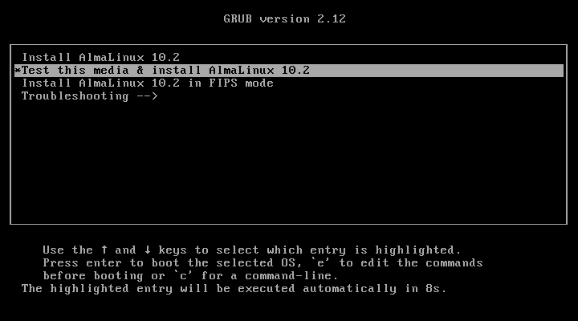

### Krok 2: język instalacji

Po chwili ładowania instalator pyta o język. Lista jest długa – najszybciej wpisać nazwę w pole wyszukiwania na dole. Wybieramy **Polski**, bo to język szkolenia; na serwerach produkcyjnych często zostawia się angielski, bo komunikaty błędów łatwiej wtedy wyszukać w internecie.

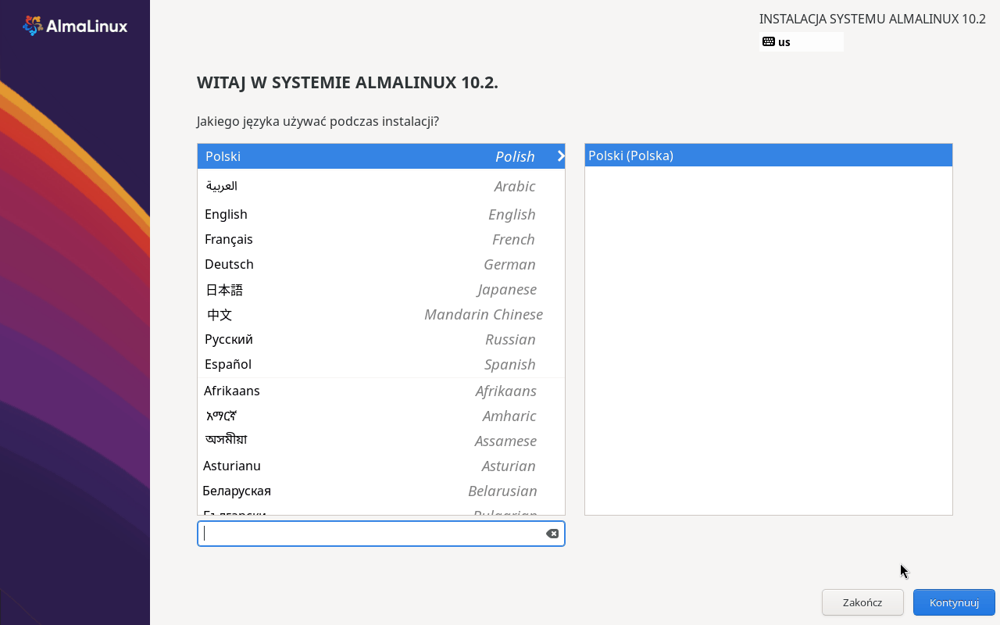

### Krok 3: podsumowanie instalacji

Anaconda nie prowadzi przez sztywną sekwencję ekranów. Pokazuje **podsumowanie**, z którego wchodzisz do poszczególnych sekcji w dowolnej kolejności i wracasz przyciskiem **Gotowe** w lewym górnym rogu.

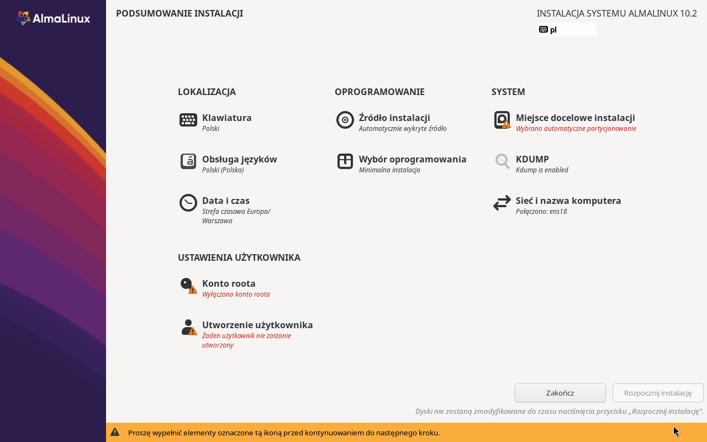

Pozycje z pomarańczowym wykrzyknikiem wymagają decyzji – dopóki ich nie uzupełnisz, przycisk **Rozpocznij instalację** pozostaje nieaktywny. Tutaj są to: miejsce docelowe instalacji, konto roota i utworzenie użytkownika. Reszta ma już sensowne wartości domyślne:

- **Klawiatura** i **Obsługa języków** – ustawione na podstawie kroku 2.
- **Data i czas** – strefa `Europa/Warszawa`, wykryta z wyboru języka.
- **Źródło instalacji** – wykryty nośnik, z którego wystartowaliśmy.
- **Sieć i nazwa komputera** – karta `ens18` dostała adres z DHCP; zostawiamy tak, jak jest.

### Krok 4: miejsce docelowe instalacji

Kliknij **Miejsce docelowe instalacji**. Instalator pokazuje wykryte dyski – nasza maszyna ma jeden, 32 GiB.

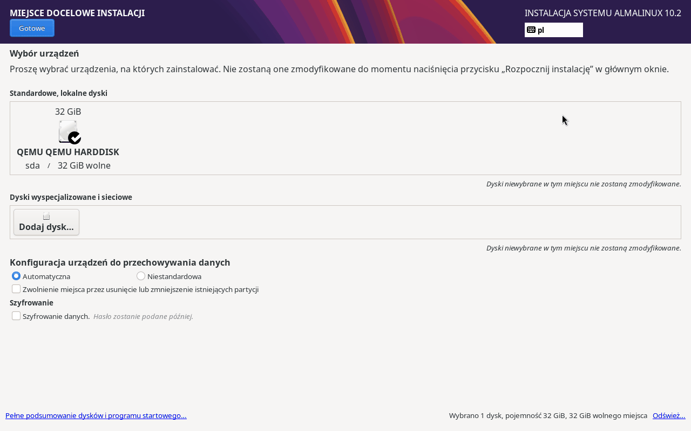

Dysk jest zaznaczony (ptaszek na ikonie), a konfiguracja ustawiona na **Automatyczna**. Dla maszyny szkoleniowej to właściwy wybór – wystarczy nacisnąć **Gotowe**. Instalator podzieli dysk sam, według stałego schematu:

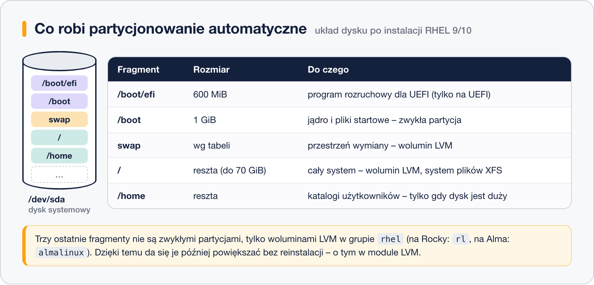

> **Uwaga:** ten ekran jest jedynym miejscem, gdzie decydujesz o losie danych na dysku. Przy automatycznym partycjonowaniu instalator wykorzysta wolne miejsce, a jeśli go brakuje – poprosi o zwolnienie, usuwając istniejące partycje. Na maszynie z danymi zawsze sprawdź dwa razy, który dysk jest zaznaczony.

### Krok 5: wybór oprogramowania

Kliknij **Wybór oprogramowania**. Po lewej wybiera się podstawowe środowisko, po prawej dodatki do niego.

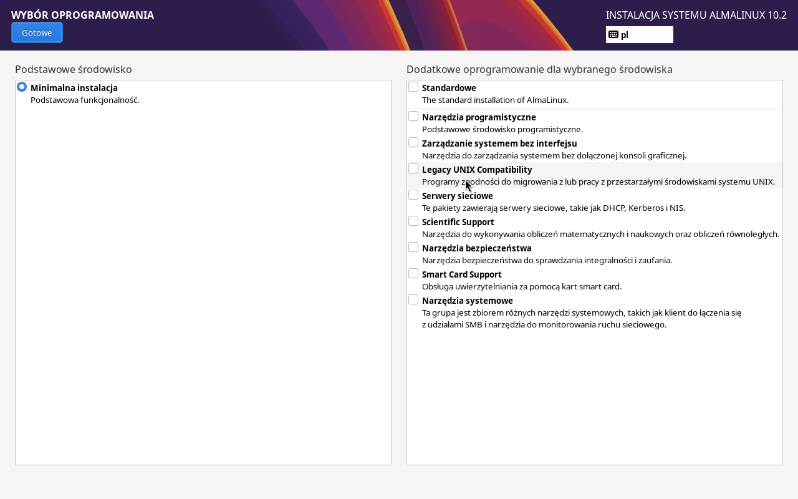

Zostawiamy **Minimalną instalację** bez żadnych dodatków. Dostajemy sam system: jądro, powłokę, menedżer pakietów, usługę SSH – i nic ponadto. Nie ma pulpitu graficznego, przeglądarki ani pakietu biurowego. Taki system startuje w kilkanaście sekund, zajmuje około 2 GB i ma mało elementów, które trzeba aktualizować i pilnować – dokładnie to, czego chce się na serwerze.

### Krok 6: konto roota

Domyślnie konto `root` jest **wyłączone**. Klikamy **Konto roota** i zaznaczamy **Włączone konto roota** – wtedy pojawiają się pola hasła.

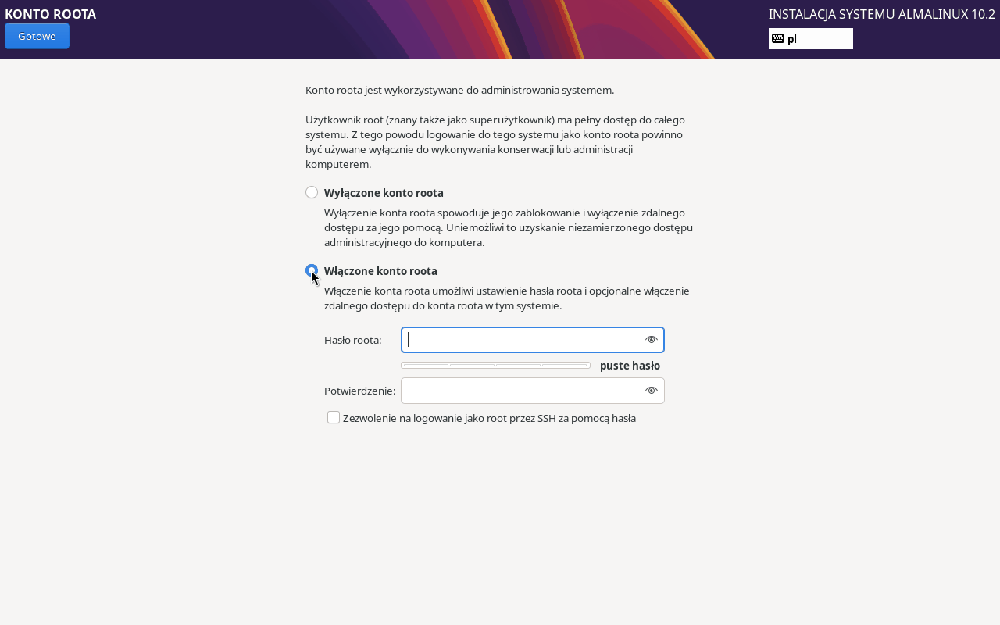

Wpisujemy hasło `szkolenie` w obu polach. Instalator ocenia jego siłę – słabe hasło przyjmie, ale trzeba wtedy nacisnąć **Gotowe** dwa razy.

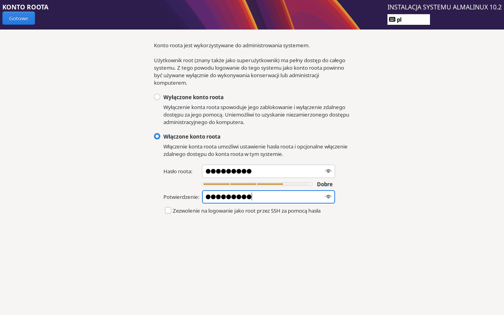

Pole **Zezwolenie na logowanie jako root przez SSH za pomocą hasła** zostawiamy niezaznaczone. Zdalne logowanie na roota hasłem to jedna z pierwszych rzeczy, których szukają automaty skanujące internet.

### Krok 7: utworzenie użytkownika – uwaga na uprawnienia

Klikamy **Utworzenie użytkownika**. Ekran otwiera się z **domyślnie zaznaczonym** polem „Dodanie uprawnień administracyjnych do tego konta użytkownika (członkostwo w grupie »wheel«)”:

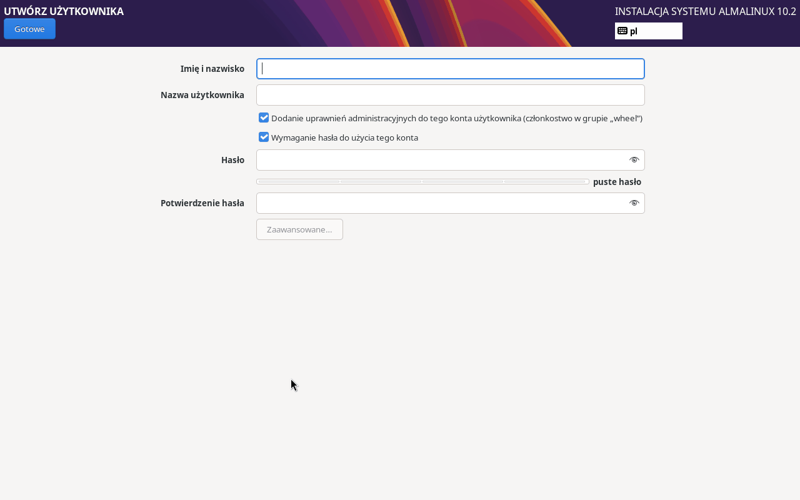

Wpisujemy `szkolenie` jako imię (nazwa użytkownika uzupełni się sama), hasło `szkolenie` w obu polach i — to najważniejszy moment tej instalacji — **odznaczamy pole uprawnień administracyjnych**:

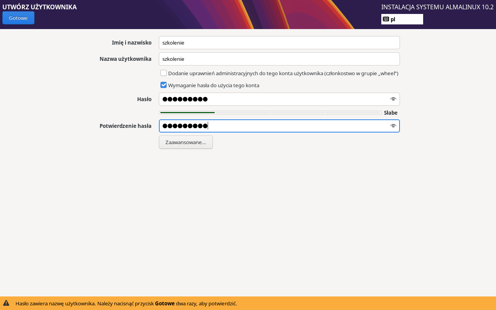

Odznaczony kwadracik oznacza, że konto `szkolenie` **nie trafi do grupy `wheel`**, a więc nie będzie mogło używać `sudo`. Każda czynność administracyjna będzie wymagała zalogowania się na `root`. Hasło jest słabe (zawiera nazwę użytkownika), więc instalator prosi o potwierdzenie – naciskamy **Gotowe** dwa razy.

### Krok 8: rozpoczęcie instalacji

Po powrocie do podsumowania wszystkie ostrzeżenia zniknęły, a przycisk **Rozpocznij instalację** jest aktywny:

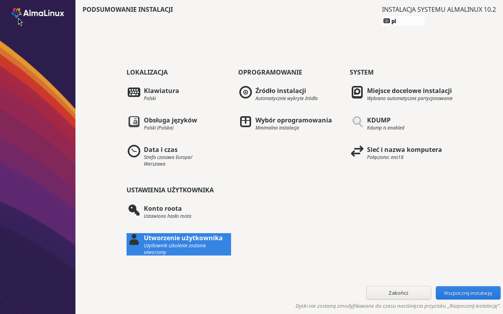

Do tej chwili na dysku nie zapisano ani jednego bajtu – dopiero ten przycisk uruchamia zmiany.

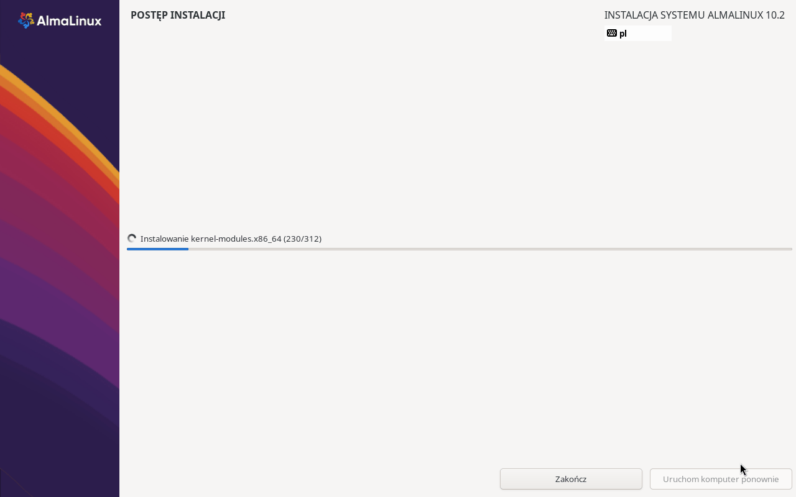

Instalacja minimalna to około 310 pakietów i kilka minut czekania.


Po komunikacie o zakończeniu klikamy **Uruchom komputer ponownie**. Zanim system wstanie, **odłącz nośnik instalacyjny** (w maszynie wirtualnej: wysuń obraz ISO z napędu), inaczej komputer znów wystartuje z instalatora.

### Krok 9: pierwsze logowanie

Po restarcie wita nas tekstowe zgłoszenie logowania – żadnego pulpitu, bo wybraliśmy instalację minimalną:

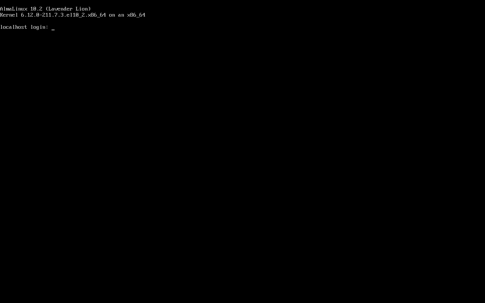

Logujemy się jako `szkolenie` z hasłem `szkolenie`. Hasło nie wyświetla się podczas pisania – nawet gwiazdkami. To normalne, pisz dalej i naciśnij Enter.

### Krok 10: sprawdzenie, kim jesteśmy

Polecenie `id` pokazuje, do jakich grup należy konto, a próba użycia `sudo` – jakie ma uprawnienia:

```bash
# kim jestem i w jakich jestem grupach
id
```

```text
uid=1000(szkolenie) gid=1000(szkolenie) groups=1000(szkolenie) context=unconfined_u:unconfined_r:unconfined_t:s0-s0:c0.c1023
```

```bash
# próba instalacji pakietu z uprawnieniami administratora
sudo dnf install nano
```

```text
[sudo] password for szkolenie:
szkolenie is not in the sudoers file.
```

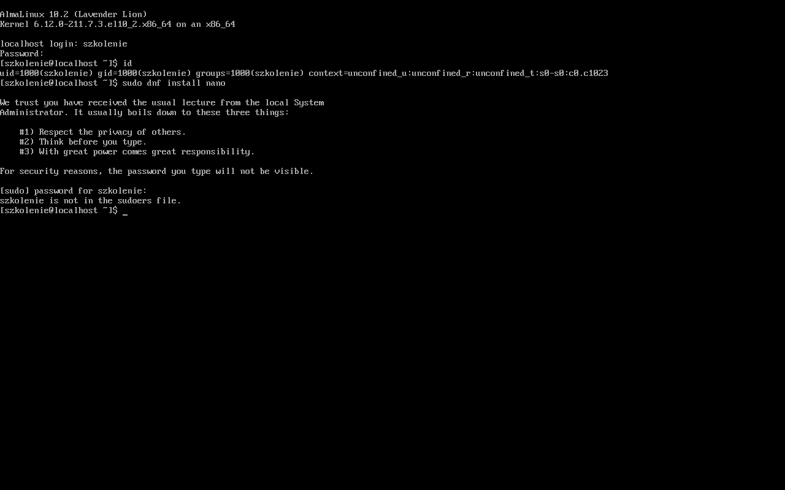

Na liście grup jest tylko `szkolenie` – **nie ma grupy `wheel`**, dokładnie tak, jak ustawiliśmy w kroku 7. Dlatego `sudo` odmawia: *szkolenie is not in the sudoers file*. Do zadań administracyjnych logujemy się na konto `root` (`exit`, a potem `root` i hasło `szkolenie`):

```bash
id
cat /etc/almalinux-release
systemctl get-default
```

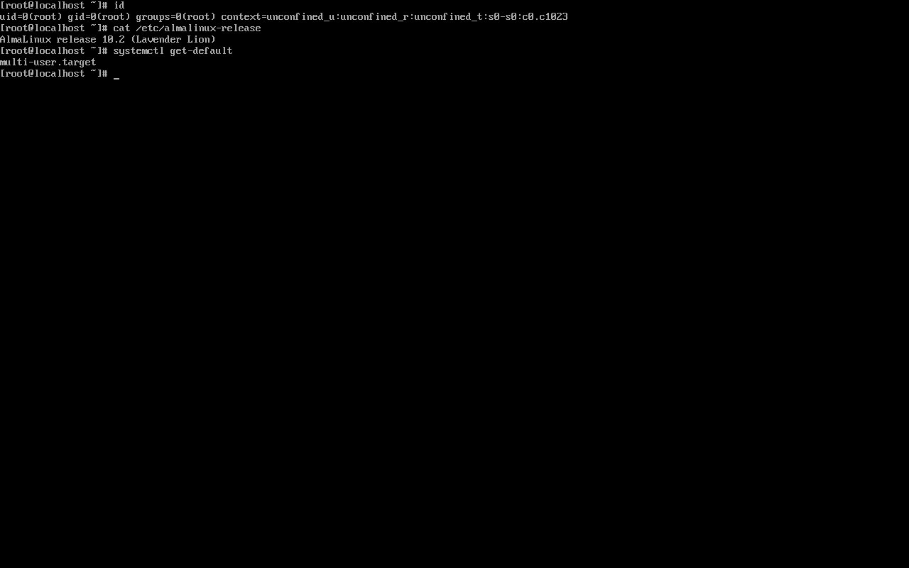

`uid=0(root)` to potwierdzenie pełnych uprawnień, a `multi-user.target` oznacza, że system startuje w trybie tekstowym, bez środowiska graficznego.

### Krok 11: pierwsze czynności w nowym systemie

Zalogowany jako `root`, wykonaj trzy rzeczy, od których zaczyna się każdy nowy serwer:

```bash
# 1. aktualizacja wszystkich pakietów do najnowszych wersji
dnf -y update
```

```bash
# 2. nadanie maszynie czytelnej nazwy (zamiast „localhost")
hostnamectl set-hostname serwer
```

```bash
# 3. sprawdzenie adresu IP, pod którym maszyna jest widoczna w sieci
ip -br a
```

```text
lo               UNKNOWN        127.0.0.1/8 ::1/128
ens18            UP             192.168.10.20/24 fe80::1c:aff:fe3d:1/64
```

Mając adres IP, dalszą pracę można prowadzić wygodnie przez SSH z własnego komputera, zamiast klikać w okno konsoli maszyny wirtualnej.

## Najczęstsze błędy i pułapki

- **Komputer po restarcie znów uruchamia instalator** – w napędzie został obraz ISO. Odłącz nośnik i uruchom maszynę ponownie.
- **Przycisk „Rozpocznij instalację" jest szary** – została sekcja z pomarańczowym wykrzyknikiem. Najczęściej to miejsce docelowe instalacji, do którego trzeba wejść i nacisnąć **Gotowe**, nawet nie zmieniając ustawień.
- **Hasło nie chce się zapisać** – przy słabym haśle instalator wymaga dwukrotnego naciśnięcia **Gotowe**. Pasek siły hasła i komunikat na dole ekranu mówią, o co chodzi.
- **Nie widać wpisywanego hasła przy logowaniu** – to zabezpieczenie, nie usterka. Terminal nie pokazuje nawet gwiazdek.
- **`sudo: command not found` albo odmowa dostępu** – konto nie ma uprawnień administratora. Zaloguj się na `root` lub dodaj konto do grupy `wheel` (`usermod -aG wheel szkolenie` jako `root`).
- **Instalacja minimalna nie ma wielu poleceń** – brakuje m.in. `nano`, `tar` czy `wget`. Doinstalujesz je jako `root`: `dnf install nano`.

## Podsumowanie

- Anaconda to wspólny instalator rodziny Red Hata; układ ekranów jest ten sam w AlmaLinux, Rocky Linux, CentOS Stream i RHEL.
- Podsumowanie instalacji to centrum sterowania – sekcje z wykrzyknikiem trzeba uzupełnić, reszta ma dobre wartości domyślne.
- **Minimalna instalacja** daje sam system bez pulpitu graficznego: szybki start, mało miejsca, mała powierzchnia ataku.
- Do dysku nie zapisuje się nic aż do naciśnięcia **Rozpocznij instalację**.
- Pole „uprawnienia administracyjne" przy tworzeniu użytkownika decyduje o członkostwie w grupie `wheel`, czyli o prawie do `sudo`. W naszej instalacji jest **odznaczone**.
- Po instalacji: zaktualizuj system, ustaw nazwę maszyny, sprawdź adres IP.

| Czynność | Polecenie |
|---|---|
| Sprawdzenie tożsamości i grup | `id` |
| Wersja systemu | `cat /etc/almalinux-release` |
| Tryb startu (graficzny/tekstowy) | `systemctl get-default` |
| Aktualizacja systemu | `dnf -y update` |
| Zmiana nazwy komputera | `hostnamectl set-hostname <nazwa>` |
| Adresy IP w skrócie | `ip -br a` |
