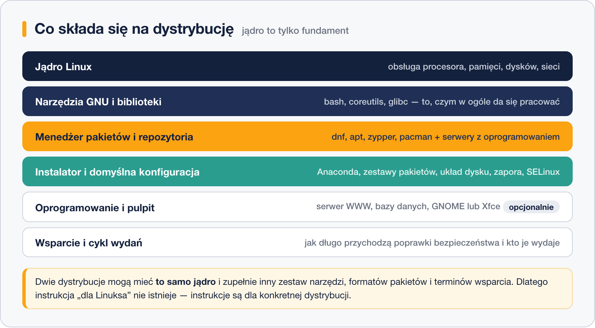

# Czym jest dystrybucja Linuksa

> **W tej lekcji:** zrozumiesz, czym jest dystrybucja, z jakich warstw się składa, czym jedna różni się od drugiej i dlaczego nie istnieje jedna uniwersalna „instrukcja dla Linuksa”.

Z poprzedniej lekcji wiesz już, że „Linux” to ściśle rzecz biorąc samo jądro. Jądra nikt jednak nie instaluje osobno – pobiera się **dystrybucję**: gotowy system, w którym ktoś już dobrał narzędzia, poukładał je w pakiety i wziął na siebie wydawanie poprawek. Nazw dystrybucji jest mnóstwo i to właśnie je spotkasz w ogłoszeniach o pracę, dokumentacji producentów i poradnikach w sieci.

## Jak to działa

**Dystrybucja** (ang. *distribution*, potocznie „distro”) to kompletny system operacyjny zbudowany wokół jądra Linux i wydawany przez jedną organizację – firmę albo społeczność. Składa się z kilku warstw, z których jądro jest tylko najniższą:



- **Jądro Linux** – to samo źródło dla wszystkich, choć każdy wydawca dokłada własne poprawki i decyduje, którą wersję zamrozić.
- **Narzędzia i biblioteki** – powłoka `bash`, zestaw `coreutils` (`ls`, `cp`, `rm`), biblioteka systemowa `glibc`. Bez nich jądro nie ma czym mówić do użytkownika.
- **Menedżer pakietów i repozytoria** – serce dystrybucji. **Pakiet** to spakowany program razem z informacją, czego potrzebuje do działania; **repozytorium** to serwer z tysiącami gotowych pakietów. To stąd bierze się oprogramowanie – nie ze stron producentów, jak w Windows.
- **Instalator i domyślna konfiguracja** – co zostanie zainstalowane, jak podzielony dysk, czy zapora i SELinux są włączone od pierwszego uruchomienia.
- **Oprogramowanie i pulpit** – serwerowy zestaw usług albo środowisko graficzne.
- **Wsparcie i cykl wydań** – jak długo przychodzą poprawki bezpieczeństwa i kto je wydaje. Dla serwera to często najważniejsza pozycja z całej listy; poświęcimy jej osobną lekcję.

### Czym dystrybucje się różnią

| Obszar | Na czym polega różnica |
|---|---|
| Format pakietów | `.rpm` (Red Hat, SUSE) albo `.deb` (Debian, Ubuntu) – pliki nie są wymienne |
| Menedżer pakietów | `dnf`, `apt`, `zypper`, `pacman`, `apk` – inne polecenia robiące to samo |
| Model wydań | wersje stabilne z długim wsparciem albo wydania ciągłe |
| Zestaw i wersje programów | dystrybucja serwerowa daje sprawdzone, starsze wersje; „świeża” – najnowsze |
| Domyślne zabezpieczenia | SELinux i `firewalld` w rodzinie Red Hat, AppArmor i `ufw` w rodzinie Debiana |
| Nazwy pakietów i ścieżki | ten sam serwer WWW to `httpd` w RHEL, a `apache2` w Ubuntu |
| Kto odpowiada | firma ze wsparciem płatnym albo społeczność i fora |

To, czego uczysz się na szkoleniu – uprawnienia, procesy, sieć, dyski, `systemd` – działa **tak samo wszędzie**. Różnice dotyczą głównie warstwy pakietów i domyślnych ustawień, dlatego przesiadka między dystrybucjami zajmuje dni, a nie miesiące.

### Kto buduje dystrybucje

- **Firmy** – Red Hat (RHEL), Canonical (Ubuntu), SUSE (SLES). Sprzedają subskrypcje: wsparcie techniczne, certyfikacje, gwarancję poprawek przez określony czas.
- **Społeczności** – Debian, Arch, Gentoo. Za darmo, bez umowy, z pomocą na listach dyskusyjnych i forach.
- **Pochodne** – dystrybucje zbudowane na innej dystrybucji. Ubuntu wyrosło z Debiana, Linux Mint z Ubuntu, Rocky Linux z RHEL. Pochodna dziedziczy format pakietów i większość poleceń, a zmienia wygląd, domyślne programy albo model wsparcia.

Dlatego dystrybucje grupuje się w **rodziny** – o nich w następnej lekcji.

## W praktyce

Na obcym serwerze pierwsze pytanie brzmi: „co to właściwie jest?”. Odpowiada jeden plik:

```bash
# wizytówka systemu – działa na każdej dystrybucji
cat /etc/os-release
```

```text
NAME="Rocky Linux"
VERSION="9.4 (Blue Onyx)"
ID="rocky"
ID_LIKE="rhel centos fedora"
VERSION_ID="9.4"
PLATFORM_ID="platform:el9"
```

- `ID` – identyfikator dystrybucji (`rocky`, `ubuntu`, `debian`, `almalinux`).
- `ID_LIKE` – **rodzina**, czyli z czym system jest zgodny. To pole mówi, które poradniki z internetu mają szansę zadziałać.
- `VERSION_ID` – wersja systemu; przyda się w następnych lekcjach.

Gdyby pliku zabrakło (bardzo stary system), rodzinę rozpozna menedżer pakietów:

```bash
# który menedżer pakietów jest w systemie
command -v dnf yum apt zypper pacman apk
```

```text
/usr/bin/dnf
/usr/bin/yum
```

`dnf` oznacza rodzinę Red Hat, `apt` – rodzinę Debiana, `zypper` – SUSE, `pacman` – Arch, `apk` – Alpine.

> **Na Ubuntu/Debianie:** `cat /etc/os-release` pokaże `ID=ubuntu` i `ID_LIKE=debian`, a pakiety instaluje `apt install` zamiast `dnf install`.

## Najczęstsze błędy i pułapki

- **Wklejanie poleceń z poradnika napisanego dla innej dystrybucji.** `apt install` na Rocky Linux nie zadziała, a pakiet `apache2` w ogóle tam nie istnieje. Zanim skopiujesz polecenie, sprawdź, dla jakiego systemu je napisano.
- **Pobieranie programów ze stron WWW jak w Windows.** W Linuksie standardem jest repozytorium: jedno polecenie instaluje program i wszystkie jego zależności, a późniejsze aktualizacje przychodzą same.
- **Mieszanie repozytoriów różnych dystrybucji.** Dodanie repozytorium Fedory do RHEL-a czy pakietu `.deb` z Ubuntu do Debiana potrafi rozsypać system na poziomie bibliotek. Pakiety są zgodne tylko w obrębie jednej wersji jednej dystrybucji.
- **„Linux to Ubuntu”.** Ubuntu jest popularne na komputerach i w poradnikach, ale w firmowej serwerowni równie często spotkasz RHEL-a, Rocky albo Debiana.
- **Szukanie „najlepszej dystrybucji”.** Takiej nie ma. Jest dystrybucja pasująca do zadania, do wymagań producenta oprogramowania i do tego, co utrzyma Twój zespół.

## Podsumowanie

- Dystrybucja = jądro + narzędzia + menedżer pakietów z repozytoriami + instalator + domyślna konfiguracja + wsparcie.
- Dystrybucje różnią się głównie formatem pakietów, modelem wydań, nazwami pakietów i domyślnymi zabezpieczeniami – nie samym Linuksem.
- Pochodne dziedziczą po swoim pierwowzorze, dlatego dystrybucje grupuje się w rodziny.
- `/etc/os-release` to wizytówka systemu: pola `ID` i `ID_LIKE` mówią, czym jest i do czego jest podobny.

| Polecenie | Co pokazuje |
|---|---|
| `cat /etc/os-release` | nazwę, wersję i rodzinę dystrybucji |
| `command -v dnf apt zypper pacman apk` | który menedżer pakietów jest w systemie |
