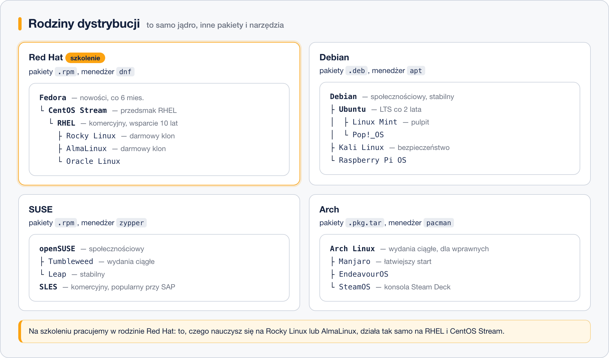
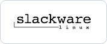

# Przegląd popularnych dystrybucji

> **W tej lekcji:** poznasz cztery główne rodziny dystrybucji i nazwy, które spotkasz w pracy – Debian, Ubuntu, RHEL, Rocky, AlmaLinux, Fedorę, SUSE, Arch, Gentoo, Alpine i kilka innych – oraz dowiesz się, do czego każda z nich się nadaje.

Dystrybucji są setki, ale w serwerowni, w chmurze i w dokumentacji producentów oprogramowania krąży kilkanaście nazw. Ta lekcja porządkuje je w rodziny i mówi wprost, czego się po każdej spodziewać. Nie musisz ich wszystkich znać – musisz wiedzieć, co zobaczysz, gdy zalogujesz się na cudzy serwer.

## Jak to działa

Dystrybucje dziedziczą po sobie, więc układają się w **rodziny**: wspólny format pakietów, te same polecenia, podobne ścieżki konfiguracji.



### Rodzina Debiana – pakiety `.deb`, menedżer `apt`

| | Dystrybucja | Czym jest |
|---|---|---|
|  | **[Debian](https://www.debian.org/)** | Najstarsza duża dystrybucja społecznościowa (1993). Znana z konserwatyzmu i stabilności: wersje programów są sprawdzone, czasem wiekowe. Bardzo często na serwerach i jako baza obrazów kontenerowych. |
|  | **[Ubuntu](https://ubuntu.com/)** | Pochodna Debiana firmy Canonical, dziś najpopularniejszy Linux na komputerach osobistych i jeden z domyślnych wyborów w chmurze. Wydania co pół roku, co dwa lata wersja LTS. Ogromna liczba poradników – stąd wrażenie, że „Linux to Ubuntu”. |
|  | **[Linux Mint](https://linuxmint.com/)** | Pochodna Ubuntu nastawiona na wygodę na komputerze biurkowym; częsty wybór osób przesiadających się z Windows. |
|  | **[Kali Linux](https://www.kali.org/)** | Debian z kompletem narzędzi do testów bezpieczeństwa. Narzędzie do pracy, nie system na co dzień. |
|  | **[Raspberry Pi OS](https://www.raspberrypi.com/software/)** | Debian przygotowany pod komputery Raspberry Pi. |

### Rodzina Red Hat – pakiety `.rpm`, menedżer `dnf`

| | Dystrybucja | Czym jest |
|---|---|---|
|  | **[RHEL](https://www.redhat.com/en/technologies/linux-platforms/enterprise-linux)** | Red Hat Enterprise Linux – komercyjny standard korporacyjny: subskrypcja, wsparcie producenta, dziesięć lat aktualizacji. |
|  | **[Rocky Linux](https://rockylinux.org/)** | Darmowy odpowiednik RHEL-a, zgodny z nim na poziomie pakietów. Na nim pracujemy na szkoleniu. |
|  | **[AlmaLinux](https://almalinux.org/)** | Drugi darmowy odpowiednik RHEL-a, rozwijany przez niezależną fundację. |
|  | **[Fedora](https://fedoraproject.org/)** | Poligon nowości Red Hata, wydanie co pół roku. |
|  | **[CentOS Stream](https://www.centos.org/centos-stream/)** | Wersja rozwojowa, z której powstaje kolejne wydanie RHEL. Nie mylić z zakończonym CentOS-em 7. |

Do rodziny należy też **[Oracle Linux](https://www.oracle.com/linux/)** – wariant RHEL utrzymywany przez Oracle, spotykany przy bazach danych tej firmy. Całej rodzinie poświęcamy osobną lekcję, bo to ona jest systemem referencyjnym szkolenia.

### Rodzina SUSE – pakiety `.rpm`, menedżer `zypper`

| | Dystrybucja | Czym jest |
|---|---|---|
|  | **[SLES](https://www.suse.com/products/server/)** | SUSE Linux Enterprise Server – komercyjny odpowiednik RHEL-a, bardzo mocna pozycja w Europie i w środowiskach SAP. |
|  | **[openSUSE](https://www.opensuse.org/)** | Darmowa odmiana społecznościowa: Leap (wydania stabilne) i Tumbleweed (wydania ciągłe). |

Znak rozpoznawczy tej rodziny to narzędzie administracyjne **YaST**, które wiele rzeczy pozwala wyklikać.

### Dystrybucje niezależne

| | Dystrybucja | Czym jest |
|---|---|---|
|  | **[Arch Linux](https://archlinux.org/)** | Wydania ciągłe, instalacja od zera, pakiety przez `pacman` i repozytorium społecznościowe AUR. Pełna kontrola i najnowsze oprogramowanie kosztem czasu administratora. Znana z doskonałej dokumentacji – [ArchWiki](https://wiki.archlinux.org/) przydaje się także na innych dystrybucjach. |
|  | **[Manjaro](https://manjaro.org/)** | Arch z instalatorem i opóźnionymi aktualizacjami – łatwiejszy start. Z tej samej rodziny wywodzą się EndeavourOS i SteamOS (konsola Steam Deck). |
|  | **[Gentoo](https://www.gentoo.org/)** | Wszystko kompilowane ze źródeł menedżerem `portage`, pod konkretny procesor i z wybranymi funkcjami. System do nauki wnętrza Linuksa; instalacja potrafi zająć cały dzień. |
|  | **[Alpine Linux](https://alpinelinux.org/)** | Minimalistyczna dystrybucja (obraz bazowy liczy kilka megabajtów) oparta na bibliotece `musl` i `busybox` zamiast GNU, z menedżerem `apk`. Król kontenerów: jeśli obraz w Dockerze ma „-alpine” w nazwie, to właśnie ona. |
|  | **[NixOS](https://nixos.org/)** | Cały system opisany jednym plikiem konfiguracyjnym, z możliwością cofnięcia każdej zmiany. Ciekawostka, która powoli wchodzi do firm. |
|  | **[Slackware](http://www.slackware.com/)** | Najstarsza wciąż rozwijana dystrybucja (1993), dziś niszowa. |

Osobną grupą są systemy **wyspecjalizowane**, zbudowane na Debianie lub RHEL-u, ale obsługiwane przez własny panel: [Proxmox VE](https://www.proxmox.com/en/proxmox-virtual-environment/overview) (wirtualizacja), [TrueNAS](https://www.truenas.com/) (macierze dyskowe), [OpenWrt](https://openwrt.org/) (routery), [Android](https://www.android.com/) (telefony).

*Logotypy są znakami towarowymi swoich właścicieli i służą tu wyłącznie do rozpoznania dystrybucji.*

### Ściąga

| Dystrybucja | Rodzina / pakiety | Model wydań | Typowe zastosowanie |
|---|---|---|---|
| RHEL, Rocky, AlmaLinux | Red Hat / `.rpm` | stabilny, 10 lat | serwery firmowe |
| Fedora | Red Hat / `.rpm` | co 6 miesięcy | komputer entuzjasty, testy nowości |
| Debian | Debian / `.deb` | stabilny, ok. 5 lat | serwery, kontenery |
| Ubuntu LTS | Debian / `.deb` | LTS co 2 lata, 5 lat | serwery, chmura, komputery |
| Linux Mint | Debian / `.deb` | za Ubuntu LTS | komputer osobisty |
| SLES, openSUSE Leap | SUSE / `.rpm` | stabilny | serwery, SAP |
| Arch, Manjaro | Arch / `.pkg.tar` | ciągły | komputer wprawnego użytkownika |
| Gentoo | niezależna / źródła | ciągły | nauka, nietypowe wdrożenia |
| Alpine | niezależna / `.apk` | co 6 miesięcy | kontenery, systemy wbudowane |
| Kali | Debian / `.deb` | ciągły | testy bezpieczeństwa |

## W praktyce

Nazwy dystrybucji poznasz najszybciej, oglądając, co jest w publicznych repozytoriach obrazów. Na maszynie szkoleniowej sprawdzisz natomiast, w której rodzinie jesteś:

```bash
# nazwa, wersja i rodzina systemu
cat /etc/os-release | grep -E '^(NAME|VERSION|ID|ID_LIKE)='
```

```text
NAME="Rocky Linux"
VERSION="9.4 (Blue Onyx)"
ID="rocky"
ID_LIKE="rhel centos fedora"
```

```bash
# ile pakietów zainstalowała dystrybucja (rodzina Red Hat)
rpm -qa | wc -l
```

```text
612
```

Dla porównania: instalacja minimalna Alpine to kilkadziesiąt pakietów, a Ubuntu Desktop – ponad dwa tysiące.

## Najczęstsze błędy i pułapki

- **Ranking z DistroWatch brany za statystykę.** Ta strona liczy odwiedziny swoich podstron, a nie instalacje. Na serwerach królują Debian, Ubuntu i rodzina RHEL, choć w rankingu bywają niżej.
- **Arch albo Gentoo na serwerze produkcyjnym.** Wydania ciągłe wymagają stałej uwagi administratora; serwer ma działać, a nie być hobby.
- **Alpine wybrane „bo lekkie” do zwykłych zastosowań.** Biblioteka `musl` zamiast `glibc` potrafi zmienić zachowanie gotowego oprogramowania – świetna do kontenerów, kłopotliwa na serwerze z komercyjną aplikacją.
- **Kali Linux jako system codzienny.** Domyślnie pracuje się tam z dużymi uprawnieniami, a zestaw narzędzi jest nastawiony na testy, nie na utrzymanie usług.
- **Wybór dystrybucji wbrew producentowi oprogramowania.** Jeśli dostawca systemu ERP wspiera wyłącznie RHEL 9, to Debian jest złym wyborem, choćby zespół go lubił.

## Podsumowanie

- Cztery główne rodziny: Red Hat (`dnf`, `.rpm`), Debian (`apt`, `.deb`), SUSE (`zypper`, `.rpm`), Arch (`pacman`, wydania ciągłe).
- Na serwerach najczęściej spotkasz RHEL i jego odpowiedniki, Debiana i Ubuntu LTS; w kontenerach – Alpine i Debiana.
- Arch i Gentoo to systemy dla wprawnych użytkowników komputerów osobistych, nie dla serwerowni.
- Dystrybucję dobiera się do zadania i do wymagań producenta oprogramowania, nie do rankingu popularności.
