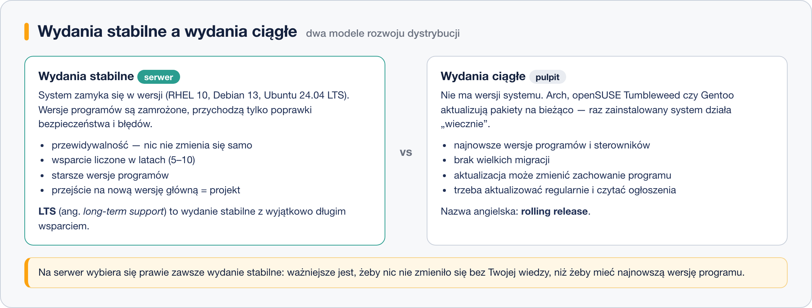
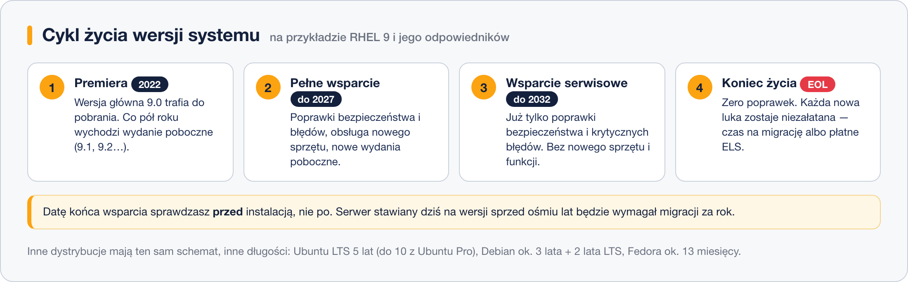

# Model wydań i cykl życia dystrybucji

> **W tej lekcji:** nauczysz się czytać numery wersji systemu, odróżnisz wydanie stabilne od ciągłego, zrozumiesz, co znaczą skróty LTS, EUS, ELS i EOL, i sprawdzisz, jak długo Twój serwer będzie jeszcze dostawał poprawki bezpieczeństwa.

Wybór dystrybucji to dopiero połowa decyzji. Druga połowa brzmi: **którą wersję** i **jak długo będzie wspierana**. Od tego zależy, czy za trzy lata będziesz spokojnie instalował poprawki, czy tłumaczył zarządowi, dlaczego trzeba przerwać pracę i migrować cały system.

## Jak to działa

### Dwa modele wydań



**Wydania stabilne** (ang. *point release*) to świat serwerów. System zamyka się w wersji – RHEL 10, Debian 13, Ubuntu 24.04 LTS – a wersje programów w niej zostają **zamrożone**. Przez lata przychodzą tylko poprawki bezpieczeństwa i błędów. Serwer zachowuje się dziś tak samo jak rok temu, a to dla usługi produkcyjnej ważniejsze niż najnowsza wersja biblioteki.

**Wydania ciągłe** (ang. *rolling release*) nie mają wersji systemu. Arch Linux, openSUSE Tumbleweed czy Gentoo aktualizują pojedyncze pakiety na bieżąco; raz zainstalowany system teoretycznie nigdy się nie „kończy”. Dostajesz najnowsze oprogramowanie i sterowniki, ale aktualizacja potrafi zmienić zachowanie programu – i nigdy nie wiesz, którego dnia.

### Co znaczy LTS

**LTS** (ang. *long-term support* – długoterminowe wsparcie) to wydanie stabilne, któremu producent obiecał wyjątkowo długie utrzymanie. Przykłady:

| Dystrybucja | Co ile nowa wersja | Jak długo wsparcie |
|---|---|---|
| RHEL, Rocky Linux, AlmaLinux | ok. 3 lata | **10 lat** (5 lat pełnego + 5 lat serwisowego) |
| Ubuntu LTS | 2 lata (kwiecień co parzysty rok) | 5 lat, do 10 z płatnym Ubuntu Pro |
| Ubuntu – wydanie pośrednie | 6 miesięcy | 9 miesięcy |
| Debian stable | ok. 2 lata | ok. 3 lata + 2 lata Debian LTS |
| SLES | ok. 4 lata | 10 lat + 3 lata wsparcia rozszerzonego |
| Fedora | 6 miesięcy | ok. 13 miesięcy |

Uwaga na pułapkę językową: w świecie jąder Linuksa „LTS” znaczy coś innego – to wybrana wersja jądra utrzymywana przez kilka lat przez zespół kernel.org. Dystrybucja zwykle i tak używa własnej, osobno łatanej wersji.

### Jak czytać numer wersji

- **RHEL i odpowiedniki: `główna.poboczna`** – np. `9.4`. Wersja główna (9, 10) to osobny system: inne jądro, inne wersje bibliotek, osobne repozytoria. Wersja poboczna wychodzi co pół roku i jest zwykłym zestawem aktualizacji – z 9.0 dochodzisz do 9.4 samym `dnf update`, bez przeinstalowania.
- **Ubuntu: `rok.miesiąc`** – `24.04` to kwiecień 2024, `25.10` to październik 2025. Każde wydanie ma też nazwę kodową (Noble Numbat), używaną w nazwach repozytoriów.
- **Debian: kolejny numer + nazwa kodowa** z bajki *Toy Story* – Debian 12 „Bookworm”, Debian 13 „Trixie”.
- **Fedora: kolejny numer** – 41, 42, 43…

### Wersja jądra to osobna historia

`uname -r` na RHEL 9 pokaże jądro `5.14` – wersję z 2021 roku. To **nie znaczy**, że system jest dziurawy. Dystrybucje korporacyjne stosują **backporty**: biorą poprawkę z najnowszego jądra i wszczepiają ją do swojej zamrożonej wersji, zachowując zgodność ze sterownikami i oprogramowaniem. Numer wersji zostaje stary, luka zostaje załatana – stąd długie przyrostki w rodzaju `5.14.0-427.13.1.el9_4`.

### Cykl życia wersji



Każda wersja stabilna przechodzi te same fazy:

1. **Premiera (GA)** – wersja trafia do pobrania.
2. **Pełne wsparcie** – poprawki bezpieczeństwa i błędów, obsługa nowego sprzętu, nowe wydania poboczne. W RHEL trwa około 5 lat.
3. **Wsparcie serwisowe** – tylko poprawki bezpieczeństwa i krytycznych błędów. Kolejne 5 lat.
4. **EOL** (ang. *end of life* – koniec życia) – poprawek nie ma wcale. System działa, ale każda nowa luka zostaje w nim na zawsze.

Dochodzą do tego dwa płatne dodatki Red Hata, które warto kojarzyć ze skrótu: **EUS** (*Extended Update Support*) przedłuża życie **wydania pobocznego**, gdy aplikacja wymaga dokładnie wersji 9.2; **ELS** (*Extended Life Cycle Support*) sprzedaje poprawki bezpieczeństwa jeszcze po EOL, gdy migracja nie zdążyła się odbyć.

Konkretne daty dla systemów, które spotkasz najczęściej:

| Wersja | Premiera | Koniec wsparcia |
|---|---|---|
| RHEL 8 i odpowiedniki | 2019 | maj 2029 |
| RHEL 9 i odpowiedniki | 2022 | maj 2032 |
| RHEL 10 i odpowiedniki | 2025 | maj 2035 |
| CentOS 7 | 2014 | **czerwiec 2024 – już po EOL** |
| Ubuntu 24.04 LTS | 2024 | 2029 (2034 z Ubuntu Pro) |

## W praktyce

```bash
# którą wersję systemu mam i czy to wersja główna, czy poboczna
cat /etc/os-release | grep VERSION
```

```text
VERSION="9.4 (Blue Onyx)"
VERSION_ID="9.4"
```

```bash
# wersja jądra wraz ze znacznikiem dystrybucji (el9 = Enterprise Linux 9)
uname -r
```

```text
5.14.0-427.13.1.el9_4.x86_64
```

```bash
# czy czekają aktualizacje bezpieczeństwa
sudo dnf updateinfo list security
```

```text
RHSA-2026:1234  Important/Sec.  openssl-3.0.7-27.el9.x86_64
```

Daty końca wsparcia sprawdzasz u producenta – Red Hat publikuje je na stronie polityki cyklu życia, Canonical i Debian na swoich wiki. Zbiorcze zestawienie dla wszystkich dystrybucji znajdziesz na [endoflife.date](https://endoflife.date/).

> **Na Ubuntu/Debianie:** aktualizacje bezpieczeństwa pokaże `apt list --upgradable`, a stan wsparcia – `pro security-status` (Ubuntu 20.04 i nowsze).

## Najczęstsze błędy i pułapki

- **Instalacja wersji, która zaraz kończy życie.** Nowy serwer na RHEL 8 w 2026 roku to trzy lata spokoju i migracja. Datę EOL sprawdza się **przed** instalacją.
- **„Stare jądro = dziurawy system”.** Audytor patrzy na numer `5.14` i zgłasza lukę sprzed lat. Odpowiedzią są backporty – liczy się pełny numer wydania pakietu, nie sama wersja jądra.
- **Mylenie wersji pobocznej z główną.** Przejście 9.3 → 9.4 to zwykła aktualizacja. Przejście 9 → 10 to migracja: osobne repozytoria, narzędzie `leapp`, test na kopii i okno serwisowe.
- **Wydanie ciągłe na serwerze.** Arch na maszynie produkcyjnej oznacza, że aktualizacja w piątek po południu może zmienić wersję bazy danych.
- **„LTS to wieczne wsparcie”.** LTS też się kończy – pięć czy dziesięć lat mija szybciej, niż się wydaje, a po tej dacie poprawek nie ma.

## Podsumowanie

- Wydania stabilne (RHEL, Debian, Ubuntu LTS) zamrażają wersje programów i dają lata poprawek – to wybór na serwer. Wydania ciągłe (Arch, Tumbleweed, Gentoo) dają świeże oprogramowanie kosztem przewidywalności.
- LTS to wydanie stabilne z długim wsparciem; w RHEL standardem jest 10 lat, w Ubuntu LTS 5 lat.
- Wersja główna to osobny system, wersja poboczna to zestaw aktualizacji w jego obrębie.
- Cykl życia: premiera → pełne wsparcie → wsparcie serwisowe → EOL. Po EOL system przestaje dostawać poprawki bezpieczeństwa.
- Stary numer jądra nie oznacza starych luk – dystrybucje korporacyjne stosują backporty.

| Polecenie | Co pokazuje |
|---|---|
| `cat /etc/os-release` | wersję systemu (`VERSION_ID`) |
| `uname -r` | wersję jądra ze znacznikiem `el9` / `el10` |
| `sudo dnf updateinfo list security` | czekające aktualizacje bezpieczeństwa |
