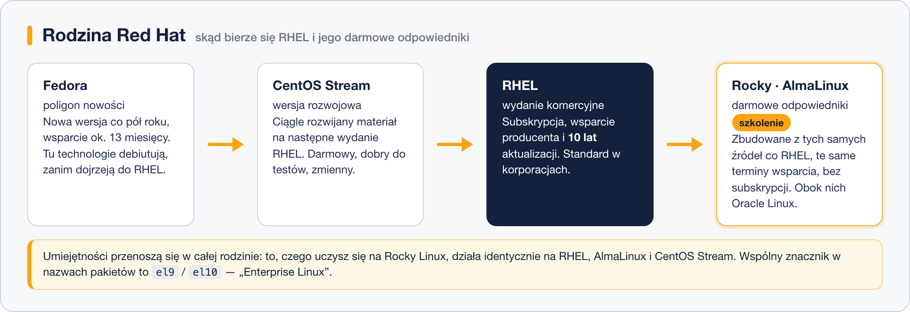

# Rodzina Red Hat

> **W tej lekcji:** dowiesz się, czym różnią się RHEL, CentOS Stream, Fedora, Rocky Linux, AlmaLinux i Oracle Linux, dlaczego na szkoleniu pracujemy akurat w tej rodzinie i co wybrać na serwer firmowy.

Rodzina Red Hat to standard korporacyjnej serwerowni: pakiety `.rpm`, menedżer `dnf`, SELinux i `firewalld` włączone od pierwszego uruchomienia, długie wsparcie. Nazwy wewnątrz tej rodziny bywają mylące – „RHEL”, „CentOS”, „Stream”, „Rocky” – a różnice między nimi mają realne skutki: licencyjne, finansowe i serwisowe. Ta lekcja je porządkuje.

## Jak to działa

Wszystkie systemy tej rodziny wywodzą się z jednego kodu, ale wchodzą do niego na różnych etapach dojrzałości:



- **Fedora** – poligon nowości. Nowa wersja co pół roku, wsparcie około 13 miesięcy. Tu debiutują technologie, które za kilka lat trafią do RHEL (tak weszły `systemd`, `dnf` czy Wayland). Dobra na komputer entuzjasty i do testowania przyszłości, nie na serwer produkcyjny.
- **CentOS Stream** – wersja rozwojowa RHEL-a. Zmiany trafiają tu, zanim ukaże się kolejne wydanie poboczne RHEL. Darmowy, przydatny do sprawdzenia, czy Twoja aplikacja zadziała na następnej wersji; w produkcji unikany, bo zmienia się częściej niż RHEL.
- **RHEL (Red Hat Enterprise Linux)** – wydanie komercyjne. Subskrypcja daje wsparcie producenta, certyfikacje sprzętu i oprogramowania oraz **10 lat aktualizacji** dla każdej wersji głównej. To ten system wskazują w wymaganiach dostawcy ERP, baz danych i oprogramowania przemysłowego. Jest też bezpłatna subskrypcja deweloperska, obejmująca niewielką liczbę maszyn do zastosowań niekomercyjnych.
- **Rocky Linux** i **AlmaLinux** – darmowe odpowiedniki RHEL-a, budowane z tych samych źródeł przez niezależne organizacje. Powstały w 2021 roku, gdy Red Hat zakończył klasyczny CentOS. Zgodne z RHEL na poziomie pakietów: co działa na RHEL, działa i tu – bez subskrypcji i bez wsparcia producenta. Na nich stoi maszyna szkoleniowa.
- **Oracle Linux** – wariant RHEL utrzymywany przez Oracle, spotykany głównie tam, gdzie działają bazy danych tej firmy.

### Co wybrać na serwer

| Sytuacja | Dobry wybór |
|---|---|
| Firma wymaga wsparcia producenta, certyfikacji, gwarancji SLA | RHEL |
| Serwer firmowy bez budżetu na subskrypcje | Rocky Linux lub AlmaLinux |
| Sprawdzenie, czy aplikacja przeżyje następne wydanie RHEL | CentOS Stream |
| Komputer do nauki i eksperymentów | Fedora |
| Baza danych Oracle z wymaganiami producenta | Oracle Linux |

Decyzja jest mniej dramatyczna, niż się wydaje: administracja wygląda identycznie we wszystkich tych systemach. Migracja z Rocky na RHEL (albo odwrotnie) to zmiana repozytoriów, nie przeinstalowanie serwera.

### Dlaczego ta rodzina na szkoleniu

Bo to ona dominuje w polskich serwerowniach korporacyjnych, a umiejętności przenoszą się w jej obrębie w całości. Wszystko, czego nauczysz się na Rocky Linux – `dnf`, SELinux, `firewalld`, `systemd`, LVM – zadziała tak samo na RHEL, AlmaLinux, CentOS Stream i Oracle Linux.

## W praktyce

```bash
# krótka informacja o systemie – tylko w rodzinie Red Hat
cat /etc/redhat-release
```

```text
Rocky Linux release 9.4 (Blue Onyx)
```

```bash
# pełna wizytówka – działa wszędzie
cat /etc/os-release
```

W wyniku zwróć uwagę na pole `ID` (`rocky`, `almalinux`, `rhel`, `centos`) oraz `PLATFORM_ID` – w całej rodzinie RHEL 9 zobaczysz tam `platform:el9`. To skrót „Enterprise Linux 9”; spotkasz go też w nazwach pakietów:

```bash
# pełna nazwa zainstalowanego pakietu ze znacznikiem systemu
rpm -q openssl
```

```text
openssl-3.0.7-27.el9.x86_64
```

Znacznik `el9` w nazwie pliku `.rpm` oznacza, że pakiet zbudowano dla Enterprise Linux 9 – i że na RHEL 10 ani na Fedorze nie powinieneś go instalować.

## Najczęstsze błędy i pułapki

- **„CentOS” ze starych poradników.** Klasyczny CentOS 7 zakończył życie w czerwcu 2024 roku i nie dostaje już poprawek. Jego dzisiejsze odpowiedniki to Rocky Linux i AlmaLinux; CentOS Stream to zupełnie co innego – wersja rozwojowa.
- **Fedora na serwerze produkcyjnym.** Wsparcie przez około rok oznacza dużą aktualizację systemu co kilkanaście miesięcy. Na komputerze to zaleta, na serwerze – kłopot.
- **RHEL bez subskrypcji.** System zainstaluje się, ale nie pobierze pakietów z oficjalnych repozytoriów. Do nauki wygodniej wziąć Rocky lub AlmaLinux albo bezpłatną subskrypcję deweloperską.
- **Mieszanie pakietów między wersjami rodziny.** Pakiet z `el8` doinstalowany ręcznie na systemie `el9` potrafi pociągnąć niezgodne biblioteki. Instaluj z repozytoriów swojej wersji.
- **Założenie, że Rocky i AlmaLinux to „gorszy RHEL”.** Dla samego systemu różnicy nie ma. Kupuje się wsparcie, certyfikaty i odpowiedzialność producenta – nie lepsze pakiety.

## Podsumowanie

- Droga technologii w tej rodzinie: Fedora (nowości) → CentOS Stream (wersja rozwojowa) → RHEL (komercyjny, 10 lat wsparcia) → Rocky Linux i AlmaLinux (darmowe odpowiedniki).
- RHEL kupuje się dla wsparcia, certyfikacji i gwarancji; Rocky i AlmaLinux dają ten sam system bez subskrypcji.
- Znacznik `el9` / `el10` w nazwie pakietu mówi, dla której wersji Enterprise Linux został zbudowany.
- Umiejętności są przenośne w całej rodzinie – uczysz się raz, pracujesz na pięciu systemach.

| Polecenie | Co pokazuje |
|---|---|
| `cat /etc/redhat-release` | wersję systemu z rodziny Red Hat |
| `cat /etc/os-release` | nazwę, wersję i `PLATFORM_ID` |
| `rpm -q <pakiet>` | pełną nazwę pakietu ze znacznikiem `el9` |
