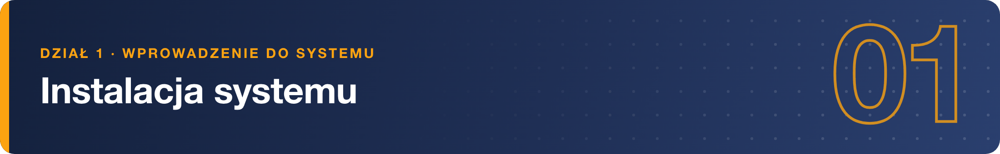
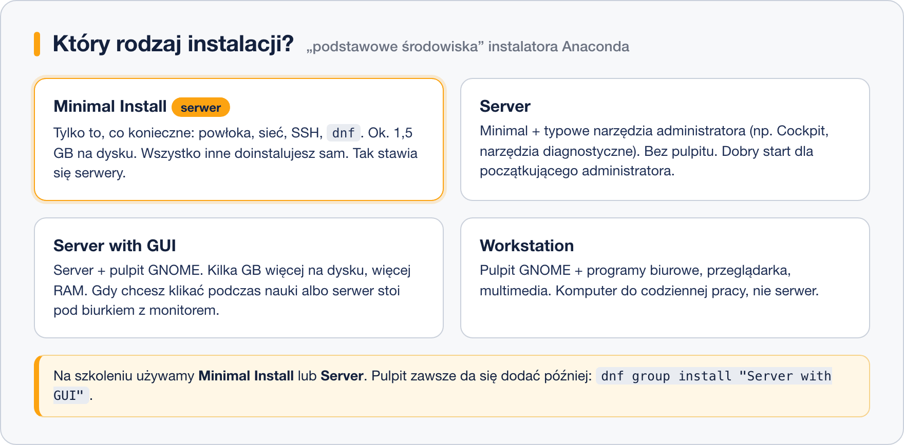
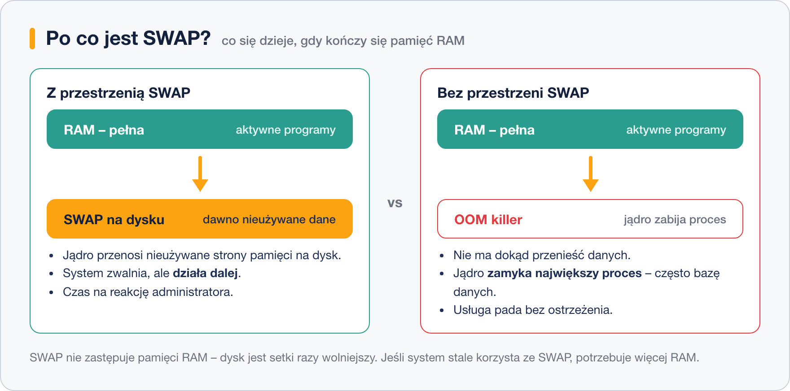

# Wybór rodzaju i wersji systemu

> **W tej lekcji:** nauczysz się świadomie wybierać rodzaj instalacji w instalatorze Anaconda (Minimal, Server, Server with GUI, Workstation), pobierać właściwą wersję i architekturę systemu oraz zdecydować, czy Twój serwer potrzebuje przestrzeni SWAP.

Przed instalacją i w jej trakcie podejmujesz trzy decyzje: którą wersję systemu pobrać, jaki zestaw oprogramowania zainstalować i czy system ma mieć przestrzeń SWAP. Każda ma praktyczne skutki: pulpit na serwerze marnuje zasoby, wersja bez wsparcia nie dostaje poprawek bezpieczeństwa, a brak SWAP potrafi położyć usługę pod obciążeniem.

## Jak to działa

### Rodzaj instalacji: zestawy oprogramowania Anacondy

Instalator systemów rodziny RHEL nazywa się **Anaconda**. Na ekranie „Wybór oprogramowania” wskazujesz **podstawowe środowisko** – gotowy zestaw pakietów:



- **Minimal Install** – absolutne minimum: powłoka, sieć, SSH, `dnf`. Zajmuje ok. 1,5 GB. Wszystko inne doinstalowujesz wtedy, gdy jest potrzebne. Tak stawia się serwery produkcyjne – im mniej pakietów, tym mniej aktualizacji i mniejsza powierzchnia ataku.
- **Server** – minimal plus typowe narzędzia administracyjne. Nadal bez grafiki. Rozsądny wybór na początek nauki.
- **Server with GUI** – Server plus pulpit GNOME. Wygodny, gdy dopiero poznajesz system, ale kosztuje kilka GB dysku i ok. 1 GB RAM więcej.
- **Workstation** – komputer biurkowy: pulpit, przeglądarka, narzędzia biurowe. To wybór na laptopa, nie na serwer.

Po prawej stronie ekranu można dodać grupy dodatkowe (np. „Container Management”). Nie przesadzaj – wszystko da się doinstalować później jednym poleceniem `dnf`.

### Którą wersję pobrać

Modele wydań, numerację i cykl życia omówiliśmy w lekcji [Model wydań i cykl życia dystrybucji](4.%20Model%20wyda%C5%84%20i%20cykl%20%C5%BCycia%20dystrybucji.md). Przy pobieraniu obrazu instalacyjnego przekłada się to na trzy decyzje:

1. **Wersja główna** – domyślnie **najnowsza** (dziś RHEL 10 i jego odpowiedniki). Starszą wybierasz tylko wtedy, gdy wymaga jej producent oprogramowania, które masz uruchomić. Każdy rok różnicy to rok krótsze życie serwera: wersja 9 kończy wsparcie w 2032 roku, wersja 10 – w 2035.
2. **Wydanie poboczne** – zawsze najnowsze dostępne (np. 9.6 zamiast 9.0). Obraz z nowszym wydaniem pobocznym zawiera już wszystkie poprawki i lepiej rozpoznaje świeży sprzęt. Jeśli aplikacja wymaga konkretnego wydania pobocznego, potrzebujesz subskrypcji z EUS.
3. **Architektura** – `x86_64` na zwykłe serwery i maszyny wirtualne, `aarch64` na procesory ARM (Raspberry Pi, maszyny ARM w chmurze, komputery Apple z procesorem M). Obrazy nie są wymienne.

| Wersja | Premiera | Koniec wsparcia | Uwagi |
|---|---|---|---|
| RHEL 9 (i Rocky/Alma 9) | 2022 | maj 2032 | wciąż bardzo częsty w produkcji |
| RHEL 10 (i Rocky/Alma 10) | 2025 | maj 2035 | domyślny wybór na nowy serwer |
| Ubuntu LTS (dla porównania) | co 2 lata (np. 24.04) | 5 lat, do 10 z Ubuntu Pro | numer = rok.miesiąc wydania |

Nazwy plików ISO wyglądają tak: `Rocky-10.0-x86_64-dvd.iso` (pełny nośnik) albo `Rocky-10.0-x86_64-minimal.iso` (wersja minimalna). O różnicach między nimi mówi lekcja o nośnikach instalacji.

### SWAP – mieć czy nie mieć?

**SWAP** (przestrzeń wymiany) to obszar na dysku, do którego jądro odkłada dawno nieużywane fragmenty pamięci, gdy RAM się kończy.



Bez SWAP, gdy pamięć się wyczerpie, jądro uruchamia mechanizm **OOM killer** (ang. *Out Of Memory*) i zamyka proces zużywający najwięcej pamięci – często właśnie Twoją bazę danych. Ze SWAP system najpierw zwalnia, dając Ci czas na reakcję. Dlatego na typowym serwerze i na maszynie do nauki SWAP **warto mieć**. Rezygnuje się z niego świadomie w szczególnych przypadkach (np. niektóre klastry i bazy o wymaganiach producenta).

Zalecane rozmiary (na podstawie wytycznych Red Hata, bez hibernacji):

| RAM w systemie | Zalecany SWAP |
|---|---|
| do 2 GB | 2 × RAM |
| 2–8 GB | tyle co RAM |
| 8–64 GB | co najmniej 4 GB |
| powyżej 64 GB | co najmniej 4 GB (wg potrzeb) |

Partycjonowanie automatyczne Anacondy utworzy SWAP zgodnie z tą tabelą – zwykle nie musisz nic zmieniać.

## W praktyce

Po instalacji sprawdzisz swoje wybory:

```bash
# wersja systemu
cat /etc/redhat-release
```

```bash
# czy i ile SWAP ma system
free -h
```

```text
               total        used        free      shared  buff/cache   available
Mem:           3,8Gi       654Mi       2,6Gi       8,0Mi       802Mi       3,2Gi
Swap:          3,9Gi          0B       3,9Gi
```

```bash
# skąd pochodzi SWAP (partycja? wolumin LVM? plik?)
swapon --show
```

```text
NAME      TYPE      SIZE USED PRIO
/dev/dm-1 partition 3,9G   0B   -2
```

## Najczęstsze błędy i pułapki

- **Pulpit na serwerze produkcyjnym „bo wygodniej”.** To dodatkowe zasoby i dodatkowe luki do łatania. Do klikania wystarczy Cockpit przez przeglądarkę – więcej w module o środowiskach graficznych.
- **Instalacja starej wersji głównej** (np. 9 zamiast 10) bez powodu skraca życie serwera – migracja między wersjami głównymi to osobny projekt.
- **Pobranie obrazu dla złej architektury.** `aarch64` nie uruchomi się na zwykłym komputerze, a `x86_64` na maszynie ARM. Instalator po prostu nie wystartuje.
- **Zero SWAP na maszynie z małym RAM.** Maszyna szkoleniowa z 2–4 GB RAM bez SWAP potrafi „zamrozić się” przy pierwszej większej aktualizacji.
- **SWAP jako lekarstwo na brak RAM.** Jeśli `free -h` stale pokazuje użyty SWAP, system potrzebuje więcej pamięci – dysk jest setki razy wolniejszy od RAM.

## Podsumowanie

- Anaconda oferuje zestawy: Minimal Install (serwery produkcyjne), Server (nauka administracji), Server with GUI i Workstation (praca z pulpitem).
- Na nowy serwer bierz najnowszą wersję główną i najnowsze wydanie poboczne; starszą wersję tylko wtedy, gdy wymaga jej producent oprogramowania.
- SWAP na serwerze zwykle warto mieć; rozmiar wg tabeli (dla 2–8 GB RAM – tyle co RAM).

| Polecenie | Co pokazuje |
|---|---|
| `cat /etc/redhat-release` | wersję systemu |
| `free -h` | pamięć RAM i SWAP |
| `swapon --show` | skąd pochodzi SWAP |
