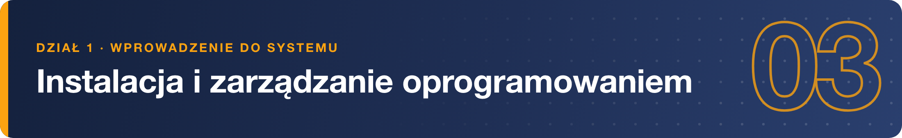
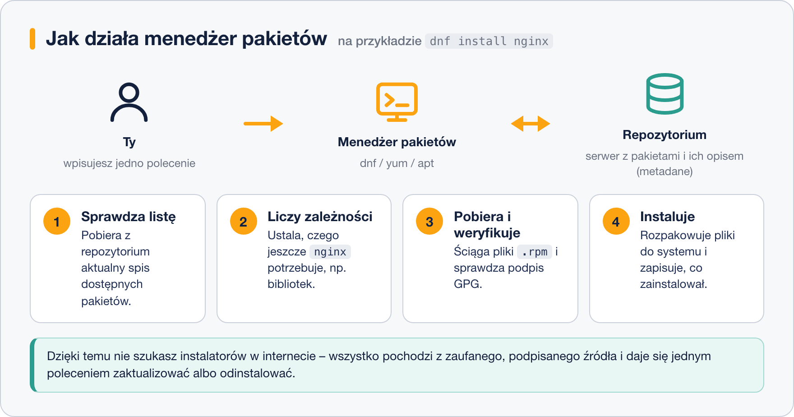

# Jak działa menedżer pakietów

> **W tej lekcji:** dowiesz się, czym jest pakiet, repozytorium i zależność oraz dlaczego na Linuksie nie szuka się instalatorów w internecie. Po jej przeczytaniu zrozumiesz, co dzieje się „pod spodem”, gdy wpisujesz `sudo dnf install nginx`.

W Linuksie całym oprogramowaniem – od jądra, przez serwer WWW, po edytor tekstu – zarządza **jedno centralne narzędzie**: menedżer pakietów (ang. *package manager*). Inaczej niż w Windows nie pobierasz instalatorów ze stron producentów: menedżer pakietów instaluje, aktualizuje i usuwa programy z jednego miejsca i prowadzi rejestr tego, co jest zainstalowane.

Administrator używa go codziennie: doinstalowuje narzędzia, wgrywa poprawki bezpieczeństwa, sprawdza, z jakiego pakietu pochodzi dany plik. To jedna z pierwszych umiejętności, bez której nie zrobisz na serwerze niczego więcej.

## Jak to działa

### Pakiet

**Pakiet** to archiwum (jeden plik), w którym zapakowano gotowy do użycia program: pliki wykonywalne, biblioteki, pliki konfiguracyjne, dokumentację. Oprócz plików pakiet zawiera **metadane** – opis: jak się nazywa, w jakiej jest wersji, kto go zbudował, jaką ma licencję i – najważniejsze – czego potrzebuje do działania.

W rodzinie Red Hat (RHEL, Rocky Linux, AlmaLinux, CentOS Stream, Fedora) pakiety mają rozszerzenie `.rpm`. W rodzinie Debiana (Debian, Ubuntu) – `.deb`. Format jest inny, zasada ta sama.

### Zależności

Programy rzadko są samowystarczalne. Serwer WWW `nginx` potrzebuje biblioteki do szyfrowania (`openssl-libs`), biblioteki do kompresji (`zlib`) i kilku innych. Taki związek nazywamy **zależnością** (ang. *dependency*): pakiet A wymaga pakietu B.

Gdybyś instalował ręcznie, musiałbyś sam odkryć, czego brakuje, znaleźć to, zainstalować, i tak w kółko. Menedżer pakietów czyta metadane i **sam układa pełną listę** tego, co trzeba doinstalować. Ty potwierdzasz jedno pytanie.

### Repozytorium

**Repozytorium** (ang. *repository*, potocznie „repo”) to serwer w internecie (albo w firmowej sieci), na którym leżą tysiące pakietów oraz ich spis – metadane wszystkich pakietów zebrane w jednym miejscu. Menedżer pakietów najpierw pobiera ten spis, dzięki czemu wie, co jest dostępne i w jakiej wersji, zanim ściągnie choć jeden pakiet.

Dystrybucja ma kilka oficjalnych repozytoriów (w RHEL 9/10: **BaseOS** – rdzeń systemu, **AppStream** – aplikacje i narzędzia). Można dopisać dodatkowe, np. **EPEL** z pakietami społecznościowymi – o tym w lekcji [3. Konfiguracja repozytoriów](3.%20Konfiguracja%20repozytoriów.md).

### Podpis GPG

Skąd wiadomo, że pakiet pobrany z internetu nie został po drodze podmieniony? Każdy pakiet w repozytorium jest **podpisany cyfrowo** kluczem GPG dystrybucji. Menedżer pakietów ma kopię klucza publicznego (w katalogu `/etc/pki/rpm-gpg/`) i przed instalacją sprawdza podpis. Jeśli się nie zgadza – odmawia instalacji. To odpowiednik pieczęci na dokumencie: nie da się jej podrobić bez klucza.

### Całość w jednym obrazku



### Dwa poziomy narzędzi

W rodzinie Red Hat są dwa narzędzia, które łatwo pomylić:

- **`rpm`** – narzędzie niskopoziomowe. Potrafi zainstalować pojedynczy plik `.rpm` i odpowiadać na pytania o to, co jest zainstalowane. **Nie zna repozytoriów i nie rozwiązuje zależności.**
- **`dnf`** (dawniej `yum`) – narzędzie wysokopoziomowe. Zna repozytoria, liczy zależności, pamięta historię. Na końcu i tak korzysta z `rpm`, żeby fizycznie rozpakować pliki.

Na co dzień używasz `dnf`. Po `rpm` sięgasz, gdy chcesz o coś **zapytać** system (lekcja [4. Pakiety RPM – praca z plikami lokalnymi](4.%20Pakiety%20RPM%20–%20praca%20z%20plikami%20lokalnymi.md)).

## W praktyce

Zobacz, jak wygląda jedna instalacja od początku do końca.

```bash
# instalujemy serwer WWW; dnf pyta o potwierdzenie, odpowiadamy „y”
sudo dnf install nginx
```

```text
Rocky Linux 9 - BaseOS                          2.1 MB/s | 2.3 MB     00:01
Rocky Linux 9 - AppStream                       4.5 MB/s | 8.4 MB     00:01
Rozwiązano zależności.
================================================================================
 Pakiet                 Arch     Wersja                   Repozytorium   Rozm.
================================================================================
Instalowanie:
 nginx                  x86_64   1:1.20.1-16.el9          appstream      36 k
Instalowanie zależności:
 nginx-core             x86_64   1:1.20.1-16.el9          appstream     565 k
 nginx-filesystem       noarch   1:1.20.1-16.el9          appstream      10 k
 rocky-logos-httpd      noarch   90.15-2.el9              appstream      24 k

Podsumowanie transakcji
================================================================================
Instalacja  4 pakiety

Całkowity rozmiar pobierania: 635 k
W porządku? [t/N]: t
Pobieranie pakietów:
...
Zainstalowano:
  nginx-1:1.20.1-16.el9.x86_64        nginx-core-1:1.20.1-16.el9.x86_64
  nginx-filesystem-1:1.20.1-16.el9.noarch   rocky-logos-httpd-90.15-2.el9.noarch
Zakończono!
```

Co tu widać, krok po kroku:

1. **Odświeżenie spisu** – dwie pierwsze linie to pobranie metadanych z repozytoriów BaseOS i AppStream.
2. **Rozwiązanie zależności** – prosiłeś o jeden pakiet, `dnf` doliczył trzy kolejne, których `nginx` potrzebuje.
3. **Podsumowanie i pytanie** – zanim cokolwiek się zmieni, widzisz pełną listę i rozmiar pobierania. Dopiero `t` (albo `y`) uruchamia zmiany.
4. **Pobranie, sprawdzenie podpisów, instalacja** – przy pierwszym użyciu repozytorium `dnf` może dodatkowo zapytać o import klucza GPG.

Wersje i rozmiary w Twoim systemie będą inne – to tylko przykład.

Potem w każdej chwili możesz sprawdzić, co masz:

```bash
# czy nginx jest zainstalowany i w jakiej wersji
dnf list --installed nginx
```

```text
Zainstalowane pakiety
nginx.x86_64        1:1.20.1-16.el9        @appstream
```

Znak `@` przed nazwą repozytorium mówi: „zainstalowano z AppStream”.

## Najczęstsze błędy i pułapki

- **Szukanie instalatorów w przeglądarce.** Odruch z Windowsa. Najpierw zawsze `dnf search nazwa` – w 9 na 10 przypadków program już jest w repozytorium, podpisany i gotowy do aktualizacji razem z systemem.
- **Mylenie `rpm` z `dnf`.** `rpm -i plik.rpm` nie dociągnie zależności i zakończy się błędem „Failed dependencies”. Do instalowania używaj `dnf`, nawet dla pliku lokalnego.
- **Brak `sudo`.** Instalacja zmienia pliki systemowe, więc wymaga uprawnień administratora. Komunikat „This command has to be run with superuser privileges” oznacza dokładnie to.
- **Brak sieci lub złe repozytorium.** Jeśli `dnf` długo „wisi” na pierwszym kroku albo zgłasza „Cannot download repodata”, problem leży w połączeniu albo w konfiguracji repozytorium, nie w pakiecie.

## Podsumowanie

- Pakiet = program + metadane (nazwa, wersja, zależności) w jednym pliku `.rpm`.
- Repozytorium = serwer ze spisem i zbiorem pakietów; system ma kilka oficjalnych, możesz dodać kolejne.
- Menedżer pakietów (`dnf`) sam rozwiązuje zależności, sprawdza podpisy GPG i pamięta, co zainstalował.
- `rpm` to narzędzie niskopoziomowe – do pytań o zainstalowane pakiety, nie do codziennej instalacji.
- Jedno polecenie instaluje, jedno aktualizuje cały system, jedno usuwa – to główna przewaga nad instalatorami `.exe`.

| Pojęcie | Po angielsku | Jednym zdaniem |
|---|---|---|
| pakiet | package | plik `.rpm` z programem i jego opisem |
| zależność | dependency | inny pakiet, bez którego ten nie zadziała |
| repozytorium | repository | serwer z pakietami i ich spisem |
| metadane | metadata | opis pakietu: nazwa, wersja, zależności |
| podpis GPG | GPG signature | cyfrowa pieczęć potwierdzająca pochodzenie pakietu |
