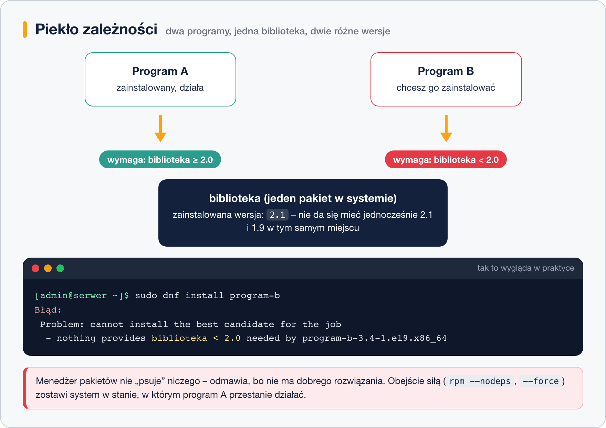

# Piekło zależności

> **W tej lekcji:** zrozumiesz, czym jest „piekło zależności”, skąd się bierze, jak menedżer pakietów chroni Cię przed nim – i jakie Twoje decyzje potrafią tę ochronę obejść. Nauczysz się też czytać komunikaty o konfliktach zamiast się ich bać.

„Piekło zależności” to sytuacja, w której menedżer pakietów nie może dokończyć instalacji albo aktualizacji, bo wymagania pakietów wzajemnie się wykluczają – zobaczysz wtedy komunikat w stylu „cannot install the best candidate for the job” albo „conflicting requests”. Znalezione w internecie porady z `--nodeps` czy `--force` potrafią w tym miejscu zepsuć system na dobre; ta lekcja uczy, jak zrozumieć, co menedżer pakietów próbuje powiedzieć, i rozwiązać problem u źródła.

## Jak to działa

### Skąd się biorą zależności

Programy współdzielą biblioteki: jedna kopia `openssl-libs` obsługuje szyfrowanie dla dziesiątek programów. To oszczędza miejsce i pozwala łatać błąd w jednym miejscu. Cena: programy muszą się „zgadzać” co do wersji wspólnych bibliotek.

### Kiedy robi się piekło

**Piekło zależności** (ang. *dependency hell*) to sytuacja, w której wymagania pakietów są sprzeczne i nie istnieje zestaw wersji zadowalający wszystkich:



Program A chce biblioteki ≥ 2.0, program B tej samej biblioteki < 2.0. W systemie pakiet biblioteki może być tylko w jednej wersji – ktoś musi odpaść.

Typowe źródła takich konfliktów:

- **mieszanie repozytoriów** z różnych wersji systemu (repozytorium dla `el8` na systemie `el9`) albo dwóch zewnętrznych repozytoriów, które pakują te same biblioteki w różnych wersjach;
- **pakiety spoza dystrybucji** – plik `.rpm` zbudowany pod Fedorę wymaga nowszych bibliotek, niż ma RHEL;
- **wymuszone instalacje** (`rpm --nodeps`, `--force`) – baza RPM twierdzi, że wszystko gra, a na dysku brakuje plików;
- **przerwane w pół drogi transakcje** – np. twardy reset w trakcie `dnf upgrade`.

### Jak broni Cię menedżer pakietów

DNF przed każdą transakcją rozwiązuje układ wymagań całościowo (robi to biblioteka libsolv – ten sam rodzaj algorytmu, co w solverach logicznych). Jeśli rozwiązanie istnieje – proponuje je. Jeśli nie – **odmawia i wypisuje dlaczego**. To nie złośliwość, to bezpiecznik: odmowa oznacza, że każda siłowa kontynuacja zostawiłaby system niespójny.

Dystrybucje klasy enterprise (RHEL i pochodne) dodatkowo minimalizują ryzyko: w ramach jednej wersji systemu wersje bibliotek są zamrożone i tylko łatane. Dlatego na RHEL 9/10 prawdziwe piekło zdarza się niemal wyłącznie wtedy, gdy sam wpuścisz obce pakiety.

## W praktyce

### Czytanie komunikatu konfliktu

```bash
sudo dnf install program-b
```

```text
Błąd:
 Problem: cannot install the best candidate for the job
  - nothing provides biblioteka < 2.0 needed by program-b-3.4-1.el9.x86_64
```

Czytaj od dołu: **kto** (`program-b-3.4-1.el9`) potrzebuje **czego** (`biblioteka < 2.0`) i czemu się nie da (`nothing provides` – nic takiego nie ma w repozytoriach). Dalsze kroki zależą od odpowiedzi na pytanie: *skąd wziął się ten pakiet i czy na pewno jest zbudowany dla mojego systemu?*

Pomocne polecenia diagnostyczne:

```bash
# czego wymaga pakiet?
dnf repoquery --requires program-b

# kto dostarcza daną bibliotekę i w jakich wersjach?
dnf repoquery --whatprovides 'biblioteka*'

# z jakich repozytoriów w ogóle korzystam?
dnf repolist
```

### Bezpieczne wyjścia

1. **Poszukaj wersji dla swojego systemu** – producent często ma osobne pakiety dla `el9` i `el10` albo własne repozytorium, które dostarcza też zależności.
2. **Sprawdź moduły/strumienie** (RHEL 9): może potrzebna wersja jest w innym strumieniu – `dnf module list nazwa` ([lekcja 5](5.%20DNF%20–%20następca%20YUM.md)).
3. **Rozważ Flatpak/kontener** dla aplikacji, która uparcie chce innych bibliotek – nosi je wtedy ze sobą i nie dotyka systemu ([lekcja 6](6.%20Menedżery%20pakietów%20innych%20dystrybucji.md)).
4. **Cofnij to, co zepsuło** – jeśli konflikt pojawił się po dodaniu repozytorium albo instalacji, `dnf history` pokaże co i kiedy, a `dnf history undo N` wycofa zmianę.

### Czego nie robić: --nodeps i spółka

```bash
# NIE RÓB TEGO – przykład pokazany, żebyś rozpoznał złą poradę
sudo rpm -ivh --nodeps program-b-3.4-1.el9.x86_64.rpm
```

`--nodeps` każe `rpm` zignorować zależności. Instalacja „się uda”, ale program nie wystartuje bez swoich bibliotek, a baza RPM zacznie kłamać – od tej pory każda kolejna transakcja DNF może zachowywać się dziwnie. Podobnie `--force` (nadpisywanie cudzych plików). Jeśli kiedykolwiek użyjesz tych opcji świadomie (są sytuacje ratunkowe), zapisz sobie co i gdzie, żeby dało się to odkręcić.

Opcja `--skip-broken` jest łagodniejsza: każe DNF pominąć pakiety, których nie da się rozwiązać, i zainstalować resztę. Bywa przydatna przy wielkich aktualizacjach, ale maskuje problem – użyta rutynowo sprawia, że część systemu po cichu przestaje się aktualizować.

## Najczęstsze błędy i pułapki

- **Kopiowanie porad z `--nodeps`/`--force`** z forów. To porady z czasów, gdy nie było lepszych narzędzi – dziś niemal zawsze istnieje czystsze wyjście.
- **Dodanie repozytorium Fedory/starej wersji RHEL**, „bo tam jest nowsza paczka”. Jedna instalacja może podmienić pół systemu bibliotek. Trzymaj się repozytoriów dla swojej wersji.
- **Ignorowanie pełnej treści komunikatu.** DNF zwykle wypisuje też podpowiedź (np. „try to add '--skip-broken'…”) oraz dokładny łańcuch zależności. Odpowiedź często jest w ostatnich dwóch liniach.
- **„Naprawianie” przez usuwanie na ślepo.** Gdy DNF proponuje usunięcie 150 pakietów, żeby zaspokoić jedną instalację – to znak, żeby się zatrzymać, nie potwierdzić `-y`.

## Podsumowanie

- Piekło zależności = sprzeczne wymagania pakietów; w systemie może być tylko jedna wersja danego pakietu biblioteki.
- Na RHEL 9/10 zdarza się rzadko – prawie zawsze przyczyną są obce repozytoria, cudze pakiety albo wymuszenia.
- Odmowa DNF to bezpiecznik. Czytaj komunikat: kto → czego wymaga → czego brakuje.
- Diagnostyka: `dnf repoquery --requires` / `--whatprovides`, `dnf repolist`, `dnf history`.
- `--nodeps` i `--force` zostaw na sytuacje ratunkowe; `--skip-broken` nie naprawia, tylko odkłada problem.

| Polecenie | Co robi |
|---|---|
| `dnf repoquery --requires pakiet` | czego pakiet wymaga |
| `dnf repoquery --whatprovides 'coś*'` | kto dostarcza zależność |
| `sudo dnf history undo N` | wycofuje transakcję, która zepsuła układ |
| `sudo dnf distro-sync` | wyrównuje wersje pakietów do stanu z włączonych repozytoriów |
| `rpm -V pakiet` | sprawdza, czy pliki pakietu są nietknięte |
