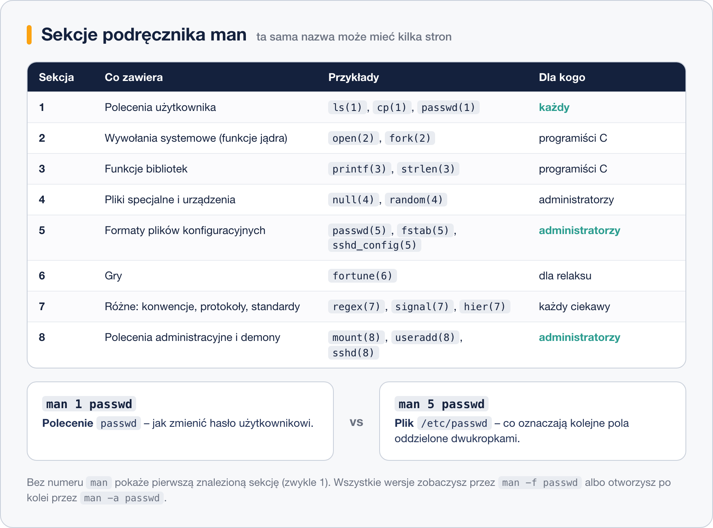
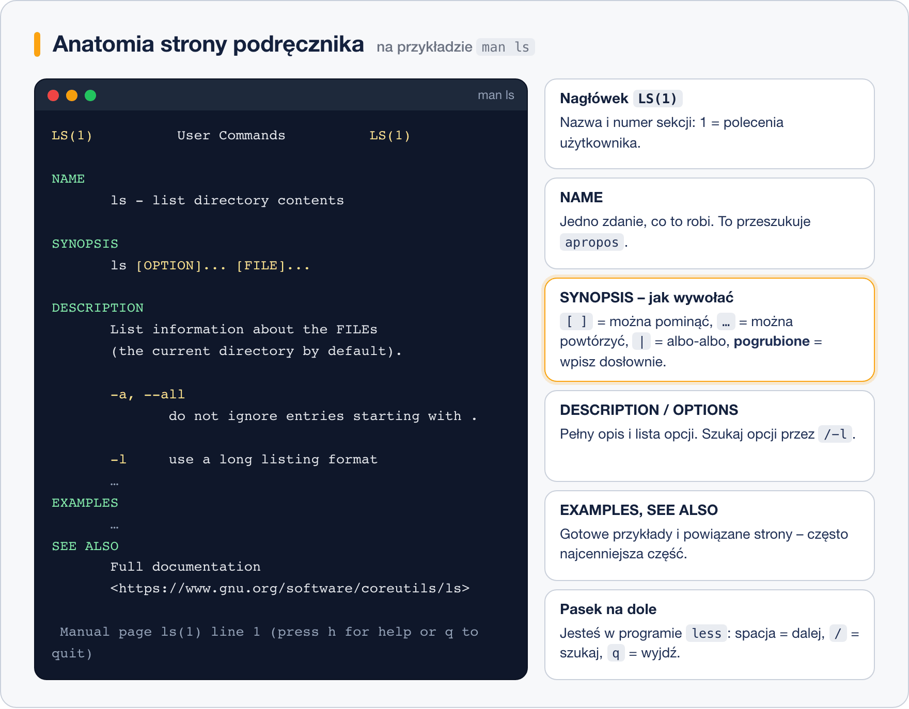
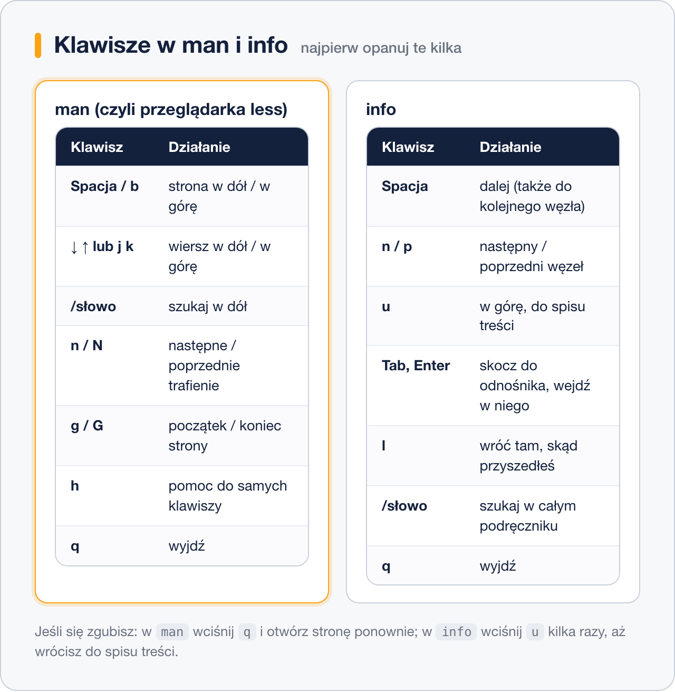

# Podręcznik systemowy man

> **W tej lekcji:** nauczysz się korzystać z wbudowanej dokumentacji systemu – poleceniem `man`. Poznasz sekcje podręcznika, budowę strony (zwłaszcza jak czytać SYNOPSIS), nawigację oraz wyszukiwanie stron, gdy nie znasz nazwy polecenia.

`man` (od ang. *manual* – podręcznik) to wbudowany w system sposób czytania dokumentacji. Linux ma setki poleceń, a każde dziesiątki opcji – nikt nie zna ich na pamięć, administratorzy różnią się tym, jak szybko umieją sprawdzić. Kompletna dokumentacja jest już na Twoim serwerze: działa bez internetu (ważne na maszynach odciętych od sieci) i zawsze opisuje dokładnie tę wersję programu, którą masz zainstalowaną.

## Jak to działa

### Strony i sekcje

Każde polecenie, format pliku czy funkcja ma swoją **stronę podręcznika** (ang. *man page*). Strony są podzielone na 8 ponumerowanych **sekcji** według rodzaju tematu:



Dla administratora liczą się głównie: **1** (polecenia), **5** (formaty plików konfiguracyjnych) i **8** (polecenia administracyjne). Numer sekcji piszemy w nawiasie za nazwą: `passwd(1)` to polecenie zmiany hasła, a `passwd(5)` – opis budowy pliku `/etc/passwd`. Ta sama nazwa, dwa zupełnie różne dokumenty:

```bash
# strona o poleceniu passwd (sekcja 1 – znaleziona jako pierwsza)
man passwd

# strona o PLIKU /etc/passwd (jawnie sekcja 5)
man 5 passwd
```

### Budowa strony



Stałe sekcje strony (w tej kolejności):

- **NAME** – nazwa i jedno zdanie opisu.
- **SYNOPSIS** – wzór wywołania. Tu obowiązuje notacja: `[ ]` – element **opcjonalny**, `…` – element **można powtórzyć**, `|` – **albo-albo**, tekst pogrubiony – wpisujesz dosłownie, tekst pochylony/podkreślony – zastępujesz własną wartością. Przykład: `ls [OPTION]... [FILE]...` czyta się: „ls, potem dowolnie wiele opcji (albo żadnej), potem dowolnie wiele plików (albo żadnego)”.
- **DESCRIPTION** i **OPTIONS** – pełny opis działania i wszystkich opcji.
- **EXAMPLES** – gotowe przykłady (nie każda strona je ma, ale zawsze warto sprawdzić).
- **FILES** – powiązane pliki konfiguracyjne; **SEE ALSO** – pokrewne strony, często z numerami sekcji.

### Nawigacja

`man` wyświetla stronę w przeglądarce tekstu `less`, więc klawisze są te same, co przy czytaniu długich plików:



Minimum na start: **spacja** – następny ekran, **/słowo** + Enter – szukaj, **n** – następne trafienie, **g**/**G** – początek/koniec, **q** – wyjście.

## W praktyce

### Codzienne użycie

```bash
# pełna dokumentacja polecenia ls
man ls

# szukamy w otwartej stronie opisu opcji -R: wpisz /-R i Enter, potem n
```

Strefa przewijania i szukania szybko wchodzi w palce. Gdy chcesz tylko zerknąć na jedną opcję, często szybsze jest `/` od razu po otwarciu strony.

### Gdy nie znasz nazwy polecenia

```bash
# przeszukuje JEDNOZDANIOWE opisy wszystkich stron (sekcja NAME)
apropos rename
```

```text
mv (1)               - move (rename) files
prename (1)          - renames multiple files
rename (1)           - rename files
rename (2)           - change the name or location of a file
```

`man -k rename` robi dokładnie to samo (`-k` jak *keyword*). Z listy wybierasz stronę i otwierasz `man 1 rename`.

W drugą stronę – znasz nazwę, chcesz tylko jednozdaniowy opis i listę sekcji:

```bash
# co to w ogóle jest? (odpowiednik: man -f passwd)
whatis passwd
```

```text
passwd (1)           - update user's authentication tokens
passwd (5)           - password file
```

> **Pułapka świeżego systemu:** `apropos`/`whatis` korzystają z indeksu budowanego przez polecenie `mandb`. Na świeżo zainstalowanym minimalnym systemie indeks może nie istnieć („nothing appropriate”) – zbuduj go ręcznie: `sudo mandb`.

### Ile stron ma dana nazwa

```bash
# otwiera po kolei WSZYSTKIE strony o tej nazwie (po q przechodzi do następnej)
man -a passwd

# gdzie fizycznie leży plik strony?
man -w passwd
```

```text
/usr/share/man/man1/passwd.1.gz
```

## Najczęstsze błędy i pułapki

- **Czytanie strony od deski do deski.** Strony man to leksykon, nie samouczek. Czytaj NAME i SYNOPSIS, potem szukaj (`/`) konkretnej opcji albo skocz do EXAMPLES.
- **Mylenie sekcji.** Szukasz opisu pliku konfiguracyjnego, a czytasz o poleceniu (albo odwrotnie). Zerknij na nagłówek: `PASSWD(1)` vs `PASSWD(5)`.
- **„No manual entry for …”** – strona nie jest zainstalowana. W systemach minimalnych brakuje pakietu `man-pages`; dokumentacja konkretnego programu przyjeżdża z jego pakietem. Czasem pomaga `sudo dnf install man-pages` albo doinstalowanie samego programu.
- **Panika w `less`.** Przypadkowo wciśnięta litera potrafi „zawiesić” widok (np. zaczęte szukanie). Ratunek uniwersalny: Esc, potem `q`.
- **Nieznajomość notacji SYNOPSIS.** `[ ]` i `…` to nie znaki do wpisania, tylko gramatyka wzoru. Jeśli wpiszesz nawiasy dosłownie, polecenie nie zadziała.

## Podsumowanie

- Dokumentacja jest w systemie, offline i zgodna z zainstalowaną wersją – `man polecenie`.
- Sekcje: 1 – polecenia, 5 – formaty plików, 8 – administracja; `man 5 passwd` ≠ `man 1 passwd`.
- SYNOPSIS czyta się według notacji: `[ ]` opcjonalne, `…` powtarzalne, `|` wybór.
- Nawigacja = `less`: spacja, `/szukaj`, `n`, `g`/`G`, `q`.
- Nie znasz nazwy? `apropos słowo`. Znasz nazwę, chcesz opis? `whatis nazwa`. Brak wyników? `sudo mandb`.

| Polecenie | Co robi |
|---|---|
| `man polecenie` | otwiera stronę podręcznika |
| `man 5 nazwa` | strona z konkretnej sekcji |
| `man -a nazwa` | wszystkie strony o tej nazwie po kolei |
| `apropos słowo` / `man -k słowo` | szuka w opisach stron |
| `whatis nazwa` / `man -f nazwa` | jednozdaniowy opis i sekcje |
| `man -w nazwa` | ścieżka pliku strony |
| `sudo mandb` | przebudowuje indeks dla apropos/whatis |
