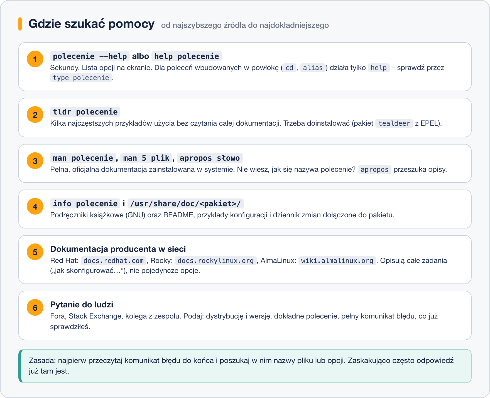

# Pomoc wbudowana w programy i dokumentacja pakietów

> **W tej lekcji:** poznasz najszybsze źródła pomocy – `--help` i `help`, dokumentację dołączaną do pakietów w `/usr/share/doc`, ściągi `tldr` oraz oficjalną dokumentację Red Hat i klonów w sieci. Nauczysz się też, jak sensownie czytać komunikaty błędów i zadawać pytania.

`man` i `info` to pełna dokumentacja – ale w codziennej pracy w 80% przypadków potrzebujesz tylko przypomnienia jednej opcji albo gotowego przykładu. Do tego są szybsze narzędzia. A gdy dokumentacja polecenia nie wystarcza – bo problem dotyczy całego zadania („jak postawić serwer WWW?”) – trzeba wiedzieć, gdzie szukać dalej i jak odróżnić źródła wiarygodne od przypadkowych.

## Jak to działa

Źródła pomocy warto znać w kolejności od najszybszego do najgłębszego:



### `--help`: ściąga wbudowana w program

Prawie każde polecenie wywołane z opcją `--help` (czasem `-h`) wypisuje skrót użycia i listę opcji. To ta sama wiedza co w SYNOPSIS i OPTIONS strony man, tylko od razu na ekranie.

### `help`: polecenia wbudowane w powłokę

Niektóre „polecenia” nie są osobnymi programami, tylko częścią samej powłoki bash – np. `cd`, `alias`, `export`, `history`. Nie mają własnych stron man (opisuje je zbiorczo `man bash`); ich dokumentację wyświetla wbudowane polecenie `help`. Czy coś jest programem, czy wbudowane – sprawdza `type`.

### Dokumentacja w pakietach: `/usr/share/doc`

Każdy pakiet RPM może instalować dokumenty do katalogu `/usr/share/doc/<nazwa-pakietu>/`: README, przykładowe pliki konfiguracyjne, listę zmian (CHANGELOG), licencję. Dla oprogramowania serwerowego często leżą tam gotowe przykłady konfiguracji, których nie ma nigdzie indziej.

### tldr: przykłady zamiast leksykonu

Projekt społecznościowy **tldr** (od ang. *too long; didn't read*) utrzymuje krótkie ściągi: kilka najczęstszych wywołań polecenia z jednozdaniowym opisem. Idealne, gdy wiesz *co* chcesz zrobić, ale nie pamiętasz *jak*.

> **Jak zainstalować tldr:** klient `tealdeer` jest w repozytorium EPEL (włączenie EPEL: [moduł 03, lekcja 3](../3.%20Instalacja%20i%20zarządzanie%20oprogramowaniem/3.%20Konfiguracja%20repozytoriów.md)):
> ```bash
> sudo dnf install tealdeer
> tldr --update          # pobiera bazę ściąg (wymaga internetu)
> tldr tar
> ```

### Dokumentacja dystrybucji w sieci

Gdy pytanie brzmi „jak skonfigurować…”, a nie „co robi opcja…”, właściwym źródłem są przewodniki producenta:

- **Red Hat:** docs.redhat.com (dawniej access.redhat.com/documentation) – kompletne przewodniki po RHEL 9/10: instalacja, sieć, storage, bezpieczeństwo. Czytanie bez logowania; baza rozwiązań (Knowledgebase) wymaga konta.
- **Rocky Linux:** docs.rockylinux.org – przewodniki i poradniki społeczności.
- **AlmaLinux:** wiki.almalinux.org.

Ponieważ Rocky i Alma są binarnie zgodne z RHEL, dokumentacja Red Hat stosuje się do nich niemal w całości – to najporządniejsze źródło wiedzy o Twoim systemie szkoleniowym.

## W praktyce

### --help, type i help

```bash
# skrócona pomoc programu
ls --help | head -5
```

```text
Użycie: ls [OPCJA]... [PLIK]...
Wypisanie informacji o PLIKACH (domyślnie w katalogu bieżącym).
...
```

```bash
# czy cd to program, czy polecenie wbudowane?
type cd
type ls
```

```text
cd jest wbudowanym poleceniem powłoki
ls jest aliasem do „ls --color=auto”
```

```bash
# pomoc dla polecenia wbudowanego
help cd
```

### Dokumentacja pakietu

```bash
# co pakiet nginx zainstalował do /usr/share/doc?
ls /usr/share/doc/nginx/
```

```text
CHANGES  README.dynamic  UPGRADE-NOTES-1.6-to-1.10
```

```bash
# lista WSZYSTKICH plików pakietu, także tego, który nie jest zainstalowany
dnf repoquery -l nginx | grep share/doc
```

`dnf repoquery -l` działa jak `rpm -ql`, ale pyta repozytorium – możesz obejrzeć zawartość pakietu przed instalacją.

### Czytanie komunikatów błędów

Komunikat błędu to nie kara, tylko odpowiedź systemu. Nawyk wart wyrobienia:

1. **Przeczytaj całość**, do ostatniej linii – tam zwykle jest konkret (ścieżka, nazwa opcji, numer linii konfiguracji).
2. **Wyłap elementy zmienne:** jaka ścieżka? jaki plik? „Permission denied” → kwestia uprawnień; „No such file or directory” → literówka albo zła ścieżka; „command not found” → brak pakietu albo PATH.
3. Dopiero potem szukaj: najpierw w `man` danego polecenia, potem w sieci – wklejając **stały fragment** komunikatu (bez swoich ścieżek) w cudzysłowie.

### Jak zadać dobre pytanie

Gdy musisz poprosić o pomoc (forum, zespół, prowadzący szkolenie), podaj komplet:

- dystrybucję i wersję (`cat /etc/os-release`),
- **dokładne** polecenie, które wydałeś (skopiowane, nie z pamięci),
- **pełny** komunikat błędu (skopiowany tekst, nie zdjęcie ekranu),
- co już sprawdziłeś i jaki był wynik.

Taki opis w połowie przypadków prowadzi do rozwiązania, zanim ktokolwiek odpowie – bo porządkując fakty, sam zauważysz przyczynę.

## Najczęstsze błędy i pułapki

- **`man cd` i zdziwienie.** Polecenia wbudowane w bash nie mają stron man – użyj `help cd`. Rozstrzyga `type`.
- **Ślepe kopiowanie poleceń z pierwszego wyniku wyszukiwarki.** Poradnik może dotyczyć innej dystrybucji, innej wersji albo być po prostu zły. Konfrontuj z dokumentacją dystrybucji i stroną man na własnej maszynie.
- **Zdjęcie ekranu zamiast tekstu.** Tekstu błędu można szukać i cytować; zdjęcia nie. Kopiuj z terminala.
- **`tldr` bez `--update`.** Zaraz po instalacji tealdeer baza ściąg jest pusta – pierwsze uruchomienie wymaga `tldr --update` (i dostępu do internetu).
- **Pomijanie `/usr/share/doc`.** Przykładowe pliki konfiguracyjne od autorów pakietu bywają lepsze niż wszystko, co znajdziesz w sieci.

## Podsumowanie

- Kolejność szukania: `--help`/`help` → `tldr` → `man`/`apropos` → `info` + `/usr/share/doc` → dokumentacja producenta → pytanie do ludzi.
- `type` mówi, czy masz do czynienia z programem, aliasem czy poleceniem wbudowanym w powłokę.
- `/usr/share/doc/<pakiet>/` i `dnf repoquery -l` – dokumentacja dołączona do pakietów.
- Dokumentacja Red Hat (docs.redhat.com) stosuje się też do Rocky/Alma; uzupełniają ją docs.rockylinux.org i wiki.almalinux.org.
- Komunikat błędu czytaj w całości; pytania zadawaj z wersją systemu, poleceniem i pełnym błędem.

| Polecenie | Co robi |
|---|---|
| `polecenie --help` | skrócona pomoc programu |
| `help cd` | pomoc dla poleceń wbudowanych w bash |
| `type nazwa` | program, alias czy polecenie wbudowane? |
| `ls /usr/share/doc/<pakiet>/` | dokumenty dołączone do pakietu |
| `dnf repoquery -l pakiet` | lista plików pakietu (też niezainstalowanego) |
| `tldr polecenie` | ściąga z przykładami (pakiet tealdeer, EPEL) |
