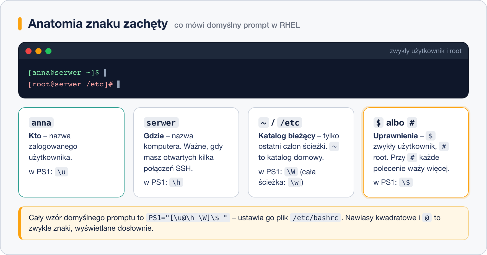

# Prompt – co mówi znak zachęty

> **W tej lekcji:** rozłożysz znak zachęty `[anna@serwer ~]$` na części, dowiesz się, czym różni
> się `$` od `#`, co to jest zmienna `PS1` i jak zmienić wygląd oraz kolor promptu.

Znak zachęty (ang. *prompt*) to kawałek tekstu, który powłoka wypisuje, zanim pozwoli Ci wpisać
polecenie. To jedyna rzecz na ekranie, która stale odpowiada na trzy pytania: **kim jestem, na
którym serwerze jestem i gdzie w drzewie katalogów stoję**. Administrator ma zwykle otwartych
kilka okien – produkcja, serwer testowy, własny laptop – i jedno spojrzenie na prompt mówi, czy
`rm -r` zaraz wykona się tam, gdzie trzeba; wielu administratorów ustawia na serwerach
produkcyjnych czerwony prompt właśnie po to, żeby ręka sama zwolniła.

## Jak to działa

### Element po elemencie



Domyślny prompt w RHEL i pochodnych wygląda tak: `[anna@serwer ~]$`. Czytasz go:

| Fragment | Znaczenie |
|---|---|
| `anna` | nazwa użytkownika, na którego jesteś zalogowany |
| `@` | zwykły znak rozdzielający, czytaj „na” |
| `serwer` | nazwa komputera (ang. *hostname*) |
| `~` | katalog bieżący – pokazywany jest tylko ostatni człon ścieżki; `~` to katalog domowy |
| `$` | kończy prompt zwykłego użytkownika |

Po `cd /etc/sysconfig` prompt zmieni się na `[anna@serwer sysconfig]$` – widzisz tylko
`sysconfig`, nie całą ścieżkę. Pełną ścieżkę zawsze pokaże `pwd`.

### `$` czy `#` – to ważne

Ostatni znak promptu mówi, **z jakimi uprawnieniami** działasz:

- `$` – zwykły użytkownik. Możesz zepsuć co najwyżej własne pliki.
- `#` – administrator `root`. Możesz zepsuć wszystko.

Dlatego w dokumentacji i na forach polecenia zapisuje się z tym znakiem na początku: `$ ls`
znaczy „jako zwykły użytkownik”, `# dnf install nginx` znaczy „jako root”. Samego `$` ani `#`
nie przepisujesz.

Gdy wykonasz `sudo -i` albo `su -`, prompt zmieni się na `[root@serwer ~]#`. Jeśli widzisz `#`,
a nie planowałeś pracować jako root – wpisz `exit`.

### Skąd powłoka wie, co wyświetlić: `PS1`

Wygląd promptu jest zapisany w zmiennej powłoki `PS1` (ang. *Prompt String 1*). Powłoka za każdym
razem czyta jej wartość i podmienia specjalne sekwencje z ukośnikiem na aktualne dane.

```bash
# zobacz obecny wzór promptu
echo $PS1
```

```text
[\u@\h \W]\$
```

Najczęstsze sekwencje:

| Sekwencja | Co wstawia | Przykład |
|---|---|---|
| `\u` | nazwa użytkownika | `anna` |
| `\h` | nazwa komputera (do pierwszej kropki) | `serwer` |
| `\H` | pełna nazwa komputera | `serwer.firma.pl` |
| `\W` | ostatni człon katalogu bieżącego | `sysconfig` |
| `\w` | pełna ścieżka katalogu bieżącego (dom jako `~`) | `~/dokumenty` lub `/etc/sysconfig` |
| `\$` | `$` dla użytkownika, `#` dla roota | – |
| `\t` | godzina `HH:MM:SS` | `10:32:15` |
| `\d` | data | `sob paź 18` |
| `\n` | nowy wiersz (prompt w dwóch liniach) | – |
| `\[` … `\]` | otaczają kody kolorów – mówią powłoce, że ten fragment nie zajmuje miejsca na ekranie | – |

## W praktyce

### Zmiana promptu na chwilę

Przypisanie do `PS1` działa od razu, ale tylko w tej jednej sesji – po wylogowaniu wszystko wraca
do normy. To bezpieczne pole do eksperymentów.

```bash
# prompt z pełną ścieżką
PS1='[\u@\h \w]\$ '
```

```text
[anna@serwer ~]$ cd /etc/sysconfig
[anna@serwer /etc/sysconfig]$
```

```bash
# prompt z godziną
PS1='\t [\u@\h \W]\$ '
```

```text
10:35:02 [anna@serwer sysconfig]$
```

```bash
# prompt w dwóch liniach – polecenie zawsze zaczyna się od lewej krawędzi
PS1='[\u@\h \w]\n\$ '
```

```text
[anna@serwer /etc/sysconfig]
$
```

Zwróć uwagę na **spację na końcu** każdego wzoru – bez niej polecenie przykleja się do promptu.
Wzór ujmujemy w apostrofy, żeby powłoka nie próbowała od razu interpretować ukośników.

### Kolor

Kolory w terminalu to specjalne sekwencje znaków: `\e[` + numer koloru + `m`. Każdy kolorowy
fragment zamykamy w `\[` i `\]`, a na końcu wracamy do domyślnego koloru sekwencją `\e[0m`.

| Kod | Kolor |
|---|---|
| `\e[31m` | czerwony |
| `\e[32m` | zielony |
| `\e[33m` | żółty |
| `\e[34m` | niebieski |
| `\e[36m` | morski |
| `\e[1;32m` | pogrubiony zielony (`1;` = pogrubienie) |
| `\e[0m` | powrót do domyślnego |

```bash
# zielony prompt, po nim zwykły kolor dla poleceń
PS1='\[\e[1;32m\][\u@\h \W]\$\[\e[0m\] '
```

```bash
# wersja „produkcja”: czerwona nazwa serwera, reszta domyślna
PS1='[\u@\[\e[1;31m\]\h\[\e[0m\] \W]\$ '
```

Jeśli pominiesz `\[` i `\]`, prompt będzie wyglądał dobrze, ale przy długich poleceniach kursor
zacznie „skakać” i nadpisywać tekst – powłoka źle policzy szerokość promptu.

### Zmiana na stałe

Żeby prompt przetrwał wylogowanie, przypisanie wpisujesz do pliku `~/.bashrc` (co to za plik
i dlaczego ten – w następnej lekcji).

```bash
# dopisz na końcu ~/.bashrc; uwaga: dwa znaki >>, nie jeden
echo "PS1='\[\e[1;32m\][\u@\h \W]\\\$\[\e[0m\] '" >> ~/.bashrc
```

Bezpieczniej jest otworzyć plik w edytorze (`nano ~/.bashrc`) i dopisać linijkę ręcznie – unikniesz
zabawy w odpowiednie zabezpieczanie ukośników w `echo`. Potem:

```bash
# wczytaj plik ponownie, bez wylogowania
source ~/.bashrc
```

### Powrót do ustawień domyślnych

```bash
# w bieżącej sesji
PS1='[\u@\h \W]\$ '
```

Na stałe – usuń dopisaną linię z `~/.bashrc`.

## Najczęstsze błędy i pułapki

1. **Zepsuty `~/.bashrc` = brzydki prompt w każdym nowym oknie.** Testuj wzór najpierw
   w sesji (`PS1='...'`), dopiero gdy działa, wpisz go do pliku.
2. **Brak spacji na końcu wzoru.** Polecenia przyklejają się do promptu: `[anna@serwer ~]$ls`.
3. **Kolory bez `\[ \]`.** Prompt wygląda dobrze, ale przy edycji długiej linii kursor wariuje.
4. **Mylenie `\w` i `\W`.** Małe – pełna ścieżka, duże – tylko ostatni człon.
5. **Ignorowanie `#`.** Prompt ostrzega, że jesteś rootem. Czytaj go, zanim naciśniesz Enter.

## Podsumowanie

- `[użytkownik@komputer katalog]$` – prompt odpowiada na pytania kto, gdzie i w którym katalogu.
- `$` = zwykły użytkownik, `#` = root. W dokumentacji ten znak mówi, jak uruchomić polecenie.
- Wzór promptu przechowuje zmienna `PS1`; `\u`, `\h`, `\W`, `\w`, `\$`, `\t` to najczęstsze
  sekwencje.
- Przypisanie `PS1='...'` działa do końca sesji; na stałe – wpis w `~/.bashrc`.
- Kolory: `\[\e[32m\]` … `\[\e[0m\]`.

| Polecenie / wzór | Co robi |
|---|---|
| `echo $PS1` | pokaż obecny wzór promptu |
| `PS1='[\u@\h \w]\$ '` | prompt z pełną ścieżką |
| `PS1='\t [\u@\h \W]\$ '` | prompt z godziną |
| `PS1='\[\e[1;32m\][\u@\h \W]\$\[\e[0m\] '` | zielony prompt |
| `source ~/.bashrc` | wczytaj zmiany bez wylogowania |
