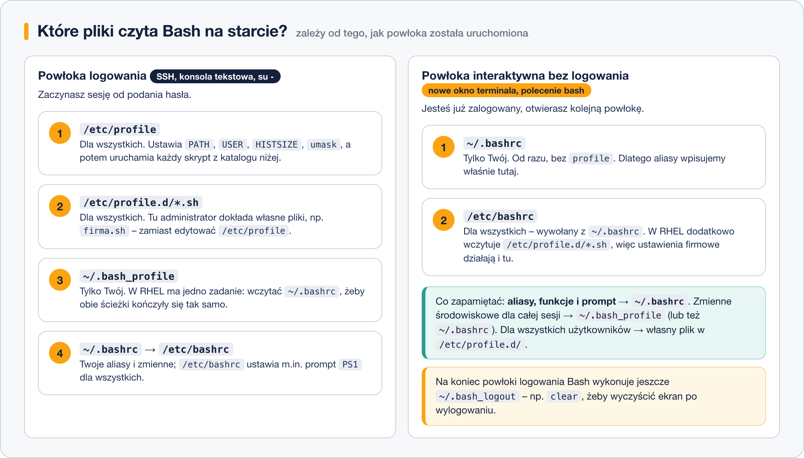

# Konfiguracja powłoki – globalna i użytkownika

> **W tej lekcji:** dowiesz się, które pliki Bash czyta przy starcie i w jakiej kolejności,
> czym różni się powłoka logowania od interaktywnej, gdzie wpisywać swoje ustawienia
> i jak je wczytać bez wylogowywania (`source`).

## Po co mi to?

W poprzedniej lekcji dopisaliśmy prompt do `~/.bashrc` i zadziałało. Ale dlaczego akurat tam?
Obok leżą `~/.bash_profile` i `~/.bash_logout`, a w systemie jeszcze `/etc/profile` i `/etc/bashrc`.
Każdy z tych plików jest czytany w innym momencie – i jeśli wpiszesz ustawienie w zły plik,
będzie działać „czasami”: w oknie terminala tak, po SSH nie. Takie „czasami” to najbardziej
frustrujący rodzaj błędu.

To też pierwszy przykład ogólnej zasady Linuksa: **konfiguracja systemowa leży w `/etc`,
konfiguracja użytkownika w jego katalogu domowym, w ukrytych plikach z kropką**. Ustawienia
użytkownika wygrywają, bo są czytane później.

## Jak to działa

### Dwa rodzaje powłok

- **Powłoka logowania** (ang. *login shell*) – pierwsza powłoka Twojej sesji: logujesz się przez
  SSH, na konsoli tekstowej albo przełączasz się na innego użytkownika przez `su -`.
- **Powłoka interaktywna bez logowania** – każda następna: otwierasz okno terminala na pulpicie
  (jesteś już zalogowany), wpisujesz `bash` w działającej powłoce.

Każdy rodzaj czyta **inne pliki startowe**:



### Co jest w których plikach

| Plik | Czyj | Kiedy czytany | Co tam wpisywać |
|---|---|---|---|
| `/etc/profile` | systemowy | logowanie | nic – nie edytuj; aktualizacja systemu może go nadpisać |
| `/etc/profile.d/*.sh` | systemowy | logowanie | ustawienia administratora **dla wszystkich** – dodajesz własny plik, np. `firma.sh` |
| `~/.bash_profile` | Twój | logowanie | zmienne środowiskowe sesji; w RHEL głównie wczytuje `~/.bashrc` |
| `~/.bashrc` | Twój | każda powłoka interaktywna | **aliasy, funkcje, prompt, własne zmienne – tu wpisujesz prawie wszystko** |
| `/etc/bashrc` | systemowy | każda powłoka interaktywna (wołany z `~/.bashrc`) | nic – systemowy prompt i ustawienia; zamiast edycji użyj `/etc/profile.d/` |
| `~/.bash_logout` | Twój | wyjście z powłoki logowania | czynności porządkowe, np. `clear` |

Dlaczego to spójnie działa: domyślny `~/.bash_profile` w RHEL zawiera trzy linijki, które wczytują
`~/.bashrc`, a `~/.bashrc` wczytuje `/etc/bashrc`. Dzięki temu niezależnie od tego, jak powłoka
wystartowała, Twoje wpisy z `~/.bashrc` zawsze obowiązują.

```bash
# tak wygląda domyślny ~/.bash_profile w RHEL
cat ~/.bash_profile
```

```text
# .bash_profile

# Get the aliases and functions
if [ -f ~/.bashrc ]; then
        . ~/.bashrc
fi
```

Zapis `. ~/.bashrc` (kropka, spacja, plik) znaczy: „wykonaj ten plik w bieżącej powłoce”.

### Praktyczna reguła

- **Wszystko, co Twoje** (aliasy, prompt, zmienne): `~/.bashrc`.
- **Dla wszystkich użytkowników serwera**: nowy plik w `/etc/profile.d/`, np.
  `/etc/profile.d/firma.sh` (wymaga uprawnień roota).
- Plików systemowych `/etc/profile` i `/etc/bashrc` **nie edytuj** – po aktualizacji pakietów
  możesz stracić zmiany, a błąd w nich psuje logowanie wszystkim.

## W praktyce

### Sprawdź, jaką masz powłokę

```bash
# powłoka logowania wyświetla "-bash", zwykła "bash"
echo $0
```

```text
-bash
```

### Dodaj własne ustawienie

```bash
# dopisz alias do ~/.bashrc (szczegóły o aliasach w następnej lekcji)
echo "alias ll='ls -lah'" >> ~/.bashrc
```

```bash
# nowy wpis nie działa w już otwartej powłoce...
ll
```

```text
bash: ll: command not found
```

```bash
# ...dopóki nie wczytasz pliku ponownie
source ~/.bashrc
ll
```

```text
razem 44K
drwx------. 6 anna anna 4,0K 18 paź 11:02 .
...
```

`source plik` i `. plik` robią dokładnie to samo – wykonują plik w bieżącej powłoce. Alternatywa:
zamknij terminal i otwórz nowy.

### Ustawienie dla wszystkich użytkowników (jako root)

```bash
# nowy plik w /etc/profile.d/ – zadziała przy następnym logowaniu każdego użytkownika
sudo tee /etc/profile.d/firma.sh > /dev/null << 'EOF'
# Ustawienia firmowe
export EDITOR=vim
EOF
```

```bash
# sprawdź, że plik jest poprawny, zanim ktokolwiek się wyloguje
bash -n /etc/profile.d/firma.sh && echo OK
```

```text
OK
```

### Pożegnanie: `~/.bash_logout`

```bash
cat ~/.bash_logout
```

```text
# ~/.bash_logout
clear
```

Ten plik wykonuje się przy wyjściu z powłoki logowania. Domyślnie czyści ekran – żeby następna
osoba przy konsoli nie widziała, co robiłeś.

## Najczęstsze błędy i pułapki

1. **Wpis w `~/.bash_profile` zamiast `~/.bashrc`.** Działa po SSH, nie działa w nowym oknie
   terminala. Odwrotna pomyłka daje odwrotny objaw. Reguła: wszystko do `~/.bashrc`.
2. **Edycja bez `source`.** Zmiana w pliku nie dotyczy już otwartych powłok. Po edycji:
   `source ~/.bashrc`.
3. **Błąd składni w `~/.bashrc`.** Każda nowa powłoka wypisze błąd, a reszta pliku się nie
   wykona. Zanim się wylogujesz, otwórz **drugi terminal** i sprawdź, że logowanie działa –
   stara sesja to Twoje koło ratunkowe. Składnię sprawdza `bash -n ~/.bashrc`.
4. **Edycja `/etc/profile` lub `/etc/bashrc`.** Zmiany giną przy aktualizacji, a literówka
   psuje logowanie wszystkim. Używaj `/etc/profile.d/`.
5. **`su` zamiast `su -`.** Bez myślnika nie dostajesz powłoki logowania – stare zmienne
   i katalog zostają po poprzednim użytkowniku. Przełączaj się zawsze przez `su -`.

## Podsumowanie

- Powłoka logowania czyta `/etc/profile` → `/etc/profile.d/*.sh` → `~/.bash_profile`
  → (z niego) `~/.bashrc` → `/etc/bashrc`; przy wyjściu `~/.bash_logout`.
- Powłoka interaktywna bez logowania czyta tylko `~/.bashrc` → `/etc/bashrc`.
- Twoje ustawienia: `~/.bashrc`. Ustawienia dla wszystkich: własny plik w `/etc/profile.d/`.
- `source plik` (albo `. plik`) wczytuje zmiany bez wylogowania.
- Plik systemowy edytowany bezpośrednio = zmiany stracone przy aktualizacji.

| Polecenie | Co robi |
|---|---|
| `echo $0` | `-bash` = powłoka logowania, `bash` = zwykła |
| `cat ~/.bashrc` | pokaż swój plik konfiguracyjny |
| `source ~/.bashrc` | wczytaj zmiany w bieżącej powłoce |
| `bash -n plik` | sprawdź składnię pliku bez wykonywania |
| `ls /etc/profile.d/` | systemowe skrypty startowe |
