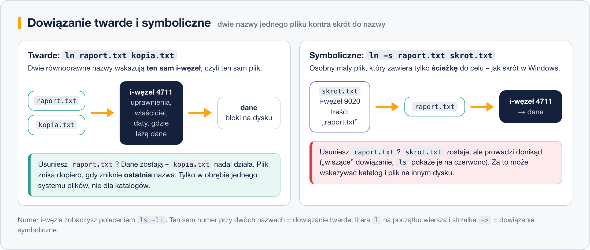

# Dowiązania twarde i symboliczne

> **W tej lekcji:** dowiesz się, czym jest i-węzeł, czym różni się dowiązanie twarde od
> symbolicznego, jak je tworzyć (`ln`, `ln -s`), rozpoznawać (`ls -li`) i co się dzieje,
> gdy usuniesz oryginalny plik.

**Dowiązania** to dodatkowe nazwy prowadzące do istniejących plików – odpowiednik skrótów znanych
z Windows, tyle że w dwóch odmianach. Spotkasz je od pierwszego dnia, nawet jeśli sam żadnego nie
utworzysz: `/bin` to w RHEL dowiązanie do `/usr/bin`, pliki konfiguracyjne usług często wskazują
wersję „aktualną”, a biblioteki – konkretne wydanie. Gdy w wyniku `ls -l` zobaczysz strzałkę `->`,
musisz wiedzieć, na co patrzysz.

Praktyczne zastosowanie: masz plik `raport-2026-10.txt`, a chcesz, żeby skrypt zawsze czytał
„najnowszy raport” bez zmieniania ścieżki. Tworzysz dowiązanie `aktualny.txt` i tylko je
przepinasz.

## Jak to działa

### I-węzeł – dowód osobisty pliku

Każdy plik w systemie plików to tak naprawdę **i-węzeł** (ang. *inode*) – rekord z metadanymi:
numer, właściciel, uprawnienia, daty, rozmiar i informacja, gdzie na dysku leżą dane. **Nazwa
pliku nie jest częścią i-węzła** – nazwa to tylko wpis w katalogu, który mówi „ta nazwa →
ten numer i-węzła”. Jeden i-węzeł może mieć wiele nazw. I to jest całe sedno tej lekcji.



### Dowiązanie twarde (ang. *hard link*)

`ln plik nowa-nazwa` dodaje **drugą nazwę do tego samego i-węzła**. Obie nazwy są całkowicie
równoprawne – nie ma „oryginału” i „kopii”. Zmiana treści, uprawnień czy właściciela przez
jedną nazwę jest natychmiast widoczna przez drugą, bo to fizycznie ten sam plik. Danych na dysku
nie przybywa.

Plik znika dopiero wtedy, gdy licznik dowiązań spadnie do zera – czyli gdy usuniesz **ostatnią**
nazwę. Ograniczenia: tylko w obrębie jednego systemu plików (i-węzły są numerowane per system
plików) i nie dla katalogów.

### Dowiązanie symboliczne (ang. *symbolic link*, *symlink*)

`ln -s cel nazwa` tworzy **osobny mały plik**, którego treścią jest ścieżka do celu. To właśnie
odpowiednik skrótu z Windows. Gdy otwierasz dowiązanie, system po cichu podąża za ścieżką.

Konsekwencje: jeśli cel usuniesz lub przeniesiesz, dowiązanie zostaje, ale „wisi” – prowadzi
donikąd. W zamian: może wskazywać katalog, plik na innym dysku, a nawet coś, co jeszcze nie
istnieje.

## W praktyce

```bash
# przygotuj plik do ćwiczeń
cd ~
echo "wersja pierwsza" > raport.txt
```

### Dowiązanie twarde

```bash
# druga nazwa dla tego samego pliku: ln CEL NOWA-NAZWA
ln raport.txt kopia.txt
```

```bash
# -i pokazuje numery i-węzłów; licznik dowiązań wzrósł do 2
ls -li raport.txt kopia.txt
```

```text
1835027 -rw-r--r--. 2 anna anna 16 18 paź 11:40 kopia.txt
1835027 -rw-r--r--. 2 anna anna 16 18 paź 11:40 raport.txt
```

Ten sam numer (1835027), ten sam rozmiar, licznik `2` – jedna treść, dwie nazwy.

```bash
# zmiana przez jedną nazwę jest widoczna przez drugą
echo "dopisek" >> kopia.txt
cat raport.txt
```

```text
wersja pierwsza
dopisek
```

```bash
# usuń "oryginał" – dane przeżyją, bo została druga nazwa
rm raport.txt
cat kopia.txt
```

```text
wersja pierwsza
dopisek
```

### Dowiązanie symboliczne

```bash
# odtwórz plik i zrób do niego skrót: ln -s CEL NAZWA-DOWIĄZANIA
echo "raport za październik" > raport-2026-10.txt
ln -s raport-2026-10.txt aktualny.txt
```

```bash
ls -li raport-2026-10.txt aktualny.txt
```

```text
1835100 lrwxrwxrwx. 1 anna anna 18 18 paź 11:45 aktualny.txt -> raport-2026-10.txt
1835099 -rw-r--r--. 1 anna anna 21 18 paź 11:45 raport-2026-10.txt
```

Inny numer i-węzła, typ `l` na początku, strzałka do celu. Rozmiar 18 to długość samej ścieżki.
Uprawnienia `rwxrwxrwx` przy dowiązaniu nic nie znaczą – liczą się uprawnienia celu.

```bash
# czytanie dowiązania = czytanie celu
cat aktualny.txt
```

```text
raport za październik
```

```bash
# usuń cel – dowiązanie wisi
rm raport-2026-10.txt
cat aktualny.txt
```

```text
cat: aktualny.txt: No such file or directory
```

Komunikat jest mylący: `aktualny.txt` istnieje, nie istnieje jego **cel**. `ls` w kolorowym
terminalu pokazuje wiszące dowiązania na czerwono.

```bash
# dowiązania symboliczne systemu – tak RHEL łączy /bin z /usr/bin
ls -ld /bin
```

```text
lrwxrwxrwx. 1 root root 7 10 paź 08:40 /bin -> usr/bin
```

> **Ścieżka w dowiązaniu symbolicznym** jest zapisywana dosłownie tak, jak ją podasz. Dowiązanie
> ze ścieżką względną (`ln -s raport.txt skrot`) przestanie działać, gdy przeniesiesz je do
> innego katalogu. Jeśli dowiązanie ma działać „zawsze i wszędzie”, podaj cel ścieżką
> bezwzględną: `ln -s /home/anna/raport.txt /tmp/skrot`.

### Kiedy którego używać

| Sytuacja | Wybór |
|---|---|
| skrót do katalogu | symboliczne (twarde się nie da) |
| cel na innym dysku / partycji | symboliczne |
| „przełącznik” na aktualną wersję pliku lub katalogu | symboliczne |
| druga nazwa pliku, która ma przeżyć usunięcie pierwszej | twarde |
| ten sam plik widoczny w dwóch miejscach bez podwójnego zajmowania dysku | twarde |

W codziennej administracji ok. 95% przypadków to dowiązania symboliczne – są widoczne na pierwszy
rzut oka i działają wszędzie.

## Najczęstsze błędy i pułapki

1. **Odwrotna kolejność argumentów.** Wzór to `ln -s CEL NAZWA` – najpierw to, co istnieje,
   potem nazwa dowiązania. Pomyłka tworzy dowiązanie wiszące albo (gdy nazwa istnieje) błąd.
2. **Dowiązanie symboliczne ze ścieżką względną przeniesione w inne miejsce.** Przestaje działać –
   ścieżka liczona jest od katalogu, w którym leży dowiązanie.
3. **„Plik jest, a `cat` mówi, że go nie ma”.** Patrzysz na wiszące dowiązanie. Sprawdź
   `ls -l` – strzałka pokaże, dokąd prowadzi i czy cel istnieje.
4. **Oczekiwanie, że twarde dowiązanie zadziała między dyskami albo dla katalogu.** Nie zadziała:
   *Invalid cross-device link* / *hard link not allowed for directory*. Użyj `ln -s`.
5. **Mylenie z kopią.** `ln` nie kopiuje danych. Jeśli chcesz niezależny plik, który można
   osobno edytować – `cp`.

## Podsumowanie

- Nazwa pliku to wpis w katalogu wskazujący i-węzeł; i-węzeł to metadane + położenie danych.
- Dowiązanie twarde (`ln`) = druga równoprawna nazwa tego samego i-węzła; dane znikają dopiero
  z ostatnią nazwą; tylko ten sam system plików, nie dla katalogów.
- Dowiązanie symboliczne (`ln -s`) = osobny plik ze ścieżką do celu; działa między dyskami
  i dla katalogów, ale usunięcie celu zostawia „wiszący” skrót.
- `ls -li` pokazuje numer i-węzła i licznik dowiązań; typ `l` i `->` zdradzają symlink.

| Polecenie | Co robi |
|---|---|
| `ln plik druga-nazwa` | dowiązanie twarde |
| `ln -s cel nazwa` | dowiązanie symboliczne |
| `ls -li` | numery i-węzłów + licznik dowiązań |
| `readlink nazwa` | dokąd prowadzi dowiązanie symboliczne |
| `readlink -f nazwa` | pełna ścieżka celu (rozwinięta) |
