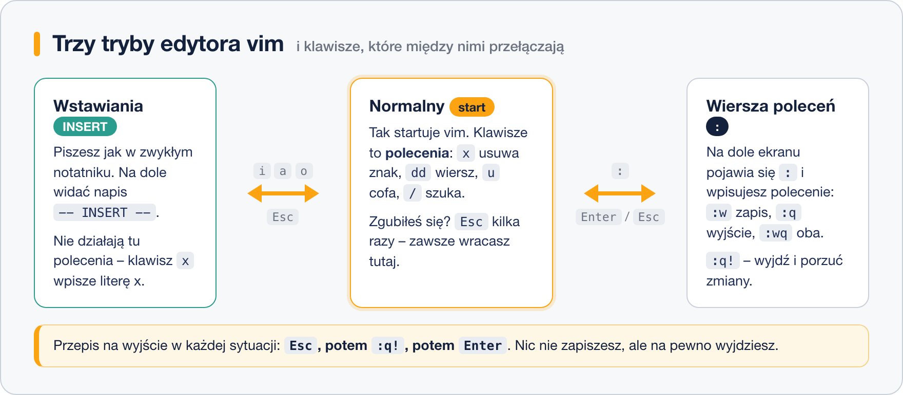

# Edytor vi i vim

> **W tej lekcji:** zrozumiesz, dlaczego vi jest na każdym Linuksie i czemu trzeba go znać,
> opanujesz trzy tryby pracy, nauczysz się przede wszystkim **wychodzić** z edytora oraz poznasz
> zestaw ratunkowy kilkunastu poleceń, który wystarcza do codziennej administracji.

**vi** to edytor tekstu, który jest częścią podstawowej instalacji każdego systemu uniksowego od
prawie pięćdziesięciu lat – na serwerze bez `nano` i bez środowiska graficznego będzie jedynym
narzędziem do poprawienia linijki w konfiguracji. W RHEL polecenie `vi` uruchamia w praktyce
**vim** (*Vi IMproved*), ulepszoną wersję tego edytora; nazwy używamy wymiennie.

Druga sprawa: niektóre narzędzia same otwierają edytor – `visudo`, `crontab -e`, `git commit`.
Jeśli nie wiesz, jak z niego wyjść, zostajesz uwięziony we własnym terminalu. To najczęstsze
pierwsze zderzenie początkującego z vimem, więc załatwmy je od razu.

## Jak to działa

### Najpierw: jak wyjść

W każdej sytuacji działa ta sekwencja:

1. `Esc` (kilka razy – na pewno wyjdziesz do trybu normalnego),
2. `:q!`
3. `Enter`.

Wyjdziesz **bez zapisywania** zmian. Jeśli chcesz zapisać: `Esc`, `:wq`, `Enter`.

### Trzy tryby

Vim różni się od notatnika jednym pomysłem: **klawisze mają różne znaczenie w zależności od
trybu**. W trybie normalnym `x` usuwa znak; w trybie wstawiania `x` wpisuje literę „x”.



- **Tryb normalny** – tak startuje vim. Klawisze to polecenia edycyjne: poruszanie się,
  usuwanie, kopiowanie. `Esc` zawsze wraca tutaj.
- **Tryb wstawiania** (INSERT) – zwykłe pisanie. Wchodzisz klawiszami `i`, `a` lub `o`;
  na dole ekranu widać `-- INSERT --`.
- **Tryb wiersza poleceń** – po naciśnięciu `:` w trybie normalnym. Tu wpisujesz polecenia
  „administracyjne”: zapis, wyjście, szukanie i zamianę.

Po co to komplikowanie? W trybie normalnym jedno–dwa naciśnięcia robią to, co w zwykłym edytorze
wymaga myszki i menu: `dd` wycina cały wiersz, `5dd` pięć wierszy, `u` cofa. Przy pracy przez
wolne łącze SSH, bez myszy, to jest szybsze – dlatego vim przetrwał pół wieku.

## W praktyce

### Pierwsza edycja krok po kroku

```bash
# otwórz (lub utwórz) plik
vim notatki.txt
```

1. Vim startuje w trybie **normalnym**. Nie pisz jeszcze!
2. Naciśnij `i` – na dole pojawi się `-- INSERT --`.
3. Wpisz tekst, np. `Moja pierwsza notatka.` Enter działa normalnie.
4. Naciśnij `Esc` – wracasz do trybu normalnego.
5. Wpisz `:wq` i naciśnij `Enter` – zapis i wyjście.

```bash
# sprawdź efekt
cat notatki.txt
```

```text
Moja pierwsza notatka.
```

### Zestaw ratunkowy – 15 poleceń

Tryb normalny:

| Klawisz | Co robi |
|---|---|
| `i` | wstawianie **przed** kursorem |
| `a` | wstawianie **za** kursorem |
| `o` | nowy wiersz pod bieżącym + wstawianie |
| `x` | usuń znak pod kursorem |
| `dd` | usuń (wytnij) cały wiersz; `5dd` – pięć wierszy |
| `yy` | skopiuj wiersz; `5yy` – pięć wierszy |
| `p` | wklej wycięte/skopiowane pod kursorem |
| `u` | cofnij ostatnią zmianę; `Ctrl+R` – przywróć |
| `gg` / `G` | skok na początek / koniec pliku |
| `/tekst` | szukaj „tekst” w dół; `n` – następne wystąpienie, `N` – poprzednie |

Tryb wiersza poleceń (zawsze zaczyna się od `:`):

| Polecenie | Co robi |
|---|---|
| `:w` | zapisz |
| `:q` | wyjdź (odmówi, jeśli są niezapisane zmiany) |
| `:wq` | zapisz i wyjdź (to samo: `ZZ` w trybie normalnym) |
| `:q!` | wyjdź **bez** zapisywania |
| `:42` | skocz do wiersza 42 |

To naprawdę wystarczy. Setki pozostałych poleceń vima poznasz (albo nie) z czasem.

### Szukanie i zamiana

```text
:%s/stary/nowy/g
```

Zamienia „stary” na „nowy” w całym pliku (`%` – wszystkie wiersze, `g` – wszystkie wystąpienia
w wierszu). Z `gc` na końcu pyta o każdą zamianę. To samo polecenie spotkasz w `sed` – vim
i narzędzia uniksowe mówią jednym językiem.

### Ćwicz z vimtutorem

```bash
# półgodzinny interaktywny samouczek wbudowany w vima, po polsku
vimtutor pl
```

Jeśli polska wersja nie jest zainstalowana, samo `vimtutor` uruchomi angielską. To najlepsze
pół godziny, jakie możesz zainwestować w naukę vima. W minimalnej instalacji RHEL jest tylko
`vi` (pakiet `vim-minimal`); pełnego vima z vimtutorem doinstalujesz przez
`sudo dnf install vim-enhanced`.

## Najczęstsze błędy i pułapki

1. **Pisanie w trybie normalnym.** Tekst „nie wchodzi”, za to dzieją się dziwne rzeczy – bo
   każda litera to polecenie. `Esc`, potem `u` tyle razy, aż cofniesz szkody, i dopiero `i`.
2. **Zablokowany terminal po `Ctrl+S`.** To nie vim – terminal wstrzymał wyświetlanie.
   `Ctrl+Q` odblokowuje.
3. **`:q` odmawia wyjścia** (*No write since last change*). Zdecyduj: `:wq` zapisuje, `:q!`
   porzuca zmiany.
4. **Wielkie litery się mylą.** `i` ≠ `I`, `a` ≠ `A` (te wielkie też wstawiają, ale na początku /
   końcu wiersza). Jeśli efekt Cię zaskoczył – `Esc`, `u`.
5. **Plik tylko do odczytu.** Otworzyłeś plik systemowy bez `sudo`; vim ostrzega `readonly`,
   a `:w` odmawia. Wyjdź (`:q!`) i otwórz ponownie: `sudo vim /etc/plik`. Nie przyzwyczajaj się
   do wymuszania zapisu.
6. **Strzałki piszą litery `ABCD`** – zdarza się w starym vi na innych Uniksach. Poruszaj się
   klawiszami `h` `j` `k` `l` (lewo, dół, góra, prawo).

## Podsumowanie

- `vi`/`vim` jest wszędzie – znajomość podstaw to polisa ubezpieczeniowa administratora.
- Trzy tryby: normalny (polecenia), wstawiania (`i`, pisanie), wiersza poleceń (`:`).
- `Esc` zawsze wraca do trybu normalnego; `Esc` `:q!` `Enter` zawsze wychodzi.
- Zestaw ratunkowy: `i a o`, `x dd yy p`, `u`, `gg G`, `/szukaj` + `n`, `:w :q :wq :q!`.
- `vimtutor` uczy reszty.

| Chcę… | Robię |
|---|---|
| zacząć pisać | `i` |
| przestać pisać | `Esc` |
| zapisać i wyjść | `:wq` (lub `ZZ`) |
| wyjść bez zapisu | `:q!` |
| usunąć wiersz | `dd` |
| cofnąć | `u` |
| znaleźć tekst | `/tekst`, potem `n` |
| zamienić w całym pliku | `:%s/stary/nowy/g` |
