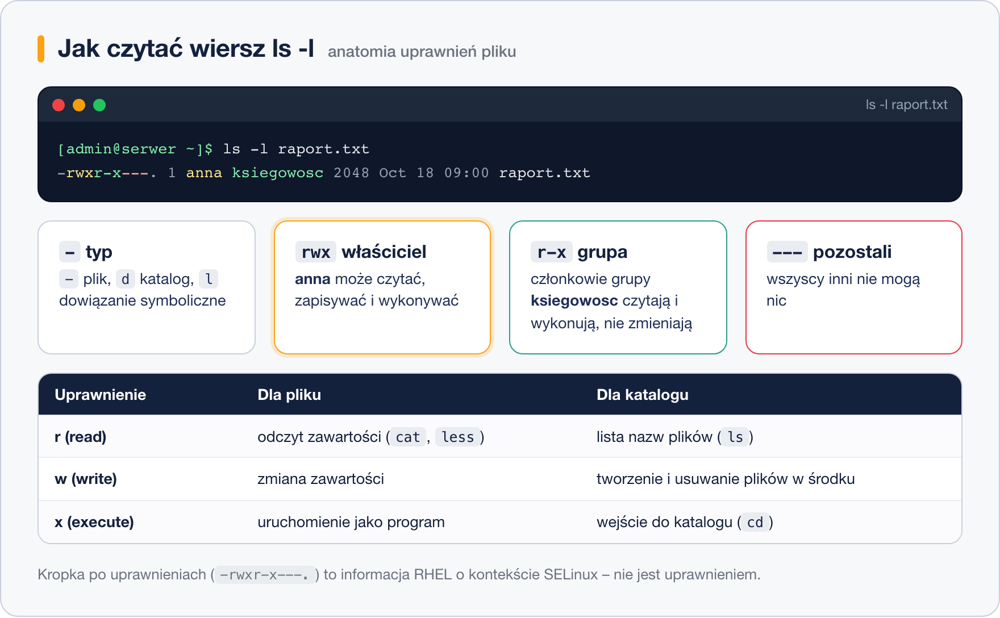
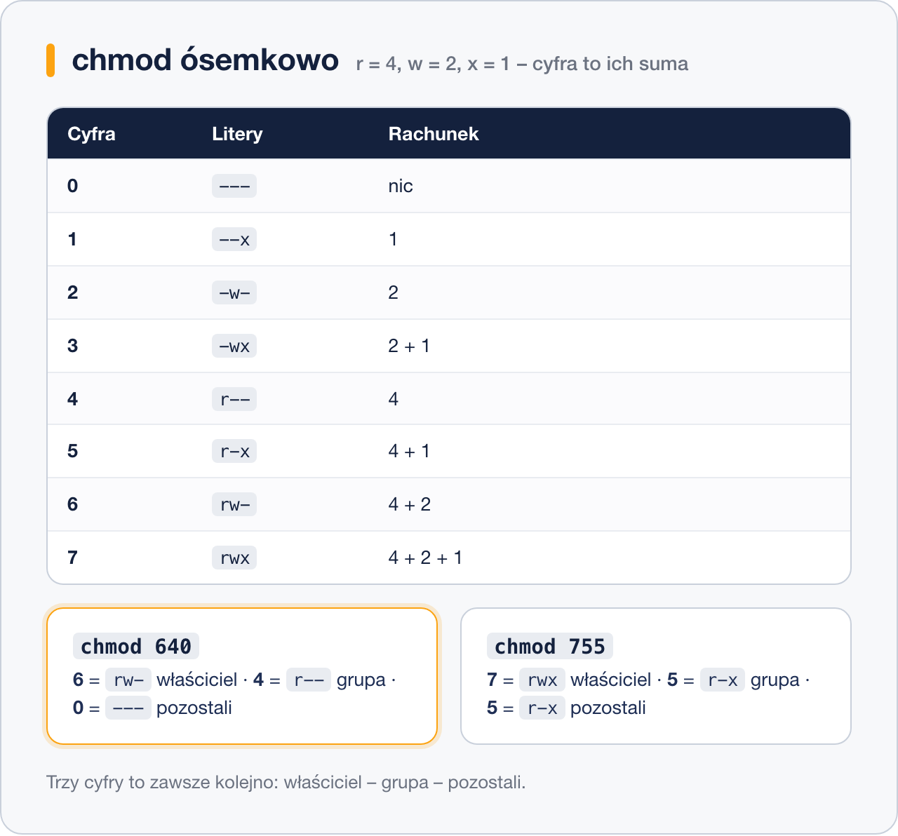

# Uprawnienia do plików i katalogów

> **W tej lekcji:** nauczysz się czytać wiersz `ls -l`, rozumieć, kto i co może zrobić z plikiem, oraz zmieniać uprawnienia i właściciela poleceniami `chmod`, `chown` i `chgrp`.

## Po co mi to?

Na jednym serwerze pracuje wiele osób i wiele programów. Serwer WWW musi czytać pliki strony, ale nie powinien ich kasować. Księgowa z działu `ksiegowosc` ma widzieć faktury, a stażysta – nie. Hasła w `/etc/shadow` może czytać tylko administrator. To wszystko załatwia jeden mechanizm: **uprawnienia** (ang. permissions).

Jeśli znasz Windows, to odpowiednik zakładki „Zabezpieczenia” we właściwościach pliku – tyle że w Linuksie jest prostszy i widać go w jednym wierszu tekstu. Większość komunikatów `Permission denied` („brak uprawnień”), które zobaczysz w pierwszych tygodniach pracy, wynika właśnie z tego, czego nauczysz się teraz.

## Jak to działa

### Trzy pytania: kto, co, do czego

Każdy plik i katalog w Linuksie ma:

- **właściciela** (ang. owner, user) – zwykle osobę, która go utworzyła,
- **grupę** (ang. group) – zespół użytkowników, np. `ksiegowosc`,
- **pozostałych** (ang. others) – wszystkich innych zalogowanych.

Dla każdej z tych trzech kategorii system pamięta trzy uprawnienia: **r** (ang. read – odczyt), **w** (ang. write – zapis) i **x** (ang. execute – wykonanie). Razem daje to 9 „przełączników”, które widzisz na początku każdego wiersza `ls -l`.



```bash
# szczegółowa lista plików w katalogu /etc – kolumna pierwsza to uprawnienia
ls -l /etc/hostname /etc/shadow /usr/bin/passwd
```

```text
-rw-r--r--. 1 root root     7 Oct  1 10:12 /etc/hostname
----------. 1 root root  1131 Oct  1 10:30 /etc/shadow
-rwsr-xr-x. 1 root root 32648 Aug 20  2024 /usr/bin/passwd
```

Jak czytać `-rw-r--r--`:

| Znak | Co oznacza |
|---|---|
| `-` (pierwszy) | typ: `-` zwykły plik, `d` katalog, `l` dowiązanie symboliczne |
| `rw-` | właściciel może czytać i zapisywać |
| `r--` | grupa może tylko czytać |
| `r--` | pozostali mogą tylko czytać |
| `.` na końcu | na RHEL: plik ma kontekst SELinux (to nie jest uprawnienie, po prostu informacja) |

`/etc/shadow` ma same kreski – nikt poza rootem (który i tak może wszystko) nie ma do niego dostępu. Tak ma być: to plik ze skrótami haseł.

### r, w, x znaczą co innego dla pliku, a co innego dla katalogu

To miejsce, w którym początkujący gubią się najczęściej. Zapamiętaj tę tabelę:

| Uprawnienie | Dla pliku | Dla katalogu |
|---|---|---|
| `r` | mogę przeczytać zawartość (`cat`, `less`) | mogę wyświetlić listę nazw (`ls`) |
| `w` | mogę zmienić zawartość | mogę tworzyć, usuwać i zmieniać nazwy plików w środku |
| `x` | mogę uruchomić jako program | mogę **wejść** do katalogu (`cd`) i sięgnąć po pliki w środku |

Dwa wnioski, które zaskakują:

1. Możesz **usunąć cudzy plik**, do którego nie masz żadnych praw, jeśli masz `w` do katalogu, w którym leży. Usuwanie to zmiana katalogu, nie pliku.
2. Katalog z `r`, ale bez `x` pozwala zobaczyć nazwy plików, ale nie pozwala ich otworzyć. Katalog bez `x` jest praktycznie bezużyteczny – dlatego katalogi prawie zawsze mają `x` tam, gdzie mają `r`.

### Zapis ósemkowy

Każdą trójkę `rwx` można zapisać jedną cyfrą: `r` = 4, `w` = 2, `x` = 1, a wartość to ich suma. `rw-` to 4 + 2 = 6, `r-x` to 4 + 1 = 5, `rwx` to 7, `---` to 0.



Trzy cyfry obok siebie to trzy kategorie: **właściciel – grupa – pozostali**. Najczęstsze kombinacje:

| Zapis | Litery | Typowe użycie |
|---|---|---|
| `644` | `rw-r--r--` | zwykły plik: ja edytuję, reszta czyta |
| `600` | `rw-------` | plik prywatny (klucze SSH, hasła) |
| `755` | `rwxr-xr-x` | katalog lub skrypt: ja wszystko, reszta czyta i wchodzi/uruchamia |
| `700` | `rwx------` | katalog prywatny |
| `770` | `rwxrwx---` | katalog współdzielony przez grupę, zamknięty dla reszty |

## W praktyce

### chmod – zmiana uprawnień

`chmod` (ang. change mode) przyjmuje zapis symboliczny albo ósemkowy. Składnia symboliczna: **komu** (`u` właściciel, `g` grupa, `o` pozostali, `a` wszyscy) + **operacja** (`+` dodaj, `-` odbierz, `=` ustaw dokładnie) + **co** (`r`, `w`, `x`).

```bash
# tworzymy plik do ćwiczeń i sprawdzamy domyślne uprawnienia
touch raport.txt
ls -l raport.txt
```

```text
-rw-rw-r--. 1 admin admin 0 Oct 18 09:00 raport.txt
```

```bash
# odbieramy pozostałym prawo odczytu (symbolicznie)
chmod o-r raport.txt

# dajemy grupie prawo zapisu, a właścicielowi prawo wykonania
chmod g+w,u+x raport.txt

# ustawiamy dokładnie: właściciel rw, grupa r, pozostali nic (ósemkowo)
chmod 640 raport.txt
ls -l raport.txt
```

```text
-rw-r-----. 1 admin admin 0 Oct 18 09:00 raport.txt
```

```bash
# katalog projektu: zmiana rekurencyjna dla całego drzewa (ostrożnie!)
chmod -R 750 ~/projekt
```

> **Uwaga na `-R` z zapisem ósemkowym:** `chmod -R 644 katalog` zabierze katalogom `x` i nie dasz rady do nich wejść. Jeśli musisz dodać `x` tylko katalogom, użyj wielkiej litery `X`: `chmod -R u=rwX,g=rX,o= katalog` – `X` daje wykonanie katalogom i plikom, które już były wykonywalne, a zwykłym plikom nie.

### chown i chgrp – zmiana właściciela i grupy

Właściciela może zmienić tylko root (dlatego `sudo`). Grupę może zmienić właściciel pliku, ale tylko na grupę, do której sam należy.

```bash
# plik przechodzi na własność użytkownika anna
sudo chown anna raport.txt

# właściciel anna i grupa ksiegowosc za jednym razem
sudo chown anna:ksiegowosc raport.txt

# tylko grupa – odpowiednik chgrp
sudo chown :ksiegowosc raport.txt
sudo chgrp ksiegowosc raport.txt

# cały katalog z zawartością
sudo chown -R anna:ksiegowosc /srv/faktury
ls -ld /srv/faktury
```

```text
drwxr-xr-x. 2 anna ksiegowosc 4096 Oct 18 09:10 /srv/faktury
```

`ls -ld` pokazuje sam katalog zamiast jego zawartości – przydatne, gdy sprawdzasz uprawnienia katalogu.

### umask – skąd się biorą domyślne uprawnienia

Nowy plik dostaje teoretycznie `666`, a nowy katalog `777`. Od tego system **odejmuje maskę** `umask`. Na RHEL zwykły użytkownik ma maskę `0002`, więc pliki powstają jako `664`, a katalogi jako `775`. Root ma `0022` (pliki `644`, katalogi `755`).

```bash
# sprawdzamy aktualną maskę
umask
```

```text
0002
```

```bash
# do końca tej sesji nowe pliki będą prywatne (600 / 700)
umask 077
```

Zmiana przez `umask` działa tylko w bieżącej powłoce. Na stałe ustawia się ją w `~/.bashrc` użytkownika albo w `/etc/profile.d/` dla wszystkich.

### Bity specjalne: SUID, SGID, sticky

Oprócz 9 zwykłych przełączników są trzy specjalne. Spotkasz je rzadko, ale dwa z nich widzisz w każdym systemie:

| Bit | Zapis | Gdzie zobaczysz | Co robi |
|---|---|---|---|
| **SUID** | `s` w miejscu `x` właściciela, ósemkowo `4xxx` | `/usr/bin/passwd` (`-rwsr-xr-x`) | program działa z uprawnieniami właściciela pliku (roota), dlatego zwykły użytkownik może zmienić swoje hasło w `/etc/shadow` |
| **SGID** | `s` w miejscu `x` grupy, `2xxx` | katalogi współdzielone | nowe pliki w katalogu dziedziczą jego grupę zamiast grupy głównej twórcy |
| **sticky** | `t` w miejscu `x` pozostałych, `1xxx` | `/tmp` (`drwxrwxrwt`) | każdy może tworzyć pliki, ale usuwać tylko własne |

```bash
# katalog działu: grupa ma pełne prawa, a nowe pliki od razu należą do grupy
sudo mkdir /srv/ksiegowosc
sudo chown root:ksiegowosc /srv/ksiegowosc
sudo chmod 2770 /srv/ksiegowosc
ls -ld /srv/ksiegowosc
```

```text
drwxrws---. 2 root ksiegowosc 4096 Oct 18 09:20 /srv/ksiegowosc
```

Ten scenariusz rozwiniesz w lekcji o grupach w module 07.

## Najczęstsze błędy i pułapki

- **`Permission denied` przy `cd`** – katalogowi brakuje `x`, nie `r`. Sprawdź `ls -ld katalog`.
- **`chmod 777` „żeby działało”** – działa, ale każdy użytkownik i każdy program na serwerze może teraz zmienić ten plik. Zamiast tego ustal właściwego właściciela/grupę i daj minimalne prawa.
- **`chmod -R 644`** na katalogu odbiera katalogom `x`. Napraw przez `chmod -R u=rwX,go=rX`.
- **Skrypt nie startuje** (`./skrypt.sh: Permission denied`) – brakuje `x`: `chmod u+x skrypt.sh`.
- **Zmiana grupy nie zadziałała** – `chgrp` na grupę, do której nie należysz, wymaga `sudo`. Jeśli przed chwilą dodano Cię do grupy, wyloguj się i zaloguj ponownie.

## Podsumowanie

- Każdy plik ma właściciela, grupę i trzy trójki `rwx` dla: właściciela, grupy, pozostałych.
- Dla katalogu `r` = lista nazw, `w` = tworzenie/usuwanie w środku, `x` = wejście.
- Ósemkowo: `r`=4, `w`=2, `x`=1; `644` dla plików i `755` dla katalogów to bezpieczne domyślne wartości.
- `umask` decyduje, jakie prawa dostają nowe pliki (na RHEL `0002` dla użytkowników, `0022` dla roota).
- SUID na `passwd`, sticky na `/tmp`, SGID na katalogach zespołowych – trzy bity specjalne warte zapamiętania.

| Polecenie | Co robi |
|---|---|
| `ls -l`, `ls -ld katalog` | pokazuje uprawnienia pliku / samego katalogu |
| `chmod 640 plik` | ustawia uprawnienia ósemkowo |
| `chmod u+x,g-w plik` | zmienia uprawnienia symbolicznie |
| `chmod -R u=rwX,go=rX katalog` | rekurencyjnie, `x` tylko dla katalogów |
| `sudo chown anna:ksiegowosc plik` | zmienia właściciela i grupę |
| `sudo chgrp ksiegowosc plik` | zmienia tylko grupę |
| `umask` / `umask 077` | pokazuje / ustawia maskę nowych plików |
| `chmod 2770 katalog` | SGID na katalogu współdzielonym |
