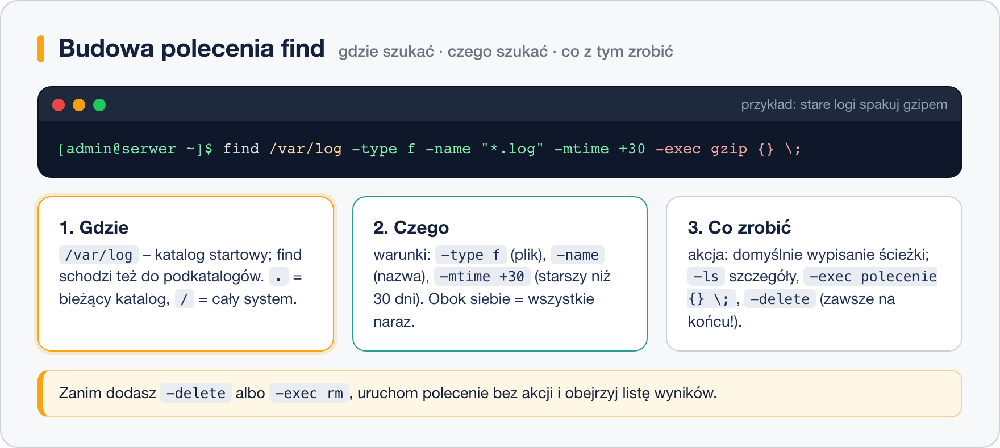

# Wyszukiwanie plików – find i locate

> **W tej lekcji:** nauczysz się znajdować pliki po nazwie, typie, rozmiarze, czasie i właścicielu poleceniem `find`, wykonywać na znalezionych plikach polecenia oraz używać szybkiego `locate` i narzędzi `which`, `whereis`, `type`.

„Gdzie jest plik konfiguracyjny tej usługi?”, „Co zajęło cały dysk?”, „Które pliki zmieniły się od wczoraj?”, „Czy ktoś zostawił w systemie pliki z prawami `777`?” – to codzienne pytania administratora. W Linuksie nie ma okienka wyszukiwania; jest `find`, które potrafi więcej niż jakiekolwiek okienko, bo każdy warunek można łączyć z innym, a na wynikach od razu wykonać polecenie.

## Jak to działa

`find` **przechodzi katalog po katalogu** od miejsca, które wskażesz, i sprawdza każdy plik według podanych warunków. Jest zawsze aktualne, ale na dużym dysku może potrwać. `locate` działa odwrotnie: przeszukuje **gotową bazę** nazw plików zbudowaną raz dziennie – odpowiada natychmiast, ale nie zna plików utworzonych po ostatniej aktualizacji bazy.

Polecenie `find` ma zawsze trzy części:



1. **Gdzie** – katalog startowy (`.` bieżący, `/home`, `/` cały system).
2. **Co** – warunki (testy): `-name`, `-type`, `-size`, `-mtime`, `-user`, `-perm`…
3. **Co zrobić** – akcja: domyślnie wypisanie ścieżki (`-print`), ale też `-exec`, `-delete`, `-ls`.

Warunki podane obok siebie muszą być spełnione **jednocześnie** (domyślne „i”). `-o` oznacza „lub”, `!` – zaprzeczenie.

## W praktyce

### Szukanie po nazwie i typie

```bash
# pliki o dokładnej nazwie w katalogu domowym i jego podkatalogach
find ~ -name notatki.txt

# wzorzec w cudzysłowie, żeby powłoka nie rozwinęła gwiazdki za wcześnie
find /var/log -name "*.log"

# bez rozróżniania wielkości liter (i = ignore case)
find /etc -iname "*.CONF"

# tylko katalogi (d) o nazwie zawierającej „backup”
find / -type d -name "*backup*" 2>/dev/null
```

| Opcja | Znaczenie |
|---|---|
| `-name wzorzec` | nazwa pliku (wzorce `*`, `?`), wielkość liter ma znaczenie |
| `-iname wzorzec` | jak wyżej, ale bez rozróżniania wielkości liter |
| `-type f` / `d` / `l` | zwykły plik / katalog / dowiązanie symboliczne |
| `-path "*/.git/*"` | dopasowanie do całej ścieżki, nie tylko nazwy |
| `-maxdepth 1` | nie schodź głębiej niż jeden poziom |

Końcówka `2>/dev/null` wyrzuca komunikaty błędów (strumień 2) „do kosza”. Bez niej przeszukiwanie całego systemu jako zwykły użytkownik zasypie Cię komunikatami `Permission denied` o katalogach, do których nie masz dostępu. Wyniki (strumień 1) zostają na ekranie.

### Szukanie po rozmiarze i czasie

```bash
# pliki większe niż 100 MB – pierwszy krok, gdy kończy się miejsce na dysku
sudo find / -type f -size +100M 2>/dev/null

# pliki puste
find ~ -type f -empty

# zmodyfikowane w ciągu ostatnich 7 dni
find /etc -type f -mtime -7

# niezmieniane od ponad roku
find /srv/archiwum -type f -mtime +365

# zmodyfikowane w ciągu ostatnich 30 minut
find /var/log -mmin -30
```

| Opcja | Znaczenie |
|---|---|
| `-size +100M` / `-size -10k` | większy niż 100 MB / mniejszy niż 10 kB (`k`, `M`, `G`) |
| `-mtime -7` | zawartość zmieniona **mniej niż** 7 dni temu |
| `-mtime +365` | zawartość zmieniona **więcej niż** 365 dni temu |
| `-mmin -30` | to samo w minutach |
| `-newer plik` | zmodyfikowany później niż podany plik |

Znak `+` znaczy „więcej niż”, `-` „mniej niż”, brak znaku – „dokładnie”. `-mtime 7` (dokładnie 7 dni) prawie nigdy nie jest tym, czego chcesz.

### Szukanie po właścicielu i uprawnieniach

```bash
# wszystkie pliki użytkownika anna w /home
sudo find /home -user anna

# pliki należące do grupy ksiegowosc
sudo find /srv -group ksiegowosc

# pliki, których właściciel już nie istnieje w systemie (po usunięciu konta)
sudo find / -nouser 2>/dev/null

# pliki z prawami dokładnie 777 – zwykle błąd konfiguracji
sudo find /var/www -type f -perm 777

# pliki z ustawionym bitem SUID (dowolne pozostałe bity)
sudo find / -type f -perm -4000 2>/dev/null
```

### Co zrobić ze znalezionymi plikami

```bash
# szczegółowa lista zamiast samych ścieżek
find ~ -name "*.sh" -ls

# wykonaj polecenie na każdym pliku: {} to znaleziony plik, \; kończy polecenie
find ~ -name "*.sh" -exec chmod u+x {} \;

# wersja z + przekazuje wiele plików naraz – szybsza
find /var/log -name "*.log" -exec grep -l "error" {} +

# wyszukaj i skopiuj do katalogu kopii
find ~/dokumenty -name "*.odt" -mtime -1 -exec cp {} ~/kopia/ \;
```

> **Ostrożnie z usuwaniem.** Zanim dopiszesz `-delete` albo `-exec rm`, uruchom to samo `find` **bez** akcji i obejrzyj listę. Dopiero gdy jest dokładnie taka, jak chcesz, dodaj usuwanie. `-delete` musi być **ostatnie** w poleceniu – `find . -delete -name "*.tmp"` usunie wszystko, bo akcja wykona się przed warunkiem.

```bash
# najpierw obejrzyj
find /tmp -type f -name "*.tmp" -mtime +7
# dopiero potem usuń
find /tmp -type f -name "*.tmp" -mtime +7 -delete
```

### Łączenie warunków

```bash
# pliki .jpg LUB .png (nawiasy trzeba zabezpieczyć przed powłoką)
find ~/zdjecia -type f \( -name "*.jpg" -o -name "*.png" \)

# pliki, które NIE należą do mnie
find ~ ! -user "$USER"
```

### locate – wyszukiwanie błyskawiczne

`locate` wymaga pakietu z bazą nazw plików. W RHEL 9 pakiet nazywa się `mlocate`, w nowszych systemach (RHEL 10, Fedora) – `plocate`. Oba dają te same polecenia: `locate` i `updatedb`.

```bash
# instalacja (jeśli pierwsza nazwa nie istnieje, użyj drugiej)
sudo dnf install plocate
sudo dnf install mlocate

# zbudowanie bazy od razu (normalnie robi to codzienne zadanie systemowe)
sudo updatedb

# szukanie – wynik pojawia się natychmiast
locate sshd_config
```

```text
/etc/ssh/sshd_config
/etc/ssh/sshd_config.d
/usr/share/man/man5/sshd_config.5.gz
```

| Opcja | Znaczenie |
|---|---|
| `locate -i wzorzec` | bez rozróżniania wielkości liter |
| `locate -c wzorzec` | tylko liczba dopasowań |
| `locate -b '\nazwa'` | dopasuj dokładnie nazwę pliku, nie fragment ścieżki |

Jeśli `locate` nie znajduje pliku, który na pewno istnieje – utworzono go po ostatnim `updatedb`. Odśwież bazę albo użyj `find`.

### which, whereis, type – gdzie jest program?

```bash
# skąd uruchamia się polecenie (pierwsze trafienie w PATH)
which nginx
```

```text
/usr/sbin/nginx
```

```bash
# program, jego pliki konfiguracyjne i strony podręcznika
whereis nginx
```

```text
nginx: /usr/sbin/nginx /usr/lib64/nginx /etc/nginx /usr/share/nginx /usr/share/man/man8/nginx.8.gz
```

```bash
# czym jest nazwa dla powłoki: aliasem, poleceniem wbudowanym czy plikiem?
type ls
type cd
```

```text
ls is aliased to `ls --color=auto'
cd is a shell builtin
```

`type` wyjaśnia niespodzianki: gdy `which cd` nic nie znajduje, to dlatego, że `cd` nie jest programem, tylko poleceniem wbudowanym w Basha.

## Najczęstsze błędy i pułapki

- **Brak cudzysłowu przy wzorcu** (`find . -name *.txt`) – jeśli w bieżącym katalogu jest plik `.txt`, powłoka podstawi jego nazwę i `find` szuka czegoś innego, niż chcesz. Zawsze `"*.txt"`.
- **Zalew `Permission denied`** – dodaj `2>/dev/null` albo uruchom z `sudo`, gdy naprawdę potrzebujesz zajrzeć wszędzie.
- **`-mtime 7` zamiast `-mtime -7`** – bez znaku to „dokładnie 7 dni”, a nie „ostatnie 7 dni”.
- **`-delete` przed warunkami** – kolejność ma znaczenie, akcje na końcu.
- **`locate` nie widzi nowego pliku** – baza jest nieaktualna, `sudo updatedb`.

## Podsumowanie

- `find GDZIE WARUNKI AKCJA` – przeszukuje dysk na żywo, zawsze aktualne, może być wolne.
- `locate` – przeszukuje bazę budowaną przez `updatedb`, natychmiastowe, może być nieaktualne.
- Warunki łączą się domyślnie przez „i”; `-o` to „lub”, `!` to „nie”.
- Przed `-delete` lub `-exec rm` zawsze najpierw uruchom samo wyszukiwanie.
- `which`, `whereis`, `type` odpowiadają na pytanie „skąd bierze się to polecenie”.

| Polecenie | Co robi |
|---|---|
| `find . -name "*.log"` | pliki po nazwie od bieżącego katalogu |
| `find /etc -iname "*.conf" -type f` | nazwa bez wielkości liter, tylko pliki |
| `find / -size +100M 2>/dev/null` | duże pliki, bez komunikatów o błędach |
| `find /var/log -mtime -1` | zmienione w ciągu ostatniej doby |
| `find /home -user anna` | pliki właściciela |
| `find . -name "*.tmp" -exec rm {} \;` | wykonaj polecenie na każdym wyniku |
| `find . -name "*.tmp" -delete` | usuń wyniki (akcja na końcu!) |
| `sudo updatedb; locate nazwa` | odśwież bazę i szukaj błyskawicznie |
| `which`, `whereis`, `type` | gdzie jest program / czym jest polecenie |
