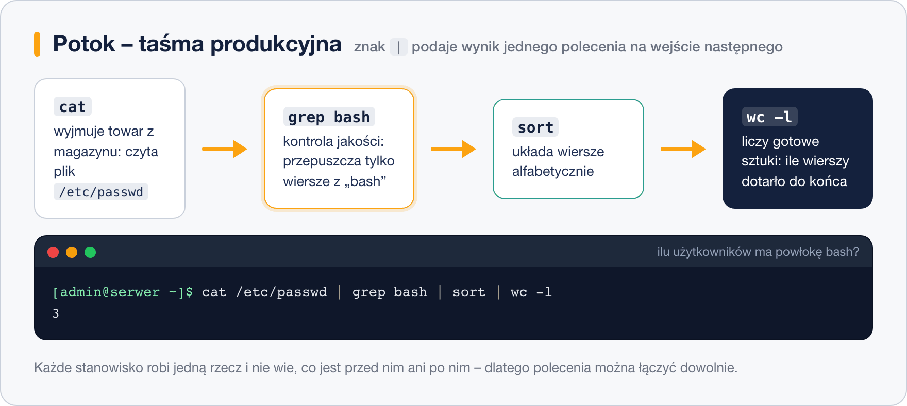

# Przeglądanie i przetwarzanie plików

> **W tej lekcji:** poznasz polecenia do oglądania plików tekstowych (`cat`, `less`, `head`, `tail`) i do ich przetwarzania (`grep`, `sort`, `uniq`, `cut`, `wc`, `tr`) oraz nauczysz się łączyć je potokami w jedno zdanie.

Linux jest zbudowany z plików tekstowych: konfiguracja leży w `/etc`, dzienniki (logi) w `/var/log`, lista użytkowników w `/etc/passwd`. Administrator nie otwiera ich w edytorze, żeby „popatrzeć” – używa narzędzi, które pokażą dokładnie ten fragment, który go interesuje: ostatnie 20 wierszy logu, tylko wiersze ze słowem `error`, listę użytkowników posortowaną alfabetycznie. Z kilku małych poleceń składa się jedno, które odpowiada na konkretne pytanie. To jedna z najważniejszych umiejętności w pracy z terminalem.

## Jak to działa

### Taśma produkcyjna, czyli potok

Każde polecenie w Linuksie ma **wejście** (ang. standard input) i **wyjście** (ang. standard output). Znak `|` (potok, ang. pipe) podłącza wyjście jednego polecenia do wejścia następnego. Wyobraź sobie taśmę produkcyjną: pierwsze stanowisko wyjmuje towar z magazynu (`cat` czyta plik), drugie odrzuca braki (`grep` zostawia pasujące wiersze), trzecie układa alfabetycznie (`sort`), czwarte liczy sztuki (`wc -l`). Każde stanowisko robi jedną rzecz i nie musi wiedzieć, co było przed nim ani co będzie po nim.



```bash
# ilu użytkowników ma powłokę bash?
cat /etc/passwd | grep bash | wc -l
```

```text
3
```

Większość poleceń z tej lekcji przyjmuje plik jako argument **albo** czyta z potoku. `grep bash /etc/passwd` i `cat /etc/passwd | grep bash` dają ten sam wynik.

## W praktyce

Będziemy ćwiczyć na dwóch plikach, które są w każdym systemie: `/etc/passwd` (lista kont, jeden wiersz = jedno konto, pola oddzielone dwukropkiem) i `/var/log/messages` (główny dziennik systemu; wymaga `sudo`, a istnieje, gdy zainstalowany jest `rsyslog` – jeśli go nie ma, użyj `journalctl`).

### Oglądanie całości: cat, tac

```bash
# cały plik na ekran – dobre dla krótkich plików
cat /etc/hostname

# kilka plików po kolei (stąd nazwa: concatenate – łączyć)
cat /etc/hostname /etc/os-release

# z numerami wierszy
cat -n /etc/passwd

# od końca (tac to cat czytane wspak)
tac /etc/passwd | head -3
```

### Oglądanie fragmentów: head, tail

```bash
# pierwsze 10 wierszy (domyślnie) albo tyle, ile podasz
head /etc/passwd
head -n 3 /etc/passwd

# ostatnie 10 wierszy – w logach najnowsze wpisy są na końcu
sudo tail /var/log/messages
sudo tail -n 50 /var/log/messages

# obserwuj plik na żywo: nowe wiersze pojawiają się same (Ctrl+C kończy)
sudo tail -f /var/log/messages
```

`tail -f` to narzędzie numer jeden przy diagnozowaniu: w jednym oknie patrzysz na log, w drugim restartujesz usługę i od razu widzisz, co napisała.

### Oglądanie długich plików: less, more

`less` pokazuje plik ekran po ekranie i pozwala się po nim poruszać. Nie ładuje całości do pamięci, więc otworzy nawet log o rozmiarze gigabajtów.

```bash
sudo less /var/log/messages
```

| Klawisz w `less` | Działanie |
|---|---|
| `Spacja` / `b` | strona w dół / w górę |
| `↓` `↑` / `j` `k` | wiersz w dół / w górę |
| `g` / `G` | początek / koniec pliku |
| `/słowo` + `Enter` | szukaj w dół; `n` następne trafienie, `N` poprzednie |
| `?słowo` | szukaj w górę |
| `F` | śledź plik na żywo jak `tail -f` (Ctrl+C wraca do przeglądania) |
| `-N` + `Enter` | włącz numery wierszy |
| `q` | wyjście |

`more` to starszy, prostszy odpowiednik (tylko w przód, Spacja i `q`). Spotkasz go w skryptach i minimalnych systemach; na co dzień używaj `less`.

### Filtrowanie: grep

`grep` wypisuje wiersze, które pasują do wzorca.

```bash
# wiersze zawierające słowo (wielkość liter ma znaczenie)
grep root /etc/passwd

# bez rozróżniania wielkości liter, z numerami wierszy
sudo grep -in "error" /var/log/messages

# wiersze, które NIE zawierają wzorca – np. pomiń komentarze
grep -v "^#" /etc/ssh/sshd_config

# szukaj we wszystkich plikach katalogu (rekurencyjnie), pokaż nazwy plików
grep -r "PermitRootLogin" /etc/ssh/

# tylko liczba pasujących wierszy
grep -c "Failed password" /var/log/secure
```

| Opcja | Znaczenie |
|---|---|
| `-i` | ignoruj wielkość liter |
| `-n` | pokaż numer wiersza |
| `-v` | odwróć: wiersze **bez** wzorca |
| `-r` | przeszukaj katalog rekurencyjnie |
| `-c` | policz pasujące wiersze |
| `-l` | tylko nazwy plików z trafieniem |
| `-w` | całe słowo (`-w log` nie dopasuje `login`) |
| `-E` | rozszerzone wyrażenia regularne (`grep -E "error|fail"`) |

Znak `^` we wzorcu oznacza początek wiersza, `$` koniec. `grep "^anna:" /etc/passwd` znajdzie konto `anna`, a nie `joanna`.

### Liczenie, sortowanie, wycinanie: wc, sort, uniq, cut, tr

```bash
# liczba wierszy, słów i bajtów; -l = tylko wiersze
wc /etc/passwd
wc -l /etc/passwd

# pierwsze pole (nazwa konta) z pliku, którego pola rozdziela dwukropek
cut -d: -f1 /etc/passwd

# pola 1 i 7: nazwa i powłoka
cut -d: -f1,7 /etc/passwd

# sortowanie alfabetyczne, odwrotne, numeryczne
sort /etc/passwd
sort -r /etc/passwd
cut -d: -f3 /etc/passwd | sort -n

# usuń powtórzenia (tylko sąsiednie! dlatego najpierw sort), policz wystąpienia
cut -d: -f7 /etc/passwd | sort | uniq -c

# zamiana znaków: małe litery na wielkie
echo "serwer" | tr a-z A-Z
```

```text
      3 /bin/bash
      1 /sbin/halt
     18 /sbin/nologin
      1 /sbin/shutdown
      1 /bin/sync
```

### Przykłady łączone

```bash
# które konta mają prawdziwą powłokę (mogą się logować)?
grep -v nologin /etc/passwd | cut -d: -f1

# 10 adresów IP, z których najczęściej próbowano logować się po SSH
sudo grep "Failed password" /var/log/secure | awk '{print $(NF-3)}' | sort | uniq -c | sort -rn | head

# ile wpisów o błędach pojawiło się w logu w ciągu ostatniej godziny obserwacji
sudo tail -f /var/log/messages | grep -i error

# zapisz wynik do pliku zamiast na ekran (> nadpisuje, >> dopisuje)
cut -d: -f1 /etc/passwd | sort > ~/konta.txt
```

Polecenie z `awk` wyprzedza program – to wyciągnięcie konkretnej kolumny z wiersza. Jedno zdanie na przyszłość: `awk` to następny krok po `cut`, gdy kolumny rozdziela zmienna liczba spacji.

## Najczęstsze błędy i pułapki

- **`cat` na ogromnym pliku** zasypuje terminal na minuty. Do dużych plików używaj `less`, `head`, `tail`.
- **`uniq` bez `sort`** nie usunie powtórzeń rozrzuconych po pliku – `uniq` porównuje tylko sąsiednie wiersze.
- **`grep error` bez `-i`** pominie `Error` i `ERROR`. W logach wielkość liter bywa różna.
- **Brak `sudo` do `/var/log`** – większość logów czyta tylko root i grupa `adm`/`systemd-journal`; `Permission denied` to nie błąd polecenia.
- **Zapomniany `q`** w `less` – terminal „stoi”, bo wciąż jesteś w przeglądarce pliku. Naciśnij `q`.
- **`>` zamiast `>>`** nadpisze plik bez pytania.

## Podsumowanie

- `cat` – całość, `head`/`tail` – początek/koniec, `less` – wygodne przeglądanie, `tail -f` – podgląd na żywo.
- `grep` filtruje wiersze; `-i`, `-v`, `-n`, `-r` to opcje, które będziesz wpisywać codziennie.
- `cut` wycina pola, `sort` układa, `uniq -c` liczy powtórzenia (po `sort`!), `wc -l` liczy wiersze.
- Potok `|` łączy polecenia: wyjście jednego staje się wejściem drugiego. Buduj go po jednym elemencie, oglądając wynik.

| Polecenie | Co robi |
|---|---|
| `cat plik`, `cat -n plik` | wypisz plik, z numerami wierszy |
| `head -n 20 plik` / `tail -n 20 plik` | pierwsze / ostatnie 20 wierszy |
| `tail -f /var/log/messages` | śledź log na żywo |
| `less plik` | przeglądaj; `/szukaj`, `G` koniec, `q` wyjście |
| `grep -in "slowo" plik` | filtruj, ignoruj wielkość liter, numeruj |
| `grep -v "^#" plik` | pomiń komentarze |
| `grep -r "slowo" /etc` | szukaj w całym katalogu |
| `cut -d: -f1 /etc/passwd` | pierwsze pole rozdzielane dwukropkiem |
| `sort -n`, `sort -r` | sortuj numerycznie / odwrotnie |
| `sort \| uniq -c` | policz powtórzenia |
| `wc -l` | policz wiersze |
| `tr a-z A-Z` | zamień znaki |
