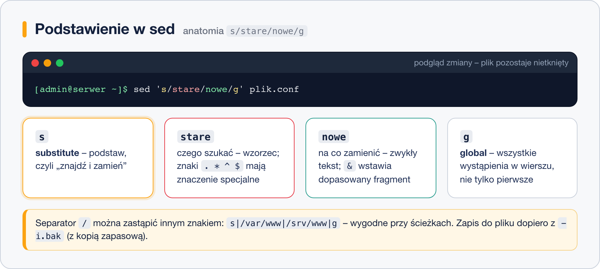

# Edycja strumieniowa – podstawy sed

> **W tej lekcji:** zrozumiesz, czym jest edycja strumieniowa, i nauczysz się podstawowych operacji `sed`: podstawiania tekstu, usuwania i wybierania wierszy oraz bezpiecznej zmiany pliku konfiguracyjnego z kopią zapasową.

## Po co mi to?

Masz zmienić jedną wartość w pliku konfiguracyjnym na dwudziestu serwerach. Albo w skrypcie instalacyjnym ustawić adres serwera bez otwierania edytora. Albo wyciąć z logu tylko wiersze 100–150. Edytor `vim` czy `nano` wymaga człowieka przy klawiaturze; `sed` robi to samo jednym poleceniem, które możesz powtórzyć, zapisać w skrypcie i uruchomić automatycznie. To narzędzie do „znajdź i zamień” bez okienka.

## Jak to działa

`sed` (ang. stream editor – edytor strumieniowy) czyta tekst **wiersz po wierszu**, do każdego wiersza stosuje podane polecenie i wypisuje wynik na wyjście. Źródłem może być plik albo potok z poprzedniej lekcji. Domyślnie `sed` **nie zmienia pliku** – pokazuje tylko, jak wyglądałby po zmianie. To bardzo bezpieczne: najpierw oglądasz, potem (opcją `-i`) zapisujesz.

Najczęstsze polecenie `sed` to podstawienie `s` (ang. substitute):



Całe wyrażenie bierzemy w **apostrofy** `'…'`, żeby powłoka nie próbowała interpretować znaków specjalnych.

## W praktyce

Ćwiczymy na kopii, żeby niczego nie zepsuć:

```bash
# kopia pliku konfiguracyjnego SSH do katalogu domowego
cp /etc/ssh/sshd_config ~/sshd_config.test
cd ~
```

### Podstawianie: s/stare/nowe/

```bash
# zamień PIERWSZE wystąpienie w każdym wierszu – tylko podgląd, plik bez zmian
echo "kot kot kot" | sed 's/kot/pies/'
```

```text
pies kot kot
```

```bash
# flaga g (global) – wszystkie wystąpienia w wierszu
echo "kot kot kot" | sed 's/kot/pies/g'
```

```text
pies pies pies
```

```bash
# bez rozróżniania wielkości liter (flaga I, rozszerzenie GNU sed, którego używa RHEL)
echo "Kot i KOT" | sed 's/kot/pies/gI'
```

### Zapis do pliku: -i z kopią zapasową

```bash
# -i.bak zmienia plik w miejscu, a oryginał zachowuje jako sshd_config.test.bak
sed -i.bak 's/^#PermitRootLogin prohibit-password/PermitRootLogin no/' sshd_config.test

# sprawdzamy, co się zmieniło
diff sshd_config.test.bak sshd_config.test
```

```text
40c40
< #PermitRootLogin prohibit-password
---
> PermitRootLogin no
```

Znak `^` na początku wzorca oznacza „początek wiersza” – dzięki temu nie zmienisz przypadkiem tego samego tekstu wewnątrz komentarza. Przyrostek po `-i` może być dowolny (`-i.orig`, `-i.stare`), ważne, żeby był – samo `-i` nadpisuje plik bez śladu.

### Separator | zamiast /

Gdy szukany tekst zawiera ukośniki (ścieżki!), każdy trzeba by poprzedzić `\`. Zamiast tego użyj innego separatora – `sed` przyjmie dowolny znak po `s`:

```bash
# nieczytelnie:
sed 's/\/var\/www/\/srv\/www/g' plik.conf

# czytelnie – ten sam efekt:
sed 's|/var/www|/srv/www|g' plik.conf
```

### Znaki specjalne we wzorcu

We wzorcu znaki `. * [ ] ^ $ \ /` mają specjalne znaczenie (to wyrażenia regularne, takie jak w `grep`). Jeśli chcesz dopasować je dosłownie, poprzedź je `\`:

```bash
# kropka w adresie IP musi być zabezpieczona, inaczej . oznacza „dowolny znak”
sed 's/192\.168\.10\.1/192.168.10.254/g' plik.conf

# w części „nowe” znak & oznacza „to, co dopasowano” – dopisujemy coś do każdego IP
echo "brama 192.168.10.1" | sed 's/192\.168\.10\.1/& (stara)/'
```

```text
brama 192.168.10.1 (stara)
```

### Usuwanie wierszy: d

```bash
# usuń wiersz numer 1
sed '1d' /etc/passwd | head -3

# usuń wszystkie wiersze zaczynające się od # (komentarze)
sed '/^#/d' sshd_config.test | head

# usuń komentarze I puste wiersze – szybki sposób na „czysty” plik konfiguracyjny
sed -e '/^#/d' -e '/^$/d' sshd_config.test
```

Opcja `-e` pozwala podać kilka poleceń naraz. Można je też rozdzielić średnikiem: `sed '/^#/d; /^$/d'`.

### Wybieranie wierszy: -n i p

Domyślnie `sed` wypisuje **każdy** wiersz. Opcja `-n` to wyłącza, a polecenie `p` (ang. print) wypisuje tylko wybrane:

```bash
# wiersze od 3 do 5
sed -n '3,5p' /etc/passwd

# tylko wiersze zawierające „bash” – jak grep
sed -n '/bash/p' /etc/passwd

# od wiersza zawierającego „Match” do końca pliku
sed -n '/^Match/,$p' sshd_config.test
```

Zakresy działają z każdym poleceniem: `sed '10,20d'` usunie wiersze 10–20, `sed '5,$s/a/b/'` podstawi od piątego wiersza do końca (`$` = ostatni wiersz).

### Typowy scenariusz: zmiana wartości w konfiguracji

Zadanie: w pliku konfiguracyjnym ustawić `MaxAuthTries` na 3, niezależnie od tego, czy wiersz jest zakomentowany i jaka jest obecna wartość.

```bash
# 1. Zobacz, jak wygląda teraz
grep -n "MaxAuthTries" sshd_config.test
```

```text
32:#MaxAuthTries 6
```

```bash
# 2. Podgląd zmiany: .* oznacza „dowolny ciąg znaków do końca wiersza”
sed 's/^#\?MaxAuthTries .*/MaxAuthTries 3/' sshd_config.test | grep -n "MaxAuthTries"
```

```text
32:MaxAuthTries 3
```

```bash
# 3. Zapis z kopią
sed -i.bak 's/^#\?MaxAuthTries .*/MaxAuthTries 3/' sshd_config.test
```

`\?` oznacza „poprzedni znak może wystąpić zero lub jeden raz” – więc wzorzec pasuje do wiersza z `#` i bez niego. Ten schemat (grep → podgląd → `-i.bak`) powtarzaj przy każdej zmianie w `/etc`.

Gdy zaczniesz potrzebować działań na kolumnach, sumowania liczb albo warunków „jeśli pole 3 większe niż…”, następnym narzędziem po `sed` jest `awk` – ale to temat na osobne szkolenie.

## Najczęstsze błędy i pułapki

- **Cudzysłowy zamiast apostrofów** – w `"…"` powłoka rozwija `$` i `\`, więc `"5,$p"` się rozsypie. Używaj `'…'`, chyba że celowo wstawiasz zmienną powłoki.
- **`-i` bez przyrostka** w `/etc` – zmiana bez kopii i bez podglądu. Nawyk: najpierw bez `-i`, potem `-i.bak`.
- **Nieosłonięta kropka** we wzorcu z adresem IP – `192.168.10.1` dopasuje też `192x168x10x1`. Zwykle nieszkodliwe, ale czasem zmienia nie to, co trzeba.
- **Brak flagi `g`** – zmieni się tylko pierwsze wystąpienie w wierszu.
- **`sed` zmienił „za dużo”** – wzorzec był za ogólny. Zakotwicz go znakiem `^` albo dodaj kontekst (`s/^Port 22$/Port 2222/`).

## Podsumowanie

- `sed` przetwarza tekst wiersz po wierszu i domyślnie **nie zmienia pliku** – zmiany zapisuje dopiero `-i`.
- `s/stare/nowe/` podstawia pierwsze wystąpienie, `s/stare/nowe/g` – wszystkie.
- `-i.bak` zapisuje zmiany i zostawia kopię; w `/etc` zawsze z kopią.
- `d` usuwa wiersze, `-n` + `p` wypisuje tylko wybrane; adresem może być numer, zakres `3,5`, wzorzec `/tekst/` lub `$`.
- Gdy wzorzec zawiera `/`, zmień separator na `|`.

| Polecenie | Co robi |
|---|---|
| `sed 's/a/b/' plik` | zamień pierwsze `a` w każdym wierszu (podgląd) |
| `sed 's/a/b/g' plik` | zamień wszystkie |
| `sed -i.bak 's/a/b/g' plik` | zapisz zmiany, kopia w `plik.bak` |
| `sed 's\|/stara/sciezka\|/nowa\|g'` | inny separator dla ścieżek |
| `sed '/^#/d' plik` | usuń komentarze |
| `sed '/^$/d' plik` | usuń puste wiersze |
| `sed -n '3,5p' plik` | wypisz wiersze 3–5 |
| `sed -n '/wzorzec/p' plik` | wypisz pasujące wiersze |
| `sed 's/^#\?Opcja .*/Opcja wartosc/'` | ustaw opcję niezależnie od stanu |
