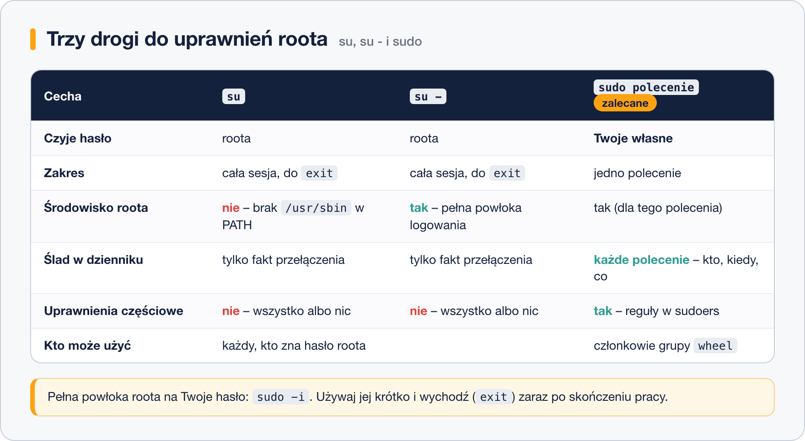

# Konto root, sudo i su

> **W tej lekcji:** dowiesz się, czym jest konto root i dlaczego nie pracuje się na nim na co dzień, oraz nauczysz się używać `su` i `sudo`, konfigurować uprawnienia w `sudoers` i sprawdzać, kto czego użył.

W każdym Linuksie istnieje jedno konto, które może wszystko: **root**, czyli superużytkownik (ang. superuser). Root nie pyta o uprawnienia – może odczytać każdy plik, zatrzymać każdą usługę i skasować cały system jednym poleceniem; jest niezbędny, ale jedna pomyłka na nim kosztuje zbyt wiele. Dlatego administrator pracuje na zwykłym koncie, a uprawnienia administratora „pożycza” tylko na czas jednego polecenia – w Windows znasz to jako UAC i „Uruchom jako administrator”, w Linuksie służy do tego `sudo`.

## Jak to działa

Masz trzy drogi do uprawnień roota:



- **`su`** (ang. substitute user – zastąp użytkownika) przełącza Cię na inne konto, domyślnie na roota. Wymaga **hasła roota** i otwiera nową powłokę, w której jesteś rootem aż do `exit`.
- **`su -`** robi to samo, ale z myślnikiem uruchamia **powłokę logowania**: dostajesz pełne środowisko roota – jego katalog domowy, zmienne, a przede wszystkim właściwą zmienną `PATH` z katalogami `/usr/sbin`. Bez myślnika polecenia administracyjne potrafią „nie istnieć”. Praktyczna zasada: `su` zawsze z myślnikiem.
- **`sudo polecenie`** wykonuje jedno polecenie jako root. Pyta o **Twoje własne hasło**, sprawdza w konfiguracji, czy masz prawo, wykonuje polecenie i zapisuje w dzienniku, kto, kiedy i co uruchomił.

Dlaczego `sudo` wygrywa w codziennej pracy:

- hasło roota nie musi być nikomu znane (na wielu serwerach konto root ma wręcz zablokowane hasło),
- każde użycie zostawia ślad w dzienniku – wiadomo, kto wykonał którą zmianę,
- uprawnienia można nadawać precyzyjnie: ktoś może restartować usługi, ale nie zakładać kont,
- odebranie uprawnień to usunięcie jednego wpisu, a nie zmiana hasła roota u wszystkich.

Na RHEL prawo do `sudo` ma domyślnie grupa **`wheel`** – wystarczy dodać użytkownika do tej grupy. Na Ubuntu/Debianie analogiczna grupa nazywa się `sudo`.

## W praktyce

### Jedno polecenie jako root

```bash
# odczyt pliku, którego zwykły użytkownik nie może czytać
sudo cat /etc/shadow | head -3
```

```text
[sudo] password for admin:
root:*:19700:0:99999:7:::
bin:*:19700:0:99999:7:::
daemon:*:19700:0:99999:7:::
```

Podajesz **swoje** hasło. Przez następne 5 minut w tym terminalu `sudo` nie zapyta ponownie.

```bash
# sprawdzenie, co wolno mi uruchamiać przez sudo
sudo -l

# polecenie jako inny użytkownik niż root (-u), np. test uprawnień anny
sudo -u anna ls /srv/ksiegowosc

# pełna powłoka roota ze środowiskiem logowania – odpowiednik su -, ale na Twoje hasło
sudo -i
```

```text
[root@serwer ~]#
```

Z powłoki roota wracasz poleceniem `exit`. Używaj `sudo -i` tylko wtedy, gdy naprawdę masz do wykonania serię poleceń administracyjnych – i wychodź od razu po skończeniu.

### Przełączanie kont przez su

```bash
# na konto roota z jego środowiskiem (pyta o hasło ROOTA)
su -

# na konto anny (pyta o hasło anny; root przełącza się bez hasła)
su - anna

# powrót do poprzedniego konta
exit
```

### Nadanie użytkownikowi prawa do sudo

```bash
# dodajemy jana do grupy wheel (szczegóły usermod w lekcji 3)
sudo usermod -aG wheel jan

# jan musi się wylogować i zalogować ponownie, potem:
su - jan
sudo -l
```

```text
User jan may run the following commands on serwer:
    (ALL) ALL
```

### Plik sudoers i visudo

Konfiguracja `sudo` mieszka w `/etc/sudoers` oraz w katalogu `/etc/sudoers.d/`. **Nigdy nie edytuj ich zwykłym edytorem** – błąd składni zablokowałby `sudo` dla wszystkich. Polecenie `visudo` otwiera plik w edytorze i przed zapisem sprawdza składnię:

```bash
# edycja głównego pliku
sudo visudo

# własny wpis trzymaj w osobnym pliku w sudoers.d – łatwiej nim zarządzać
sudo visudo -f /etc/sudoers.d/monitoring
```

Składnia wpisu: **kto gdzie = (jako kto) co**.

```text
# grupa wheel może wszystko (wpis domyślny na RHEL; % oznacza grupę)
%wheel  ALL=(ALL)  ALL

# jan może tylko restartować nginx, bez pytania o hasło
jan  ALL=(root)  NOPASSWD: /usr/bin/systemctl restart nginx

# anna może wykonywać polecenia jako użytkownik aplikacji
anna  ALL=(aplikacja)  ALL
```

| Pole | Znaczenie |
|---|---|
| `jan` / `%wheel` | użytkownik lub grupa (z `%`) |
| pierwsze `ALL` | na których komputerach wpis obowiązuje (istotne, gdy plik jest wspólny dla wielu serwerów) |
| `(ALL)` / `(root)` | jako kto wolno wykonywać polecenia |
| ostatnie `ALL` / ścieżka | które polecenia; pełne ścieżki, rozdzielane przecinkami |
| `NOPASSWD:` | bez pytania o hasło – tylko dla wąskich, bezpiecznych poleceń |

### Kto czego użył – dziennik

Każde wywołanie `sudo` trafia do dziennika systemowego:

```bash
# wpisy sudo z dziennika systemd
sudo journalctl -g sudo --since today
```

```text
Oct 18 10:02:11 serwer sudo[2143]: jan : TTY=pts/0 ; PWD=/home/jan ; USER=root ; COMMAND=/usr/bin/systemctl restart nginx
```

Widzisz, kto (`jan`), skąd (`PWD`), jako kto (`USER=root`) i co dokładnie uruchomił. Przy incydencie to pierwsze miejsce, do którego zaglądasz.

## Najczęstsze błędy i pułapki

- **Praca na stałe jako root** – jedna literówka w `rm -rf` i po systemie. Zwykłe konto + `sudo` to siatka bezpieczeństwa, nie biurokracja.
- **`su` bez myślnika** – powłoka roota bez jego środowiska; polecenia typu `useradd` „znikają”, bo `/usr/sbin` nie ma w `PATH`. Używaj `su -`.
- **`user is not in the sudoers file`** – konto nie należy do `wheel`. Dodaj je z konta, które ma uprawnienia (albo przez `su -`): `usermod -aG wheel nazwa`.
- **Edycja `/etc/sudoers` zwykłym edytorem** – literówka i nikt już nie wykona `sudo`. Zawsze `visudo`.
- **`sudo` dodane, ale nie działa** – po dodaniu do grupy trzeba się wylogować i zalogować ponownie; stara sesja nie zna nowej grupy.
- **`NOPASSWD: ALL` „dla wygody”** – każdy, kto usiądzie przy odblokowanym terminalu, jest rootem. Bez hasła zwalniaj tylko pojedyncze, konkretne polecenia.

## Podsumowanie

- Root może wszystko – dlatego używasz go jak najrzadziej i jak najkrócej.
- `sudo polecenie` – jedno polecenie jako root, na Twoje hasło, ze śladem w dzienniku. To domyślny sposób pracy.
- `su -` – pełne przełączenie na roota, na hasło roota; myślnik jest ważny.
- Prawo do `sudo` na RHEL daje grupa `wheel`; szczegółowe reguły konfigurujesz przez `visudo` w `/etc/sudoers.d/`.
- `journalctl -g sudo` pokazuje, kto czego użył.

| Polecenie | Co robi |
|---|---|
| `sudo polecenie` | wykonaj polecenie jako root |
| `sudo -l` | pokaż, co wolno mi przez sudo |
| `sudo -u anna polecenie` | wykonaj jako inny użytkownik |
| `sudo -i` | powłoka logowania roota (Twoje hasło) |
| `su -` | powłoka logowania roota (hasło roota) |
| `su - anna` | przełącz się na konto anny |
| `sudo usermod -aG wheel jan` | nadaj janowi prawo do sudo |
| `sudo visudo` / `sudo visudo -f /etc/sudoers.d/plik` | bezpieczna edycja reguł |
| `sudo journalctl -g sudo` | dziennik użyć sudo |
