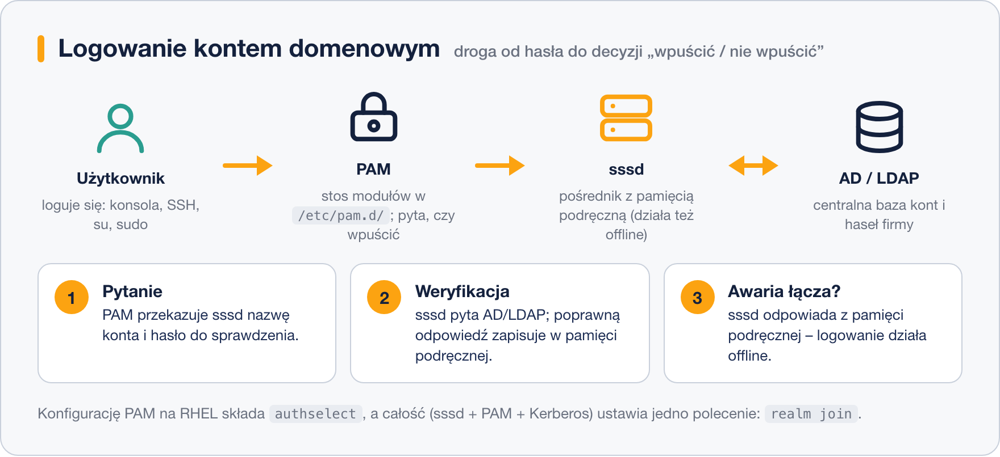

# Uwierzytelnianie w LDAP i Active Directory – sssd i PAM

> **W tej lekcji:** zrozumiesz, po co firmom centralna baza kont, jaką rolę pełnią PAM i sssd, i zobaczysz, jak krok po kroku podłączyć serwer RHEL do domeny Active Directory.

Zakładanie każdemu z dwudziestu administratorów konta na każdym z dziesięciu serwerów (i pilnowanie haseł!) to 200 kont do utrzymania – a gdy ktoś odchodzi z firmy, trzeba pamiętać o usunięciu go wszędzie. Rozwiązaniem jest **jedna centralna baza kont**, do której logują się wszystkie maszyny: użytkownik ma jedno hasło, a zablokowanie konta w jednym miejscu odcina go od całej infrastruktury. Taką bazę nazywa się **usługą katalogową** (ang. directory service) – przechowuje użytkowników, grupy i komputery.

Spotkasz dwie: **LDAP** (ang. Lightweight Directory Access Protocol) – otwarty protokół dostępu do katalogu, którego serwerem bywa OpenLDAP, FreeIPA i inne – oraz **Active Directory (AD)** – usługę katalogową Microsoftu, standard w firmowych sieciach Windows, która rozmawia m.in. protokołem LDAP i dodaje uwierzytelnianie Kerberos. Linux potrafi dołączyć do obu; najczęstszy scenariusz w praktyce to serwery RHEL dołączone do istniejącej domeny AD, żeby administratorzy logowali się kontami domenowymi.

## Jak to działa

Przy logowaniu współpracują ze sobą trzy warstwy:



### PAM – kto decyduje o wpuszczeniu

**PAM** (ang. Pluggable Authentication Modules – wtykowe moduły uwierzytelniania) to warstwa, przez którą przechodzi **każde** logowanie: na konsoli, przez SSH, `su`, `sudo`. Programy nie sprawdzają haseł same – pytają PAM. PAM czyta konfigurację z `/etc/pam.d/` (osobny plik na usługę, np. `sshd`) i przepuszcza logowanie przez **stos modułów**: jeden moduł sprawdza hasło, inny godziny logowania, jeszcze inny zakłada przy pierwszym logowaniu katalog domowy. Wymiana jednego modułu zmienia sposób uwierzytelniania w całym systemie – bez zmian w aplikacjach.

Na RHEL konfiguracji PAM nie edytuje się ręcznie – składa ją narzędzie **`authselect`** z gotowych profili (`authselect current` pokaże bieżący).

### sssd – pośrednik i pamięć podręczna

**sssd** (ang. System Security Services Daemon) to demon, który w imieniu systemu rozmawia z usługą katalogową. PAM i `getent` pytają sssd, a sssd pyta AD/LDAP. Po co pośrednik?

- **Pamięć podręczna (cache):** sssd zapamiętuje odpowiedzi katalogu. Przy kolejnych logowaniach nie trzeba pytać serwera o wszystko od nowa.
- **Praca offline:** gdy łącze do AD padnie, zalogujesz się na dane z pamięci podręcznej – laptop firmowy działa też poza biurem.
- **Jedna konfiguracja** (`/etc/sssd/sssd.conf`) dla wielu źródeł: AD, LDAP, Kerberos.

### realmd – automat do dołączania

Ręczna konfiguracja sssd, Kerberosa i PAM to sporo plików. Narzędzie **`realm`** (z pakietu `realmd`) robi to wszystko za Ciebie: wykrywa domenę, instaluje co trzeba, dołącza maszynę i ustawia sssd oraz PAM.

## W praktyce

Scenariusz: serwer RHEL dołącza do domeny AD `firma.local`. Potrzebujesz działającego DNS wskazującego na kontrolery domeny i konta z prawem dołączania komputerów (np. `Administrator`).

```bash
# 1. Pakiety: realmd + sssd + narzędzia pomocnicze
sudo dnf install realmd sssd oddjob oddjob-mkhomedir adcli samba-common-tools

# 2. Czy domena jest widoczna? (discover niczego nie zmienia)
realm discover firma.local
```

```text
firma.local
  type: kerberos
  realm-name: FIRMA.LOCAL
  configured: no
  server-software: active-directory
  client-software: sssd
  required-package: oddjob
  ...
```

```bash
# 3. Dołączenie do domeny (pyta o hasło konta domenowego)
sudo realm join firma.local -U Administrator

# 4. Czy system widzi konta domenowe?
id anna@firma.local
getent passwd anna@firma.local
```

```text
uid=1829201104(anna@firma.local) gid=1829200513(domain users@firma.local) groups=...
```

Pakiet `oddjob-mkhomedir` dokłada do PAM moduł, który przy pierwszym logowaniu użytkownika domenowego automatycznie tworzy mu katalog domowy – bez niego logowanie się uda, ale użytkownik wyląduje bez `/home`.

```bash
# ograniczenie, kto z domeny może się logować na TEN serwer
sudo realm permit -g "admini-linux@firma.local"

# stan usługi i diagnostyka
systemctl status sssd
sudo sssctl domain-status firma.local

# dziennik przy problemach z logowaniem
sudo journalctl -u sssd --since "1 hour ago"

# wyczyszczenie pamięci podręcznej (po zmianach po stronie AD)
sudo sss_cache -E
```

Czego **nie** robić: nie edytuj plików w `/etc/pam.d/` ręcznie (od tego jest `authselect`, a `realm join` ustawia go sam) i nie zakładaj lokalnych kont o nazwach takich samych jak domenowe – lokalne wygrywają i robi się zamieszanie.

## Najczęstsze błędy i pułapki

- **`realm discover` nic nie znajduje** – prawie zawsze DNS: serwer musi używać serwerów DNS domeny (sprawdź `/etc/resolv.conf`), bo po nich odnajduje kontrolery.
- **Dołączone, ale `id anna@firma.local` nie zwraca nic** – odczekaj chwilę, sprawdź `systemctl status sssd` i dziennik; częsta przyczyna to rozjechany czas – Kerberos wymaga zegara zgodnego z domeną (`chronyc tracking`).
- **Logowanie działa, ale brak katalogu domowego** – brakuje `oddjob-mkhomedir` (i jego usługi `oddjobd`).
- **Stare dane po zmianach w AD** (np. użytkownik usunięty, a nadal się loguje offline) – pamięć podręczna sssd; `sudo sss_cache -E`.
- **Każdy użytkownik domeny może się logować wszędzie** – domyślnie po `realm join` tak jest; ogranicz przez `realm permit`.

## Podsumowanie

- Centralna baza kont = jedno konto i hasło na całą infrastrukturę; usługa katalogowa to LDAP lub (najczęściej) Active Directory.
- PAM to warstwa, przez którą przechodzi każde logowanie; na RHEL konfiguruje ją `authselect`, nie ręczna edycja.
- sssd pośredniczy między systemem a katalogiem, trzyma pamięć podręczną i umożliwia pracę offline.
- Dołączenie do domeny: pakiety → `realm discover` → `realm join` → test `id user@domena`.
- Diagnoza: DNS, czas, `systemctl status sssd`, `sssctl`, dziennik.

| Polecenie | Co robi |
|---|---|
| `realm discover firma.local` | sprawdź widoczność domeny (bez zmian) |
| `sudo realm join firma.local -U Administrator` | dołącz do domeny |
| `realm list` | pokaż dołączone domeny |
| `sudo realm permit -g grupa@domena` | ogranicz, kto może się logować |
| `id anna@firma.local` / `getent passwd anna@firma.local` | test widoczności konta |
| `sudo sssctl domain-status firma.local` | stan połączenia z domeną |
| `sudo sss_cache -E` | wyczyść pamięć podręczną sssd |
| `sudo realm leave firma.local` | opuść domenę |
