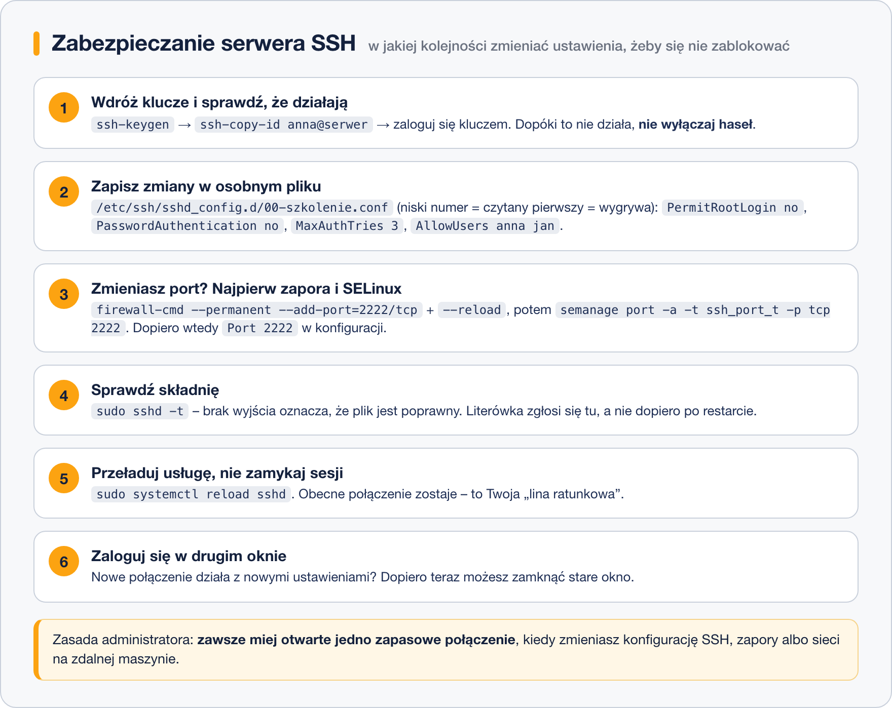

# Serwer SSH – instalacja i konfiguracja

> **W tej lekcji:** zainstalujesz i uruchomisz serwer SSH, poznasz najważniejsze ustawienia w `sshd_config`, nauczysz się je bezpiecznie zmieniać (bez odcięcia sobie dostępu) i dowiesz się, co trzeba zrobić dodatkowo przy zmianie portu na RHEL.

W poprzedniej lekcji byłeś klientem. Teraz spójrz z drugiej strony: to Ty stawiasz serwer, do
którego będą się logować inni. Domyślna konfiguracja działa, ale nie jest przygotowana na
internet. Serwer z otwartym portem 22 dostaje w ciągu doby tysiące prób logowania z całego świata –
automaty zgadują hasła do konta `root`. Kilka linijek w konfiguracji zamyka te drzwi.

Druga strona medalu: konfiguracja SSH to jedyne miejsce, w którym literówka potrafi **odciąć Cię
od serwera** stojącego 300 km dalej. Dlatego w tej lekcji równie ważne jak „co zmienić” jest
„w jakiej kolejności”.

## Jak to działa

Serwer SSH to pakiet **`openssh-server`** i usługa **`sshd`**. Na RHEL 9/10 pakiet jest
zainstalowany domyślnie i usługa startuje razem z systemem.

Konfiguracja leży w katalogu `/etc/ssh/`:

| Plik | Do czego |
|---|---|
| `/etc/ssh/sshd_config` | główna konfiguracja **serwera** (litera `d` jak demon) |
| `/etc/ssh/sshd_config.d/*.conf` | katalog dodatkowych plików dołączanych do konfiguracji (RHEL 9 i nowsze) |
| `/etc/ssh/ssh_config` | konfiguracja **klienta** dla wszystkich użytkowników – nie myl z powyższym |
| `/etc/ssh/ssh_host_*_key` | klucze hosta – ten „dowód osobisty” serwera z lekcji 1 |

Na początku `sshd_config` znajdziesz wiersz `Include /etc/ssh/sshd_config.d/*.conf`. Oznacza
on: „najpierw wczytaj wszystkie pliki z tego katalogu, potem resztę”. Reguła, którą trzeba
zapamiętać: **dla każdej opcji liczy się pierwsza napotkana wartość**. Pliki z katalogu są czytane
w kolejności alfabetycznej, a dopiero po nich główny plik. Dlatego własne ustawienia wpisujemy do
osobnego pliku o nazwie zaczynającej się od niskiej liczby, np. `00-szkolenie.conf` – wygrają
wtedy zarówno z plikiem instalatora (`01-permitrootlogin.conf`, jeśli istnieje), jak i z `50-redhat.conf`
oraz głównym plikiem. Główny plik zostaje nietknięty, co ułatwia aktualizacje.



### Najważniejsze opcje

| Opcja | Domyślnie | Znaczenie i zalecenie |
|---|---|---|
| `Port 22` | 22 | numer portu, na którym nasłuchuje serwer |
| `PermitRootLogin` | `prohibit-password` | czy `root` może się logować; zalecane **`no`** – loguj się jako zwykły użytkownik i używaj `sudo` |
| `PasswordAuthentication` | `yes` | logowanie hasłem; po wdrożeniu kluczy ustaw **`no`** |
| `PubkeyAuthentication` | `yes` | logowanie kluczem – zostaw włączone |
| `AllowUsers anna jan` | (wszyscy) | lista kont, które w ogóle mogą się logować; reszta dostaje odmowę |
| `MaxAuthTries 3` | 6 | ile prób hasła w jednym połączeniu |
| `ClientAliveInterval 300` | 0 | co ile sekund serwer „puka” do bezczynnego klienta; z `ClientAliveCountMax 2` rozłączy go po 10 minutach ciszy |
| `Banner /etc/issue.net` | brak | tekst pokazywany **przed** logowaniem, np. ostrzeżenie prawne |

## W praktyce

### Instalacja i uruchomienie

```bash
# upewniamy się, że serwer jest zainstalowany (zwykle już jest)
sudo dnf install openssh-server
```

```bash
# włączamy start przy rozruchu i uruchamiamy od razu
sudo systemctl enable --now sshd
```

```bash
# sprawdzamy stan usługi
systemctl status sshd
```

```text
● sshd.service - OpenSSH server daemon
     Loaded: loaded (/usr/lib/systemd/system/sshd.service; enabled; preset: enabled)
     Active: active (running) since Mon 2026-10-19 08:12:03 CEST; 2h ago
```

Na RHEL usługa `ssh` w zaporze jest domyślnie otwarta. Gdyby nie była:

```bash
# otwieramy usługę ssh (port 22) w zaporze na stałe i przeładowujemy reguły
sudo firewall-cmd --permanent --add-service=ssh
sudo firewall-cmd --reload
```

> **Na Ubuntu/Debianie:** pakiet nazywa się tak samo, ale usługa to `ssh`, nie `sshd`
> (`sudo systemctl enable --now ssh`), a zaporę otwiera `sudo ufw allow ssh`.

### Własny plik konfiguracyjny

```bash
# tworzymy plik z naszymi ustawieniami (edytor nano, zapis Ctrl+O, wyjście Ctrl+X)
sudo nano /etc/ssh/sshd_config.d/00-szkolenie.conf
```

Treść pliku:

```text
# Zdalna administracja - ustawienia szkoleniowe
PermitRootLogin no
MaxAuthTries 3
ClientAliveInterval 300
ClientAliveCountMax 2
AllowUsers anna jan
Banner /etc/issue.net
```

Uwaga: `PasswordAuthentication no` celowo **jeszcze** tu nie ma – dopiszesz je w lekcji 4, gdy
klucze będą działać.

```bash
# treść baneru – jedno zdanie, które zobaczy każdy przed logowaniem
echo "System firmowy. Dostęp tylko dla upowaznionych." | sudo tee /etc/issue.net
```

### Sprawdzenie i przeładowanie

```bash
# test składni: brak komunikatu = wszystko w porządku
sudo sshd -t
```

```text
/etc/ssh/sshd_config.d/00-szkolenie.conf: line 3: Bad configuration option: MaxAuthTrie
```

Taki komunikat to dobry znak – błąd wyszedł **przed** przeładowaniem, a nie po. Popraw literówkę
i powtórz test.

```bash
# przeładowujemy konfigurację bez zrywania istniejących sesji
sudo systemctl reload sshd
```

`reload` zamiast `restart` – obecne połączenia zostają, a nowe już używają nowych ustawień.
Teraz w **drugim** oknie terminala zaloguj się ponownie (`ssh anna@localhost`) i sprawdź, czy
baner się pokazuje. Dopiero gdy nowe logowanie działa, możesz zamknąć stare okno.

### Zmiana portu – trzy miejsca, nie jedno

Przeniesienie SSH np. na port 2222 ogranicza automatyczne skanery. Ale na RHEL sam wpis
`Port 2222` nie wystarczy – port musi przepuścić **zapora** i zaakceptować **SELinux**
(mechanizm bezpieczeństwa, który pilnuje, na jakich portach wolno działać danej usłudze;
więcej w module 16. SELinux).

```bash
# 1. zapora: otwieramy nowy port na stałe
sudo firewall-cmd --permanent --add-port=2222/tcp
sudo firewall-cmd --reload
```

```bash
# 2. SELinux: pozwalamy sshd nasłuchiwać na 2222 (narzędzie semanage jest w tym pakiecie)
sudo dnf install policycoreutils-python-utils
sudo semanage port -a -t ssh_port_t -p tcp 2222
```

```bash
# 3. dopiero teraz konfiguracja sshd
echo "Port 2222" | sudo tee -a /etc/ssh/sshd_config.d/00-szkolenie.conf
sudo sshd -t && sudo systemctl reload sshd
```

```bash
# test w drugim oknie – nowy port podajemy opcją -p
ssh -p 2222 anna@localhost
```

Gdy działa, możesz zamknąć stary port w zaporze (`--remove-service=ssh`). Jeśli pominiesz krok
SELinux, `sshd` nie wystartuje, a w `journalctl -u sshd` zobaczysz
`Permission denied` przy próbie otwarcia portu.

## Najczęstsze błędy i pułapki

- **`restart` zamiast `reload` przy błędnej konfiguracji.** `restart` zatrzymuje usługę; jeśli nie
  wystartuje, tracisz dostęp. Zawsze najpierw `sshd -t`, potem `reload`, test w drugim oknie.
- **Edycja `ssh_config` zamiast `sshd_config`.** Jedna litera różnicy: bez `d` to klient.
- **Opcja w `00-szkolenie.conf` „nie działa”.** Sprawdź, czy ta sama opcja nie jest ustawiona
  w innym pliku o nazwie wcześniejszej alfabetycznie – wygrywa pierwsza wartość.
  Pomaga `sudo sshd -T | grep -i nazwa_opcji`, które pokazuje **efektywną** konfigurację.
- **`AllowUsers` bez własnego konta.** Jeśli wpiszesz tam tylko kolegów, Ty też zostaniesz
  odcięty. Zawsze dodaj konto, z którego administrujesz.
- **Zmiana portu bez zapory i SELinuksa.** Objaw: usługa nie startuje albo port 2222 „nie
  odpowiada”. Kolejność: zapora → SELinux → konfiguracja.

## Podsumowanie

- Serwer to pakiet `openssh-server` i usługa `sshd`; włączasz ją `systemctl enable --now sshd`.
- Własne ustawienia trzymaj w `/etc/ssh/sshd_config.d/00-szkolenie.conf`; pierwsza napotkana
  wartość wygrywa.
- Minimum bezpieczeństwa: `PermitRootLogin no`, `MaxAuthTries 3`, `AllowUsers`, a po wdrożeniu
  kluczy `PasswordAuthentication no`.
- Zawsze: `sshd -t` → `systemctl reload sshd` → test logowania w drugim oknie.
- Zmiana portu na RHEL = zapora (`firewall-cmd`) + SELinux (`semanage port`) + `Port` w konfiguracji.

| Polecenie | Co robi |
|---|---|
| `sudo systemctl enable --now sshd` | włącza i uruchamia serwer |
| `systemctl status sshd` | stan usługi |
| `sudo sshd -t` | sprawdza składnię konfiguracji |
| `sudo sshd -T \| grep -i opcja` | pokazuje efektywną wartość opcji |
| `sudo systemctl reload sshd` | wczytuje nową konfigurację bez zrywania sesji |
| `sudo firewall-cmd --permanent --add-port=2222/tcp && sudo firewall-cmd --reload` | otwiera port w zaporze |
| `sudo semanage port -a -t ssh_port_t -p tcp 2222` | pozwala SELinuksowi na nowy port SSH |
| `sudo journalctl -u sshd -n 50` | ostatnie 50 wpisów dziennika usługi |
