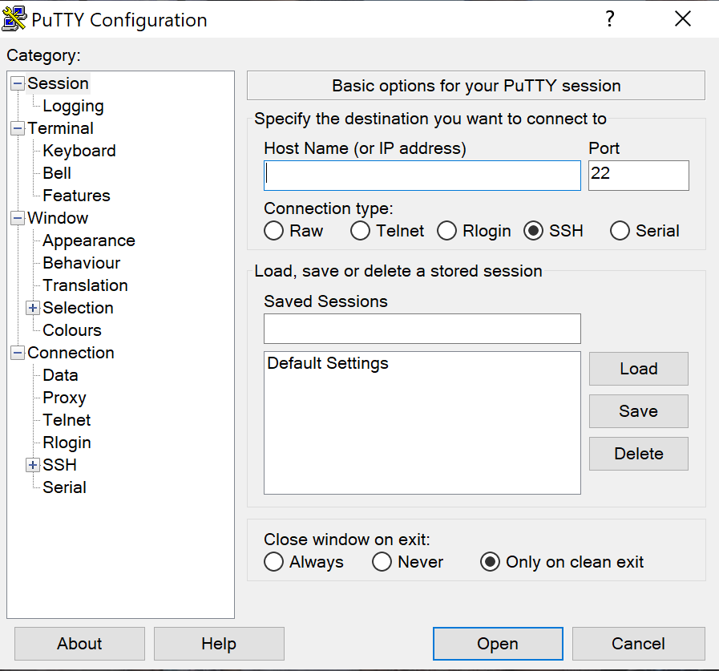

# Klient SSH – ssh, PuTTY i plik config

> **W tej lekcji:** nauczysz się wygodnie łączyć z wieloma serwerami z Linuksa, macOS i Windows – poleceniem `ssh` z plikiem `~/.ssh/config`, programem PuTTY i wbudowanym OpenSSH w Windows – oraz diagnozować nieudane połączenia opcją `-v`.

## Po co mi to?

Administrator ma zwykle kilkanaście serwerów, każdy z innym adresem, nazwą użytkownika, czasem
innym portem. Wpisywanie za każdym razem `ssh jan.kowalski@10.20.30.41 -p 2222` jest męczące
i kończy się pomyłkami. Klient SSH pozwala to wszystko zapisać raz, a potem łączyć się krótkim
`ssh baza`.

Druga część lekcji jest dla osób pracujących na Windows – tam przez lata jedynym sensownym
klientem był **PuTTY** i spotkasz go w każdej firmie. Dziś ma już konkurencję w samym systemie.

## Jak to działa

Polecenie `ssh` czyta ustawienia z trzech miejsc, w tej kolejności: opcje podane w wierszu
poleceń, plik użytkownika `~/.ssh/config`, plik systemowy `/etc/ssh/ssh_config`. Pierwsza
znaleziona wartość wygrywa – tak samo jak po stronie serwera.

Plik `~/.ssh/config` składa się z bloków `Host`. Każdy blok to „skrót” dla jednego lub kilku
serwerów:

| Słowo kluczowe | Znaczenie |
|---|---|
| `Host baza` | nazwa skrótu – to, co wpiszesz po `ssh` |
| `HostName 192.168.10.20` | prawdziwy adres IP lub nazwa DNS |
| `User jan` | konto na serwerze |
| `Port 2222` | port, jeśli inny niż 22 |
| `IdentityFile ~/.ssh/klucz_baza` | który klucz prywatny użyć (lekcja 4) |
| `Host *` | blok wspólny dla wszystkich serwerów – umieszcza się go **na końcu** |

## W praktyce

### Podstawowe wywołania

```bash
# pełna postać: użytkownik, adres, port
ssh -p 2222 jan@192.168.10.20
```

```bash
# bez użytkownika – ssh użyje Twojej lokalnej nazwy konta
ssh 192.168.10.20
```

```bash
# wykonanie jednego polecenia bez otwierania powłoki (więcej w lekcji 5)
ssh anna@localhost uptime
```

### Plik ~/.ssh/config

```bash
# katalog .ssh musi istnieć i być prywatny
mkdir -p ~/.ssh && chmod 700 ~/.ssh
nano ~/.ssh/config
```

```text
# serwer bazy danych – inny port i konto
Host baza
    HostName 192.168.10.20
    User jan
    Port 2222

# serwer WWW
Host www
    HostName www.firma.local
    User anna

# ćwiczenia: własna maszyna
Host ja
    HostName localhost
    User anna

# ustawienia wspólne dla wszystkich – zawsze na końcu
Host *
    ServerAliveInterval 60
```

```bash
# plik z konfiguracją też powinien być prywatny
chmod 600 ~/.ssh/config
```

Od teraz wystarczy:

```bash
ssh baza
ssh ja
```

Skróty działają też w `scp`, `sftp` i `rsync` (lekcja 5). `ServerAliveInterval 60` sprawia, że
klient co minutę wysyła sygnał życia – połączenie nie zerwie się po chwili bezczynności przez
zaporę firmową.

### Gdy coś nie działa: ssh -v

```bash
# tryb gadatliwy: klient opisuje każdy krok połączenia
ssh -v ja
```

```text
OpenSSH_8.7p1, OpenSSL 3.0.7
debug1: Reading configuration data /home/anna/.ssh/config
debug1: /home/anna/.ssh/config line 12: Applying options for ja
debug1: Connecting to localhost [::1] port 22.
debug1: Connection established.
debug1: Offering public key: /home/anna/.ssh/id_ed25519 ED25519
debug1: Authentications that can continue: publickey,password
debug1: Next authentication method: password
```

Czytaj od góry: który plik konfiguracyjny został użyty, z jakim adresem i portem nastąpiła
próba, czy serwer odpowiedział, jakie metody logowania zaproponował. `-vv` i `-vvv` dają jeszcze
więcej szczegółów. Najczęstsze wnioski:

| Fragment wyjścia | Co oznacza |
|---|---|
| `Connection refused` | serwer odpowiada, ale na tym porcie nic nie nasłuchuje |
| `Connection timed out` | brak jakiejkolwiek odpowiedzi – sieć, zapora, zły adres |
| `Permission denied (publickey)` | serwer przyjmuje tylko klucze, a Twój nie pasuje |
| `Permission denied (publickey,password)` po haśle | złe hasło albo konto zablokowane |

### PuTTY na Windows

PuTTY to darmowy klient SSH dla Windows (putty.org). Składa się z kilku programów:
`putty.exe` (terminal), `puttygen.exe` (generator kluczy – lekcja 4), `pscp.exe` i `psftp.exe`
(kopiowanie plików), `pageant.exe` (przechowalnia kluczy).



Łączenie krok po kroku:

1. W polu **Host Name (or IP address)** wpisz `anna@192.168.10.20` (albo sam adres – wtedy PuTTY
   zapyta o login).
2. **Port** – zostaw 22 lub wpisz własny. **Connection type** – `SSH`.
3. W polu **Saved Sessions** wpisz nazwę, np. `serwer`, i kliknij **Save** – następnym razem
   wystarczy ją dwukrotnie kliknąć. To odpowiednik bloku `Host` z pliku `config`.
4. **Open**. Przy pierwszym połączeniu pojawi się okno *PuTTY Security Alert* z odciskiem klucza
   serwera – to to samo pytanie co „Are you sure…” z lekcji 1; kliknij **Accept**.
5. Podaj hasło. Prawy przycisk myszy w oknie PuTTY **wkleja** schowek (zaznaczenie myszą kopiuje).

Przydatne ustawienia w drzewie po lewej: *Window → Translation → UTF-8* (polskie znaki),
*Connection → Seconds between keepalives: 60* (nie zrywa sesji), *Connection → Data →
Auto-login username*.

### Alternatywa: OpenSSH wbudowane w Windows

Windows 10 (od wersji 1809) i Windows 11 mają wbudowanego klienta OpenSSH – to **ten sam**
program `ssh`, co na Linuksie. Otwórz **Windows Terminal** albo PowerShell i wpisz:

```powershell
ssh anna@192.168.10.20
```

Plik konfiguracyjny ma tę samą składnię i leży w `C:\Users\TwojaNazwa\.ssh\config`. Działają
także `scp`, `sftp` i `ssh-keygen`. Dla osoby znającej już polecenie `ssh` to wygodniejsze
rozwiązanie niż PuTTY; PuTTY pozostaje przydatny tam, gdzie nie wolno instalować niczego, a w
firmie leży gotowy plik `.ppk` z kluczem.

## Najczęstsze błędy i pułapki

- **`Bad owner or permissions on ~/.ssh/config`.** Plik musi należeć do Ciebie i mieć uprawnienia
  `600`. Napraw: `chmod 600 ~/.ssh/config`.
- **Blok `Host *` na początku pliku.** Wygrywa pierwsza wartość – jeśli w `Host *` ustawisz
  `User root`, żaden późniejszy `User` nie zadziała. `Host *` zawsze na końcu.
- **Wcięcia i wielkość liter.** Słowa kluczowe nie rozróżniają wielkości liter, ale nazwa po
  `Host` już tak: `ssh Baza` nie znajdzie bloku `Host baza`.
- **W PuTTY brak polskich znaków lub „krzaki”.** Ustaw *Translation → UTF-8* i zapisz sesję.
- **Hasło wklejone z Ctrl+V w PuTTY.** PuTTY wkleja **prawym przyciskiem myszy**; Ctrl+V nic nie
  zrobi, a Ctrl+Shift+V działa tylko w nowszych wersjach.

## Podsumowanie

- `ssh [-p port] użytkownik@adres` – podstawowa składnia; `exit` kończy sesję.
- `~/.ssh/config` zamienia długie wywołania na skróty (`Host`, `HostName`, `User`, `Port`,
  `IdentityFile`); blok `Host *` na końcu; uprawnienia `600`.
- `ssh -v` pokazuje krok po kroku, dlaczego połączenie się nie udaje.
- Na Windows: PuTTY (zapisywane sesje, wklejanie prawym przyciskiem) albo wbudowany klient
  OpenSSH w Windows Terminal – ten sam `ssh`, ta sama składnia `config`.

| Polecenie / miejsce | Co robi |
|---|---|
| `ssh -p 2222 jan@192.168.10.20` | połączenie z podaniem portu |
| `ssh baza` | połączenie przez skrót z `~/.ssh/config` |
| `ssh -v baza` | połączenie z diagnostyką |
| `chmod 700 ~/.ssh; chmod 600 ~/.ssh/config` | poprawne uprawnienia |
| `/etc/ssh/ssh_config` | ustawienia klienta dla wszystkich użytkowników |
| PuTTY → Saved Sessions → Save | odpowiednik bloku `Host` |
