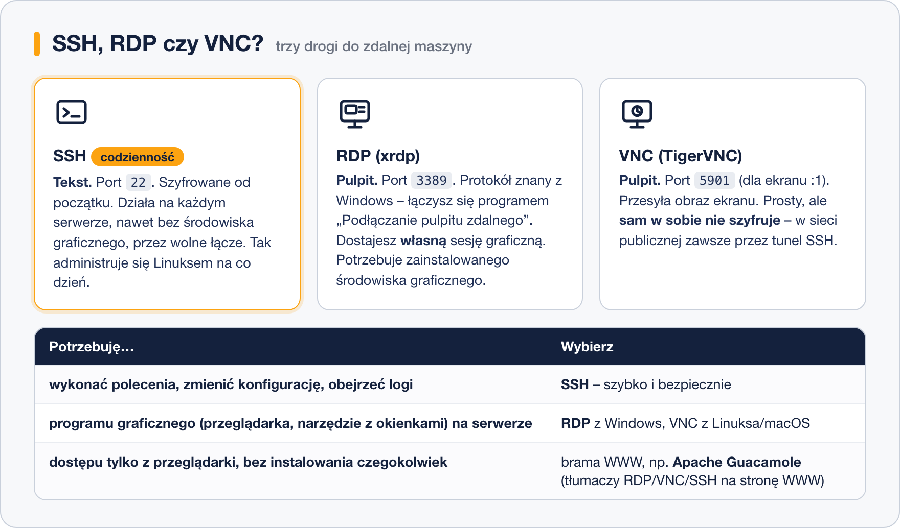

# Pulpit zdalny

> **W tej lekcji:** dowiesz się, kiedy zdalny pulpit jest naprawdę potrzebny, uruchomisz na RHEL serwer RDP (xrdp) i VNC (TigerVNC), połączysz się z Windows i zabezpieczysz VNC tunelem SSH.

## Po co mi to?

Serwerem Linux administruje się w terminalu – przez SSH jest szybciej, bezpieczniej i działa to
nawet przez komórkowy internet. Są jednak sytuacje, w których potrzebujesz **okienek** na zdalnej
maszynie: program graficzny dostępny tylko tam (narzędzie bazodanowe, przeglądarka w sieci
wewnętrznej), stanowisko szkoleniowe albo użytkownik, który Linuksa dopiero poznaje i czuje się
pewniej z pulpitem. Dokładnie tak działa maszyna, na której ćwiczysz podczas tego szkolenia.

## Jak to działa

Trzy protokoły, trzy różne filozofie:



- **RDP** (*Remote Desktop Protocol*) – protokół pulpitu zdalnego z Windows. Na Linuksie udostępnia go
  serwer **xrdp**. Każde logowanie dostaje **własną, nową sesję** graficzną. Klient jest w każdym
  Windows („Podłączanie pulpitu zdalnego”, `mstsc`). Port **3389/TCP**. Połączenie jest szyfrowane.
- **VNC** (*Virtual Network Computing*) – przesyła obraz ekranu i ruchy myszy. Na RHEL serwerem jest
  **TigerVNC**. Każdy użytkownik ma numer ekranu (`:1`, `:2`…), a port to 5900 + numer, czyli dla
  `:1` – **5901/TCP**. Sam protokół **nie szyfruje** ruchu, dlatego przez sieć publiczną łączymy
  się tunelem SSH.
- **Dostęp przez przeglądarkę** – brama taka jak **Apache Guacamole** stoi pomiędzy Tobą a serwerem
  i zamienia RDP, VNC lub SSH na zwykłą stronę WWW. Nie instalujesz nic na komputerze. To rozwiązanie
  dla większych środowisk – tu tylko o nim wspominamy.

Warunek wspólny dla RDP i VNC: na serwerze musi być zainstalowane **środowisko graficzne**
(na RHEL grupa pakietów `Server with GUI` – GNOME). Serwer „bez okienek” pulpitu nie udostępni.

## W praktyce

### RDP: serwer xrdp

Pakiet `xrdp` pochodzi z dodatkowego repozytorium **EPEL** (*Extra Packages for Enterprise Linux*,
więcej w [module 03](../../Dzia%C5%82%201%20-%20Wprowadzenie%20do%20systemu/03.%20Instalacja%20i%20zarz%C4%85dzanie%20oprogramowaniem/1.%20Jak%20dzia%C5%82a%20mened%C5%BCer%20pakiet%C3%B3w.md)).

```bash
# włączamy repozytorium EPEL i instalujemy xrdp
sudo dnf install epel-release
sudo dnf install xrdp
```

```bash
# uruchamiamy usługę i włączamy jej start przy rozruchu
sudo systemctl enable --now xrdp
```

```bash
# otwieramy port RDP w zaporze
sudo firewall-cmd --permanent --add-port=3389/tcp
sudo firewall-cmd --reload
```

```bash
# sprawdzamy, czy xrdp nasłuchuje
sudo ss -tlnp | grep 3389
```

```text
LISTEN 0  2  *:3389  *:*  users:(("xrdp",pid=2140,fd=11))
```

Połączenie z Windows: **Start → wpisz „Podłączanie pulpitu zdalnego”** (albo `mstsc`), w polu
*Komputer* adres serwera, *Połącz*. Pojawi się ekran logowania xrdp – wpisz nazwę i hasło
użytkownika **Linuksa** (sesja `Xorg`). Po chwili zobaczysz pulpit GNOME. Z Linuksa lub macOS
użyjesz klienta `Remmina` albo Microsoft Remote Desktop.

Wskazówka: użytkownik nie powinien być w tym samym czasie zalogowany lokalnie na konsoli –
GNOME nie lubi dwóch sesji tego samego konta naraz.

> W RHEL 9 i 10 GNOME ma też własny serwer RDP (`gnome-remote-desktop`, Ustawienia →
> Udostępnianie → Pulpit zdalny). Udostępnia on bieżącą sesję zalogowanego użytkownika; xrdp
> pozostaje prostszym wyborem dla serwera, do którego ma się logować wiele osób.

### VNC: serwer TigerVNC

```bash
# instalujemy serwer VNC
sudo dnf install tigervnc-server
```

TigerVNC na RHEL działa jako usługa systemd „na użytkownika”: do numeru ekranu przypisujemy
konto w pliku `/etc/tigervnc/vncserver.users`.

```bash
# ekran :1 należy do użytkownika anna
echo ":1=anna" | sudo tee -a /etc/tigervnc/vncserver.users
```

```bash
# JAKO anna: ustawiamy hasło VNC (osobne od hasła konta, maksymalnie 8 znaków ma znaczenie)
vncpasswd
```

```text
Password:
Verify:
Would you like to enter a view-only password (y/n)? n
```

```bash
# JAKO anna: wybieramy środowisko dla sesji VNC
mkdir -p ~/.vnc && echo "session=gnome" >> ~/.vnc/config
```

```bash
# uruchamiamy usługę dla ekranu :1 i otwieramy port w zaporze
sudo systemctl enable --now vncserver@:1
sudo firewall-cmd --permanent --add-service=vnc-server
sudo firewall-cmd --reload
```

Usługa `vnc-server` w zaporze otwiera porty 5900–5903, czyli ekrany `:0`–`:3`.
Stan sprawdzisz przez `systemctl status vncserver@:1`.

Klient: na Windows **TigerVNC Viewer** lub RealVNC Viewer, na Linuksie `vncviewer`
(pakiet `tigervnc`). Adres: `192.168.10.20:1` albo `192.168.10.20:5901`.

### Bezpieczne VNC – tunel przez SSH

Portu 5901 **nie** otwieraj na świat: VNC przesyła hasło i obraz bez szyfrowania. Zamiast tego
zostaw go zamkniętego w zaporze (albo otwartego tylko dla sieci lokalnej) i przepuść przez SSH:

```bash
# na swoim komputerze: lokalny port 5901 prowadzi tunelem do portu 5901 na serwerze
ssh -L 5901:localhost:5901 anna@192.168.10.20
```

Zostaw to okno otwarte i uruchom klienta VNC z adresem **`localhost:5901`**. Ruch idzie przez
szyfrowane połączenie SSH, a z zewnątrz widać tylko port 22. Dokładnie ten sam zapis `-L`
poznałeś w lekcji 5.

> **Na Ubuntu/Debianie:** `sudo apt install xrdp` (bez EPEL), zapora `sudo ufw allow 3389/tcp`;
> VNC to pakiet `tigervnc-standalone-server`, uruchamiany zwykle poleceniem `vncserver :1`,
> bez pliku `vncserver.users`.

## Najczęstsze błędy i pułapki

- **Czarny ekran lub natychmiastowe rozłączenie po logowaniu w xrdp.** Najczęściej brak
  środowiska graficznego na serwerze albo to samo konto zalogowane już lokalnie. Sprawdź
  `dnf group list --installed` i wyloguj się z konsoli.
- **„Connection refused” do 3389 lub 5901.** Usługa nie działa (`systemctl status xrdp` /
  `vncserver@:1`) albo port nie jest otwarty w zaporze (`firewall-cmd --list-all`).
- **`vncserver@:1` nie startuje.** W `vncserver.users` brak wpisu `:1=anna`, użytkownik nie
  ustawił `vncpasswd` albo nie ma `~/.vnc/config`. Zajrzyj do `journalctl -u vncserver@:1`.
- **Hasło VNC = hasło konta.** To osobne hasło, ustawiane przez `vncpasswd`; VNC nie pyta o hasło
  logowania Linuksa.
- **VNC wystawione na internet bez tunelu.** Nawet z hasłem to zaproszenie do podsłuchu.
  Zawsze `ssh -L`.

## Podsumowanie

- Codzienna administracja = SSH. Pulpit zdalny tylko wtedy, gdy potrzebujesz programu
  graficznego.
- **RDP/xrdp**: EPEL → `dnf install xrdp` → `systemctl enable --now xrdp` → port 3389 →
  „Podłączanie pulpitu zdalnego” w Windows. Szyfrowane, własna sesja na logowanie.
- **VNC/TigerVNC**: `vncserver.users` (`:1=anna`) → `vncpasswd` → `vncserver@:1` → port 5901.
  Bez szyfrowania – przez tunel `ssh -L 5901:localhost:5901`.
- Apache Guacamole daje te same pulpity w przeglądarce – rozwiązanie dla większych środowisk.

| Polecenie | Co robi |
|---|---|
| `sudo dnf install epel-release xrdp` | instaluje xrdp z EPEL (na RHEL w dwóch krokach) |
| `sudo systemctl enable --now xrdp` | uruchamia serwer RDP |
| `sudo firewall-cmd --permanent --add-port=3389/tcp` | otwiera RDP w zaporze |
| `sudo dnf install tigervnc-server` | instaluje serwer VNC |
| `/etc/tigervnc/vncserver.users` | przypisanie ekranu `:1` do użytkownika |
| `vncpasswd` | hasło VNC użytkownika |
| `sudo systemctl enable --now vncserver@:1` | uruchamia VNC dla ekranu `:1` (port 5901) |
| `sudo firewall-cmd --permanent --add-service=vnc-server` | otwiera porty 5900–5903 |
| `ssh -L 5901:localhost:5901 anna@serwer` | tunel SSH dla VNC |
