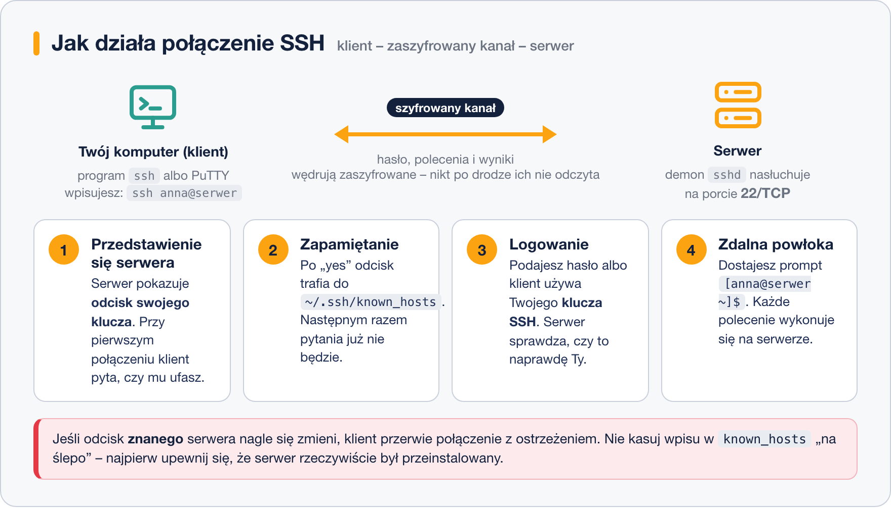

# Czym jest SSH

> **W tej lekcji:** dowiesz się, po co administratorowi zdalny dostęp, jak działa połączenie SSH i co odpowiedzieć, gdy system po raz pierwszy pyta „Are you sure you want to continue connecting?”.

## Po co mi to?

Wyobraź sobie, że firma ma dziesięć serwerów: dwa w serwerowni w piwnicy, pięć w centrum danych
pod Warszawą i trzy w chmurze. Nie podejdziesz do żadnego z nich z klawiaturą i monitorem.
Administrator Linuksa pracuje **zdalnie** – siedzi przy swoim laptopie, a polecenia wykonują się
na maszynie oddalonej o kilometry.

Do tego służy **SSH** (ang. *Secure Shell* – „bezpieczna powłoka”). To protokół, czyli umówiony
sposób rozmowy dwóch komputerów, który daje Ci na zdalnej maszynie dokładnie taki sam terminal,
jaki znasz z lekcji o powłoce Bash. Wpisujesz `ls`, a listę plików pokazuje serwer w Warszawie.

Jeśli znasz Windows: SSH jest dla Linuksa tym, czym „Podłączanie pulpitu zdalnego” dla Windows –
tyle że tekstowym, lżejszym i obecnym na każdym serwerze od ponad dwudziestu lat.

## Jak to działa

### Szyfrowanie w jednym akapicie

Zanim powstał SSH, do zdalnej pracy używano programu `telnet`. Wysyłał on wszystko – także hasło –
otwartym tekstem. Każdy, kto podsłuchiwał sieć (np. w kawiarnianym Wi-Fi), widział je jak na dłoni.
SSH **szyfruje** całą rozmowę: zanim cokolwiek zostanie wysłane, klient i serwer ustalają wspólny
tajny klucz sesji, a potem każdy bajt jest nim zamieniany w bezsensowny ciąg znaków. Podsłuchujący
widzi szum. Nie musisz rozumieć matematyki, która za tym stoi – wystarczy wiedzieć, że dzieje się
to automatycznie i zawsze.

### Klient i serwer

Połączenie SSH ma zawsze dwie strony:

- **Serwer** – maszyna, do której się łączysz. Działa na niej program-demon `sshd`
  (*SSH daemon*; demon to program pracujący w tle bez okna). Nasłuchuje on połączeń na
  **porcie 22/TCP**. Port to numer „drzwi” w systemie – o portach więcej w
  [module 12](../../Dział%203%20-%20Zarządzanie%20systemem%20Linux/12.%20Konfiguracja%20sieci/1.%20Podstawy%20sieci%20dla%20administratora.md).
- **Klient** – Twój komputer. Na Linuksie i macOS to polecenie `ssh`, na Windows program PuTTY
  albo wbudowane `ssh` w Windows 10/11.



### Odcisk klucza serwera

Każdy serwer SSH ma własny **klucz hosta** – coś w rodzaju dowodu osobistego. Przy pierwszym
połączeniu klient go nie zna, więc pokazuje jego skrót, czyli **odcisk** (ang. *fingerprint*),
i pyta, czy ufasz tej maszynie. Chodzi o to, żebyś nie wpisał hasła na serwerze podstawionym przez
kogoś obcego.

Po Twojej zgodzie odcisk jest zapisywany w pliku `~/.ssh/known_hosts` („znane hosty”). Przy
kolejnych połączeniach klient porównuje odcisk z zapisanym i – jeśli się zgadza – nie pyta już
o nic.

## W praktyce

Na maszynie szkoleniowej serwer SSH jest już uruchomiony, więc możesz połączyć się do niej
samej. To normalna technika: adres `localhost` zawsze oznacza „ten komputer”.

```bash
# łączymy się jako użytkownik anna z tym samym komputerem
ssh anna@localhost
```

```text
The authenticity of host 'localhost (::1)' can't be established.
ED25519 key fingerprint is SHA256:Qm3kZ7l0kPaa2VJ0h6l2Xv0p1cY0h9Tq5n0kO2yX8Mw.
This key is not known by any other names
Are you sure you want to continue connecting (yes/no/[fingerprint])? yes
Warning: Permanently added 'localhost' (ED25519) to the list of known hosts.
anna@localhost's password:
[anna@serwer ~]$
```

Co tu się stało, krok po kroku:

1. *The authenticity of host … can't be established* – klient widzi ten serwer po raz pierwszy.
2. *key fingerprint is SHA256:…* – to odcisk klucza serwera.
3. *Are you sure you want to continue connecting?* – wpisz **`yes`** (całe słowo; samo `y` nie
   wystarczy). W firmie administrator powinien porównać odcisk z tym, który podał mu kolega
   stawiający serwer; na szkoleniu i przy łączeniu do własnej maszyny po prostu potwierdzasz.
4. *Permanently added … to the list of known hosts* – odcisk trafił do `~/.ssh/known_hosts`.
5. Pytanie o hasło – podaj hasło użytkownika `anna` **na serwerze** (nie zobaczysz kropek ani
   gwiazdek, to normalne).
6. Prompt `[anna@serwer ~]$` – jesteś zalogowany. Od teraz każde polecenie wykonuje się zdalnie.

```bash
# sprawdźmy, gdzie jesteśmy i kto jest zalogowany
hostname
whoami
```

```bash
# kończymy sesję zdalną i wracamy do lokalnej powłoki
exit
```

Możesz też nacisnąć `Ctrl+D`. Po wyjściu prompt wraca do postaci sprzed połączenia.

### Zaglądamy do known_hosts

```bash
# jeden wiersz na każdy serwer, z którym się łączyliśmy
cat ~/.ssh/known_hosts
```

```text
localhost ssh-ed25519 AAAAC3NzaC1lZDI1NTE5AAAAIO3k...
```

Jeżeli serwer został przeinstalowany i ma nowy klucz, klient zaprotestuje bardzo głośno:

```text
@@@@@@@@@@@@@@@@@@@@@@@@@@@@@@@@@@@@@@@@@@@@@@@@@@@@@@@@@@@
@    WARNING: REMOTE HOST IDENTIFICATION HAS CHANGED!     @
@@@@@@@@@@@@@@@@@@@@@@@@@@@@@@@@@@@@@@@@@@@@@@@@@@@@@@@@@@@
```

To zabezpieczenie przed podstawionym serwerem. Jeżeli **wiesz**, że zmiana jest uzasadniona
(reinstalacja), usuń stary wpis:

```bash
# usuwamy zapamiętany odcisk wskazanego hosta
ssh-keygen -R localhost
```

## Najczęstsze błędy i pułapki

- **Odpowiedź `y` zamiast `yes`.** Klient powtórzy pytanie. Trzeba wpisać całe słowo.
- **Hasło do złego konta.** `ssh anna@serwer` pyta o hasło użytkownika `anna` **na serwerze**,
  nie o Twoje hasło lokalne. Gdy pominiesz `anna@`, klient użyje Twojej lokalnej nazwy użytkownika –
  i zdziwi się, że na serwerze takiego konta nie ma.
- **„Connection refused”** – na serwerze nie działa `sshd` albo nasłuchuje na innym porcie.
  Zobacz [lekcję 2](2.%20Serwer%20SSH%20–%20instalacja%20i%20konfiguracja.md).
- **„Connection timed out”** – pakiety w ogóle nie dochodzą: zły adres, zapora sieciowa albo
  serwer wyłączony. Diagnostyka sieci jest w
  [module 12](../../Dział%203%20-%20Zarządzanie%20systemem%20Linux/12.%20Konfiguracja%20sieci/5.%20Testowanie%20i%20diagnostyka%20sieci.md).
- **Kasowanie całego `known_hosts`, bo „coś nie działa”.** Pozbywasz się wtedy ochrony dla
  wszystkich serwerów naraz. Usuwaj pojedyncze wpisy poleceniem `ssh-keygen -R`.

## Podsumowanie

- SSH daje zdalny, **szyfrowany** terminal na innej maszynie; zastąpił niebezpieczny `telnet`.
- Po stronie serwera pracuje demon `sshd` na porcie **22/TCP**; po stronie klienta polecenie
  `ssh` lub PuTTY.
- Przy pierwszym połączeniu potwierdzasz **odcisk klucza serwera** słowem `yes`; trafia on do
  `~/.ssh/known_hosts`.
- Ostrzeżenie o zmianie klucza traktuj poważnie; pojedynczy wpis usuwa `ssh-keygen -R host`.

| Polecenie | Co robi |
|---|---|
| `ssh anna@serwer` | logowanie jako `anna` na maszynę `serwer` |
| `ssh anna@localhost` | logowanie do własnej maszyny (ćwiczenia) |
| `exit` lub `Ctrl+D` | zakończenie sesji zdalnej |
| `cat ~/.ssh/known_hosts` | lista zapamiętanych serwerów |
| `ssh-keygen -R serwer` | usunięcie zapamiętanego odcisku serwera |

## Zobacz też

- [2. Serwer SSH – instalacja i konfiguracja](2.%20Serwer%20SSH%20–%20instalacja%20i%20konfiguracja.md)
- [3. Klient SSH – ssh, PuTTY i plik config](3.%20Klient%20SSH%20–%20ssh,%20PuTTY%20i%20plik%20config.md)
- [Moduł 12. Konfiguracja sieci – Podstawy sieci dla administratora](../../Dział%203%20-%20Zarządzanie%20systemem%20Linux/12.%20Konfiguracja%20sieci/1.%20Podstawy%20sieci%20dla%20administratora.md)
