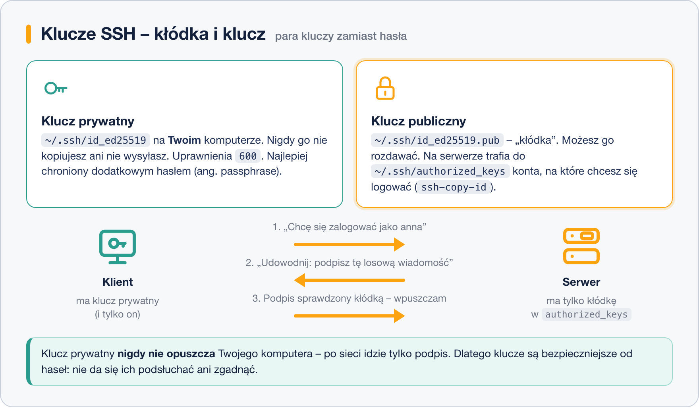
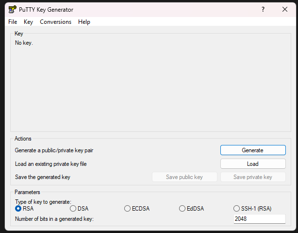
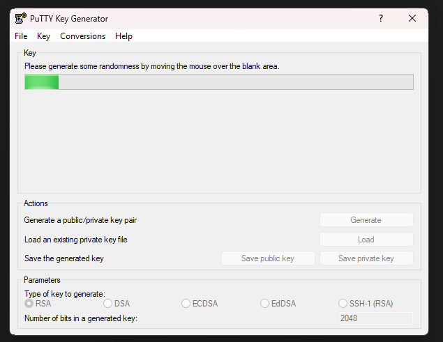
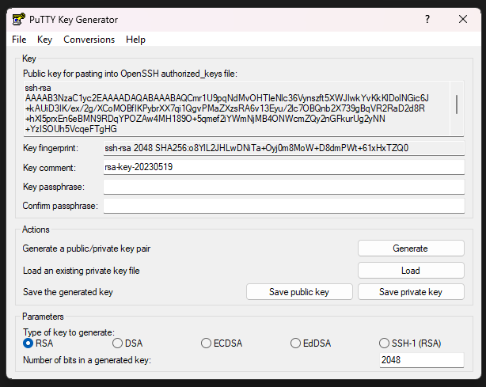

# Klucze SSH

> **W tej lekcji:** zrozumiesz, czym różni się klucz prywatny od publicznego, wygenerujesz własną parę, wgrasz klucz na serwer, nauczysz się nie wpisywać hasła do klucza przy każdym połączeniu (`ssh-agent`) i wyłączysz logowanie hasłem. Poznasz też PuTTYgen i format `.ppk`.

## Po co mi to?

Hasło da się podejrzeć, zgadnąć, wyłudzić i – co najgorsze – automaty próbują go tysiące razy na
godzinę na każdym serwerze widocznym w internecie. Klucz SSH to plik, którego nie da się
zgadnąć, a nawet podsłuchanie połączenia nic nie daje, bo klucz nigdy nie jest wysyłany.

Klucze mają jeszcze jedną zaletę: logowanie bez pytania o hasło. Dzięki temu skrypty i kopie
zapasowe (lekcja 5) mogą pracować w nocy same. Według dzisiejszych standardów serwer dostępny
z internetu, na który loguje się hasłem, uznaje się za źle zabezpieczony.

## Jak to działa

Para kluczy to dwa pliki, które powstają razem i pasują tylko do siebie:

- **Klucz prywatny** – „klucz”. Zostaje na Twoim komputerze, nigdy go nie kopiujesz ani nie
  wysyłasz. Kto go ma, ten jest Tobą.
- **Klucz publiczny** – „kłódka”. Możesz go rozdawać bez obaw. Wieszasz go na każdym serwerze, do
  którego chcesz wchodzić.



Logowanie wygląda tak: serwer wysyła losową wiadomość i mówi „podpisz to”. Klient podpisuje ją
kluczem prywatnym, serwer sprawdza podpis kluczem publicznym z pliku `~/.ssh/authorized_keys`
(„upoważnione klucze”) na koncie, na które się logujesz. Podpis pasuje – wchodzisz. Po sieci
wędruje tylko podpis, który nic nie zdradza.

Klucz prywatny można dodatkowo zabezpieczyć **hasłem do klucza** (ang. *passphrase*). Wtedy nawet
skradziony plik jest bezużyteczny. Żeby nie wpisywać go przy każdym połączeniu, używa się
**agenta** (`ssh-agent`) – programu, który raz odblokowany klucz trzyma w pamięci do końca
sesji.

Typ klucza: dziś zalecany jest **Ed25519** – krótki, szybki i bezpieczny. Starsze serwery
akceptują RSA (minimum 3072 bity). Na RHEL 9 i 10 Ed25519 działa bez dodatkowej konfiguracji.

## W praktyce

Ćwiczymy na jednej maszynie: klucz generujesz jako `anna` i wgrywasz go na konto `anna` na
`localhost`. Na prawdziwym serwerze wszystko wygląda tak samo, zmienia się tylko adres.

### 1. Generowanie pary kluczy

```bash
# tworzymy parę kluczy typu Ed25519 z komentarzem ułatwiającym rozpoznanie
ssh-keygen -t ed25519 -C "anna@laptop"
```

```text
Generating public/private ed25519 key pair.
Enter file in which to save the key (/home/anna/.ssh/id_ed25519):
Enter passphrase (empty for no passphrase):
Enter same passphrase again:
Your identification has been saved in /home/anna/.ssh/id_ed25519
Your public key has been saved in /home/anna/.ssh/id_ed25519.pub
```

- Pierwsze pytanie – zatwierdź Enterem, domyślna ścieżka jest dobra.
- Hasło do klucza – na szkoleniu możesz zostawić puste (Enter), w pracy ustaw je. Nic nie widać
  podczas wpisywania.

```bash
# para plików: prywatny (bez rozszerzenia) i publiczny (.pub)
ls -l ~/.ssh/
cat ~/.ssh/id_ed25519.pub
```

```text
-rw-------. 1 anna anna  411 paź 19 09:10 id_ed25519
-rw-r--r--. 1 anna anna   95 paź 19 09:10 id_ed25519.pub
ssh-ed25519 AAAAC3NzaC1lZDI1NTE5AAAAIGx0...8sQ anna@laptop
```

Klucz publiczny to jedna linia tekstu. Klucz prywatny ma uprawnienia `600` – tylko Ty możesz go
czytać; `ssh` odmówi użycia klucza z luźniejszymi uprawnieniami.

### 2. Wgranie klucza na serwer

```bash
# kopiuje klucz publiczny do ~/.ssh/authorized_keys na serwerze (ostatni raz pyta o hasło)
ssh-copy-id anna@localhost
```

```text
Number of key(s) added: 1
Now try logging into the machine, with: "ssh 'anna@localhost'"
and check to make sure that only the key(s) you wanted were added.
```

```bash
# logowanie – tym razem bez hasła konta (co najwyżej hasło do klucza)
ssh anna@localhost
```

Co zrobiło `ssh-copy-id`: utworzyło na serwerze katalog `~/.ssh` z uprawnieniami **700**,
dopisało linię z kluczem publicznym do `~/.ssh/authorized_keys` i nadało temu plikowi **600**.
Gdy nie masz `ssh-copy-id` (np. w Windows), zrób to ręcznie na serwerze:

```bash
# ręczny odpowiednik ssh-copy-id – wykonaj na serwerze, wklejając swój klucz publiczny
mkdir -p ~/.ssh && chmod 700 ~/.ssh
echo "ssh-ed25519 AAAAC3Nza...8sQ anna@laptop" >> ~/.ssh/authorized_keys
chmod 600 ~/.ssh/authorized_keys
```

Uprawnienia są tu **wymagane**, nie zalecane: jeśli ktoś inny mógłby zapisywać do
`authorized_keys`, mógłby dopisać własną kłódkę – dlatego `sshd` ignoruje plik i katalog
z za szerokimi uprawnieniami.

### 3. Agent – hasło do klucza tylko raz

```bash
# uruchamiamy agenta w bieżącej powłoce i dodajemy do niego klucz
eval "$(ssh-agent -s)"
ssh-add ~/.ssh/id_ed25519
```

```text
Agent pid 4213
Enter passphrase for /home/anna/.ssh/id_ed25519:
Identity added: /home/anna/.ssh/id_ed25519 (anna@laptop)
```

Od teraz do zamknięcia terminala wszystkie połączenia używają odblokowanego klucza.
`ssh-add -l` wypisuje załadowane klucze. W sesji graficznej GNOME agent startuje automatycznie
i o hasło pyta okienkiem.

### 4. Osobne klucze dla różnych serwerów

```bash
# klucz w innym pliku, np. tylko do serwera bazy
ssh-keygen -t ed25519 -f ~/.ssh/klucz_baza -C "anna – baza"
ssh-copy-id -i ~/.ssh/klucz_baza.pub jan@192.168.10.20
```

Który klucz do którego serwera – zapisujesz w `~/.ssh/config` (lekcja 3) opcją
`IdentityFile ~/.ssh/klucz_baza`.

### 5. Wyłączenie logowania hasłem

Dopiero gdy **sprawdziłeś**, że logowanie kluczem działa (i masz otwarte zapasowe okno):

```bash
# na serwerze: wyłączamy hasła w naszym pliku konfiguracyjnym z lekcji 2
echo "PasswordAuthentication no" | sudo tee -a /etc/ssh/sshd_config.d/00-szkolenie.conf
sudo sshd -t && sudo systemctl reload sshd
```

Test: `ssh -o PubkeyAuthentication=no anna@localhost` powinien teraz zakończyć się komunikatem
`Permission denied (publickey)` – hasła nie są już przyjmowane.

### 6. PuTTYgen i format .ppk (Windows)

PuTTY nie czyta kluczy OpenSSH wprost – używa własnego formatu **`.ppk`**. Klucz generuje program
**PuTTYgen**:



1. W **Parameters** wybierz **EdDSA** (to Ed25519) albo RSA z co najmniej 3072 bitami.
2. Kliknij **Generate** i poruszaj myszą nad pustym polem – program zbiera z ruchów losowość
   potrzebną do stworzenia klucza.



3. Po chwili pojawi się klucz. Pole **Key passphrase** to hasło do klucza – ustaw je.
4. **Save private key** → plik `.ppk` (trzymaj go jak hasło). W PuTTY wskażesz go w
   *Connection → SSH → Auth → Credentials*.
5. Zawartość pola **Public key for pasting into OpenSSH authorized_keys file** skopiuj i wklej
   na serwerze do `~/.ssh/authorized_keys` (ręczna metoda z punktu 2). Nie używaj przycisku
   *Save public key* do tego celu – zapisuje on inny format, którego `sshd` nie przyjmie.



Konwersja w drugą stronę: masz klucz z Linuksa (`id_ed25519`) i chcesz go użyć w PuTTY?
PuTTYgen → *Conversions → Import key* → wskaż plik prywatny → *Save private key* jako `.ppk`.
Odwrotnie: wczytaj `.ppk` i *Conversions → Export OpenSSH key*.

## Najczęstsze błędy i pułapki

- **Wysłanie klucza prywatnego mailem „żeby zadziałało”.** Na serwer trafia **tylko** plik `.pub`.
  Jeśli klucz prywatny gdziekolwiek wyciekł, wygeneruj nową parę i usuń starą kłódkę z
  `authorized_keys`.
- **Złe uprawnienia.** `~/.ssh` musi mieć `700`, `authorized_keys` i klucze prywatne `600`.
  Objaw: serwer wciąż pyta o hasło; w `ssh -v` zobaczysz, że klucz został zaoferowany
  i odrzucony. Na serwerze `journalctl -u sshd` wskaże `Authentication refused: bad ownership
  or modes`.
- **Wyłączenie haseł przed sprawdzeniem kluczy.** Kolejność z grafiki w lekcji 2: klucz działa →
  dopiero wtedy `PasswordAuthentication no`.
- **Klucz z Windows wklejony z końcami wierszy.** Klucz publiczny to **jedna** linia. Jeśli edytor
  ją zawinął, `sshd` go nie rozpozna.
- **Hasło do klucza pomylone z hasłem konta.** To dwie różne rzeczy: pierwsze odblokowuje plik
  lokalnie, drugie zna serwer. Po wdrożeniu kluczy serwer o hasło konta już nie pyta.

## Podsumowanie

- Para kluczy: prywatny zostaje u Ciebie (`600`), publiczny (`.pub`) trafia do
  `~/.ssh/authorized_keys` na serwerze (`600`, katalog `700`).
- `ssh-keygen -t ed25519` tworzy parę; `ssh-copy-id` wgrywa klucz publiczny i ustawia uprawnienia.
- `ssh-agent` + `ssh-add` – hasło do klucza wpisujesz raz na sesję.
- Po sprawdzeniu kluczy wyłącz hasła: `PasswordAuthentication no`.
- PuTTY używa formatu `.ppk`; PuTTYgen generuje i konwertuje klucze w obie strony.

| Polecenie | Co robi |
|---|---|
| `ssh-keygen -t ed25519 -C "opis"` | generuje parę kluczy |
| `ssh-keygen -t ed25519 -f ~/.ssh/nazwa` | generuje parę w innym pliku |
| `ssh-copy-id [-i klucz.pub] anna@serwer` | wgrywa klucz publiczny na serwer |
| `cat ~/.ssh/id_ed25519.pub` | pokazuje klucz publiczny do wklejenia |
| `eval "$(ssh-agent -s)"; ssh-add` | uruchamia agenta i ładuje klucz |
| `ssh-add -l` | lista kluczy w agencie |
| `ssh -i ~/.ssh/nazwa anna@serwer` | połączenie wskazanym kluczem |
| `chmod 700 ~/.ssh; chmod 600 ~/.ssh/authorized_keys` | wymagane uprawnienia |

## Zobacz też

- [2. Serwer SSH – instalacja i konfiguracja](2.%20Serwer%20SSH%20–%20instalacja%20i%20konfiguracja.md)
- [3. Klient SSH – ssh, PuTTY i plik config](3.%20Klient%20SSH%20–%20ssh,%20PuTTY%20i%20plik%20config.md)
- [Moduł 07. Użytkownicy i grupy](../07.%20Użytkownicy%20i%20grupy/0.%20O%20module.md) – uprawnienia do plików
