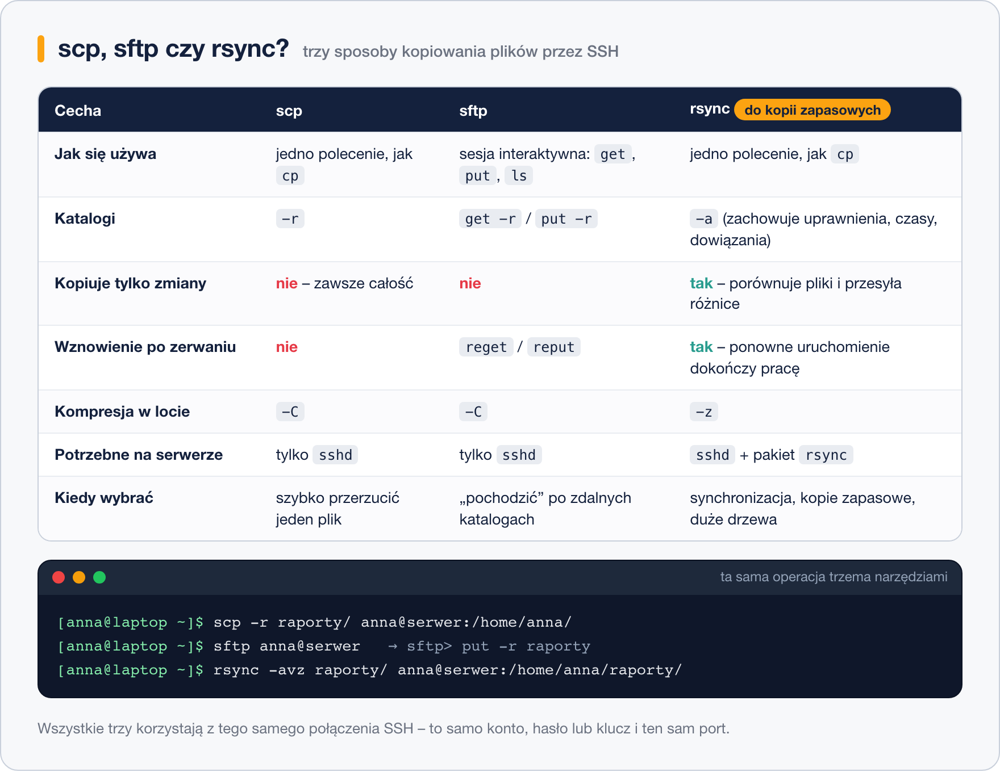

# Zdalne wykonywanie poleceń i kopiowanie plików

> **W tej lekcji:** nauczysz się uruchamiać pojedyncze polecenia na zdalnej maszynie (także na kilku naraz), kopiować pliki i katalogi w obie strony poleceniami `scp`, `sftp` i `rsync` oraz zrobić prostą kopię zapasową przez sieć.

## Po co mi to?

Logowanie i praca w zdalnej powłoce to tylko część codzienności. Równie często chcesz coś
**szybko sprawdzić** na dziesięciu serwerach („ile mają wolnego miejsca?”), **przerzucić plik**
(konfigurację, raport, paczkę) albo **co noc kopiować** katalog z dokumentami na drugą maszynę.
Wszystko to robi się tym samym połączeniem SSH, które już znasz – bez dodatkowych usług,
udziałów sieciowych czy pendrive'a.

## Jak to działa

SSH potrafi nie tylko otworzyć powłokę. Może też przekazać serwerowi **jedno polecenie**,
odebrać jego wynik i się rozłączyć. Na tym mechanizmie zbudowano narzędzia do plików:

- **`scp`** (*secure copy*) – działa jak `cp`, tylko jedna ze ścieżek jest na innej maszynie.
- **`sftp`** (*SSH file transfer protocol*) – sesja interaktywna jak dawny FTP: „chodzisz” po
  zdalnych katalogach i pobierasz albo wysyłasz pliki.
- **`rsync`** – najmądrzejszy z trójki: porównuje pliki po obu stronach i przesyła **tylko
  różnice**. Dlatego nadaje się do kopii zapasowych i synchronizacji.



Zdalna ścieżka ma zawsze postać `użytkownik@host:ścieżka`. Dwukropek jest kluczowy – bez niego
`scp` potraktuje napis jako zwykłą nazwę lokalnego pliku. Po dwukropku ścieżka względna liczy
się od katalogu domowego użytkownika na serwerze, więc `anna@serwer:` to `/home/anna/`.

## W praktyce

Ćwiczymy na własnej maszynie (`localhost`), więc „zdalny” katalog to po prostu inny katalog
na tym samym dysku – ale polecenia są identyczne jak dla prawdziwego serwera.

### Zdalne polecenia

```bash
# jedno polecenie na serwerze, wynik na Twoim ekranie
ssh anna@localhost 'df -h /'
```

```text
System plików  rozm. użyte dost. %uż. zamont. na
/dev/mapper/rl-root  17G  4,2G   13G  25% /
```

Polecenie ujmij w apostrofy – wtedy całe trafi na serwer w nienaruszonej postaci. Bez nich
powłoka lokalna mogłaby „po drodze” rozwinąć zmienne i symbole `*`.

```bash
# kilka poleceń naraz, oddzielonych średnikami
ssh anna@localhost 'hostname; uptime; who'
```

```bash
# to samo na kilku serwerach – prosta pętla w Bashu
for host in serwer1 serwer2 serwer3; do
    echo "== $host =="
    ssh anna@$host 'df -h / | tail -1'
done
```

Pętla ma sens dopiero z kluczami SSH (lekcja 4) – inaczej trzy razy wpiszesz hasło.
Polecenie wymagające terminala (np. `sudo` pytające o hasło albo `top`) potrzebuje opcji
`-t`: `ssh -t anna@serwer 'sudo dnf update'`.

### scp – kopiowanie jak cp

```bash
# przygotujmy coś do kopiowania
mkdir -p ~/raporty && echo "raport za październik" > ~/raporty/pazdziernik.txt
```

```bash
# z lokalnego na zdalny: plik trafi do /home/anna/ na serwerze
scp ~/raporty/pazdziernik.txt anna@localhost:
```

```bash
# ze zdalnego na lokalny: z serwera do bieżącego katalogu (kropka = tutaj)
scp anna@localhost:/etc/hostname .
```

```bash
# cały katalog (-r = rekurencyjnie), na serwer z innym portem (-P, wielka litera!)
scp -r -P 22 ~/raporty anna@localhost:/tmp/
```

| Opcja | Znaczenie |
|---|---|
| `-r` | kopiuje katalogi wraz z zawartością |
| `-P 2222` | port serwera (w `scp` **wielkie** P; małe `-p` zachowuje czasy i uprawnienia) |
| `-C` | kompresja w locie – pomaga przy wolnym łączu |
| `-i klucz` | użycie wskazanego klucza prywatnego |

Skróty z `~/.ssh/config` działają: `scp plik.txt baza:`.

### sftp – sesja interaktywna

```bash
# otwieramy sesję; zamiast promptu Basha pojawi się sftp>
sftp anna@localhost
```

```text
Connected to localhost.
sftp> pwd                 # katalog zdalny
Remote working directory: /home/anna
sftp> ls                  # lista plików na serwerze
pazdziernik.txt  raporty
sftp> lpwd                # katalog lokalny (l = local)
Local working directory: /home/anna
sftp> get pazdziernik.txt # pobierz z serwera
sftp> put ~/notatki.txt   # wyślij na serwer
sftp> get -r raporty      # pobierz katalog
sftp> bye                 # koniec
```

Zasada: polecenia bez `l` dotyczą serwera (`ls`, `cd`, `pwd`), z `l` – Twojego komputera
(`lls`, `lcd`, `lpwd`). `get` pobiera, `put` wysyła. Na Windows ten sam protokół obsługują
programy z okienkami, np. WinSCP czy FileZilla – łączą się na port 22 kontem SSH.

### rsync – synchronizacja i kopia zapasowa

`rsync` musi być zainstalowany **po obu stronach** (na RHEL zwykle jest; jeśli nie:
`sudo dnf install rsync`).

```bash
# kopia katalogu raporty do /home/anna/kopia/raporty na serwerze
rsync -avz ~/raporty/ anna@localhost:kopia/raporty/
```

```text
sending incremental file list
created directory kopia/raporty
./
pazdziernik.txt
sent 183 bytes  received 71 bytes  508,00 bytes/sec
```

| Opcja | Znaczenie |
|---|---|
| `-a` | tryb archiwum: katalogi, uprawnienia, właściciele, czasy, dowiązania – wszystko zachowane |
| `-v` | wypisuje kopiowane pliki |
| `-z` | kompresja w czasie przesyłania |
| `--delete` | usuwa po stronie docelowej pliki, których już nie ma w źródle (prawdziwe „lustro”) |
| `-n` | próba na sucho – pokazuje, co **by** zrobił, nic nie zmienia |
| `-e "ssh -p 2222"` | inny port SSH |

Uruchom to samo polecenie drugi raz: `rsync` przesłał tylko to, co się zmieniło (lista będzie
pusta). To odróżnia go od `scp`, które za każdym razem kopiuje całość.

**Ukośnik na końcu ma znaczenie.** `~/raporty/` oznacza „zawartość katalogu”, `~/raporty` –
„katalog razem z nazwą”. Pierwszy zapis tworzy `kopia/raporty/pazdziernik.txt`, drugi
`kopia/raporty/raporty/pazdziernik.txt`.

Przykład kopii zapasowej katalogu domowego z zachowaniem lustra:

```bash
# najpierw na sucho, żeby zobaczyć, co zostanie usunięte
rsync -avz --delete -n ~/dokumenty/ anna@serwer:kopie/dokumenty/
# jeśli lista wygląda dobrze – naprawdę
rsync -avz --delete ~/dokumenty/ anna@serwer:kopie/dokumenty/
```

Takie polecenie, z kluczem bez hasła, wpisuje się do harmonogramu `cron`
(moduł 15. Crontab) i kopia robi się sama co noc.

### Jedno zdanie o tunelach

Opcja `ssh -L 8080:localhost:80 anna@serwer` sprawia, że port 8080 na Twoim komputerze prowadzi
przez szyfrowane połączenie do portu 80 na serwerze – tak dostaniesz się do usługi, która nie jest
wystawiona do sieci. Użyjemy tego w lekcji 6 przy VNC.

## Najczęstsze błędy i pułapki

- **Brak dwukropka.** `scp plik anna@serwer` tworzy lokalny plik o nazwie `anna@serwer`.
  Zdalna ścieżka zawsze z `:`.
- **`-p` kontra `-P`.** W `ssh` port to `-p`, w `scp` to **`-P`**; w `rsync` port podaje się
  przez `-e "ssh -p 2222"`.
- **`--delete` bez próby na sucho.** Pomylisz kierunek i `rsync` wyczyści Ci źródło. Zawsze najpierw `-n`.
- **Ukośnik w `rsync`.** Zagnieżdżony katalog `raporty/raporty` to niemal zawsze brak ukośnika po źródle.
- **Polecenie zdalne bez apostrofów.** `ssh serwer ls *.log` – gwiazdkę rozwinie powłoka
  **lokalna**. Ujmij polecenie w `'…'`.

## Podsumowanie

- `ssh host 'polecenie'` wykonuje polecenie zdalnie; pętla `for` powtarza je na wielu maszynach.
- `scp` – szybkie kopiowanie jak `cp`; `sftp` – interaktywne `get`/`put`; `rsync -avz` –
  tylko różnice, idealny do kopii zapasowych.
- Zdalna ścieżka: `użytkownik@host:ścieżka`; bez ścieżki = katalog domowy.
- `rsync --delete` zawsze najpierw z `-n`.

| Polecenie | Co robi |
|---|---|
| `ssh anna@serwer 'df -h'` | polecenie zdalne |
| `ssh -t anna@serwer 'sudo …'` | polecenie zdalne wymagające terminala |
| `scp plik anna@serwer:` | plik na serwer (do katalogu domowego) |
| `scp anna@serwer:/ścieżka/plik .` | plik z serwera do bieżącego katalogu |
| `scp -r katalog anna@serwer:/tmp/` | katalog na serwer |
| `sftp anna@serwer` → `get`, `put`, `ls`, `lls`, `bye` | sesja interaktywna |
| `rsync -avz źródło/ anna@serwer:cel/` | synchronizacja (tylko zmiany) |
| `rsync -avz --delete -n …` | próba na sucho z usuwaniem |
| `ssh -L 8080:localhost:80 anna@serwer` | tunel: lokalny port 8080 → port 80 na serwerze |

## Zobacz też

- [3. Klient SSH – ssh, PuTTY i plik config](3.%20Klient%20SSH%20–%20ssh,%20PuTTY%20i%20plik%20config.md)
- [4. Klucze SSH](4.%20Klucze%20SSH.md) – logowanie bez hasła dla skryptów
- [6. Pulpit zdalny](6.%20Pulpit%20zdalny.md) – tunel SSH w praktyce
- [Moduł 06. Zarządzanie plikami i katalogami](../06.%20Zarządzanie%20plikami%20i%20katalogami/0.%20O%20module.md) – `cp`, ścieżki
- [Moduł 15. Crontab](../../Dział%204%20-%20Tematy%20dodatkowe/15.%20Crontab/0.%20O%20module.md)
