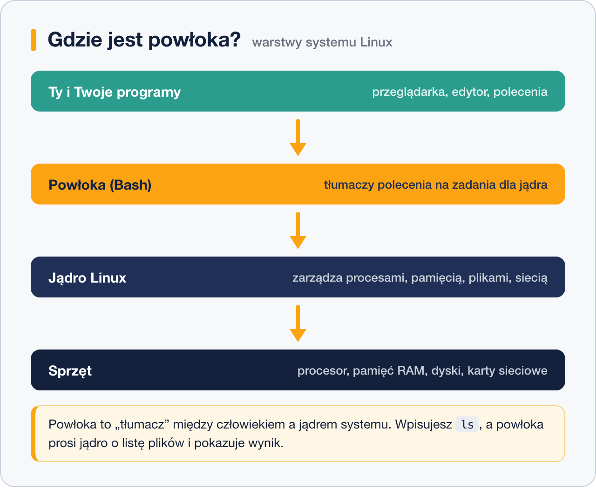
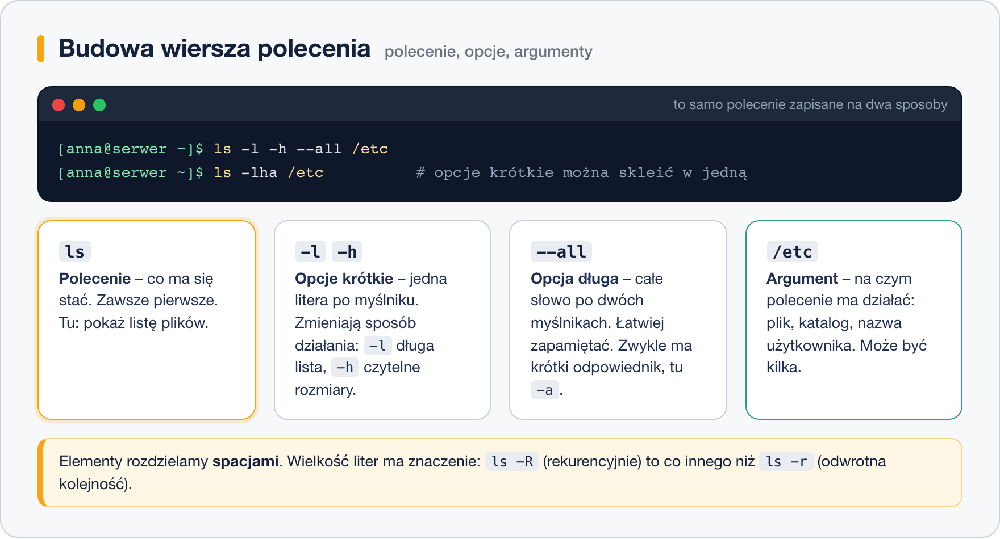

# Czym jest powłoka i terminal

> **W tej lekcji:** dowiesz się, czym różnią się terminal, konsola, powłoka i Bash, jak zbudowane
> jest każde polecenie, jakie nawyki oszczędzają czas w terminalu i jak czytać trzy najczęstsze
> komunikaty błędów.

Serwer z Linuksem zwykle nie ma środowiska graficznego – stoi w szafie w serwerowni albo w
chmurze, a administrator łączy się z nim zdalnie i pracuje w oknie tekstowym: wpisuje polecenia,
które wykonuje powłoka. Tekstowe polecenia mają zasadniczą przewagę nad klikaniem: da się je
**zapisać, powtórzyć i wysłać koledze** – zamiast tłumaczyć „kliknij tu, potem tam”, wysyłasz
jedną linijkę, a zamiast klikać to samo na dwudziestu serwerach, uruchamiasz skrypt. Dlatego
administratorzy wolą terminal, nawet gdy mają do dyspozycji pulpit graficzny.

## Jak to działa

### Cztery słowa, które często się myli

| Słowo | Co to jest | Porównanie |
|---|---|---|
| **Terminal** | Program z oknem, w którym widzisz tekst i wpisujesz polecenia (np. GNOME Terminal, PuTTY, Windows Terminal). | Telefon – urządzenie, przez które rozmawiasz. |
| **Konsola** | Terminal „wbudowany” w system, bez okna – to, co widzisz na ekranie serwera, gdy nie ma środowiska graficznego (przełączasz się do niej klawiszami `Ctrl+Alt+F3`). | Telefon stacjonarny przykręcony do ściany serwerowni. |
| **Powłoka** (ang. *shell*) | Program, który czyta Twoje polecenia, interpretuje je i prosi jądro systemu o wykonanie. Działa „w środku” terminala. | Rozmówca po drugiej stronie, który rozumie, co mówisz. |
| **Bash** | Najpopularniejsza powłoka w Linuksie i domyślna w RHEL. Są też inne: `sh`, `zsh`, `fish`. | Konkretny język, którym rozmówca mówi. |

Terminal to tylko okno. To, co „myśli”, to powłoka. Kiedy wpisujesz `ls` i naciskasz Enter,
terminal przekazuje te znaki do powłoki, powłoka znajduje program `ls`, uruchamia go, a jego wynik
wraca przez terminal na ekran.



### Jak zbudowane jest polecenie

Każda linia, którą wpisujesz, ma ten sam szkielet: **polecenie**, potem **opcje**, potem
**argumenty**. Rozdzielasz je spacjami.



- **Polecenie** – co ma się stać (`ls` – pokaż listę, `cp` – skopiuj).
- **Opcje** – jak ma się to stać. Krótkie to jedna litera po myślniku (`-l`), długie to słowo
  po dwóch myślnikach (`--all`). Krótkie można skleić: `-l -a -h` to to samo co `-lah`.
- **Argumenty** – na czym polecenie ma działać: plik, katalog, nazwa użytkownika.

Wielkość liter ma znaczenie: `ls -r` i `ls -R` robią co innego, a `Plik.txt` i `plik.txt` to dwa
różne pliki.

## W praktyce

### Skąd wziąć terminal

- Na pulpicie GNOME: aplikacja **Terminal** (naciśnij klawisz Super i wpisz „terminal”).
- Zdalnie: połączenie SSH – pokazujemy je w module
  [Zdalna administracja](../4.%20Zdalna%20administracja/1.%20Czym%20jest%20SSH.md).
- Na serwerze bez pulpitu: po prostu logujesz się na konsoli.

Po zalogowaniu zobaczysz **znak zachęty** (ang. *prompt*), na przykład `[anna@serwer ~]$`. Znaczy on:
„jestem gotowa, wpisz polecenie”. Co dokładnie mówią poszczególne części, rozbieramy w lekcji
[Prompt – co mówi znak zachęty](4.%20Prompt%20–%20co%20mówi%20znak%20zachęty.md).

### Pierwsze polecenia

```bash
# kim jestem? (nazwa zalogowanego użytkownika)
whoami
```

```text
anna
```

```bash
# na jakim komputerze jestem?
hostname
```

```text
serwer
```

```bash
# która godzina na serwerze?
date
```

```text
sob, 18 paź 2026, 10:32:15 CEST
```

```bash
# która powłoka mnie obsługuje?
echo $SHELL
```

```text
/bin/bash
```

### Nawyki, które od razu oszczędzają czas

| Klawisz | Co robi | Kiedy używać |
|---|---|---|
| `Tab` | Dopełnia nazwę polecenia lub pliku. Dwa razy `Tab` – pokazuje wszystkie możliwości. | **Zawsze.** Wpisz `cd /et`, naciśnij `Tab` – dostaniesz `cd /etc/`. Mniej literówek. |
| `↑` / `↓` | Przewija historię poleceń. | Gdy chcesz powtórzyć lub poprawić poprzednie polecenie. |
| `Ctrl+R` | Szuka w historii – zacznij pisać fragment, powłoka podpowie całe polecenie. | Gdy pamiętasz tylko kawałek. |
| `Ctrl+C` | Przerywa działające polecenie. | Gdy coś „wisi” albo wpisałeś coś, czego nie chcesz wykonać – skasuje całą linię. |
| `Ctrl+L` lub `clear` | Czyści ekran. | Gdy ekran jest pełen śmieci. Nic nie kasuje z historii. |
| `Ctrl+D` lub `exit` | Zamyka powłokę (wylogowuje). | Na koniec pracy. `Ctrl+D` na pustej linii = `exit`. |
| `Ctrl+A` / `Ctrl+E` | Skok na początek / koniec linii. | Przy poprawianiu długiego polecenia. |
| `history` | Pokazuje numerowaną listę poleceń z historii. `!42` wykonuje polecenie numer 42, `!!` powtarza ostatnie. | Gdy potrzebujesz czegoś sprzed godziny. |

```bash
# zobacz ostatnie 5 poleceń
history 5
```

```text
  201  whoami
  202  hostname
  203  date
  204  echo $SHELL
  205  history 5
```

### Jak czytać komunikaty błędów

Komunikat błędu to nie kara, tylko informacja. Niemal każdy ma ten sam układ:
`kto zgłasza: czego dotyczy: co jest nie tak`. Trzy, które zobaczysz najczęściej:

```bash
lss
```

```text
bash: lss: command not found
```

**„Nie znaleziono polecenia”** – zgłasza to sam Bash. Albo literówka (tu: `lss` zamiast `ls`),
albo program nie jest zainstalowany. Sprawdź pisownię, a jeśli jest poprawna – zainstaluj pakiet
(moduł [Instalacja i zarządzanie oprogramowaniem](../../Dzia%C5%82%201%20-%20Wprowadzenie%20do%20systemu/3.%20Instalacja%20i%20zarz%C4%85dzanie%20oprogramowaniem/1.%20Jak%20dzia%C5%82a%20mened%C5%BCer%20pakiet%C3%B3w.md)).

```bash
cat /etc/shadow
```

```text
cat: /etc/shadow: Permission denied
```

**„Brak dostępu”** – polecenie istnieje i plik istnieje, ale Ty nie masz prawa go czytać.
To normalne: `/etc/shadow` przechowuje skróty haseł i czyta go tylko administrator. Jeśli naprawdę
musisz – poprzedź polecenie `sudo`. Nie rób tego odruchowo; najpierw zastanów się, czy to na pewno
plik, którego potrzebujesz.

```bash
cat raport.txt
```

```text
cat: raport.txt: No such file or directory
```

**„Nie ma takiego pliku ani katalogu”** – plik nie istnieje **w miejscu, w którym go szukasz**.
Najczęściej stoisz w innym katalogu, niż myślisz (sprawdź `pwd`), albo nazwa ma literówkę
(użyj `Tab`, wtedy literówki nie będzie).

> **Jeśli system jest po polsku**, te same komunikaty brzmią: `nie znaleziono polecenia`,
> `Brak dostępu`, `Nie ma takiego pliku ani katalogu`. Na serwerach zwykle zostawia się język
> angielski – łatwiej wtedy znaleźć rozwiązanie w internecie.

## Najczęstsze błędy i pułapki

1. **Brak spacji między elementami.** `ls-l` to dla powłoki jedno słowo – nieistniejące
   polecenie. Musi być `ls -l`.
2. **Zła wielkość liter.** Linux rozróżnia `Dokumenty` i `dokumenty`. Jeśli coś „nie istnieje”,
   sprawdź wielkość liter – albo użyj `Tab`.
3. **Przepisywanie ręczne zamiast `Tab`.** Każde ręcznie wpisane słowo to szansa na literówkę.
   Dopełnianie nie tylko oszczędza czas, ale też potwierdza, że plik istnieje.
4. **Panika, gdy coś „wisi”.** Niektóre programy czekają na dane albo działają długo. `Ctrl+C`
   przerywa niemal wszystko. Jeśli wpadłeś do edytora albo przeglądarki tekstu i nie wiesz,
   jak wyjść: `q`, a w `vim` – `Esc`, potem `:q!` i `Enter`.
5. **Zamykanie okna zamiast `exit`.** Działa, ale powłoka nie zapisuje wtedy historii poleceń
   do pliku i nie wykonuje czynności końcowych. Nawyk: `exit` lub `Ctrl+D`.

## Podsumowanie

- Terminal to okno, powłoka to program, który rozumie polecenia; Bash to konkretna powłoka,
  domyślna w RHEL.
- Polecenie = `polecenie -opcje argumenty`, elementy rozdzielone spacjami, wielkość liter ma
  znaczenie.
- `Tab` dopełnia, strzałki i `Ctrl+R` przeszukują historię, `Ctrl+C` przerywa, `Ctrl+L` czyści,
  `Ctrl+D` wylogowuje.
- Komunikat błędu czytaj od końca: *command not found* – literówka lub brak programu,
  *Permission denied* – brak uprawnień, *No such file or directory* – zła ścieżka lub nazwa.

| Polecenie | Co robi |
|---|---|
| `whoami` | nazwa zalogowanego użytkownika |
| `hostname` | nazwa komputera |
| `date` | data i godzina |
| `echo $SHELL` | która powłoka Cię obsługuje |
| `history` | lista wcześniejszych poleceń |
| `clear` | czyści ekran |
| `exit` | kończy sesję powłoki |
