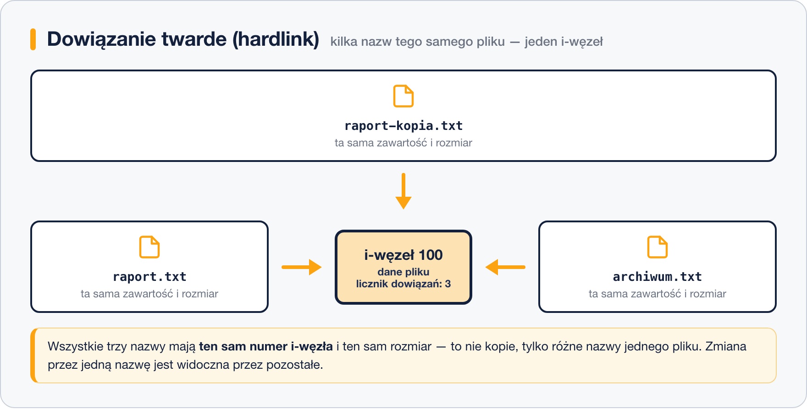
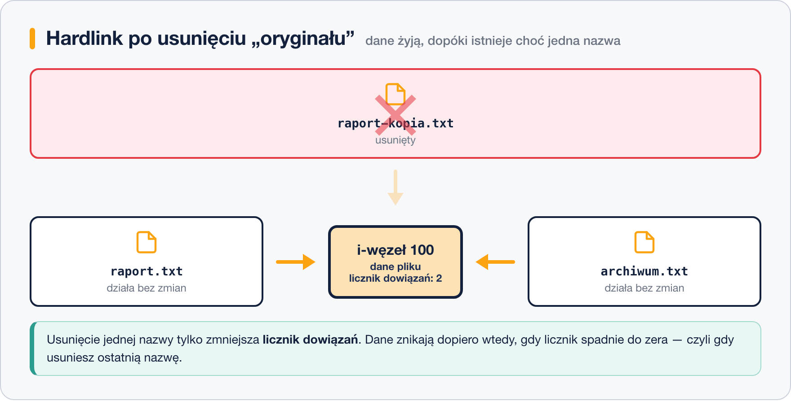

# Hardlink vs Symlink

Każdy plik w systemie ma przypisany unikalny numer nazwany inode, zawiera on wszystkie informacje z wyjątkiem zawartosci liku i jego nazwy. Każdy numer inode jest unikatowy i może służyć do identyfikacji pliku. 

***Informacje które zawiera INODE***
- Numer INODE
- Informacje o właścicelu
- Przypisane dostępy
- Typ plików
- Informacje o linkach 
___
***SOFTLINK***

Softlink w systemie Windows jest reprezentowany nazwą jako „skrót do ...” i wskazuje on miejsce oryginalnego pliku. Rozmiar pliku skrótu jest mniejszy od oryginalnego pliku do którego się odwołuje, tym jest właśnie softlink. 


Jeżeli skasujemy oryginalny link do którego jest przypisany softlink to softlink stanie się bezużyteczny, nie będzie miał odniesienia do pliku do którego jest przypisany. Tak samo jak w systemie windows jeżeli skasujemy plik do którego skrót się odnosi to skrót przestanie działać.


___
***HARDLINK***

Hardlink jest dowiązaniem który jest inna nazwa tego samego pliku, posiada dokładnie ten sam rozmiar pliku do którego się odwołuje oraz posiada ten sam numer INODE. 



Jeżeli usuniemy plik oryginalny to hardlinki powiązane z oryginalny plikiem pozostaną niezmienione i będą zawierać te same dane co oryginał. Można więc przyjąć że hardlink to kopia danego pliku a softlink to skrót do niego.


___

## W praktyce

Numer i-węzła oraz licznik dowiązań pokazuje `ls` z opcją `-i` oraz `-l`:

```bash
# -i wypisuje numer i-węzła, -l pokazuje licznik dowiązań w drugiej kolumnie
ls -li
```

```text
131079 -rw-r--r--. 1 anna anna 1240 10-22 09:14 raport.txt
```

```bash
# dowiązanie twarde: ta sama nazwa i-węzła, licznik rośnie do 2
ln raport.txt archiwum.txt

# dowiązanie symboliczne: osobny plik wskazujący ścieżkę
ln -s raport.txt skrot-a

ls -li
```

```text
131079 -rw-r--r--. 2 anna anna 1240 10-22 09:14 archiwum.txt
131079 -rw-r--r--. 2 anna anna 1240 10-22 09:14 raport.txt
131083 lrwxrwxrwx. 1 anna anna   10 10-22 09:16 skrot-a -> raport.txt
```

`archiwum.txt` i `raport.txt` mają ten sam numer i-węzła (131079) i licznik `2`, a `skrot-a` ma własny i-węzeł, typ `l` na początku uprawnień i strzałkę ze ścieżką do celu.

> **Uwaga:** dowiązanie twarde działa tylko w obrębie jednego systemu plików i nie można nim wskazać katalogu. Dowiązanie symboliczne nie ma tych ograniczeń — może prowadzić na inny dysk i do katalogu.

___

>PRZEJDZ DO KATALOGU ZADANIA I WYKONAJ ZADANIA:

```
8. Symlink i hardlink
```
