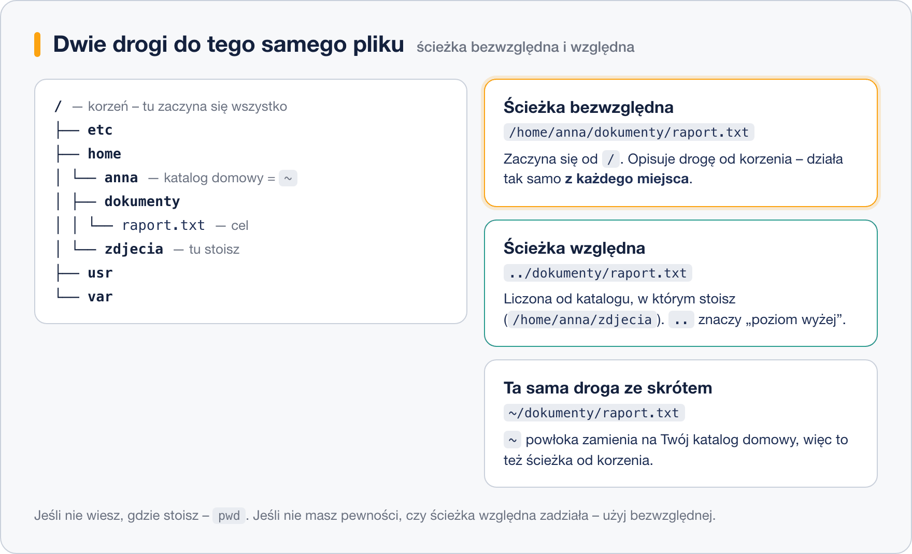
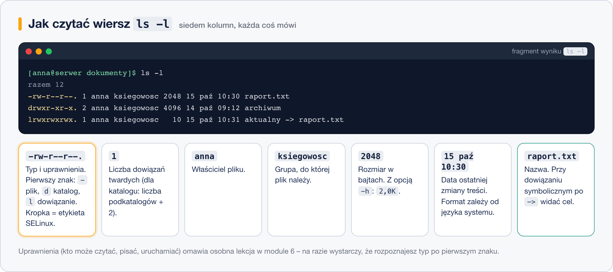

# Poruszanie się po systemie

> **W tej lekcji:** nauczysz się sprawdzać, gdzie jesteś (`pwd`), oglądać zawartość katalogów
> (`ls`) i przechodzić między nimi (`cd`), a także rozumieć ścieżki bezwzględne i względne oraz
> skróty `~`, `.`, `..` i `-`.

W terminalu – inaczej niż w Eksploratorze Windows – informacja o bieżącym katalogu nie jest stale
widoczna na ekranie. Musisz umieć zapytać system „gdzie jestem?” (`pwd`), „co tu jest?” (`ls`) i
„zabierz mnie tam” (`cd`) – to trzy polecenia, których będziesz używać częściej niż wszystkich
innych razem. Bez nich każda inna czynność – kopiowanie, edycja, instalacja – kończy się
komunikatem *No such file or directory*, bo próbujesz działać na pliku, którego w bieżącym
katalogu nie ma.

## Jak to działa

### Jedno drzewo, jeden korzeń

W Windows każdy dysk ma swoją literę: `C:`, `D:`. W Linuksie **wszystko** jest jednym drzewem,
które zaczyna się od katalogu głównego, zapisywanego jako `/` (czytaj: „korzeń”, ang. *root*).
Dyski, pendrive'y, udziały sieciowe – wszystkie są „wpięte” gdzieś w to drzewo jako katalogi.

Ścieżkę zapisujesz ukośnikami w prawo: `/home/anna/dokumenty/raport.txt` znaczy: w korzeniu
katalog `home`, w nim `anna`, w nim `dokumenty`, w nim plik `raport.txt`.

### Katalog bieżący

Powłoka zawsze „stoi” w jakimś katalogu – to **katalog bieżący** (ang. *working directory*).
Po zalogowaniu jest to Twój **katalog domowy**: `/home/anna` dla użytkownika `anna`
(dla administratora `root` – `/root`). Każda nazwa pliku, którą podasz bez pełnej ścieżki,
jest szukana właśnie tam.

### Ścieżka bezwzględna i względna



- **Bezwzględna** zaczyna się od `/` i opisuje całą drogę od korzenia. Działa z każdego miejsca.
- **Względna** nie zaczyna się od `/` – jest liczona od katalogu bieżącego. Krótsza, ale działa
  tylko wtedy, gdy stoisz we właściwym miejscu.

Cztery skróty, które skracają ścieżki:

| Skrót | Znaczenie | Przykład |
|---|---|---|
| `~` | Twój katalog domowy | `cd ~/dokumenty` = `cd /home/anna/dokumenty` |
| `.` | katalog bieżący | `./skrypt.sh` – uruchom skrypt z tego katalogu |
| `..` | katalog nadrzędny (o poziom wyżej) | `cd ..` – wyjdź poziom wyżej; `../zdjecia` – katalog obok |
| `-` | poprzedni katalog (tylko z `cd`) | `cd -` – wróć tam, skąd przyszedłem |

## W praktyce

### `pwd` – gdzie jestem

```bash
# wypisz pełną ścieżkę katalogu bieżącego (print working directory)
pwd
```

```text
/home/anna
```

### `ls` – co tu jest

```bash
# zwykła lista: same nazwy
ls
```

```text
dokumenty  Pobrane  Pulpit  zdjecia
```

```bash
# długa lista: typ, uprawnienia, właściciel, rozmiar, data
ls -l
```

```text
razem 16
drwxr-xr-x. 2 anna anna 4096 15 paź 10:30 dokumenty
drwxr-xr-x. 2 anna anna 4096 12 paź 18:02 Pobrane
drwxr-xr-x. 2 anna anna 4096 10 paź 09:00 Pulpit
drwxr-xr-x. 2 anna anna 4096 14 paź 20:41 zdjecia
```

Najważniejsze opcje `ls`:

| Opcja | Co robi |
|---|---|
| `-l` | długa lista (szczegóły w osobnych kolumnach) |
| `-a` | pokazuje też pliki ukryte – te, których nazwa zaczyna się od kropki (np. `.bashrc`) |
| `-h` | rozmiary „dla ludzi”: `4,0K`, `2,3M` zamiast liczby bajtów (tylko razem z `-l`) |
| `-t` | sortuje od najnowszego; `-tr` – od najstarszego |
| `-d` | pokazuje sam katalog, a nie jego zawartość (`ls -ld /etc`) |
| `-R` | wchodzi rekurencyjnie do podkatalogów – ostrożnie, w `/` wynik ma tysiące linii |

Opcje łączysz dowolnie: `ls -lah`, `ls -lt`, `ls -la /etc`.

Jak czytać jeden wiersz `ls -l`:



Na razie wystarczy, że patrzysz na **pierwszy znak** (`-` plik, `d` katalog, `l` dowiązanie)
i na **nazwę**. Uprawnienia (`rwx`) omawia moduł
[Zarządzanie plikami i katalogami](../2.%20Zarz%C4%85dzanie%20plikami%20i%20katalogami/1.%20Uprawnienia%20do%20plik%C3%B3w%20i%20katalog%C3%B3w.md).
Kropka po uprawnieniach oznacza, że plik ma etykietę SELinux – w RHEL ma ją każdy plik.

```bash
# wszystko, także ukryte, z czytelnymi rozmiarami
ls -lah
```

```text
razem 44K
drwx------. 6 anna anna 4,0K 15 paź 10:30 .
drwxr-xr-x. 4 root root 4,0K 10 paź 08:55 ..
-rw-r--r--. 1 anna anna   18 10 paź 08:55 .bash_logout
-rw-r--r--. 1 anna anna  141 10 paź 08:55 .bash_profile
-rw-r--r--. 1 anna anna  492 10 paź 08:55 .bashrc
drwxr-xr-x. 2 anna anna 4,0K 15 paź 10:30 dokumenty
...
```

Zwróć uwagę na dwa pierwsze wpisy: `.` to ten katalog, `..` to katalog nadrzędny. Pojawiają się
w każdym katalogu.

### `cd` – przejdź do katalogu

```bash
# ścieżka bezwzględna – działa z każdego miejsca
cd /etc
pwd
```

```text
/etc
```

```bash
# ścieżka względna – katalog „sysconfig” wewnątrz /etc
cd sysconfig
pwd
```

```text
/etc/sysconfig
```

```bash
# poziom wyżej
cd ..
pwd
```

```text
/etc
```

```bash
# wróć do poprzedniego katalogu (tu: /etc/sysconfig), potem znów do /etc
cd -
cd -
```

```bash
# samo cd bez argumentu = do katalogu domowego; to samo robi cd ~
cd
pwd
```

```text
/home/anna
```

```bash
# do podkatalogu w katalogu domowym – skądkolwiek
cd ~/dokumenty
```

Przy wpisywaniu ścieżek używaj `Tab`: `cd /etc/sysc` + `Tab` dopełni do `/etc/sysconfig/`.
Jeśli dopełnienie nie działa, katalog o takiej nazwie nie istnieje – to też informacja.

### Najważniejsze katalogi systemu

Linux ma ustaloną strukturę katalogów – w każdej dystrybucji te same rzeczy leżą w tych samych
miejscach. Na początek wystarczy osiem:

> | Katalog | Co w nim jest |
> |---|---|
> | `/` | korzeń – tu zaczyna się wszystko |
> | `/home` | katalogi domowe użytkowników (`/home/anna`) |
> | `/root` | katalog domowy administratora `root` |
> | `/etc` | konfiguracja systemu i usług – pliki tekstowe |
> | `/var` | dane, które się zmieniają: logi (`/var/log`), bazy, kolejki poczty |
> | `/tmp` | pliki tymczasowe, czyszczone automatycznie |
> | `/usr/bin` | programy (polecenia) – tu leży `ls`, `cp`, `vim` |
> | `/boot` | jądro i pliki potrzebne do uruchomienia systemu |
>
> Pełne drzewo z opisem każdego katalogu znajdziesz w lekcji
> [Drzewo katalogów Linuksa](../../Dzia%C5%82%203%20-%20Zarz%C4%85dzanie%20systemem%20Linux/3.%20System%20plik%C3%B3w/6.%20Drzewo%20katalog%C3%B3w%20Linuksa.md).

## Najczęstsze błędy i pułapki

1. **„Nie ma takiego pliku”, choć plik istnieje.** Stoisz w innym katalogu, niż myślisz.
   Nawyk: `pwd` przed każdą operacją, której nie jesteś pewien.
2. **Spacja w nazwie.** `cd Moje dokumenty` to dla powłoki dwa argumenty. Pisz `cd "Moje dokumenty"`
   albo `cd Moje\ dokumenty` – a najlepiej pozwól `Tab` wstawić ukośnik za Ciebie. W nazwach,
   które sam tworzysz, unikaj spacji i polskich znaków.
3. **Ukośnik w złą stronę.** Windows używa `\`, Linux `/`. `cd \etc` nie zadziała tak, jak chcesz.
4. **`ls -l` bez `-a` i „zniknięte” pliki.** Pliki konfiguracyjne w katalogu domowym zaczynają się
   od kropki i są ukryte. Jeśli czegoś nie widzisz, dodaj `-a`.
5. **`cd` do pliku.** `cd raport.txt` zwróci *Not a directory* – `cd` wchodzi tylko do katalogów.

## Podsumowanie

- Linux ma jedno drzewo katalogów z korzeniem `/`; nie ma liter dysków.
- Powłoka zawsze stoi w katalogu bieżącym – `pwd` mówi, w którym.
- Ścieżka od `/` jest bezwzględna i działa wszędzie; bez `/` na początku jest względna i zależy
  od tego, gdzie stoisz.
- `~` dom, `.` tu, `..` wyżej, `cd -` z powrotem.
- `ls -l` pokazuje szczegóły, `-a` pliki ukryte, `-h` czytelne rozmiary, `-t` sortowanie po dacie.

| Polecenie | Co robi |
|---|---|
| `pwd` | pokaż katalog bieżący |
| `ls` | lista plików w katalogu bieżącym |
| `ls -lah` | wszystko, ze szczegółami i czytelnymi rozmiarami |
| `ls -lt` | od najnowszego pliku |
| `ls -ld katalog` | informacje o samym katalogu |
| `cd /sciezka` | przejdź do katalogu |
| `cd` lub `cd ~` | do katalogu domowego |
| `cd ..` | poziom wyżej |
| `cd -` | do poprzedniego katalogu |
