# Struktura katalogów Linuksa

> **W tej lekcji:** przejdziesz katalog po katalogu przez całe drzewo Linuksa – dowiesz się, co leży w `/etc`, `/var`, `/usr`, `/home` i kilkunastu innych miejscach, które katalogi są Twoim miejscem pracy, a które należą wyłącznie do systemu.

Układ katalogów Linuksa opisuje standard **FHS** (ang. *Filesystem Hierarchy Standard*). Gdy go znasz, na dowolnej dystrybucji – RHEL, Ubuntu, Alpine – znajdziesz plik konfiguracyjny usługi, jej logi i dane bez szukania w internecie. Gdy go nie znasz, łatwo skasować coś w `/usr` albo zapisać dane bazy w `/tmp`, skąd znikną po restarcie.

Jedna zasadnicza różnica wobec Windows: Linux **nie ma liter dysków**. Jest jedno drzewo zaczynające się od korzenia `/`, a kolejne dyski, partycje, pendrive’y i udziały sieciowe wpinają się do niego w wybranych katalogach – o montowaniu mówi [moduł o systemach plików](../../Dzia%C5%82%203%20-%20Zarz%C4%85dzanie%20systemem%20Linux/4.%20System%20plik%C3%B3w/9.%20Zarz%C4%85dzanie%20systemami%20plik%C3%B3w.md). Użytkownik nie musi wiedzieć, że `/home` jest na innym dysku niż `/`.

## Jak to działa

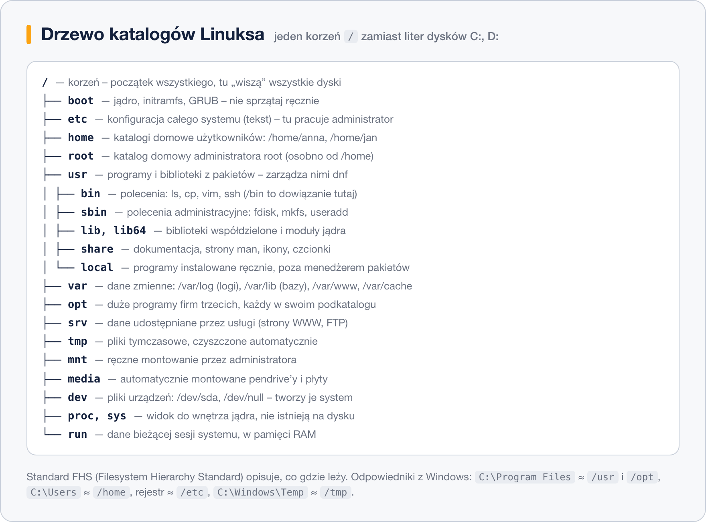

Całe drzewo rozkładamy teraz na części – katalog po katalogu.

### `/` – korzeń systemu plików

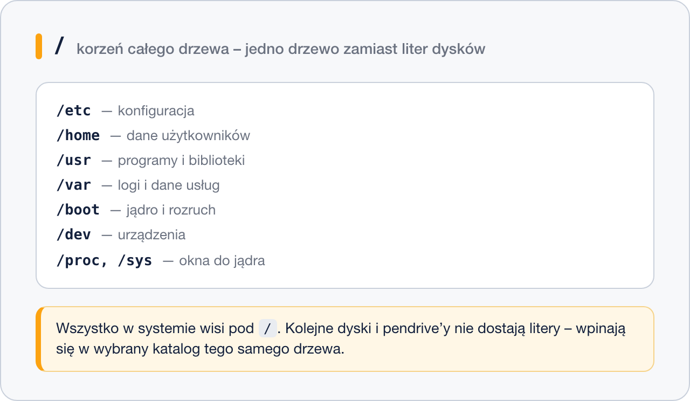

Korzeń to punkt wyjścia dla wszystkiego: każda ścieżka bezwzględna zaczyna się od `/`. W Windows każda partycja ma własną literę i własne drzewo; w Linuksie partycje, dyski USB i zasoby sieciowe stają się podkatalogami tego jednego drzewa. Dzięki temu program nigdy nie musi wiedzieć, na którym fizycznym dysku leży plik – wystarczy mu ścieżka.

### `/boot` – pliki startowe

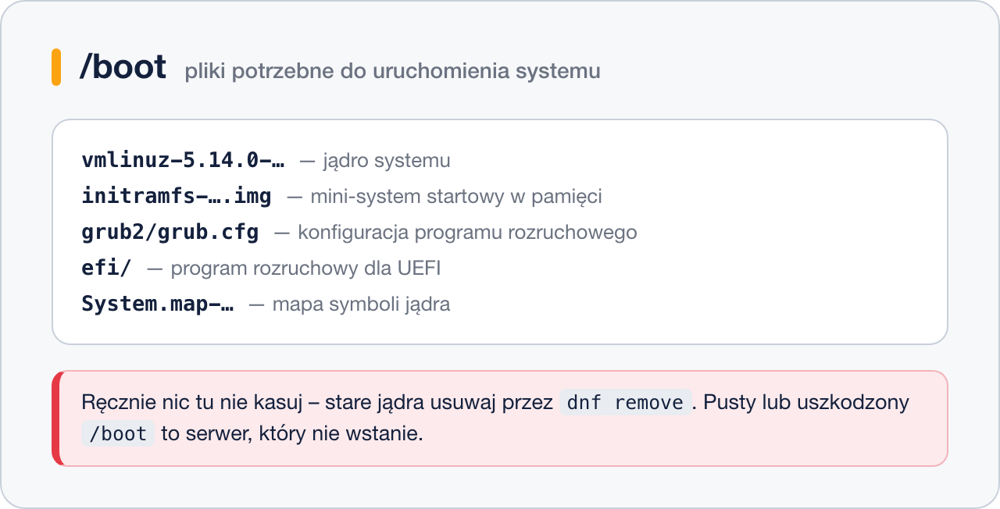

Tu leży wszystko, co jest potrzebne, zanim system w ogóle ruszy: jądro (`vmlinuz-*`), `initramfs` (mini-system wczytywany do pamięci, który potrafi zamontować prawdziwy dysk) i konfiguracja programu rozruchowego GRUB. Na komputerach z UEFI dochodzi podkatalog `efi/` z programem rozruchowym.

`/boot` bardzo często jest osobną, małą partycją – żeby program rozruchowy mógł ją przeczytać, zanim jądro obsłuży LVM czy szyfrowanie. Dlatego też potrafi się zapełnić starymi jądrami; usuwa się je menedżerem pakietów, nigdy poleceniem `rm`.

### `/dev` – urządzenia

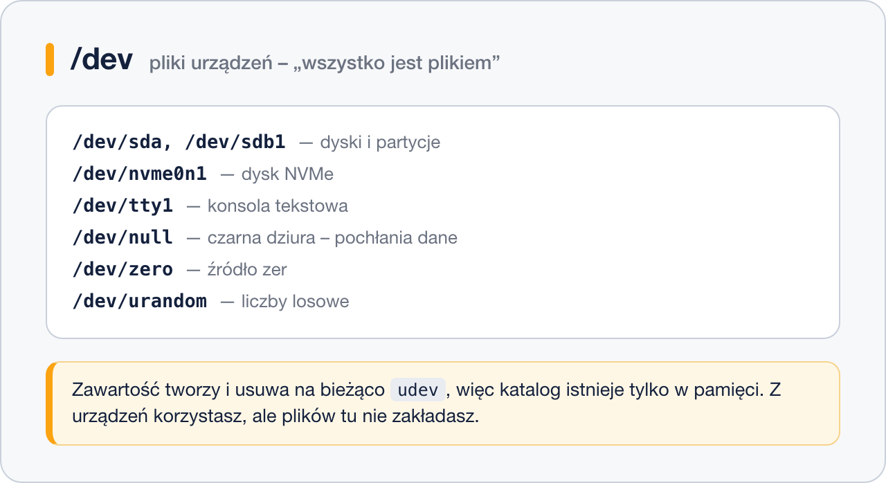

Linux realizuje zasadę „wszystko jest plikiem” również dla sprzętu: dysk, partycja, karta dźwiękowa i terminal mają tu swoje pliki specjalne. Dzięki temu kopię całej partycji robi się zwykłym `dd`, a nie osobnym programem.

Katalog jest tworzony w pamięci przy starcie i aktualizowany na bieżąco przez `udev` – gdy wepniesz pendrive, plik `/dev/sdc` pojawia się w ułamku sekundy. Szczególnie przydatne są dwa pliki wirtualne: `/dev/null` (pochłania wszystko, co do niego zapiszesz) i `/dev/urandom` (daje nieskończony strumień losowych bajtów).

### `/etc` – konfiguracja systemu

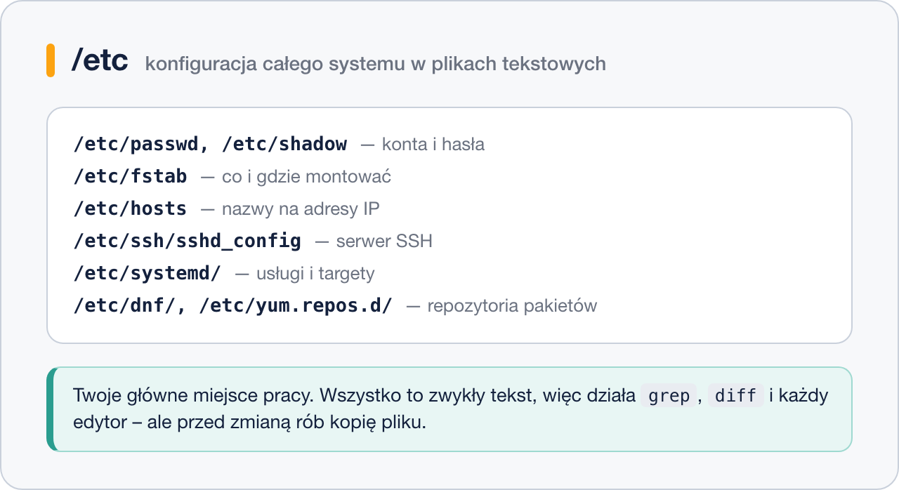

Jedno miejsce na konfigurację całego systemu i wszystkich usług – w **plikach tekstowych**. To fundamentalna różnica wobec rejestru Windows: konfigurację przeszukasz `grepem`, porównasz `diffem`, wrzucisz do gita i skopiujesz na inny serwer.

Nazwa pochodzi historycznie od *et cetera*, dziś czyta się ją jako *editable text configuration*. To tu spędzisz większość czasu jako administrator – i to tu najłatwiej zepsuć działający system, więc przed każdą zmianą rób kopię pliku:

```bash
sudo cp /etc/ssh/sshd_config /etc/ssh/sshd_config.bak
```

### `/home` – katalogi użytkowników

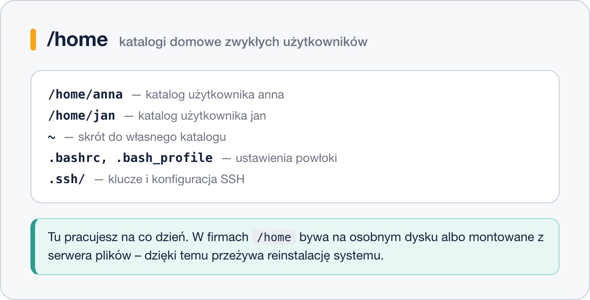

Każdy zwykły użytkownik ma tu swój katalog o nazwie konta – `/home/anna`, `/home/jan`. Powłoka oznacza go skrótem `~`, a zmienna `$HOME` przechowuje jego ścieżkę.

W katalogu domowym oprócz plików użytkownika leżą **pliki ukryte** (zaczynające się od kropki) z jego osobistymi ustawieniami: `.bashrc`, `.ssh/`, konfiguracje programów. `ls` ich nie pokazuje – zobaczysz je dopiero przez `ls -a`. W firmach `/home` bywa na osobnym dysku albo montowany z serwera plików, dzięki czemu przeżywa reinstalację systemu.

### `/root` – katalog domowy administratora

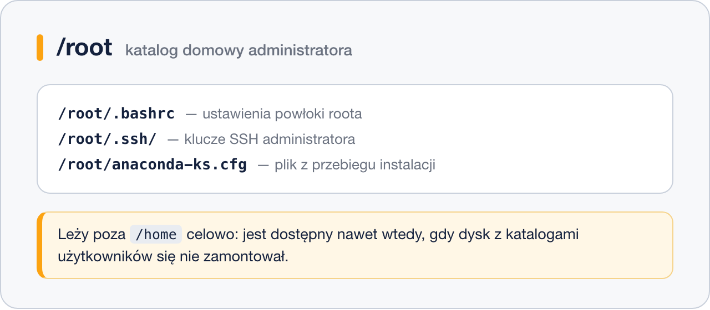

Konto `root` ma własny katalog domowy – i celowo nie leży on w `/home`. Gdyby `/home` był na osobnym dysku, który nie zdążył się zamontować, administrator zostałby bez swoich ustawień i kluczy właśnie wtedy, gdy musi ratować system.

Nie myl `/root` (katalog domowy roota) z `/` (korzeń drzewa). W rozmowie po angielsku oba bywają nazywane „root”, stąd częste nieporozumienia.

### `/bin`, `/sbin`, `/lib`, `/lib64` – dziś tylko dowiązania

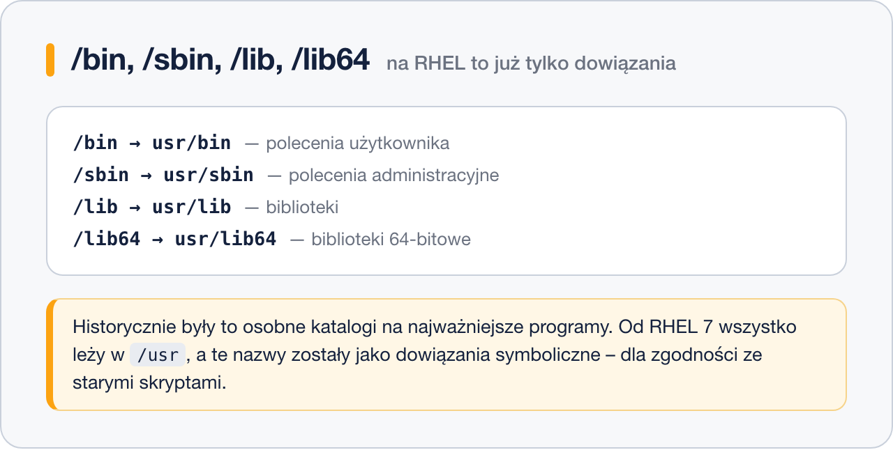

Historycznie `/bin` trzymał najpotrzebniejsze polecenia, `/sbin` polecenia administratora, a `/lib` biblioteki potrzebne obu. Podział miał sens, gdy `/usr` bywało na osobnym, montowanym później dysku.

Od RHEL 7 wszystko to leży w `/usr`, a stare nazwy zostały jako **dowiązania symboliczne** – żeby skrypty z `#!/bin/bash` nadal działały. Zobaczysz to od razu:

```bash
ls -l / | grep '\->'
```

```text
lrwxrwxrwx.  1 root root    7 05-16  2024 bin -> usr/bin
lrwxrwxrwx.  1 root root    9 05-16  2024 lib64 -> usr/lib64
lrwxrwxrwx.  1 root root    8 05-16  2024 sbin -> usr/sbin
```

### `/usr` – programy z pakietów

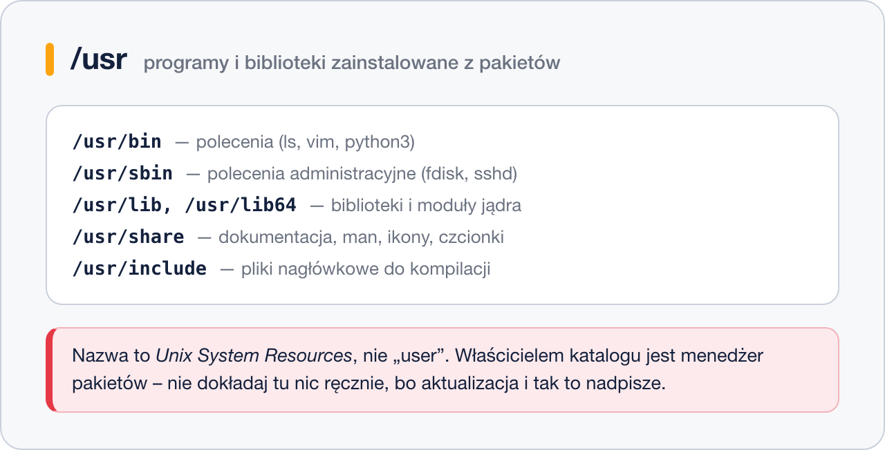

Największy katalog w systemie i miejsce, w którym menedżer pakietów rozkłada zainstalowane oprogramowanie: polecenia w `/usr/bin`, narzędzia administracyjne w `/usr/sbin`, biblioteki w `/usr/lib64`, dokumentacja, strony `man`, ikony i czcionki w `/usr/share`.

Nazwa nie oznacza „user”, tylko *Unix System Resources*. Właścicielem całego katalogu jest `dnf` – ręczne dokładanie tu plików kończy się tym, że pierwsza aktualizacja je nadpisze albo usunie.

### `/usr/local` – to, co zrobiłeś sam

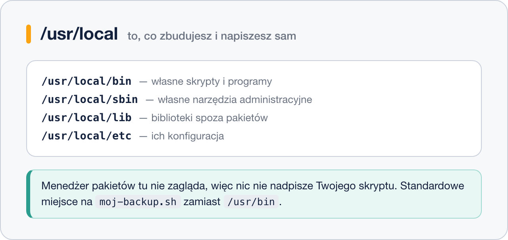

Lustrzane odbicie `/usr`, ale zarezerwowane dla rzeczy spoza repozytoriów: Twoich skryptów, programów skompilowanych ze źródeł (`./configure --prefix=/usr/local`), narzędzi pobranych z sieci.

Menedżer pakietów tu nie zagląda, więc nic nie nadpisze Twojej pracy, a `/usr/local/bin` jest standardowo w `PATH`. Własny skrypt `moj-backup.sh` kładziesz właśnie tu – nie w `/usr/bin`.

### `/var` – dane, które rosną

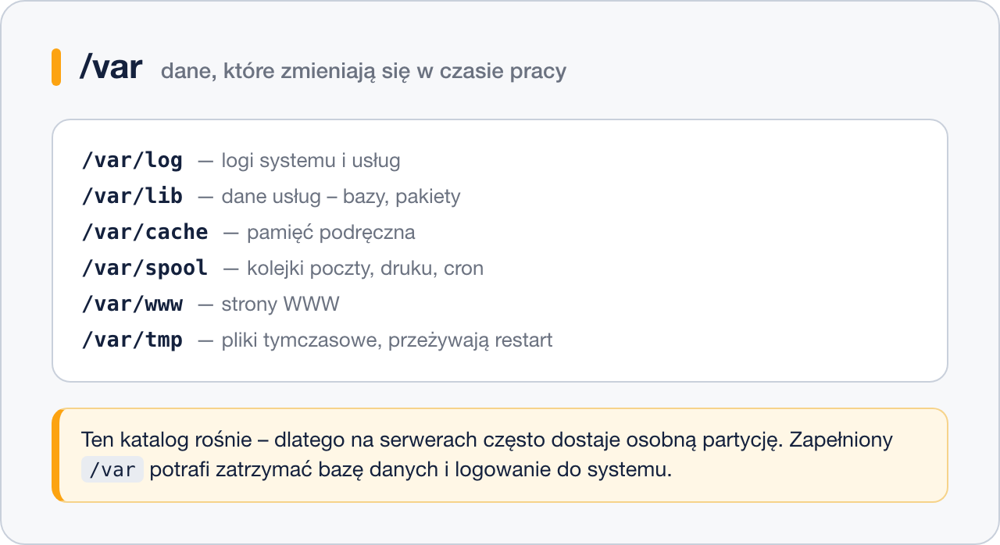

Wszystko, co zmienia się w trakcie pracy systemu: logi w `/var/log`, dane usług w `/var/lib` (bazy danych, baza pakietów RPM), pamięć podręczna w `/var/cache`, kolejki poczty i cron w `/var/spool`.

To katalog, który **rośnie** – dlatego na serwerach bardzo często dostaje osobną partycję. Zapełniony `/var` to klasyczna awaria: baza danych przestaje przyjmować zapisy, usługi nie mogą pisać logów, a czasem nie da się nawet zalogować. Pierwsze polecenie przy takiej awarii:

```bash
sudo du -sh /var/* | sort -h | tail -5
```

### `/tmp` – pliki tymczasowe

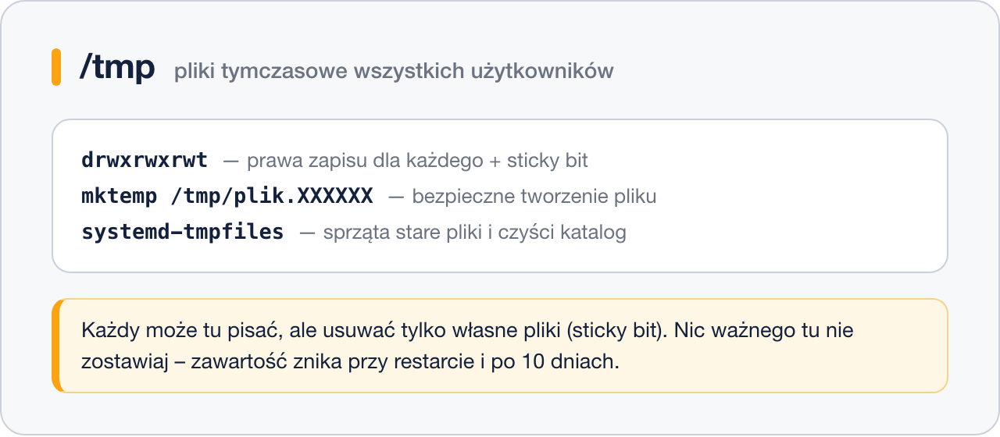

Wspólna przestrzeń na pliki tymczasowe, do której **każdy może pisać**. Przed bałaganem chroni ją **sticky bit** (`t` na końcu praw): plik usuwa tylko jego właściciel, nawet jeśli wszyscy mają prawo zapisu do katalogu.

Zawartość jest sprzątana przez `systemd-tmpfiles` (na RHEL pliki starsze niż 10 dni) i często przy restarcie. Nie trzymaj tu niczego, co ma przetrwać, i niczego poufnego – inni użytkownicy to zobaczą.

### `/opt` – oprogramowanie spoza repozytoriów


Miejsce na duże programy, które przychodzą we własnym archiwum albo instalatorze: Chrome, oprogramowanie przemysłowe, aplikacje firmowe. Każdy produkt dostaje jeden podkatalog z własną strukturą w środku (`bin/`, `lib/`, `etc/`).

Zaleta tego układu jest praktyczna: żeby usunąć taki program, wystarczy skasować jego katalog, a przy kopii zapasowej wiesz dokładnie, co zabrać.

### `/srv` – dane wystawiane przez usługi

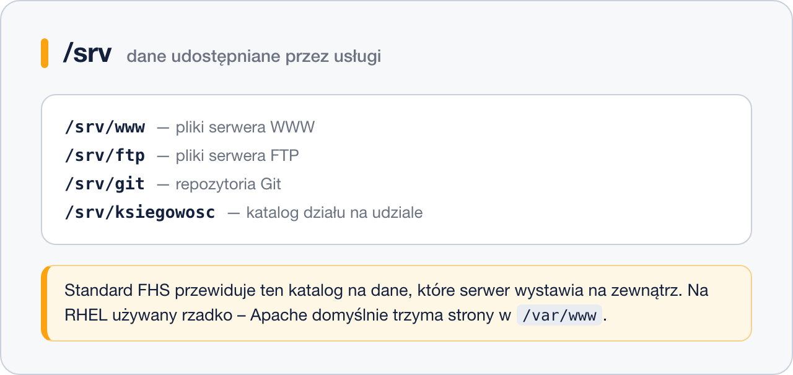

Standard FHS przewiduje ten katalog na dane, które serwer udostępnia na zewnątrz: strony WWW, pliki FTP, repozytoria Git. W praktyce na RHEL spotkasz go rzadko, bo Apache domyślnie trzyma strony w `/var/www`.

Jeśli projektujesz serwer od zera, `/srv` jest dobrym miejscem na dane usług – nie miesza się wtedy z systemowym `/var`.

### `/mnt` i `/media` – punkty montowania

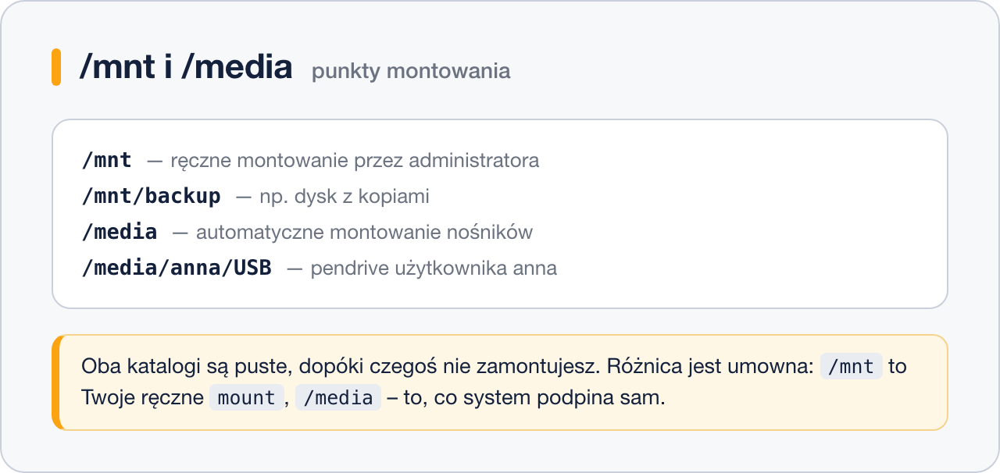

Oba katalogi są puste, dopóki czegoś do nich nie podepniesz. Różnica jest umowna, ale warto ją znać: `/mnt` to miejsce, w którym **administrator montuje ręcznie** (dysk z kopiami, obraz ISO, udział sieciowy), a `/media` zapełnia **system automatycznie**, gdy użytkownik wepnie pendrive w środowisku graficznym.

```bash
sudo mkdir /mnt/backup
sudo mount /dev/sdb1 /mnt/backup
```

### `/proc` i `/sys` – okna do jądra

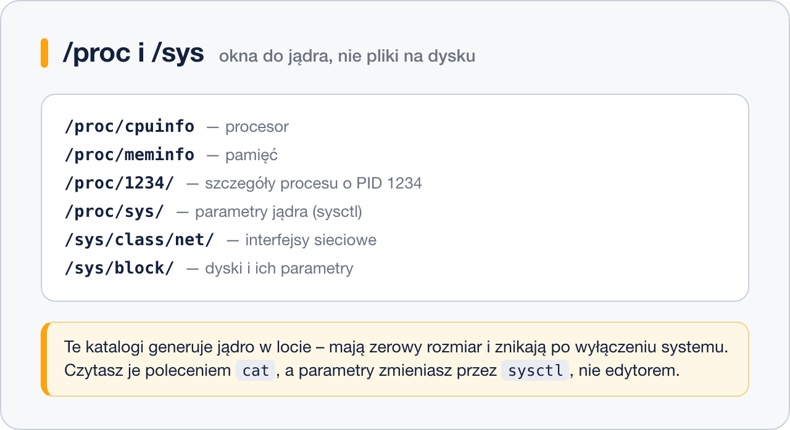

Te dwa katalogi nie istnieją na dysku – jądro generuje je w locie, dlatego pliki mają zerowy rozmiar, a mimo to coś pokazują. `/proc` daje informacje o systemie i procesach (każdy działający proces ma tu katalog o nazwie swojego numeru PID), `/sys` – o urządzeniach i sterownikach.

```bash
cat /proc/meminfo | head -3
cat /sys/class/net/enp1s0/address
```

Część plików w `/proc/sys` da się zapisywać – tak zmienia się parametry jądra. Robi się to jednak przez `sysctl`, nie edytorem, żeby ustawienie przetrwało restart.

### `/run` – stan bieżącej pracy systemu

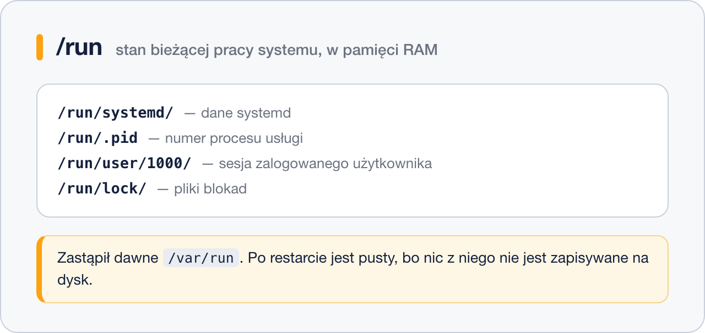

Katalog trzymany w pamięci RAM, dostępny od najwcześniejszego etapu startu. Usługi zapisują tu numery swoich procesów i gniazda, systemd trzyma swój stan, a każda sesja zalogowanego użytkownika dostaje `/run/user/<UID>`.

Po restarcie `/run` jest pusty – i tak ma być. Zastąpił dawne `/var/run`, które na RHEL jest dziś dowiązaniem do niego.

### `/lost+found` – pliki odzyskane po awarii

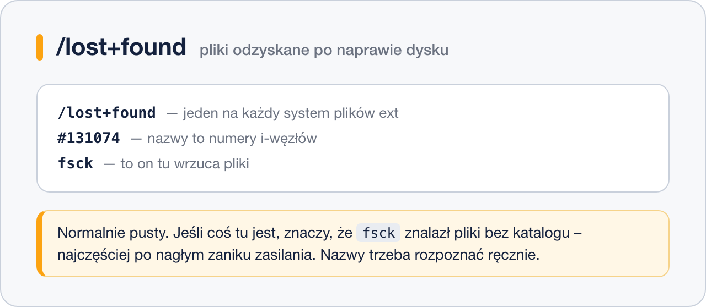

Istnieje tylko na systemach plików z rodziny ext i normalnie jest pusty. Gdy po nagłym zaniku zasilania `fsck` znajdzie pliki, które straciły wpis w katalogu, odkłada je właśnie tutaj – pod nazwami będącymi numerami i-węzłów.

Zaglądasz tu więc tylko w jednej sytuacji: po awarii, szukając czegoś, co zniknęło. Rozpoznanie tych plików (`file`, `head`) to już praca ręczna.

### Odpowiedniki z Windows

| Windows | Linux | Uwaga |
|---|---|---|
| `C:\Program Files` | `/usr` (z pakietów), `/opt` (firm trzecich) | w Linuksie program jest rozrzucony: binarium w `/usr/bin`, biblioteki w `/usr/lib64`, konfiguracja w `/etc`, dane w `/var/lib` |
| `C:\Users\anna` | `/home/anna` | |
| `C:\Users\Administrator` | `/root` | |
| Rejestr, `C:\ProgramData` | `/etc` | pliki tekstowe zamiast bazy binarnej |
| `C:\Windows\System32\drivers` | `/usr/lib/modules/<wersja-jądra>` | |
| `C:\Windows\Temp` | `/tmp`, `/var/tmp` | |
| Podgląd zdarzeń | `/var/log`, `journalctl` | |
| `D:`, `E:` | `/mnt/dane`, `/media/anna/USB` | brak liter – punkty montowania |

## W praktyce

```bash
# korzeń drzewa; widać, że bin, sbin i lib to dowiązania do /usr
ls -l /
```

```bash
# gdzie pakiet rozłożył swoje pliki – na przykładzie serwera SSH
rpm -ql openssh-server | head
```

```text
/etc/ssh/sshd_config
/etc/sysconfig/sshd
/usr/lib/systemd/system/sshd.service
/usr/sbin/sshd
/var/lib/sshd
```

Jeden pakiet, cztery katalogi, każdy zgodnie z FHS: konfiguracja w `/etc`, jednostka systemd i program w `/usr`, dane w `/var/lib`.

```bash
# jak duży jest każdy katalog najwyższego poziomu (-x pomija inne systemy plików)
sudo du -shx /* 2>/dev/null | sort -h | tail -6
```

```bash
# opis całego standardu, wbudowany w system
man hier
```

## Najczęstsze błędy i pułapki

- **Zapisywanie danych w `/tmp`.** Po restarcie ich nie ma. Dane usługi idą do `/var/lib`, dane użytkownika do `/home`, dane wystawiane na zewnątrz do `/srv` lub `/var/www`.
- **Własne skrypty w `/usr/bin`.** Pierwsza aktualizacja pakietu może je nadpisać. Miejsce na własne narzędzia to `/usr/local/bin`.
- **Mylenie `/root` z `/`.** `rm -rf /root` kasuje katalog domowy administratora, a nie korzeń – ale to nadal strata, a literówka `rm -rf / root` kasuje system.
- **Ręczne sprzątanie `/boot`.** Usunięcie „starego” jądra poleceniem `rm` zostawia wpisy w GRUB-ie i kończy się serwerem, który nie wstaje. Jądra usuwa `dnf remove`.
- **Szukanie logów w `/etc`.** W `/etc` jest wyłącznie konfiguracja. Logi są w `/var/log` i w dzienniku systemd (`journalctl`).

## Podsumowanie

- Linux ma **jedno drzewo** od korzenia `/`; dyski nie dostają liter, tylko punkty montowania.
- Twoje miejsca pracy: `/etc` (konfiguracja), `/home` (dane), `/var` (logi i dane usług), `/opt` i `/usr/local` (własne oprogramowanie), `/mnt` (montowanie ręczne).
- Miejsca systemu, w których nie grzebiesz ręcznie: `/usr`, `/boot`, `/dev`, `/proc`, `/sys`, `/run`.
- `/bin`, `/sbin`, `/lib` i `/lib64` to na RHEL tylko dowiązania do odpowiedników w `/usr`.

| Polecenie | Co pokazuje |
|---|---|
| `ls -l /` | zawartość korzenia wraz z dowiązaniami do `/usr` |
| `rpm -ql pakiet` | gdzie pakiet rozłożył swoje pliki |
| `sudo du -shx /* \| sort -h` | który katalog zajmuje najwięcej miejsca |
| `man hier` | pełny opis standardu FHS w systemie |
