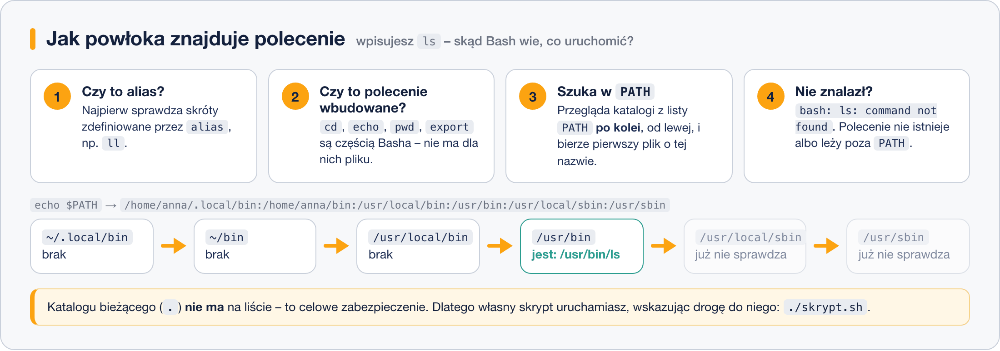

# Zmienne i aliasy

> **W tej lekcji:** nauczysz się tworzyć i odczytywać zmienne, zrozumiesz różnicę między zmienną
> powłoki a środowiskową (`export`), poznasz najważniejsze zmienne systemowe z `PATH` na czele
> oraz nauczysz się definiować aliasy – własne skróty poleceń.

**Zmienna** to krótka nazwa, pod którą powłoka przechowuje wartość odczytywaną w locie przez
system i programy: `$USER` i `$HOME` zawsze mówią, kim jesteś i gdzie jest Twój katalog domowy, a
jedna konkretna zmienna, `PATH`, decyduje o tym, **które polecenia w ogóle działają**. **Alias**
to z kolei własny skrót polecenia – oszczędność klawiatury i zabezpieczenie: jeśli sto razy
dziennie piszesz `ls -lah`, niech to będzie `ll`; jeśli boisz się `rm`, niech zawsze pyta o
potwierdzenie.

## Jak to działa

### Zmienna powłoki a zmienna środowiskowa

- **Zmienna powłoki** istnieje tylko w powłoce, w której ją utworzyłeś. Programy, które z niej
  uruchamiasz, jej **nie widzą**.
- **Zmienna środowiskowa** (ang. *environment variable*) jest przekazywana każdemu programowi
  uruchamianemu z tej powłoki. Zmienną powłoki zamieniasz w środowiskową poleceniem `export`.

Obie znikają po zamknięciu powłoki. Na stałe – wpis w `~/.bashrc`
(poprzednia lekcja: [Konfiguracja powłoki](5.%20Konfiguracja%20powłoki%20–%20globalna%20i%20użytkownika.md)).

### Zmienne, które już masz

System ustawia je przy logowaniu:

| Zmienna | Co zawiera | Przykład |
|---|---|---|
| `HOME` | Twój katalog domowy | `/home/anna` |
| `USER` | Twoja nazwa użytkownika | `anna` |
| `SHELL` | Twoja domyślna powłoka | `/bin/bash` |
| `LANG` | język i kodowanie komunikatów | `pl_PL.UTF-8` |
| `PATH` | lista katalogów, w których powłoka szuka poleceń | `/home/anna/.local/bin:...:/usr/bin` |
| `PWD` | katalog bieżący (to z niego korzysta `pwd`) | `/etc` |
| `HISTSIZE` | ile poleceń trzyma historia | `1000` |

### `PATH` – jak powłoka znajduje polecenie

Gdy wpisujesz `ls`, powłoka nie przeszukuje całego dysku. Sprawdza po kolei: alias? polecenie
wbudowane? a potem przegląda katalogi z `PATH` **od lewej do prawej** i uruchamia pierwszy
znaleziony plik o tej nazwie.



Katalogu bieżącego nie ma w `PATH` – celowo. Gdyby był, złośliwy plik `ls` podrzucony np.
do `/tmp` uruchomiłby się, gdy tylko administrator wpisze tam `ls`. Dlatego własny skrypt
uruchamiasz, jawnie wskazując drogę: `./skrypt.sh` („w tym katalogu”).

## W praktyce

### Tworzenie i odczyt zmiennych

```bash
# utwórz zmienną – BEZ spacji wokół znaku =
PROJEKT="inwentaryzacja"
```

```bash
# odczytaj: nazwa poprzedzona znakiem dolara
echo $PROJEKT
```

```text
inwentaryzacja
```

```bash
# zmienna działa wszędzie tam, gdzie wpisałbyś jej wartość
mkdir ~/$PROJEKT
ls -d ~/$PROJEKT
```

```text
/home/anna/inwentaryzacja
```

```bash
# zmienna powłoki NIE jest widoczna w programach potomnych...
bash -c 'echo $PROJEKT'
```

```text

```

```bash
# ...dopóki jej nie wyeksportujesz
export PROJEKT
bash -c 'echo $PROJEKT'
```

```text
inwentaryzacja
```

Można też od razu: `export PROJEKT="inwentaryzacja"`. Zmienną usuwa `unset PROJEKT`.

### Przegląd zmiennych

```bash
# wszystkie zmienne środowiskowe (długa lista – przewijana przez less)
env | less
```

```bash
# wartość jednej zmiennej
printenv HOME
```

```text
/home/anna
```

`env` i `printenv` pokazują tylko zmienne środowiskowe; zmienne powłoki zobaczysz poleceniem
`set` (lista jest dłuższa, bo zawiera też funkcje).

### `PATH` w praktyce

```bash
# co jest na liście
echo $PATH
```

```text
/home/anna/.local/bin:/home/anna/bin:/usr/local/bin:/usr/bin:/usr/local/sbin:/usr/sbin
```

```bash
# skąd powłoka weźmie polecenie ls?
type ls
which ls
```

```text
ls is aliased to `ls --color=auto'
/usr/bin/ls
```

```bash
# dołóż własny katalog ze skryptami na koniec listy (dwukropek oddziela pozycje)
export PATH=$PATH:$HOME/skrypty
```

Zapis `$PATH:$HOME/skrypty` znaczy: „dotychczasowa wartość, dwukropek, nowy katalog”. Bez `$PATH`
na początku **wymazałbyś** całą listę – przestałyby działać nawet `ls` i `vim`. Wpis na stałe
dodaj w `~/.bashrc`.

### Aliasy

Alias to własny skrót: powłoka widzi `ll`, a wykonuje `ls -lah`.

```bash
# zdefiniuj alias (obowiązuje do końca sesji)
alias ll='ls -lah'
ll /etc | head -3
```

```text
razem 1,3M
drwxr-xr-x.  81 root root 8,0K 18 paź 09:15 .
drwxr-xr-x.  18 root root  235 10 paź 08:50 ..
```

```bash
# rm, które zawsze pyta przed usunięciem
alias rm='rm -i'
rm stary-plik.txt
```

```text
rm: usunąć zwykły plik 'stary-plik.txt'? n
```

```bash
# lista zdefiniowanych aliasów / definicja jednego
alias
alias ll
```

```text
alias ll='ls -lah'
alias rm='rm -i'
...
```

```bash
# usuń alias; a jednorazowo pomiń go, poprzedzając polecenie ukośnikiem: \rm plik
unalias rm
```

Przydatne aliasy na początek – dopisz do `~/.bashrc` i wczytaj przez `source ~/.bashrc`:

```bash
alias ll='ls -lah'
alias ..='cd ..'
alias rm='rm -i'
alias cp='cp -i'
alias mv='mv -i'
alias df='df -h'
alias wolne='df -h | grep -v tmpfs'
```

> **Na Ubuntu/Debianie:** `ll` jest często zdefiniowane domyślnie w `~/.bashrc` jako `ls -alF`.
> W RHEL definiujesz je sam.

## Najczęstsze błędy i pułapki

1. **Spacje wokół `=`.** `PROJEKT = "x"` to dla powłoki polecenie `PROJEKT` z argumentami.
   Przypisanie pisze się bez spacji: `PROJEKT="x"`.
2. **`$` przy zapisie, brak `$` przy odczycie.** Tworzysz: `X=5` (bez dolara). Czytasz: `echo $X`
   (z dolarem).
3. **Nadpisanie `PATH`.** `export PATH=/home/anna/skrypty` odcina system od wszystkich poleceń.
   Ratunek w tej sesji: `export PATH=/usr/local/bin:/usr/bin:/usr/local/sbin:/usr/sbin` albo
   po prostu nowy terminal (o ile nie zapisałeś błędu w `~/.bashrc`).
4. **Alias zdefiniowany, a po otwarciu nowego okna go nie ma.** Aliasy z linii poleceń żyją do
   końca sesji. Na stałe – `~/.bashrc` + `source ~/.bashrc`.
5. **Alias przykrywa polecenie i o tym zapominasz.** `type polecenie` zawsze powie, czy to alias,
   wbudowane, czy program z dysku.
6. **Cudzysłowy a apostrofy.** W `"..."` powłoka podstawia zmienne od razu, w `'...'` nie.
   Definicje aliasów i `PS1` zapisuj w apostrofach.

## Podsumowanie

- Zmienna powłoki: `NAZWA=wartość`; środowiskowa (widoczna dla programów): `export NAZWA`.
- Odczyt: `echo $NAZWA`; przegląd: `env`, `printenv`; usunięcie: `unset NAZWA`.
- `PATH` to lista katalogów z poleceniami, przeszukiwana od lewej; katalogu bieżącego na niej
  nie ma – stąd `./skrypt.sh`.
- Alias: `alias skrót='polecenie'`; trwałość zapewnia wpis w `~/.bashrc`.
- `type nazwa` mówi, czym naprawdę jest wpisywane polecenie.

| Polecenie | Co robi |
|---|---|
| `NAZWA=wartość` | utwórz zmienną powłoki |
| `export NAZWA` | zamień na zmienną środowiskową |
| `echo $NAZWA` | odczytaj wartość |
| `env`, `printenv` | lista zmiennych środowiskowych |
| `unset NAZWA` | usuń zmienną |
| `echo $PATH` | pokaż ścieżkę wyszukiwania |
| `type polecenie`, `which polecenie` | czym jest / gdzie leży polecenie |
| `alias x='...'` / `unalias x` | utwórz / usuń alias |
