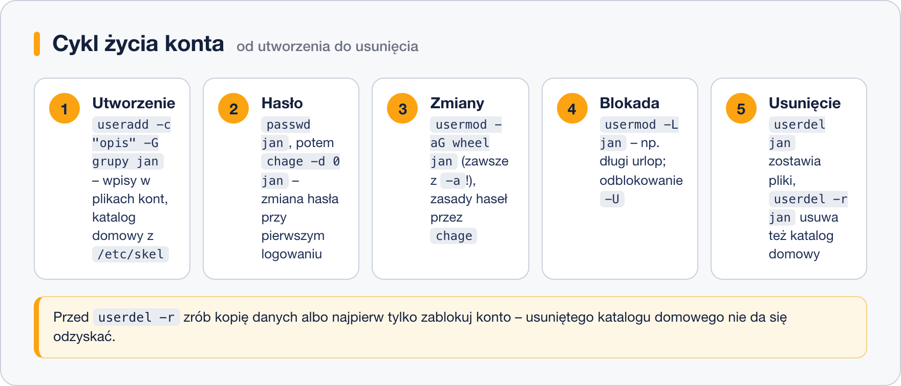

# Zarządzanie użytkownikami

> **W tej lekcji:** nauczysz się zakładać, modyfikować, blokować i usuwać konta użytkowników, ustawiać zasady wygasania haseł oraz sprawdzać, kto jest i był zalogowany.

Do firmy przychodzi nowy pracownik – potrzebuje konta. Ktoś idzie na długi urlop – konto trzeba zablokować. Ktoś odchodzi – konto znika, ale pliki czasem muszą zostać. Polityka bezpieczeństwa każe zmieniać hasła co 90 dni. To chleb powszedni administratora i w tej lekcji przejdziesz cały cykl życia konta: od `useradd` do `userdel`.



## Jak to działa

Konto użytkownika to kilka wpisów w plikach systemowych (poznasz je w [lekcji 5](5.%20Pliki%20konfiguracyjne%20kont.md)) plus katalog domowy. Polecenie `useradd`:

1. dopisuje konto do `/etc/passwd` i `/etc/shadow`, nadając mu numer **UID** (ang. user ID; zwykli użytkownicy na RHEL dostają numery od 1000),
2. tworzy prywatną grupę główną o nazwie konta,
3. zakłada katalog domowy `/home/nazwa` i kopiuje do niego zawartość szablonu **`/etc/skel`** – to stąd nowe konto ma od razu `.bashrc` i `.bash_profile`. Jeśli chcesz, by każdy nowy użytkownik dostawał np. plik z regulaminem, włóż go do `/etc/skel`.

Świeże konto jest **zablokowane**, dopóki nie nadasz mu hasła poleceniem `passwd`.

## W praktyce

### Zakładanie konta

```bash
# proste konto z ustawieniami domyślnymi
sudo useradd anna

# konto z opisem (-c), dodatkowymi grupami (-G) i jawnie wskazaną powłoką (-s)
sudo useradd -c "Jan Kowalski, ksiegowosc" -G ksiegowosc,wheel -s /bin/bash jan

# nadanie hasła – bez tego logowanie nie zadziała
sudo passwd jan
```

```text
Changing password for user jan.
New password:
Retype new password:
passwd: all authentication tokens updated successfully.
```

| Opcja `useradd` | Znaczenie |
|---|---|
| `-c "opis"` | komentarz – zwykle imię, nazwisko, dział |
| `-m` | utwórz katalog domowy (na RHEL domyślne; istotne w innych dystrybucjach) |
| `-d /katalog` | niestandardowy katalog domowy |
| `-G grupa1,grupa2` | grupy dodatkowe od razu przy tworzeniu |
| `-g grupa` | inna grupa główna (rzadko potrzebne) |
| `-s /bin/bash` | powłoka; `-s /sbin/nologin` dla kont technicznych bez logowania |
| `-e 2026-12-31` | data wygaśnięcia całego konta |
| `-r` | konto systemowe (UID poniżej 1000, bez katalogu domowego) |

```bash
# sprawdzenie, co powstało
id jan
ls -la /home/jan
```

### Modyfikowanie konta: usermod

```bash
# DOPISANIE do grupy dodatkowej – koniecznie z -a!
sudo usermod -aG ksiegowosc anna

# zmiana opisu i powłoki
sudo usermod -c "Anna Nowak, kadry" -s /bin/bash anna

# zablokowanie konta (L = lock) i odblokowanie (U = unlock)
sudo usermod -L anna
sudo usermod -U anna
```

> **Pułapka numer jeden: `usermod -G` bez `-a`.** `usermod -G ksiegowosc jan` **zastępuje** całą listę grup dodatkowych – jan wyleci z `wheel` i wszystkich innych grup, zostanie tylko w `ksiegowosc`. Zapamiętaj parę `-aG` (append – dopisz) jako jedno słowo.

Blokada `-L` psuje hasło konta (dopisuje `!` przed skrótem w `/etc/shadow`), więc logowanie hasłem przestaje działać. Nie blokuje jednak logowania kluczem SSH – jeśli chcesz odciąć konto całkowicie, dodatkowo ustaw datę wygaśnięcia: `sudo usermod -e 1970-01-02 anna` (cofnięcie: `-e ""`).

### Wygasanie haseł: chage

Zasadami starzenia się hasła steruje `chage` (ang. change age):

```bash
# podgląd ustawień konta
sudo chage -l jan
```

```text
Last password change                                    : Oct 18, 2026
Password expires                                        : never
Password inactive                                       : never
Account expires                                         : never
Minimum number of days between password change          : 0
Maximum number of days between password change          : 99999
Number of days of warning before password expires       : 7
```

```bash
# hasło ważne 90 dni, ostrzeżenie 7 dni przed końcem
sudo chage -M 90 -W 7 jan

# wymuś zmianę hasła przy następnym logowaniu (d 0 = „ostatnia zmiana: nigdy”)
sudo chage -d 0 jan
```

`chage -d 0` to standard przy zakładaniu kont: nadajesz hasło tymczasowe, a użytkownik przy pierwszym logowaniu ustawia własne.

### Usuwanie konta: userdel

```bash
# samo konto – katalog domowy i pliki zostają (np. do przekazania następcy)
sudo userdel anna

# konto razem z katalogiem domowym i skrzynką pocztową
sudo userdel -r anna
```

Po `userdel` bez `-r` pliki użytkownika nadal istnieją i pokazują się w `ls -l` z samym numerem UID zamiast nazwy. Warto je odnaleźć i zdecydować, co z nimi: `sudo find / -nouser 2>/dev/null`.

### Kto jest i był zalogowany

```bash
# kto jest teraz zalogowany
who

# jak wyżej, plus co kto robi i jakie jest obciążenie systemu
w

# historia logowań (z pliku /var/log/wtmp)
last | head
```

```text
jan      pts/0        10.0.0.5         Sat Oct 18 09:58   still logged in
anna     pts/1        10.0.0.7         Fri Oct 17 16:02 - 17:45  (01:43)
reboot   system boot  5.14.0-570.el9   Fri Oct 17 08:11   still running
```

## Najczęstsze błędy i pułapki

- **`usermod -G` bez `-a`** – kasuje dotychczasowe grupy dodatkowe. Zawsze `-aG`.
- **Konto założone, ale „nie da się zalogować”** – nie nadano hasła (`passwd`) albo powłoka to `/sbin/nologin`.
- **Zmiany grup nie działają** – użytkownik musi zalogować się ponownie.
- **`userdel` na zalogowanym użytkowniku** – kończy się błędem `user ... is currently used by process`. Najpierw wyloguj go (lub `sudo pkill -u anna`), potem usuwaj.
- **`userdel -r` bez zastanowienia** – katalog domowy znika bezpowrotnie. Jeśli dane mogą być potrzebne, najpierw zablokuj konto, a usuń po wykonaniu kopii.

## Podsumowanie

- Cykl konta: `useradd` → `passwd` → (`usermod`, `chage`) → `usermod -L` → `userdel [-r]`.
- Nowe konto dziedziczy pliki startowe z `/etc/skel` i dostaje prywatną grupę o nazwie konta.
- `-aG` przy `usermod` dopisuje do grup; samo `-G` zastępuje listę.
- `chage -d 0` wymusza zmianę hasła przy pierwszym logowaniu, `chage -M 90` ogranicza ważność hasła.
- `who`, `w`, `last` mówią, kto jest i był w systemie.

| Polecenie | Co robi |
|---|---|
| `sudo useradd -c "opis" -G grupy -s /bin/bash jan` | załóż konto |
| `sudo passwd jan` | nadaj/zmień hasło |
| `sudo usermod -aG wheel jan` | dopisz do grupy |
| `sudo usermod -L jan` / `-U jan` | zablokuj / odblokuj |
| `sudo chage -l jan` | pokaż zasady hasła |
| `sudo chage -d 0 jan` | wymuś zmianę hasła przy logowaniu |
| `sudo userdel -r jan` | usuń konto z katalogiem domowym |
| `id`, `who`, `w`, `last` | kim jestem / kto jest / kto był zalogowany |
