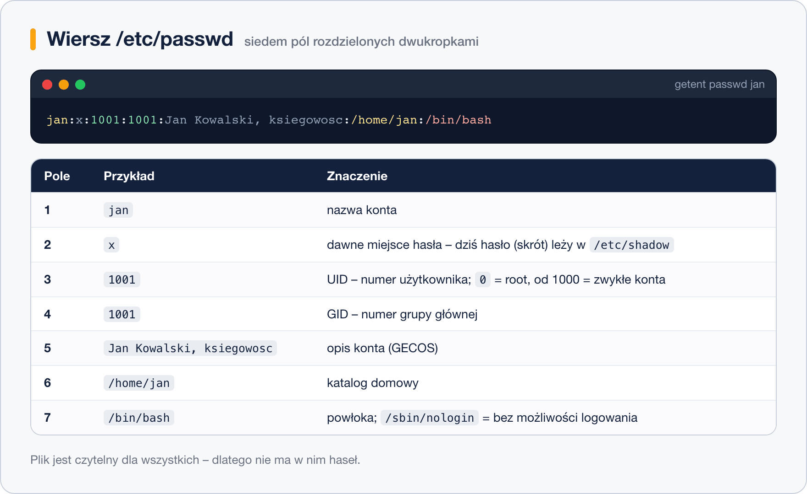

# Pliki konfiguracyjne kont

> **W tej lekcji:** zajrzysz do plików, w których system naprawdę przechowuje konta – `/etc/passwd`, `/etc/shadow`, `/etc/group` – i nauczysz się je czytać pole po polu oraz bezpiecznie przeglądać.

`useradd`, `passwd` i `groupadd` to tylko wygodne nakładki – pod spodem wszystko sprowadza się do kilku plików tekstowych w `/etc`. Gdy coś nie działa („dlaczego ten użytkownik nie może się zalogować?”, „czemu jego pliki pokazują numer zamiast nazwy?”), odpowiedź znajdziesz właśnie tam. Umiejętność czytania tych plików to różnica między zgadywaniem a diagnozą.

## Jak to działa

### /etc/passwd – spis kont

Jeden wiersz = jedno konto, siedem pól rozdzielonych dwukropkami:



```bash
# wpis konkretnego konta
grep "^jan:" /etc/passwd
```

```text
jan:x:1001:1001:Jan Kowalski, ksiegowosc:/home/jan:/bin/bash
```

| Pole | Przykład | Znaczenie |
|---|---|---|
| 1 | `jan` | nazwa konta |
| 2 | `x` | dawniej hasło; dziś zawsze `x` – hasło jest w `/etc/shadow` |
| 3 | `1001` | UID; `0` = root, poniżej 1000 = konta systemowe |
| 4 | `1001` | GID grupy głównej |
| 5 | `Jan Kowalski, ksiegowosc` | opis (pole GECOS) |
| 6 | `/home/jan` | katalog domowy |
| 7 | `/bin/bash` | powłoka; `/sbin/nologin` = konto bez możliwości logowania |

Plik jest czytelny dla wszystkich (`644`) – programy muszą tłumaczyć UID na nazwy. Dlatego właśnie hasła przeniesiono gdzie indziej.

### /etc/shadow – hasła i ich terminy

Czytelny tylko dla roota. Dziewięć pól; najważniejsze to pierwsze cztery–pięć:

```bash
sudo grep "^jan:" /etc/shadow
```

```text
jan:$6$kT9x...dlugi.skrot...:20744:0:99999:7:::
```

| Pole | Przykład | Znaczenie |
|---|---|---|
| 1 | `jan` | nazwa konta |
| 2 | `$6$…` | **skrót** (hash) hasła – nie hasło! |
| 3 | `20744` | data ostatniej zmiany hasła (dni od 1.01.1970) |
| 4–5 | `0`, `99999` | minimalna / maksymalna liczba dni między zmianami |
| 6 | `7` | ile dni przed wygaśnięciem ostrzegać |
| 7–8 | puste | dni nieaktywności po wygaśnięciu; data wygaśnięcia konta |

Pola 3–8 to dokładnie to, co oglądałeś przez `chage -l`. Pole 2 warto umieć rozpoznać:

- `$6$` – skrót SHA-512 (domyślny w RHEL 9),
- `$y$` – yescrypt (spotkasz w RHEL 10 i nowszych dystrybucjach),
- `!` lub `*` na początku – konto zablokowane / bez hasła (tak wygląda efekt `usermod -L`),
- `!!` albo puste – hasła nigdy nie ustawiono.

System nie zna Twojego hasła – przy logowaniu liczy skrót z tego, co wpisałeś, i porównuje ze skrótem w pliku. Dlatego hasła nie da się „odczytać”, można je tylko zresetować.

### /etc/group i /etc/gshadow

```bash
getent group ksiegowosc
```

```text
ksiegowosc:x:1005:anna,jan,ewa
```

Cztery pola: nazwa, `x` (hasło grupy – praktycznie nieużywane), GID, lista członków (tylko tych, dla których grupa jest **dodatkowa** – członkostwo z grupy głównej widać w `/etc/passwd`, nie tu!). `/etc/gshadow` to odpowiednik `shadow` dla grup: hasła grup i ich administratorzy; w praktyce zagląda się tam rzadko.

### Skąd biorą się wartości domyślne

- **`/etc/login.defs`** – ogólne zasady: zakresy UID/GID dla nowych kont, domyślne terminy ważności haseł (`PASS_MAX_DAYS`), maska.
- **`/etc/default/useradd`** – domyślne ustawienia `useradd`: powłoka, baza katalogów domowych, szkielet (`/etc/skel`). Podgląd: `useradd -D`.
- **`/etc/skel`** – pliki kopiowane do katalogu domowego każdego nowego konta.

### getent – pytaj system, nie plik

```bash
# działa jak grep po /etc/passwd…
getent passwd jan

# …ale zapyta też LDAP/AD, jeśli serwer korzysta z kont centralnych
getent passwd anna@firma.local
```

`getent` (ang. get entries) pyta wszystkie skonfigurowane źródła kont – lokalne pliki i katalogi sieciowe (LDAP, Active Directory). Dlatego w skryptach i diagnostyce używaj `getent`, a nie `grep /etc/passwd`.

## W praktyce: bezpieczne przeglądanie i edycja

Tych plików **nie edytuje się ręcznie** bez ważnego powodu. Literówka w `/etc/passwd` może odciąć logowanie wszystkim, łącznie z Tobą. Narzędzia (`useradd`, `usermod`, `passwd`, `gpasswd`) dbają o spójność między `passwd`, `shadow` i `group` oraz o blokady przed równoczesną edycją.

Jeśli naprawdę musisz edytować ręcznie (np. naprawa uszkodzonego wpisu), użyj `vipw` i `vigr` – jak `visudo`, blokują plik i pilnują podstawowej poprawności:

```bash
# edycja /etc/passwd z blokadą; z opcją -s edytuje /etc/shadow
sudo vipw

# to samo dla /etc/group (z -s dla /etc/gshadow)
sudo vigr
```

Przydatne polecenia diagnostyczne:

```bash
# wszystkie konta „ludzkie” (UID >= 1000)
awk -F: '$3 >= 1000 {print $1, $3}' /etc/passwd

# sprawdzenie spójności plików kont i grup
sudo pwck
sudo grpck
```

## Najczęstsze błędy i pułapki

- **Edycja `/etc/passwd` zwykłym edytorem** – bez blokady i kontroli składni. Używaj narzędzi, ostatecznie `vipw`/`vigr`.
- **Szukanie członków grupy tylko w `/etc/group`** – użytkownicy, dla których grupa jest główna, są wpisani w `/etc/passwd` (pole GID), nie na liście w `/etc/group`.
- **Mylenie hasła ze skrótem** – w `shadow` nie ma haseł; „odzyskanie hasła” to zawsze reset.
- **`grep konto /etc/passwd` na serwerze z AD/LDAP** – konta sieciowe nie występują w pliku. `getent passwd konto` widzi wszystkie.
- **Pliki z numerem zamiast właściciela w `ls -l`** – konto lub grupa zostały usunięte; wpis w plikach kont już nie istnieje, ale UID/GID na plikach został.

## Podsumowanie

- `/etc/passwd` – konta (7 pól), czytelny dla wszystkich, haseł brak.
- `/etc/shadow` – skróty haseł i terminy ważności, tylko dla roota; `$6$`=SHA-512, `$y$`=yescrypt, `!` na początku = blokada.
- `/etc/group` – grupy i członkowie „dodatkowi”; grupa główna wynika z pola 4 w `passwd`.
- Domyślne wartości: `/etc/login.defs`, `/etc/default/useradd`, szkielet `/etc/skel`.
- Nie edytuj ręcznie; gdy trzeba – `vipw`/`vigr`. Do odpytywania używaj `getent`.

| Polecenie | Co robi |
|---|---|
| `getent passwd jan` | wpis konta z dowolnego źródła (pliki, LDAP/AD) |
| `getent group ksiegowosc` | wpis grupy |
| `sudo grep "^jan:" /etc/shadow` | hasłowy wpis konta |
| `useradd -D` | domyślne ustawienia useradd |
| `sudo vipw` / `sudo vigr` | ręczna edycja z blokadą |
| `sudo pwck` / `sudo grpck` | kontrola spójności plików kont / grup |
