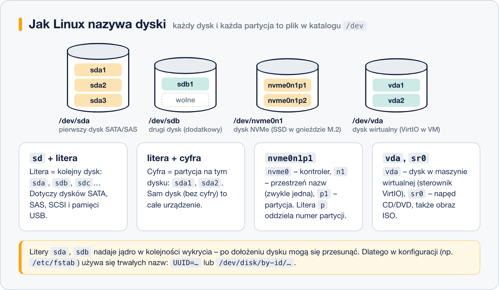

# Dyski w Linuksie – katalog dev i nazwy urządzeń

> **W tej lekcji:** dowiesz się, jak Linux nazywa dyski i partycje, gdzie je znaleźć i jak jednym poleceniem zobaczyć, co jest podłączone do serwera.

W Linuksie dysk nie ma litery jak `C:` czy `D:` w Windows. Zamiast tego każdy dysk i każda partycja to **plik** w katalogu `/dev` – na przykład `/dev/sda`. Nazwy takie jak `sdb1` czy `nvme0n1p2` są zbudowane według stałych reguł i dokładnie mówią, o które urządzenie i którą partycję chodzi.

Z tymi nazwami pracujesz przy dokładaniu dysku do serwera, sprawdzaniu wolnego miejsca, montowaniu nośników – i w każdej kolejnej lekcji tego działu.

## Jak to działa

### Wszystko jest plikiem

Linux trzyma się zasady: urządzenia widać w systemie jako pliki. Katalog `/dev` (od ang. *devices* – urządzenia) zawiera plik dla każdego dysku, każdej partycji, napędu CD, terminala czy karty dźwiękowej. Pliki dysków to **urządzenia blokowe** (ang. *block device*) – dane czyta się z nich i zapisuje w blokach po 512 bajtów lub 4 KiB, a nie znak po znaku jak z klawiatury.

Te pliki nie leżą na dysku – tworzy je na bieżąco jądro razem z usługą `udev`, gdy wykryje sprzęt. Po odłączeniu dysku plik znika.

### Nazwy dysków



| Nazwa | Co to jest |
|---|---|
| `/dev/sda`, `/dev/sdb`, `/dev/sdc` | kolejne dyski SATA, SAS, SCSI, a także pamięci USB. `sd` = *SCSI disk*, litera = numer dysku w kolejności wykrycia |
| `/dev/sda1`, `/dev/sda2` | partycje (części) dysku `sda`; cyfra = numer partycji |
| `/dev/nvme0n1` | dysk NVMe (szybki SSD w gnieździe M.2 lub PCIe); `nvme0` = kontroler, `n1` = przestrzeń nazw |
| `/dev/nvme0n1p1` | pierwsza partycja tego dysku – litera `p` oddziela numer partycji od nazwy dysku |
| `/dev/vda`, `/dev/vdb` | dyski wirtualne w maszynie wirtualnej ze sterownikiem VirtIO (KVM, Proxmox) |
| `/dev/sr0` | napęd CD/DVD, także podpięty obraz ISO |
| `/dev/md0` | macierz RAID programowego (lekcja 10) |
| `/dev/mapper/rl-root` | wolumin logiczny LVM (moduł 10) |

Zasada ogólna: **nazwa bez cyfry = cały dysk, nazwa z cyfrą = partycja**. Na całym dysku trzyma się tablicę partycji, na partycji – system plików z danymi.

### Dlaczego `sdb` może jutro nazywać się `sdc`

Litery nadaje jądro w kolejności, w jakiej wykryje dyski podczas startu. Dołożenie dysku, zmiana kabla albo inny kontroler może tę kolejność zmienić. Dlatego w plikach konfiguracyjnych (np. `/etc/fstab`, o którym mówi moduł 11) **nie używa się nazw `sdX`**, tylko identyfikatorów, które nie zmieniają się nigdy:

| Katalog | Co zawiera | Przykład |
|---|---|---|
| `/dev/disk/by-uuid/` | UUID systemu plików – unikalny numer nadawany przy formatowaniu | `3f1c2a9e-…` |
| `/dev/disk/by-id/` | model i numer seryjny dysku | `ata-SAMSUNG_SSD_870_S5…` |
| `/dev/disk/by-path/` | fizyczne miejsce podłączenia (port kontrolera) | `pci-0000:00:17.0-ata-2` |
| `/dev/disk/by-label/` | etykieta systemu plików, jeśli ją nadano | `DANE` |

Wpisy w tych katalogach to dowiązania symboliczne do właściwych plików `/dev/sdX`.

## W praktyce

```bash
# lista dysków i partycji w formie drzewa – najczęściej używane polecenie w tym module
lsblk
```

```text
NAME          MAJ:MIN RM  SIZE RO TYPE MOUNTPOINTS
sda             8:0    0   40G  0 disk
├─sda1          8:1    0  600M  0 part /boot/efi
├─sda2          8:2    0    1G  0 part /boot
└─sda3          8:3    0 38,4G  0 part
  ├─rl-root   253:0    0 34,4G  0 lvm  /
  └─rl-swap   253:1    0    4G  0 lvm  [SWAP]
sdb             8:16   0   10G  0 disk
sdc             8:32   0   10G  0 disk
sr0            11:0    1 1024M  0 rom
```

Jak to czytać:

- `sda` to dysk systemowy 40 GB z trzema partycjami; na `sda3` działa LVM z woluminami `rl-root` (katalog główny `/`) i `rl-swap`.
- `sdb` i `sdc` to dodatkowe dyski po 10 GB **bez partycji** – na nich będziemy ćwiczyć w tym module.
- `MOUNTPOINTS` mówi, gdzie w drzewie katalogów widać zawartość danej partycji. Pusta kolumna = partycja niezamontowana.
- `RM` = 1 oznacza nośnik wymienny (ang. *removable*), `RO` = 1 – tylko do odczytu.

```bash
# to samo z informacją o systemie plików, etykiecie i UUID
lsblk -f
```

```text
NAME        FSTYPE      LABEL UUID                                 MOUNTPOINTS
sda
├─sda1      vfat              8C1A-3F2B                            /boot/efi
├─sda2      xfs               6a0e3b1c-5d2f-4e8a-9c7b-1f2e3d4c5b6a /boot
└─sda3      LVM2_member       pQ3x…
  ├─rl-root xfs               2b7d9e4f-…                           /
  └─rl-swap swap              9c1f0a2d-…                           [SWAP]
sdb
sdc
```

Przy `sdb` i `sdc` nie ma nic – dysk bez partycji i bez systemu plików to „czysty” dysk.

```bash
# identyfikatory UUID i typy systemów plików (wymaga uprawnień administratora, żeby zobaczyć wszystko)
sudo blkid
```

```text
/dev/sda1: UUID="8C1A-3F2B" TYPE="vfat" PARTUUID="…"
/dev/sda2: UUID="6a0e3b1c-5d2f-4e8a-9c7b-1f2e3d4c5b6a" TYPE="xfs" PARTUUID="…"
/dev/sda3: UUID="pQ3x…" TYPE="LVM2_member" PARTUUID="…"
```

```bash
# szczegóły dysków: rozmiar, model, typ tablicy partycji, lista partycji
sudo fdisk -l
```

```text
Disk /dev/sda: 40 GiB, 42949672960 bytes, 83886080 sectors
Disk model: QEMU HARDDISK
Units: sectors of 1 * 512 = 512 bytes
Sector size (logical/physical): 512 bytes / 512 bytes
Disklabel type: gpt

Device       Start      End  Sectors  Size Type
/dev/sda1     2048  1230847  1228800  600M EFI System
/dev/sda2  1230848  3328031  2097184    1G Linux filesystem
/dev/sda3  3328032 83884031 80555999 38,4G Linux LVM

Disk /dev/sdb: 10 GiB, 10737418240 bytes, 20971520 sectors
Disk model: QEMU HARDDISK
```

```bash
# trwałe nazwy dysków – które dowiązanie prowadzi do którego dysku
ls -l /dev/disk/by-id/
```

```text
lrwxrwxrwx. 1 root root  9 10-18 09:12 ata-QEMU_HARDDISK_QM00001 -> ../../sda
lrwxrwxrwx. 1 root root 10 10-18 09:12 ata-QEMU_HARDDISK_QM00001-part1 -> ../../sda1
lrwxrwxrwx. 1 root root  9 10-18 09:12 ata-QEMU_HARDDISK_QM00003 -> ../../sdb
```

```bash
# plik urządzenia – litera b na początku oznacza urządzenie blokowe
ls -l /dev/sda /dev/sda1
```

```text
brw-rw----. 1 root disk 8, 0 10-18 09:12 /dev/sda
brw-rw----. 1 root disk 8, 1 10-18 09:12 /dev/sda1
```

Liczby `8, 0` to numer główny i poboczny urządzenia: `8` = dyski typu `sd`, `0` = pierwszy dysk, `1` = jego pierwsza partycja. Właścicielem jest `root`, grupa `disk` – zwykły użytkownik nie czyta dysków bezpośrednio, stąd `sudo` przy większości poleceń w tym module.

## Najczęstsze błędy i pułapki

- **Mylenie dysku z partycją.** `mkfs.xfs /dev/sdb` formatuje cały dysk (bez tablicy partycji), `mkfs.xfs /dev/sdb1` – tylko pierwszą partycję. Oba warianty są poprawne technicznie, ale robią zupełnie co innego. Zawsze sprawdź w `lsblk`, na czym pracujesz.
- **Wpisywanie `/dev/sdb1` do `/etc/fstab`.** Po dołożeniu dysku `sdb` może stać się `sdc`, a system nie wystartuje poprawnie. Używaj `UUID=`.
- **Uruchamianie `fdisk -l` i `blkid` bez `sudo`.** Zwykły użytkownik widzi niepełne informacje albo nic – a łatwo uznać, że dysku „nie ma”.
- **Szukanie litery `C:`.** W Linuksie nie ma liter dysków; zawartość partycji pojawia się w katalogu, w którym ją zamontowano (moduł 11).

## Podsumowanie

- Każdy dysk to plik w `/dev`: `sda`, `sdb` (SATA/SAS/USB), `nvme0n1` (NVMe), `vda` (VirtIO w VM).
- Cyfra na końcu = partycja: `sda1`, `nvme0n1p1`. Bez cyfry = cały dysk.
- Litery `sdX` mogą się zmieniać między restartami; w konfiguracji używaj UUID lub `/dev/disk/by-id`.
- `lsblk` to pierwsze polecenie, które wpisujesz, gdy pytasz „co tu jest podłączone?”.

| Polecenie | Co pokazuje |
|---|---|
| `lsblk` | drzewo dysków, partycji i punktów montowania |
| `lsblk -f` | plus systemy plików, etykiety i UUID |
| `sudo blkid` | UUID i typy systemów plików wszystkich partycji |
| `sudo fdisk -l` | szczegóły dysków i tablic partycji |
| `ls -l /dev/disk/by-id/` | trwałe nazwy dysków (model + numer seryjny) |
| `ls -l /dev/disk/by-uuid/` | które UUID odpowiada której partycji |
