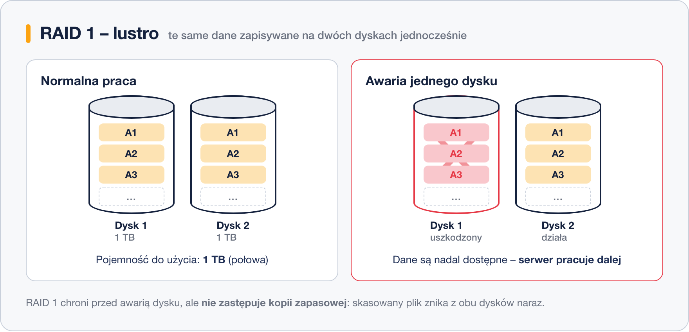

# RAID 1 – lustro

> **W tej lekcji:** poznasz RAID 1 – macierz lustrzaną: jak działa zapis na dwa dyski naraz, ile pojemności oddajesz za ochronę i dlaczego lustro nadal nie jest kopią zapasową.

RAID 1, zwany **lustrem** (ang. *mirroring*), to dokładne przeciwieństwo RAID 0: zamiast dzielić dane między dyski, zapisuje **te same dane na każdym dysku macierzy jednocześnie**. Dyski są swoimi wiernymi kopiami.

To najprostszy sposób ochrony przed awarią dysku i najczęstszy wybór na dysk systemowy serwera.

## Jak to działa

Każda operacja zapisu trafia na oba dyski naraz; przy odczycie macierz może pobierać dane z dowolnego z nich (a nawet z obu równolegle, co przyspiesza odczyt). Gdy jeden dysk padnie, drugi ma komplet danych – serwer pracuje dalej, jakby nic się nie stało:

Cena jest widoczna od razu: dwa dyski po 1 TB dają tylko **1 TB** miejsca do użycia. Zapis nie jest szybszy niż na pojedynczym dysku (te same dane muszą trafić wszędzie), odczyt bywa szybszy.

Po wymianie uszkodzonego dysku **odbudowa** (ang. *rebuild*) to zwykłe skopiowanie zawartości ocalałego dysku na nowy – najprostsza i najbardziej przewidywalna odbudowa ze wszystkich poziomów RAID.

| Parametr | RAID 1 |
|---|---|
| Minimalna liczba dysków | 2 |
| Pojemność do użycia | 1 × dysk (50% przy dwóch) |
| Ile awarii dysków przeżyje | N − 1 (przy 2 dyskach: 1) |

## Kiedy stosować

- dyski systemowe serwerów – serwer wstaje nawet po awarii dysku z systemem,
- małe serwery z dwoma dyskami,
- wszędzie tam, gdzie prostota i pewność są ważniejsze niż pojemność.

### RAID to nie kopia zapasowa

Lustro chroni przed awarią **dysku** – i tylko przed nią. Polecenie `rm`, błąd aplikacji czy ransomware wykonują się na obu dyskach naraz: skasowany plik znika z całej macierzy w tej samej chwili. Kopia zapasowa (osobna kopia, w innym miejscu, z historią wersji) jest nadal konieczna.

## Podsumowanie

- RAID 1 zapisuje te same dane na wszystkich dyskach macierzy – dyski są lustrzanymi kopiami.
- Pojemność: jednego dysku; odporność: przeżyje awarię wszystkich dysków poza jednym.
- Odbudowa to proste kopiowanie z ocalałego dysku.
- Typowe zastosowanie: dysk systemowy serwera. Kopii zapasowej nie zastępuje.
