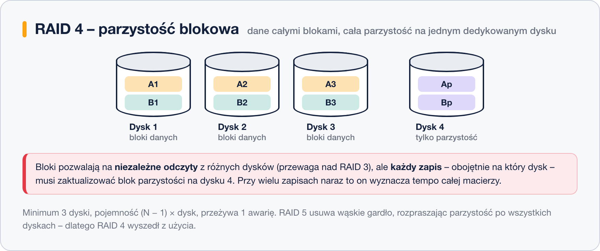

# RAID 4 – parzystość blokowa na jednym dysku

> **W tej lekcji:** poznasz RAID 4 – paskowanie blokowe z dedykowanym dyskiem parzystości: czym różni się od RAID 3, dlaczego dysk parzystości dławi zapisy i jak ten problem rozwiązał RAID 5.

RAID 4 działa jak RAID 3, ale dane rozkłada na dyski **blokami** (jak RAID 0), a nie bajtami. Parzystość nadal ląduje w całości na **jednym dedykowanym dysku**.

To ostatni krok ewolucji przed RAID 5 – wystarczy zrozumieć jego słabość, żeby wiedzieć, czemu RAID 5 wygląda tak, a nie inaczej.

## Jak to działa

Bloki danych trafiają na przemian na dyski danych, a dla każdego rzędu bloków macierz liczy blok parzystości i zapisuje go na ostatnim dysku:

Dzięki blokom (zamiast bajtów) **odczyty są niezależne**: mały plik leży w całości na jednym dysku, więc kilka odczytów może iść z różnych dysków równolegle. To realna przewaga nad RAID 3.

Problemem pozostają zapisy. **Każdy zapis** – obojętnie na który dysk danych – wymaga też zaktualizowania bloku parzystości, a wszystkie bloki parzystości leżą na tym samym dysku. Przy wielu równoległych zapisach dyski danych czekają, aż dysk parzystości nadąży: to klasyczne **wąskie gardło zapisu**.

| Parametr | RAID 4 |
|---|---|
| Minimalna liczba dysków | 3 (2 danych + 1 parzystości) |
| Pojemność do użycia | (N − 1) × dysk |
| Ile awarii dysków przeżyje | 1 |

## Kiedy stosować

W praktyce – nie stosuje się. RAID 5 robi to samo bez wąskiego gardła, rozpraszając parzystość po wszystkich dyskach. Ciekawostka: RAID 4 przetrwał w macierzach firmy NetApp, której system plików buforuje zapisy tak, by dysk parzystości nie dławił pracy – ale to wyjątek potwierdzający regułę. `mdadm` formalnie potrafi zbudować poziom 4, lecz nie ma powodu go wybierać.

## Podsumowanie

- RAID 4 = paskowanie blokowe + cała parzystość na jednym dedykowanym dysku.
- Bloki dają niezależne odczyty (przewaga nad RAID 3), ale każdy zapis przechodzi przez dysk parzystości – wąskie gardło.
- Rozwiązanie tego problemu – rozproszenie parzystości – to właśnie RAID 5, temat następnej lekcji.
